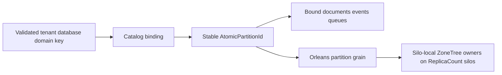

# ADR-001: Atomic partition identity and affinity

Status: Accepted; implementation and GitHub qualification pending. Related product source: [architecture sections 4, 18, 28, 37, and 41](../design/architecture-v0.3.uk.md).

## Context

Document, event, queue, graph, and series operations need a stable atomic scope. Textually equal partition keys in different tenant, database, or transaction-domain bindings must not authorize shared state. Logical atomic identity is independent of which Orleans silo currently hosts the partition grain.

## Decision

Resolve one `AtomicPartitionId` from the server-validated tenant, database, `TransactionDomainId`, and versioned partition key. Catalog resource bindings determine whether resources participate in that domain. The client cannot select an arbitrary node or make unrelated resources atomic by reusing a key string. The partition grain is an ordinary Orleans grain; Orleans may move its activation between silos without changing the logical identity or the committed lineage.

## Rationale, alternatives, consequences

This makes authorization, command routing, transaction scope, and idempotency agree. Per-resource independent identity would prevent required document/event/local-queue transactions; using a raw key string globally would leak state across domains. A partition-per-engine model is also rejected because it couples logical cardinality to physical resources. Catalog binding is correctness-critical and must preserve unique constraints and command/read tokens or reject the operation.

## Related requirements

`REQ-DSTORE-004`/`AC-DSTORE-004`, `REQ-MSG-005`/`AC-MSG-005`, and `REQ-GRAPH-001`/`AC-GRAPH-001`; see [DocumentStorage](../Features/DocumentStorage.md), [Messaging](../Features/Messaging.md), and [GraphTraversal](../Features/GraphTraversal.md). Cluster routing requirements remain in [ClusterRouting](../Features/ClusterRouting.md); the cluster concept is described in [ADR-136](ADR-136-native-orleans-partition-ownership.md).

## Implementation contract

1. Freeze canonical identity fields, catalog binding validation, and token lineage before changing routing.
2. Add real tests for cross-domain key reuse, valid shared resources, authorization, and stable command scope.
3. Implement in `src/KeyLoad.Abstractions/ClusterRouting/` and `src/KeyLoad.Core/ClusterRouting/`; route via the connection grain and the logical partition grain. Preserve the silo-local ZoneTree owner's ownership of stores and locks.
4. Create resources under the canonical catalog binding and reject ambiguous or absent bindings.5. GitHub Actions must run TUnit, recovery, and the Aspire replicated cluster through .NET and MCP SDKs; compare stable outcomes across failover. Root owns shared resolver/contracts; worker joins only after exact tests and changed paths are reported.

Dependencies: [ADR-002](ADR-002-command-idempotency.md), [ADR-004](ADR-004-committed-read-views.md), and [ADR-005](ADR-005-canonical-keyspace-codec.md). Verification: named catalog tests plus the repository GitHub CI matrix; no local test qualification. Stop if a source binding, token lineage, or multi-resource atomic scope is ambiguous.

