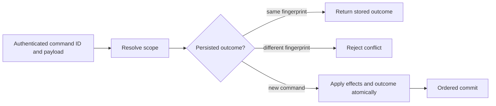

# ADR-002: Command identity and persisted idempotency

Status: Accepted; implementation and GitHub qualification pending. Source contract: `CommandRequest`, `CommandOutcome`, and `CommitReceipt` in `src/KeyLoad.Abstractions/Contracts.cs`; product source [sections 5, 38, and 41](../design/product-specification.md).

## Context and decision

Network retries can repeat a request after its outcome committed but before the client received the response. Every mutating command therefore has a stable caller-generated `CommandId`, scoped to its authenticated principal and resolved atomic partition. The server stores the original typed command with its outcome. A retry with the same principal and command ID replays the stored outcome when its typed input matches the retained input; different content is a `Conflict`. The comparison runs only when a stored outcome for that command ID exists, so a first-time command is neither serialized for identity nor hashed.

## Rationale and consequences

Persisting command identity with effects resolves lost responses across process restart and failover. An in-memory response cache cannot do so. Principal and scope are part of the outcome key, and authorization precedes replay. Deduplication is bounded by persisted retention/format rules; this decision does not promise eternal retry safety after dedup metadata expires or exactly-once external side effects.

## Related requirements

`REQ-DSTORE-004`/`AC-DSTORE-004`, `REQ-MSG-002`/`AC-MSG-002`, `REQ-MSG-005`/`AC-MSG-005`, plus EventStreams `REQ-EVENT-004`/`AC-EVENT-004` (append OCC/idempotency extension). See [DocumentStorage](../Features/DocumentStorage.md) and [Messaging](../Features/Messaging.md).

## Implementation contract

1. Freeze principal/scope binding, retry content comparison, error replay, and retention horizon before changing envelopes.
2. Add TUnit tests for same-ID/same-content replay, same-ID/changed-content conflict, lost response after commit, precondition failure replay, and unrelated principal/partition scope.
3. Keep shared command/request/outcome contracts in the existing `src/KeyLoad.Abstractions/Contracts.cs` building block and dispatch/persisted outcome handling in `src/KeyLoad.Core/DatabaseEngine.cs`; feature-specific mutation logic remains in its canonical owning `Features/<SliceName>/` directory. Do not create a separate CommandExecution slice or project.
4. The current outcome format has one canonical reader and writer. Unknown, malformed, or unsupported outcomes fail closed without rewrite or alternate-key lookup.
5. GitHub qualification is TUnit, real process recovery, and replicated-cluster SDK outcomes after failover.

Dependencies: [ADR-001](ADR-001-partition-identity-affinity.md), [ADR-003](ADR-003-durability-ack-barrier.md), [ADR-004](ADR-004-committed-read-views.md), [ADR-005](ADR-005-canonical-keyspace-codec.md). Stop if retry comparison or dedup expiry behavior is not specified. Do not infer exactly-once handler execution or include an external API call in the database transaction.

## Scoped command-outcome contract

REQ/AC-DSTORE-009 in
[DocumentStorage](../Features/DocumentStorage.md) freezes the complete atomic
partition identity in persisted command-outcome lookup. Current command writes
use the accepted outcome representation; every lookup is bound to its normalized
operation, authenticated principal, and complete partition scope. Public
principal/ID-only result or key access is not an accepted path.

The current contract rejects a missing or contradictory locator, malformed
record, duplicate scoped identity, or unsupported outcome without rewriting
persisted bytes, searching an alternate key, or deriving identity from a hash.
The current `Unknown` scope represents a normalized operation that failed before
partition resolution. Its matching, freshly authorized retry replays only that
same failed operation; it never invents partition authority or permits effects.
Unknown scope values and contradictory identities fail closed. New commands use the
canonical current identity and outcome representation. The real unit, scalar,
process-recovery, restart and replicated-cluster cases are mapped in the feature
contract. This section records the behavior contract and does not claim gate
completion.

Command outcomes have no automatic TTL or purge. A matching authorized retry
resolves its retained canonical outcome in the same store incarnation. This does
not promise a finite minimum retention period, eternal replay after explicit store
or record removal, or replay across a changed incarnation; an outcome from another
incarnation is TokenInvalidated. Expiry, purge and a minimum temporal horizon need
a separately accepted contract. Process-kill tests establish process-restart
recovery only, never power-loss durability.
