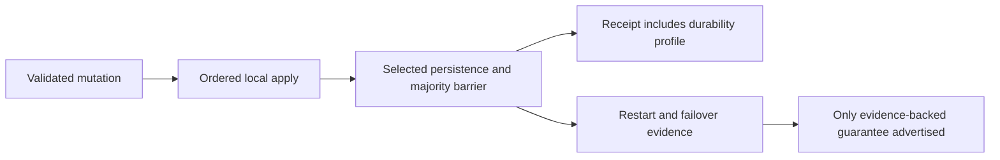

# ADR-003: Durability profile and acknowledgement barrier

Status: Accepted; exact profile qualification pending. Related product source: [architecture sections 5–6, 14, and 37–45](../design/product-specification.md); source enum: `DurabilityProfile` in `src/KeyLoad.Abstractions/Contracts.cs`.

## Context and decision

An acknowledgement is meaningful only relative to an explicit persistence and replication profile. The current contract names `Buffered`, `ProcessDurable`, `LocalDurable`, `QuorumProcessDurable`, and `QuorumDurable`. A quorum profile means a majority of the `KeyLoad:ReplicaCount` copies, written through ordinary Orleans calls to the silo-local ZoneTree owners, confirmed durable local apply. The write path must report the selected profile and must cross that profile's declared barrier before returning committed success. ProcessDurable and QuorumProcessDurable describe process-recovery scope; they do not prove survival of power loss. LocalDurable/QuorumDurable must not be advertised as qualified until filesystem/device flush semantics and fault evidence support them.

## Rationale, alternatives, consequences

One generic “durable” label would conceal materially different failure models. Separate acknowledgement contracts let callers choose and compare guarantees. Every profile increases latency/resource cost and needs direct failure evidence; source enums alone do not establish the barrier. No claim of power-loss safety follows from process-kill tests.

## Related requirements

`REQ-MSG-001`/`AC-MSG-001`, `REQ-MSG-005`/`AC-MSG-005`, and EventStreams `REQ-EVENT-004`/`AC-EVENT-004`. Cross-link [Messaging](../Features/Messaging.md), [EventStreams](../Features/EventStreams.md), and [ADR-143](ADR-143-independent-silo-replica-topology.md) for the ReplicaCount copies.

## Implementation contract

1. Freeze per-profile acknowledged record, local persistence, majority acknowledgement, and response semantics; keep unsupported profiles unavailable in the capability manifest.
2. Add TUnit state-machine and real-process interruption cases at every barrier, including write/ACK response loss and restart. Power-loss/endurance tests remain separate required evidence for local/quorum durable claims.
3. Implement local persistence and read-lifetime barriers under `src/KeyLoad.Storage.ZoneTree/StorageRecovery/`, majority acknowledgement across the ReplicaCount copies through Orleans calls, and shared receipt contracts in the existing Abstractions durability contract. Preserve silo-local ZoneTree owner ownership of files; do not add standalone Durability or Commit slices.
4. Validate profile metadata explicitly. Advertise only profiles proven by the active deployment; rollback disables stronger profiles before changing barriers and never relabels receipts.
5. GitHub CI runs build, TUnit, process recovery, and real replicated-cluster .NET/MCP operations; power-loss and endurance require their own CI/environment evidence before qualification.

Dependencies: [ADR-004](ADR-004-committed-read-views.md) and [ADR-008](ADR-008-backup-log-retention.md). No test run is implied by source presence. Escalate if the actual flush/majority-acknowledgement barrier cannot be identified; never infer power-loss durability from an enum or process kill.

