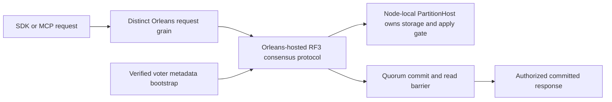
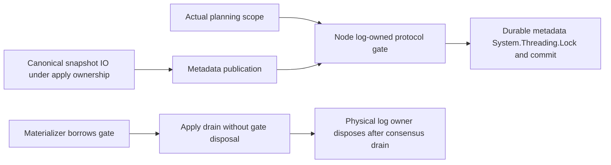

# ADR-007: Orleans replica consensus and metadata bootstrap

Status: Accepted current architecture contract; exact-source Linux qualification remains pending. Foundation decision: [ADR-036-orleans-foundation](ADR-036-orleans-foundation.md). Related source ownership: [ClusterReplication](../Features/ClusterReplication.md) and [ClusterRouting](../Features/ClusterRouting.md).

## Context and decision

The database cluster uses Orleans as its sole distributed runtime and membership/directory foundation. Consensus, terms/votes/log state, ordered appends, read barriers, snapshot transfer, and replicated metadata are KeyLoad-owned protocols hosted through Orleans. Every request uses its own routing grain; durable storage, journals, locks, and apply gate remain owned by the node-local `PartitionHost` if an Orleans activation moves. Do not introduce DotNext.AspNetCore.Cluster or DotNext.Net.Cluster.

Bootstrap must establish a fixed RF3 voter set and persisted cluster metadata without a second competing membership authority. Empty/restarted replicas join through verified metadata/snapshot and ordered tail. The precise consensus proof and deployment source of voter identity remain governed by the owning replication contract; no single-node substitute is allowed.

## Rationale and consequences

One cluster foundation avoids split-brain membership and duplicate routing layers. Orleans activation placement is not storage ownership. This requires explicit request routing, stable replica identity, control-plane capacity, quorum barriers, and recovery evidence. Source presence and historical CI do not qualify current delivered behavior.

## Related requirements

`REQ-REP-001..006`/`AC-REP-001..006` and `REQ-ROUTE-001..003`/`AC-ROUTE-001..003`. Related data guarantees: `REQ-MSG-001`/`AC-MSG-001` and `REQ-DSTORE-004`/`AC-DSTORE-004`.

## Implementation contract

1. Freeze voter identity/bootstrap, term/log/cut, read barrier, forwarding, membership changes, and recovery contracts with ADR-036; use Orleans only.
2. Add real TUnit protocol/state tests and process recovery for interrupted vote/append/snapshot; add Aspire Docker RF3 SDK and MCP tests for quorum, minority denial, failover, and activation movement.
3. Target owners are `src/KeyLoad.Orleans/Features/ClusterReplication/` for Orleans transport, `src/KeyLoad.Orleans/Features/ClusterRouting/` for routing, `src/KeyLoad.Replication/Features/ClusterReplication/` for consensus, and `src/KeyLoad.Server/Features/StorageRecovery/` for node-local `PartitionHost` lifecycle. Shared membership/contracts have one root integration owner.
4. Bootstrap must verify the complete current fixed-voter identity before serving. Rollout must not advertise readiness before quorum/read barrier; rollback fences the newer ownership epoch and restores only a complete cut.
5. The canonical Aspire-owned entry runs the TUnit, process-recovery and Docker/Aspire RF3 suites; RF3 exercises the real .NET and official MCP clients. Local runs are development evidence only. Only exact-source Linux GitHub jobs qualify delivered behavior. Root reviews membership/source changes and joins original artifacts.

Dependencies: [ADR-001](ADR-001-partition-identity-affinity.md), [ADR-003](ADR-003-durability-ack-barrier.md), [ADR-004](ADR-004-committed-read-views.md), [ADR-008](ADR-008-backup-log-retention.md), [ADR-016](ADR-016-atomic-physical-placement.md), and [ADR-036](ADR-036-orleans-foundation.md). Stop on any request to add DotNext or transfer storage ownership to activations whose placement may move; those conflict with root policy.

## Current benchmark membership boundary

The production contract remains an odd-voter RF3 cluster. Trusted comparison jobs
may select fixed native one-, two- or three-member target topologies under
[ADR-056](ADR-056-isolated-linux-comparison-cells.md) and
REQ-BC-053/AC-ISO-004. Majority remains `floor(n/2)+1`; RF1 tolerates no voter loss,
and RF2 requires both voters for quorum reads and writes. This bounded benchmark
profile does not enable HTTP caller opt-in, alternate storage, membership
reconfiguration that weakens quorum or a production-readiness claim. Its native
fault tests do not replace the unchanged RF3 recovery and qualification gates.

## Snapshot publication ordering and regressions

REQ-REP-051/AC-REP-051 require one node-owned `ProtocolGate` on
`IDurableReplicaLog`. `ReplicaMaterializer` borrows that exact
`SemaphoreSlim`; its shutdown drains apply work and never disposes the gate.
`DurableReplicaLog.Dispose` closes it only after node-host consensus/materializer
drain. `PublishSnapshot` acquires the gate before the existing metadata `System.Threading.Lock`
and releases it in `finally`. Both actual `SnapshotStore.Create` and
`SnapshotStore.Complete`, including recovery/reset incoming publication, use that
path. Canonical image I/O remains outside the gate. Gate-to-metadata-lock is the
only permitted order; recursive publication while the gate is held is forbidden.
Persisted format, voters, quorum and public database wire remain unchanged;
rollback is a coordinated source rollback after host drain and retains every valid
durable cut.

The owning recovery regression lives in
`tests/KeyLoad.RecoveryTests/Features/ClusterReplication/ReplicaCheckpointProtocolGate*.cs`
with a same-slice `ReplicaCheckpointProtocolPlanningScope.cs` helper only if needed.
It uses real `ReplicaState.LockedAsync` with the real materializer/log and ZoneTree
fixture. It captures planning state, term and suffix inside one owned planning
task, then starts actual Create and incoming Complete cases while that scope is
held. Every path releases and joins the original
planning/publication tasks before disposing the physical log owner. Preserve native
image flush and verification, blocked publication, unchanged metadata and final
tail/term/vote/applied-cut assertions. The production protocol gate is not replaced
with a test gate or hook.

Lifecycle cleanup preserves each original failure while continuing independent
cleanup: constructor failures close both opened stores; disposal attempts both
stores and fixture source/directory owners; aggregate and access-denied failures
remain visible as their original objects. Tests verify the actual planning and
publication tasks settle before disposal. Multiple simultaneous native filesystem
faults have source-review evidence only unless an exact original runtime receipt
proves their execution; no forced fatal failure or successful settlement is
invented.

TASK-REP-MATERIALIZER-FAULT-ORACLE implements AC-REP-002/004/051 in the existing
real ZoneTree lifecycle case and fixture. Preserve production fault propagation:
JournalFlushed failure fences the waiter with RecoveryRequired, while repeated
memoized disposal observes the same original UnknownWriteOutcome after terminal
cleanup. Verify the borrowed protocol gate, physical owner closure and committed
prefix reopen. Only the exact already-asserted terminal exception may be
acknowledged by fixture cleanup; every other scenario or cleanup failure remains
visible. Implement the test oracle, then its narrow fixture acknowledgment, review
the normal/faulted paths, and run native recovery before exact-source Linux
qualification. Root owns contract/integration; the recovery worker owns only
ReplicaMaterializerLifecycleTests.cs and ReplicaMaterializerLifecycleFixture.cs
under RecoveryTests/Features/ClusterReplication. No production, format, dependency
or topology change is involved; reverting the test correction preserves every
durable cut. Existing process-kill proof does not qualify power-loss or RF3.

Local development execution, when useful, uses the canonical Aspire-owned test
entry and is labeled development evidence. Only exact-source Linux GitHub
Recovery/RF3 jobs qualify delivered behavior. No test-only result or historical
receipt qualifies current-source delivery.

## TASK-KL035-INSTALL-BOUNDARY-003: actual descriptor limit and original cancelled admission

REQ/AC-REP-004 and original architecture KL035 atomic snapshot installation require an explicit install boundary, independent of existing GC cancellation/log read limits. ReplicaSnapshotInstallBoundaryTests.ActualSnapshotCeilingOrOriginalCancelledInstallPreservesWholeCutThenSameTransferAndColdTailAreHealthy uses the existing real CrashHost SnapshotChunkAcknowledged producer, actual killed/readers-joined native source/target and original partial descriptor. After the same genuine image is fully copied, one source argument validates an exact image-length-minus-one receiver ceiling with valid smaller chunk bounds; the other calls real materializer InstallCheckpointAsync with its original already-cancelled caller token. Exact Validation or original OCE/token must retain full canonical+replica records/positions/hardstate/native local identity/read generation and private image/manifest lengths+SHA. The SAME valid descriptor then installs snapshot4, applies retained tail5, preserves complete ordered original receipts, joins actual materializer/node/source and cold reopens full literal healthy state. This cancellation is before apply ownership; no in-flight IO rollback is claimed. No fixture/threshold/product limit/deadline/retry/provider/format/authority change.

The existing49 task objects remain unchanged. Root must compile and obtain genuine native typed argument expansion/UID/PDB source-image records before adding this class to the Recovery selector; two source Arguments are not native census or passing outcomes. Existing full-suite/fault/coverage/Linux RF3 gates remain mandatory, and process recovery cannot qualify power-loss/endurance. Shared heavyweight fixture ownership remains untouched.

## TASK-KL035-EMPTY-NATIVE-PROJECTION-001: consistent stopped empty-follower cohort

Original exact-source 9c5fe578/run37920436876 normal job113786795759 and scalar job113786795953 both contain a native node1 startup failure in NativeTextRootFiles.VerifyReceipt, before the outer canceled-operation/cleanup aggregate. Production rejects a retained text projection owner receipt whose SourceNodeId differs from the newly created empty canonical store identity. The fixture erased database/replica/snapshots but retained both eagerly opened text projection roots.

Implementation contract: after the original actual Aspire kill joins and while the existing node.owner.lock is held exclusively, validate every existing mandatory erase root with the same no-link regular-tree/file-exclusive checks BEFORE deleting any root. Add only search-indexes and text-projections, the two actual eagerly initialized disposable native text roots bound to the erased canonical NodeId. Canonical and replica retain their explicit owner/WAL/metadata lock checks; text roots use existing recursive exclusive checks for every file. Preserve node root, ownership file, bootstrap/profile/incarnation/voters, all other native directories, survivor storage and production owner receipt checks. No migration/reader fallback.

The SAME existing genuine erased-follower operation is the regression: restart must now complete real native root construction, receive actual quorum snapshot plus ordered tail under its unchanged original three-minute token, show a genuinely new NodeId with unchanged incarnation, complete literal SDK/official MCP state/receipt/persisted-policy denial then healthy read, stop/inspect exact snapshot SHA/hardstate/tail, cold reopen retaining that NodeId and execute the original healthy update/replay. Do not substitute advisory readiness. No new cases, Arguments, UID/count or execution claims; original failed logs remain immutable. Root owns fresh build/discovery and exact-source Linux normal/scalar execution; task49/full recovery/GC/cleanup gates remain mandatory.

Ordered stages: immutable original evidence and this contract; guarded fixture/docs change; root review/join/build/census; original full RF3 case normal/scalar with unchanged deadlines; authenticate task/full-suite originals. Rollback restores prior fixture source, retains original logs and leaves production state/formats unchanged. This is a test-fixture cohort reset, not production recovery or power-loss proof.

## TASK-REP-TRANSPORT-JOINED-CLEANUP-001

REQ-REP-001/006 and ADR007: preserve original RuntimeStorageServices subscription, discovery withdrawal before drain, native discovery StopAsync first and endpoint StopAsync with the exact supplied lifecycle cancellation second. Both original shutdown operations are awaited even after the first fails. No timeout/source/options change: current owner has no standalone cancellation budget. MaximumShutdownStages=2 names only existing failure-ledger initial capacity, not admission or a new policy limit.

Preserve original initiating/fatal and every independent cleanup exception by reference/order; the existing NativeCqrsBoundaryErrors.IsNonFatal classification supplies two exhaustive filtered catches, both retain original errors without converting, suppressing or early throwing. Existing ReplicaDiscoveryLifetime.ThrowIfAny remains the sole final emitter after both stages settle. No storage, identity, serialized field, RPC, authority or concurrency contract changes.

Existing whole operation controls remain RequestCqrsCohortShutdownTests.AsyncDisposeStopsAdmissionAndJoinsOriginalNativeAttempt and SyncDisposeStartsSameShutdownAndAsyncDisposeJoinsIt, plus RequestCqrsCohortLifetimeTests.ShutdownSharesSettlementStopsAdmissionAndReleasesOnlyAfterLeaseExit. They prove real native callback cancellation/drain/rejected later admission and retained charge/resource release after lease exit. These are not direct tests of two simultaneously failing transport lifecycle stages; that error-path runtime evidence remains OPEN. No artificial successful transport, mock provider or test-only product seam is added for a behavior-preserving analyzer closure.

Native exact R4 original rows are KLD0035 21:44 and CA1031 30:9. Both actual codefix checks returned NotFound. The initial request's KLD0037 shutdown-budget description is absent from current native body and supplied R4 rows; do not add invented configuration. Root must verify current SDK/analyzers/format, original nativeSIMD50 whole shutdown/lifetime operations and required Linux/RF3 gates. This is source-only, no runtime PASS or retrospective failure causality.

## TASK-PEER-DISCOVERY-LIFETIME-001 — native recovery owner closure (2026-10-12)

REQ-PEER-DISCOVERY-LIFETIME-001: The original recovery discovery fixture owns its acquired authenticators/runtime; the native cluster owns its TestCluster and nodes; each node owns its materializer and term-metadata lifetime. Partial construction must release every acquired owner and original private directory while preserving the initiating and cleanup exceptions. Borrowed cluster references remain borrowed. Successful construction transfers ownership once; the original memoized disposal task joins runtime/consensus before storage and directory disposal. No deadline, capacity, secret, serialization or transport contract changes.

AC-PEER-DISCOVERY-LIFETIME-001: Preserve every original discovery security/ownership/replay operation and declaration. The lexical fixture RunAsync captures operation errors before implicit disposal and records acquisition/disposal errors afterward; no exception is lost. Direct materializer/journal/TestCluster disposal stays in the same original ordered shutdown. Required canonical recovery execution and native analyzer recognition remain OPEN until the source is compiled/executed; source review does not qualify process/power-loss or Linux gates.

Source map: RecoveryTests/Features/ClusterReplication/Fixtures/PeerDiscoveryFixture.cs, PeerDiscoveryNativeCluster.cs, PeerDiscoveryNativeNode.cs. Original actual cohort, signed caller authentication, real silo registration and original startup/shutdown limits remain unchanged.

## TASK-CQRS-COHORT-LIFETIME-001 — native detached-owner join (2026-10-12)

REQ-CQRS-COHORT-LIFETIME-001: RequestCqrsCohortRuntimeFixture disposal returns the same original shutdown task to every caller, including concurrent/repeated callers. It joins original runtime/consensus/cluster/node operations before releasing fixture registration and clearing the owned secret. During genuine voter restart, the actual detached node is lexically owned: restart failure remains first, disposal failure follows, and both settle before any fresh membership observation. An unexpected detached owner is rejected; both detached and original node owners are joined, never silently lost. A failed removal leaves the original dictionary-owned node for fixture cleanup.

AC-CQRS-COHORT-LIFETIME-001: Preserve existing RequestCqrsCohort whole-flow declarations, exact native voter/incarnation/address, signed calls, generation-change oracle, startup/shutdown bounds and actual healthy/rejected/replay operations. Direct cluster disposal stays in the original ordered shutdown and every fatal/nonfatal error is retained. Required native Unit50 SIMD execution, compiled discovery and analyzer recognition are OPEN. This source-only correction does not prove causes for historical Linux cancellation or introduce a retry, timeout, authority, topology or synthetic-success seam.

Source map: UnitTests/Features/ClusterReplication/Fixtures/RequestCqrsCohortRuntimeFixture.cs. Existing original scenario/native node owners remain unchanged.

## TASK-REP-TRANSPORT-DUAL-FAILURE-WHOLE-002

REQ-REP-001/006, ADR007 and ordered Transport READY2: test actual ReplicaTransportLifecycle registered in an actual Orleans SiloLifecycleSubject, with the existing native three-silo fixture/membership/authentication and an independently owned genuine ReplicaLifecycleFixture endpoint attached to the actual ReplicaGrainServiceClient. A delegating lifecycle observer retains the original registered Stop task; it does not implement another shutdown algorithm.

Use existing native observer and ConfigureForwarding callback contracts. Each genuine admitted operation owns one cancellation registration that throws its independently retained original exception, then remains held until explicit release. Discovery Stop cancels and joins its held native callback before endpoint Stop begins. Endpoint Stop cancels and joins its held real Forward operation. The exact aggregate contains original memoized shutdown exceptions by reference/order; flattened native failures retain the registered exception objects. Cancellation of these actual operations leaves complete native rows/cut and document/outbox state unchanged. Neither callback returns a fabricated result.

After both joins, acknowledge only the exact asserted terminal exceptions during repeated owner disposal; preserve all unexpected initiating/fatal/cleanup errors. Construct fresh actual native discovery and endpoint owners. Fresh signed request verifies full original metadata payload. The original cancelled full command then succeeds via real native Forward and DatabaseEngine.Apply, returns an independent complete mutation receipt/document/outbox state, and same-ID replay leaves full native bytes/cut unchanged. Original fixture disposal remains awaited. No private storage reuse, fake provider/success counter, reflection, timeout change, product seam or protocol/authority/config change.

Original selectors and declarations remain unchanged; one genuine new whole case is authored. New UID/case census, compiler/analyzers/formatter, nativeSIMD50 execution and exact-source Linux/RF3 remain OPEN. Source-only native read/metadata/new-path NS/guard/reconstruction are not runtime pass.

## TASK-TRANSPORT-CONNECTION-WHOLE-UNION-003 (2026-10-12)

REQ-REP-001/006, AC-CRS-001/003 and ADR007/125: compose immutable TransportDualFailure6 and Connection54READY4 without new duplicate cases or invented UIDs. Exact original registered stop task, both admitted native callback gates, original ordered aggregate objects and flattened callback causes remain authoritative. The observer publishes the same returned original Task before StopObserved completes; the consumer awaits that bounded publication rather than assuming a nullable field was already assigned when the cancellation callback runs. Each owner flattened failure must contain exactly its one registered original callback exception; unexpected additional failures cannot be silently acknowledged. All original held requests and owner disposals join, and every unexpected body/acquisition/fatal/cleanup error stays in order. The real ReplicaLifecycleFixture now attempts every original endpoint/materializer/log/store/directory release in the same order rather than overwriting or skipping errors through nested finally. New TransportShutdownFlow observes the real database body before implicit owned disposal and records disposal failures afterward.

Native Resource/BatchResource contract requires the configured collection and command to share the same actual transaction domain. The draft-only transport setup mismatch is corrected by configuring db.Partition.TransactionDomainId; product checks and all command/document literals stay unchanged. Both fresh native transport and fresh connection continuations validate the complete independently expected CommitReceipt: same cancelled CommandId, original pre-operation owned-store incarnation/durability, canonical partition, literal initial placement epoch1, next physical commit, and literal complete mutation. Original full literal document/outbox and raw payload replay/native images/cut are retained. No production receipt fields are copied into expected values. The genuine new connection owner uses the SAME cancelled command and closes to actual zero request activations; no closed-ID tombstone or compatibility path. Original callback/consumer protocol deadlines, grants, fixture sharing and native50 SIMD scheduling remain unchanged.

Original Connection AcCrs054 declaration/UID is preserved. The one already-authored TransportShutdownWholeFlow declaration requires authentic fresh compiled discovery, not a source-guessed UID. Existing ReplicaConsensusLifecycleTests concurrent and repeated stop/dispose operations remain unchanged. Main/source/compiler/analyzer/formatter/native runtime/Linux gates remain OPEN; this union supplies source/API/guard/reconstruction proof only.
