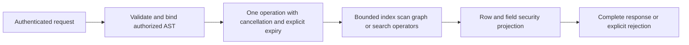

# ADR-010: Bounded query execution and security barriers

Status: Accepted; end-to-end qualification pending. Related current baseline: [QueryExecution](../Features/QueryExecution.md), [ResourceExecution](../Features/ResourceExecution.md), and product source [sections 13–15, 23–26, and 29–30](../design/product-specification.md).

[ADR-149](ADR-149-no-operation-limits.md) governs operation bounds: there are no configured work, read-byte or result-byte budgets.

## Context and decision

Queries combine parsing/planning, index/scan work, point dereferences, graph expansion, search branches, projection, and serialized response metadata. Unbounded stages can consume memory/CPU or leak data through filtering/ranking. A request carries one operation (`ReadExecutionBudget`: caller cancellation, explicit expiry and resource-lifetime bindings) through relevant operators; it counts no work, read bytes or result bytes. Authorization and row/field policy must be applied before data can affect an observable result; security barriers cannot be moved below a filter or ranking stage that reveals protected values.

## Rationale and consequences

One operation lets every operator observe the same cancellation and expiry. Explicit failure preserves honesty when completeness cannot be proven; partial results require a separately explicit contract. Typed authorized ASTs and field lineage prevent SQL/JSON/C# surface differences from bypassing policy. An elapsed expiry surfaces as a stable `BudgetExceeded` error; large valid workloads run as far as the caller's limits, cancellation and expiry allow.

## Related requirements

QueryExecution `REQ-QUERY-001..003`/`AC-MP-003`, GraphTraversal `REQ-GRAPH-002..004`, DocumentStorage `REQ-DSTORE-003`, EventStreams `REQ-EVENT-001..003`, and Search `REQ-SR-001..005`. Live change-feed behavior (`REQ/AC-FEED-002/003/005`, owned by [ChangeFeeds](../Features/ChangeFeeds.md)) follows this decision: a continuation cursor carries no frozen local cut, every call opens a fresh committed view with its own cut, and a page is bounded by its record `Limit`; cancellation returns no partial page.

## Implementation contract

1. Freeze the operation's cancellation and expiry checkpoints, error behavior, and authorization-before-observation rules.
2. Add real tests for cancel/deadline, hidden rows/fields, aliases, explain, and following-operation health.
3. Implement the shared operation under `src/KeyLoad.Abstractions/ResourceExecution/` and `src/KeyLoad.Core/ResourceExecution/`; each canonical slice owns its operators under `Features/<Slice>/`.
4. Any policy change is versioned/configured explicitly. Capability manifests list only operators whose cancellation, expiry and caller limits are enforced.
5. GitHub CI executes TUnit and real replicated-cluster API scenarios with the same caller-visible errors; retained diagnostics contain no sensitive payloads.

Dependencies: [ADR-004](ADR-004-committed-read-views.md), [ADR-006](ADR-006-strict-derived-indexes.md), [ADR-009](ADR-009-search-provider-boundaries.md), [ADR-013](ADR-013-authorized-query-ast.md), [ADR-014](ADR-014-principals-rbac-row-policy.md), [ADR-015](ADR-015-sensitive-data-lineage.md), [ADR-018](ADR-018-global-rank-fusion.md), [ADR-019](ADR-019-managed-ann.md), and [ADR-022](ADR-022-policy-epoch-revocation.md). Stop if an operator cannot prove complete bounded output or policy order; do not silently truncate.

