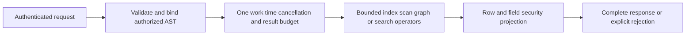

# ADR-010: Bounded query execution and security barriers

Status: Accepted; end-to-end qualification pending. Related current baseline: [QueryExecution](../Features/QueryExecution.md), [ResourceExecution](../Features/ResourceExecution.md), and product source [sections 13–15, 23–26, and 29–30](../design/architecture-v0.3.uk.md).

## Context and decision

Queries combine parsing/planning, index/scan work, point dereferences, graph expansion, search branches, projection, and serialized response metadata. Unbounded stages can consume memory/CPU or leak data through filtering/ranking. A request carries one bounded cancellation/deadline/work/read/result budget through relevant operators. Authorization and row/field policy must be applied before data can affect an observable result; security barriers cannot be moved below a filter or ranking stage that reveals protected values.

## Rationale and consequences

One budget prevents each operator from independently spending the full limit. Explicit failure preserves honesty when completeness cannot be proven; partial results require a separately explicit contract. Typed authorized ASTs and field lineage prevent SQL/JSON/C# surface differences from bypassing policy. Budgets may reject large valid workloads and must be surfaced as stable errors.

## Related requirements

QueryExecution `REQ-QUERY-001..003`/`AC-MP-003`, GraphTraversal `REQ-GRAPH-002..004`, DocumentStorage `REQ-DSTORE-003`, EventStreams `REQ-EVENT-001..003`, and Search `REQ-SR-001..005`.

## Implementation contract

1. Freeze per-request budget dimensions, operator charge points, error behavior, and authorization-before-observation rules.
2. Add real tests for scan/index/point accounting, metadata/result bytes, cancel/deadline, hidden rows/fields, aliases, explain, and following-operation health.
3. Implement shared budgets under `src/KeyLoad.Abstractions/ResourceExecution/` and `src/KeyLoad.Core/ResourceExecution/`; each canonical slice owns its operators under `Features/<Slice>/`.
4. Any budget or policy change is versioned/configured explicitly; rollback restores the prior bound without allowing an unbounded fallback. Capability manifests list only operators with an enforced budget.
5. GitHub CI executes TUnit and real replicated-cluster API scenarios with the same caller-visible errors; root joins security/search/query owners and checks retained diagnostics without sensitive payloads.

Dependencies: [ADR-004](ADR-004-committed-read-views.md), [ADR-006](ADR-006-strict-derived-indexes.md), [ADR-009](ADR-009-search-provider-boundaries.md), [ADR-013](ADR-013-authorized-query-ast.md), [ADR-014](ADR-014-principals-rbac-row-policy.md), [ADR-015](ADR-015-sensitive-data-lineage.md), [ADR-018](ADR-018-global-rank-fusion.md), [ADR-019](ADR-019-managed-ann.md), and [ADR-022](ADR-022-policy-epoch-revocation.md). Stop if an operator cannot prove complete bounded output or policy order; do not silently truncate.

## TASK-KL051-NORMALIZED-PLAN-ERROR-001 — actual adapter plans and vector attachment boundary

REQ-KL051-PLAN-001 / AC-KL051-PLAN-001 refine existing REQ-QUERY-004/005/006 and AC-QUERY-004/005/006 under ADR004/010/118. Real SQL named decimal/string parameters, preserved JSON AST with same typed parameters and native C# Q1 builder literal lowering execute same indexed predicate/order/projection. Actual EXPLAIN pages must byte-match all three inputs, with independent literal accessPath/atomicPartition/nativeScanBudget plan, complete literal rows/source revisions and full-store/position invariance. Fresh persisted denied principal must yield exact same PermissionDenied safe detail on all three actual input operations; no returned partial page. Following privileged full literal results must remain healthy. This is real executor work, not static normalized-AST getter equality.

REQ-KL051-VECTOR-001 / AC-KL051-VECTOR-001 map REQ-QUERY-007 and existing graph-search profile to actual SQL named vector-array attachment, typed C# GraphSearchRequest and its public JSON roundtrip. Persist two real cosine vectors/raw documents, execute SQL SearchSqlAsync and native GraphSearchAsync for both typed/public JSON inputs, compare complete results with independent literal document/entity/revision/JSON/rank score/empty expansion. Wrong dimension must reject exact Validation before native access, preserve full store/cut, then valid actual operation completes. SQL parser safe detail and typed-search validator safe detail are distinct existing contract messages and remain exact; code parity does not fabricate message equivalence.

Source-proven boundary: KeyLoadQuery<T> currently explicitly supports scalar Q1 expression lowering only; there is no C# LINQ vector attachment/parameter-marker API. SQL vector attachments use Q1.Search.v1/SqlGraphSearchRequest, not scalar SELECT. These tests do not introduce a builder/parallel planner or claim three-input LINQ vector plan equivalence. Original KL051 remains open for complete vector-builder lowering and equivalent public profile errors; actual supported subset may be qualified only after original native execution. No unsupported expression is silently evaluated client-side.

Ownership UnitTests QueryExecution Cases/Helpers, existing ZoneTree/TestDatabase/QueryEngine/SearchEngine and actual public KeyLoadQuery APIs. Docs then tests; root guarded join/format/build/current native discovery normal/scalar/recovery/RF3/Linux gates; preserve originals and no source-only PASS. Rollback only tests/appendix, no production/dependency/protocol change.

## TASK-KL079-NATIVE-FEED-LIVE-001

REQ/AC-FEED-002/003/005 and REQ/AC-QUERY-001/003, AC-MP-003/012 retain one native owner read cut, persisted current/historical authorization, signed original cursors, gap-free snapshot/tail and no raw PII. ReadChangeFeed's existing two-argument API deliberately delegates to its new original-cancellation overload; no legacy path or schema. Original DatabaseEngine clock owns cursor expiry and operation deadline. One existing ReadExecutionBudget and read grant charge all actual raw storage bytes/record attempts before decode/copy, projected result retention and the complete final response. Request.MaxBytes still bounds change payload and preserves the first undelivered entry; it does not replace complete wrapper/read-work limits. Feed cancellation produces no returned partial page. Existing live reader/view budget and profile stay unchanged.

Order: this contract and canonical ChangeFeeds/ADR010 appendices precede source. Core owns public feed same-cut operation; The connection grain forwards the exact original token through the existing native CQRS path. Tests: native observed point-read cancellation/deadline -> original error/no partial/full canonical cut unchanged -> independent complete literal healthy feed/empty continuation; genuine Aspire RF3 SDK/official MCP reconnect, replay, historic/current row+field redaction, persisted revoke/token invalidation -> exact grant repair/fresh cursor -> healthy; live initial snapshot/concurrent committed writes/deltas/delete/current revocation -> ordinary query literal parity/healthy fresh subscription. Cold feed continuity is exercised by the RF3 reconnect case. SQL Q1 CALL uses existing tools/decoder, no new dialect/operation.

Ownership: existing Core ChangeFeeds.cs, existing Orleans GrainCoreReadCapabilities.cs, feature-local Unit and Integration ChangeFeeds roles, docs/Features/ChangeFeeds.md and ADR010 appendices. No shared fixture mutation, new option/quota/provider, alias/Id/default/deadline/protocol change. Root joins source and owns compiler/census/native normal+scalar/recovery/Linux RF3 qualification; source-authored arguments are not observed native counts or PASS. Original KL079 full criteria and mandatory full product/fault/endurance/coverage gates stay open. Rollback source stage only, no persisted migration.

## TASK-KL079-FULL-LIVE-PAGE-002

REQ/AC-FEED-002/003/005 and AC-MP-003/012 retain the existing six-field LiveQueryChange and five-field LiveQueryPage. Independent upsert revision2 and native tombstone revision3 come from the original stored document mutation, not a constructor overload. Complete SDK/official MCP/Q1 tail pages compare literal changes, through sequence, hasMore and the actual unchanged owning read cut. Each returned opaque cursor is nonempty and is consumed through the same real route; the complete empty continuation preserves through sequence, hasMore=false and the same unchanged cut. Cursor bytes are never fabricated or required to equal independently issued tokens. Current persisted revocation and obsolete-policy token failures cover SDK, official MCP and both Q1 routes, with no partial result, bracketed by existing full canonical no-effect checks; exact policy repair leads to a fresh healthy full page on all routes.

Order: feature/ADR contract, native constructor/delete semantic proof, bounded assertion helpers, unchanged two genuine RF3 case identities. No production schema/alias/Id, runtime option, timeout, topology or authorization change. Root owns fresh compiler/native census/Linux operations; this fixture correction alone does not qualify the whole task. Rollback removes only these fixture assertions and appendix together.

## TASK-KL079-COMPLETE-PAGE-COLD-003

REQ/AC-FEED-002/003/005 retain the same bounded polling/retention, current persisted privacy and six-field LiveQueryChange (original upsert revision2/delete revision3) contracts. The existing RF3 feed case must assert all seven page fields: complete independent literal changes, actual opaque cursor, exact through/tail/firstAvailable/hasMore, and actual read cut bounded by the original successful receipt. Fixture tail2 includes its hidden second row; updated tail3 follows only the actual acknowledged replacement. Each SDK, official MCP and both Q1 route consumes its own returned opaque cursor; the next page is the independently known hidden position or complete empty tail. Different issued cursor bytes/read cuts are not fabricated or required equal. Every original assertion remains.

The existing live RF3 case closes its actual original reader/administrator before genuine all-three fixture kill/restart, recreates fresh callers from the same persisted credentials and continues the original subscription. The original pre-cold subscription cursor is then consumed for the actual fresh delete, exact native revision3/receipt/Remove and full page/empty continuation on all four routes, followed by persisted revocation, obsolete-policy token refusal, exact policy repair and fresh healthy snapshot/tail. This is continuation of the real original subscription, not resynchronizing under a replacement token. No connection-grain, public schema, limit/deadline, clock, topology or production behavior change.

Existing two `FeedLiveRf3Tests` identities are unchanged. Native discovery/source/PE/PDB and Linux normal/scalar outcomes plus actual owned resource/reader cleanup remain required; source review and local prior15 cases do not close the task. Existing Unit/projection process paths remain mandatory, with full product/endurance gates separate and open. Rollback removes only this fixture oracle/cold extension coherently; no state/format migration.

## TASK-KL079-REPAIRED-LIVE-COLD-004

REQ/AC-FEED-002/003/005: the same original ConcurrentSnapshotAndCommittedTailRemainGapFreePrivateAndRevocable RF3 case must retain its freshly authorized repaired-policy snapshot cursor, genuinely resurrect its original deleted row with original private payload/owner (previous native revision3, new revision4, outbox sequence5), and receive the full independent redacted upsert plus complete empty continuation through SDK, official MCP and both Q1 routes. The hidden row remains excluded. Preserve the actual new command and complete acknowledged receipt; same-ID replay under fresh persisted administrator authorization leaves the complete outbox state unchanged.

Close original callers and use the existing actual all-three same-root cold restart. The SAME repaired pre-write cursor must return that complete revision4/sequence5 delta after cold; independently issued cursor bytes are not required equal. The earlier old-policy subscription remains TokenInvalidated with no protected result/effects across all four routes, and the repaired current caller ends with a fresh full literal snapshot and healthy empty tail. No new product/schema/alias/Id/clock/quota/deadline/transport/connection policy. Original test declarations and every prior concurrent/delete/revoke/repair assertion stay.

Order/owners: append this feature/ADR010 contract before private source; existing LiveTailRf3Trial returns its actual repaired snapshot and delegates the added phase to bounded feature-local LiveRepairedRf3Continuation/Assertions. FeedLiveRf3Protocol owns only independent semantic revision/sequence constants. FeedLiveRf3Connections owns every original/fresh SDK+official client and preserves original initiating/cleanup ledger. Runtime/discovery/source-image/normal+scalar RF3 and complete Unit/recovery remain root-owned authentic gates; this packet claims no PASS or task closure. Rollback removes only this extension and its contract together.

## TASK-KL079-PUBLIC-FIRST-ENTRY-BACKPRESSURE-005

REQ/AC-FEED-002/003/005 and the original KL079 delivery/backpressure criteria retain the existing OriginalCursorReconnectsAcrossColdRf3AndRechecksRevokedPersistedAccess identity. Native PrepareChangeRead accepts MaxBytes=1 as a positive bound; native ProjectChangePage measures the complete authorized DocumentChange and refuses before retaining or advancing its first undelivered visible entry. The independently fixed first projected JSON {"number":1,"status":"open"} alone exceeds one UTF8 byte, and the original full literal healthy page proves this actual first entry/ref/revision/receipt/redaction. The visible original first entry precedes the hidden second row; the request is not an empty/hidden-only tail or invalid zero-bound control.

Before the original first page, issue that SAME positive one-byte request through actual SDK, official MCP, Q1 SDK and Q1 MCP and require exactly BudgetExceeded with no protected returned page. Existing complete QueryAst/outbox-status comparison brackets all refusals. Immediately continue the original unmodified full literal page and its actual own hidden-gap resume. Preserve its actual cursor across original caller close/all-three same-root cold, original acknowledged update, full receipt replay, current persisted revoke/repair/obsolete-token no-effect and healthy continuation. No new case/declaration/UID, copied token, producer effect, clock, topology, resource/operation deadline/default or product contract.

Ordered implementation: this feature/ADR010 append; only the existing FeedReconnectRf3Trial call and semantic test payload-bound constant in FeedLiveRf3Protocol; root coherent compiler/discovery and complete Linux normal/scalar Unit/projection process/RF3 SDK+official MCP+both Q1 qualification. Existing observed native read cancel/deadline controls, complete live-result cumulative cap, projection pins/backpressure/checkpoint/recovery remain mandatory. Source presence is not PASS or complete feature/cross-partition qualification. Rollback removes only this additive refusal call and named fixture bound together.

## TASK-KL079-LIVE-FRESH-CUT-011

REQ/AC-FEED-002/003/005 retain the original ConcurrentSnapshotAndCommittedTailRemainGapFreePrivateAndRevocable RF3 scenario, its concurrent snapshot/write fence, literal ordered events and original receipt tokens, privacy, persisted revoke/restore, original command replay, two joined cold RF3 restarts and all SDK/official MCP/Q1 SDK/Q1 MCP paths. Original Linux run38143183124/job114481041255 failed full-page equality at LivePageRf3Assertions line17. The original log does not identify the unequal field; retain it unchanged and do not claim a runtime-confirmed field diagnosis. Native LiveQueryExecutor opens a fresh database query view and maps ProjectChangePage's current Store.Position; the signed resume cursor contains no frozen local cut. This is the existing fresh-call contract, not a new product behavior.

AC-FEED-LIVE-FRESH-CUT-001: independently bracket each first live page and its consumed-cursor empty continuation with actual complete ordinary AST query pages through the same route and installed physical endpoint. Compare only inclusive before-local-cut <= live-local-cut <= after-local-cut. Require exact literal ordinary rows, null ordinary cursor and native bounded-full-scan access path. A minimum-token Get must return the exact current authorized document or tombstone. Never numerically compare a commit-token position with a local query/live cut or make copied actual.CutPosition the sole oracle. Full live-page equality retains literal changes/through/hasMore and actual nonempty opaque cursors, with its cut independently bounded.

AC-FEED-LIVE-FRESH-CUT-002: after the original acknowledged deletion page, commit a genuine unrelated no-grants principal via the administrator's native public API. Require its complete literal result, unchanged complete outbox status, exact empty authorized ordinary query and strictly advancing local cut on the original endpoint. Resume the SAME original live request through all four routes and consume each returned cursor; neither unrelated authorization state nor the hidden row becomes a live event. Preserve the existing restoration, fresh acknowledged work, complete original receipt replay and second cold flow.

Scope is Core0: bounded feature-local integration assertions/control and the existing trial callsites only. No product hooks, cursor/public/storage format changes, deadline/clock/limit/topology/readiness changes or inferred native PASS. Canonical formatter/analyzers, original native discovery, actual fixture-owned Aspire RF3 and exact-source Linux qualification remain pending; source evidence cannot replace runtime proof. Rollback removes this coherent oracle/control change, retaining original failure receipts.

## TASK-KL079-LIVE-RETENTION-RESYNC-001

Test-only closure of REQ/AC-FEED-003/004/005 under ADR010. Preserve the original NonMatchingChangesAdvanceTheCursorAndHistoryLossRequiresResynchronization declaration, all existing assertions and original deadlines/native50. R41 RF3 diagnostic packet is disjoint and untouched. No server-retained materialized view, storage/public format, product seam or policy change.

After the original real nonmatching commit and acknowledged purge, capture a genuinely fresh empty live snapshot at logical horizon1. Commit an original bounded command replacing a with literal number7/statusopen at revision2; require its complete receipt, same-ID full receipt replay and unchanged complete native key/value image. Resume the fresh snapshot into the complete literal Upsert at sequence2 with actual original receipt token, partition/entity/revision, full JSON/redaction/source fields, false HasMore and independently observed current local cut. Repeating original cursor has identical complete changes and no effects. Original pre-purge cursor remains HistoryUnavailable.

Join the original store, open that same directory with its original validated options, validate the actual store incarnation, current position and complete native bytes, then use the fixture's original configured DatabaseEngine factory. Replay the same original command returns its complete original receipt without effects. Both original-history refusal and fresh-snapshot resume remain correct. Consume that page then commit an actual delete at revision2: original receipt yields sequence3 Remove revision3 with null Row; complete ordinary authorized query is empty and consumed continuation has no changes. Every read/refusal/replay bracket preserves full native bytes/current cut. Cold owner closes before fixture cleanup.

Validation remains OPEN: native previews/NS and reconstruction are source evidence only. Root performs current compilation/analyzers/format, actual original native UID discovery and normal SIMD TUnit50 operation; complete Linux/process/RF3/coverage gates remain mandatory. No scalar execution.

## TASK-KL079-LIVE-INDEPENDENT-PERMUTATION-001

REQ/AC-FEED-003 with REQ/AC-FEED-002/005 retains the original ScalarLiveDeltasMatchTheSharedQueryOracleAcrossSeededMutationsAndReplay declaration/UID, all100 acknowledged mutations, original permutation and identity/transition coverage, query oracle, deadline and bounds. The separate test-input model must independently require complete literal materialized rows: known order identity, round-derived revision, original trial number/open JSON, Redacted=false, empty redacted fields and absent Sources. Do not derive expected rows from ExecuteAst or returned deltas. Preserve the original production-query comparison as an additional oracle.

Each original Put/Delete returns its actual acknowledged receipt. Before any reads capture complete bounded native bytes and local store position. Require the full independent zero/one change with original receipt token, sequence trial+1, known kind/reference/revision and literal row/null; full replay and actual consumed-cursor empty continuation retain that horizon, HasMore=false and unchanged original local cut/native image. Each issued opaque cursor must be nonempty; distinct issued token bytes are not required equal. Snapshot starts independently empty at logical horizon0. Extract only unchanged Apply/Same/full-round visitation responsibilities into the feature-owned oracle so method/class bounds stay intact; every original mutation/assertion remains. No production/cursor/storage/provider/clock/deadline/limit/authority or scheduling changes, no Test/Args/new UID and no disabled-SIMD profile.

Original8e4 full-page failure is retained without an identified unequal field. Current public fresh-cut brackets, R41 failure-only diagnostics, live retention/resynchronization, persisted revoke/repair, cancellation/native producer joins and real cold operations remain distinct mandatory cases. This new independent permutation oracle is not evidence those public gates passed. Root executes exact current compiler/format/native50 SIMD/compiled discovery and Linux/process/RF3/coverage gates; all remain OPEN until genuine receipts.

## TASK-SQL-NUMERIC-REFUSAL-WHOLE-001 current-format operation proof

The existing SQL numeric TryParse boundary returns Validation for integer LIMIT and decimal/exponent operands outside their native type range. Preserve it and the actual original cancellation token. The existing positive MaximumResultBytes=1 setting rejects the complete nonempty result with BudgetExceeded, never a partial page. Extend the original SqlBetween delimiter/retry case with independent full literal rows and complete unchanged native byte/cut brackets, then genuine joined same-volume reopen and healthy repeated SQL. This is test-only evidence under REQ-SQLC-003/004/006 and AC-SQLC-003P/004/006A; current native50 SIMD execution and Linux gates remain OPEN. No changed defaults, product type, numeric arithmetic, serialization or compatibility behavior.
