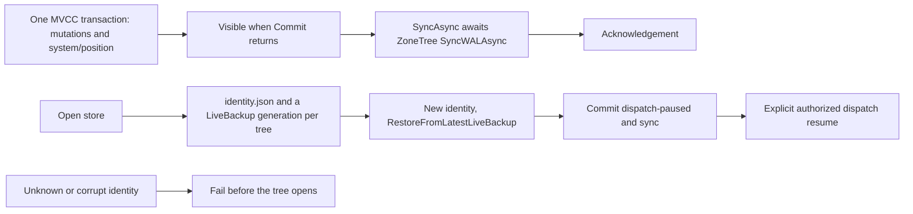

# ADR-011: Current format, ZoneTree durability and backup restore

Status: Accepted (owner direction 2026-10-31); in source; exact-source Linux
qualification pending. Owner: root integration. Related: REQ-STORAGE-005/006/007/021
and AC-STORAGE-005/006/007, AC-EXECUTION-001/002, REQ/AC-BACKUP-001–004 and
REQ/AC-DSTORE-009. Feature contracts: [StorageRecovery](../Features/StorageRecovery.md),
[CurrentFormat](../Features/StorageRecovery/CurrentFormat.md) and
[BackupRestore](../Features/BackupRestore.md). [ADR-116](ADR-116-first-release-current-format.md)
keeps one current format without migration.

## Decision

KeyLoad owns no write-ahead log, backup format, snapshot format or archive format.
Storage, its redo log and its backups are ZoneTree's; KeyLoad keeps thin wrappers
that add the store identity, the commit position and the restored dispatch pause.

1. **Store layout.** A store directory holds `owner.lock`, `identity.json` and
   `tree/` for native MVCC records and `plain-tree/` for non-transactional table
   records, both in ZoneTree's own layout.
2. **Native redo logs.** Each native tree owns its ZoneTree write-ahead log in `WriteAheadLogMode.AsyncCompressed`
   (with uncompressed payloads) supplies redo without a KeyLoad journal. A transactional commit is one ZoneTree
   MVCC transaction that holds the staged mutations and the store position record
   under the key `system/position`. `Store.Position` is read back from the tree on
   open. ZoneTree replays its own log when it opens and drops a transaction whose
   commit never reached the log.
3. **Visibility and durability.** A commit is visible when `Commit` returns and
   durable after the next `IAtomicStore.SyncAsync`, which awaits ZoneTree's
   `SyncWALAsync`. Every acknowledgement path awaits that sync
   before it reports success ([ADR-003](ADR-003-durability-ack-barrier.md)).
   `DatabaseEngine.Apply` itself does not sync. Disposing a store flushes the log.
   A visible commit that was not yet synced can be lost by a process crash; no
   acknowledgement is sent for it.
4. **Backup.** `IAtomicStore.CreateBackupAsync(directory)` requires an empty or
   absent directory (otherwise `Conflict`), checks cancellation before it creates
   anything, copies `identity.json` and writes a ZoneTree `LiveBackup`
   generation per native tree (in-memory mode `Snapshot`) of the MVCC tree's storage into
   `<directory>/tree` and `<directory>/plain-tree`. Captures of the two trees
   are independent. It returns the store position read before the generation:
   the backup holds every commit through that position and may also hold later
   ones. There is no manifest, checksum list or archive.
5. **Restore.** `ZoneTreeStore.RestoreAsync(backup, destination, ...)` requires an
   empty or absent destination (otherwise `Conflict`) and checks cancellation
   before it creates the destination. It writes a new identity — new `NodeId`, a
   new or caller-supplied incarnation and signing key, `DispatchPaused = true` — to
   `<destination>/identity.json`, restores both native trees with ZoneTree's
   `RestoreFromLatestLiveBackup` into `<destination>/tree` and `<destination>/plain-tree`, then opens the
   restored store, commits `system/dispatch-paused = true` and syncs. The
   restored store reads its own position from the tree: the MVCC generation's position plus the pause commit. Canonical records, sequences, clocks and stored outcomes are
   restored unchanged; the default new incarnation and signing key fence old outcomes,
   cursors, leases and signed tokens. Dispatch resumes only through the authorized
   dispatch operation. Explicit overrides can preserve configured group authority
   for a replica; unchanged authority does not fence its old tokens.
6. **Copy.** `ZoneTreeBackupCopy.CopyToFileStorageAsync` copies every backup file
   into ManagedCode.Storage `FileSystemStorage` at its relative path; the copy root
   is itself a restorable backup directory. Missing sources, overlapping paths,
   occupied destinations and pre-cancellation are refused before writing.
7. **Format admission.** `identity.json` is a magic-tagged generated Orleans
   envelope with a SHA-256 payload checksum, the current data epoch 8, KeyCodec v1
   and reader capability 1. An unknown magic, epoch, codec version or capability
   fails `FormatUnsupported`; a checksum mismatch or an invalid identity domain
   (empty node or incarnation, wrong signing-key length, negative read
   generation, undefined durability) fails `Corruption`. Both fail before ZoneTree
   opens or changes the tree. ZoneTree validates its own files. There is no
   alternate reader, conversion or runtime fallback.

## Native concurrency and plain tables

ZoneTree owns read snapshots, optimistic commit conflicts, thread-safe physical
writes, cache cleanup and merges. KeyLoad adds no database writer semaphore,
reader/writer lock, point-value cache or second maintenance timer. The physical
owner joins borrowers before closing handles; a retained iterator joins its visitor
before disposal.

`Transactional=false` is an immutable table setting for document tables, time
series and analytics tables. One command cannot write both table modes. Plain
records use native `Upsert` and deletion without MVCC versions. Their WAL sync
finishes before their transactional outcome is committed, and acknowledgements
also await native WAL sync. Plain multi-record effects are not atomic: interruption
can leave data without an outcome. A failure after plain publication is an unknown
outcome and requires reopen; KeyLoad does not retry those physical effects.
See [NonTransactionalTables](../Features/RelationalStorage/NonTransactionalTables.md).

## Consequences

- For transactional data, a process kill observed at the crash stages behaves as follows: after
  `MutationApplied` the transaction is absent; after `ApplyCompleted` it is wholly
  present or wholly absent; after `WriteAheadLogSynced` it is present. Process kill
  does not prove power-loss durability.
- Each silo-local ZoneTree owner backs up and restores its own files; a globally
  consistent cut across silos is not part of the design (REQ/AC-BACKUP-004).
- A backup records physical-file metadata and references, not the payloads that
  ManagedCode.Storage holds ([ADR-038](ADR-038-chunked-blob-storage.md)).
- A KeyLoad-owned journal or archive format is rejected: it duplicated ZoneTree's
  log and fsync under the commit gate and added a second format to admit, verify
  and qualify.

## Current scoped command outcomes

[DocumentStorage](../Features/DocumentStorage.md), ADR-002 owns the
operation-aware identity and replay contract. Current outcome partition keys
contain the complete PartitionRef; Global and Unknown have distinct explicit
identities. A partition locator contains its exact matching outcome key.
StoredOutcome's alias, Id0..7, policy epochs, incarnation checks, error semantics
and atomic effect/watermark/clock transaction remain fixed. Unknown is a persisted
failed-operation scope with no locator or inferred partition; an authorized retry
of that same normalized operation can replay it. Corrupt scope, orphan/mismatched
locator or malformed bytes fail closed without repair. Authorization precedes
outcome decoding. A denied operation cannot validate, overwrite or expose an
existing corrupt result. Every actual caller carries the original normalized
operation and current server-authenticated identity. Outcomes from another
incarnation after restore remain invalid and are not rebound.

## Verification

Required evidence: the strict solution build, formatter and governance; the
current-format, backup and restore real-store cases named in the feature
contracts; the process-recovery crash matrix; the Aspire cluster administrator
backup through the SDK and official MCP; functional coverage; and exact-source
Linux qualification. Compilation alone closes no gate.
