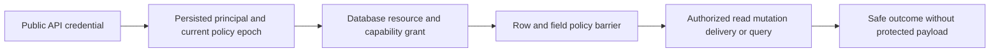

# ADR-014: Persisted principals, scoped RBAC, and row policy

Status: Accepted; all-interface GitHub qualification pending. Current persisted contract: principal/grant/api-key records in `src/KeyLoad.Abstractions/Contracts.cs`; current authorization enforcement is in `src/KeyLoad.Core/MutationAuthorization.cs`, identity/command persistence helpers in `src/KeyLoad.Core/DatabaseEngine.cs`, and shared policy primitives in `src/KeyLoad.Core/Authorization/Execution/AuthorizationPolicy.cs`; product source [sections 14 and 29](../design/product-specification.md).

## Context and decision

Public requests authenticate to a persisted database principal. Grants are scoped by database/resource and capabilities; row policy and field-use/write policies constrain data operations. A client never supplies a trusted role. Credential verification, policy epochs, revocation, and authorization happen at each relevant request/page/delivery boundary.

## Rationale and consequences

Persisted grants replicate and survive failover, unlike process-local role claims. Scope checks prevent a broad administrator label from silently authorizing unrelated resources. Revocation can invalidate cursors and cached payload access; this adds reads/barriers but avoids serving stale authority. Authentication does not itself grant a capability.

## Related requirements

Authorization `REQ-AUTH-001`, plus [REQ-AUTH-004..009 and matching AC-AUTH-004..009](../Features/Authorization.md) for persisted public identity, scoped row/capability checks, field read/use/write, current policy epochs, protected worker inputs, and sensitive diagnostics. DocumentStorage `REQ-DSTORE-003`; Messaging `REQ-MSG-001..003`; GraphTraversal `REQ-GRAPH-002`; QueryExecution `REQ-QUERY-003`. Row policy (owner, project and team membership) and the disposable generation-scoped row-visibility acceleration cache are specified in [Authorization](../Features/Authorization.md); a cached set never decides current output and is rebuilt empty after restart. See [Authorization](../Features/Authorization.md) and the canonical data features.

## Implementation contract

1. Freeze principal identity, grant vocabulary, scope resolution, row/field policy, and revocation boundary.
2. Add real TUnit and SDK/MCP tests for missing/invalid/expired/revoked credentials, forged tenant/row scope, protected field use, policy epoch change, page/delivery/cursor reauthorization, and immutable internal principal.
3. Target ownership: `src/KeyLoad.Abstractions/Authorization/`, `src/KeyLoad.Security/Authorization/`, plus replicated persistence through `src/KeyLoad.Core/Authorization/`; endpoints enforce the same policy through shared command/read boundaries.
4. Create current principal and grant records only through authorized administrative operations with least privilege. Publish credentials only after replicated verifier/grants commit; rollback revokes newly issued keys and preserves audit state. No trusted-role input field is accepted.
5. GitHub CI runs TUnit, real recovery, and replicated-cluster SDK/MCP adversarial calls before/after failover and revocation. Assertions check exact unchanged effects, and retained artifacts are redacted.

Dependencies: [ADR-001](ADR-001-partition-identity-affinity.md), [ADR-004](ADR-004-committed-read-views.md), [ADR-010](ADR-010-query-budgets-security.md), [ADR-013](ADR-013-authorized-query-ast.md), [ADR-015](ADR-015-sensitive-data-lineage.md), [ADR-022](ADR-022-policy-epoch-revocation.md), [ADR-023](ADR-023-journal-authority.md), [ADR-026](ADR-026-fenced-delivery-inbox.md), and [ADR-029](ADR-029-event-message-classification.md). Stop if a client-controlled field can establish authority or if a policy denial mutates data.

## refusal-envelope preflight correction

Actual existing SqlModelViewClusterAuthorizationAssertions.AssertDeniedAsync establishes that a revoked persisted credential reaches MCP HTTP authentication before tool dispatch: official Client CallAsync throws HttpRequestException with HTTP401; no structured dispatched error is fabricated. Preserve both genuine official direct/Q1 denied calls, exact Unauthorized status, and bounded original McpUnauthorizedProbe safe Problem/no operation header under the same credential/node. Capability refusals remain dispatched PermissionDenied structured envelopes. SDK generic result no-body assertions distinguish reference Value null from JsonElement Undefined/Null, preserving the actual ExecuteSqlAsync<Result<JsonElement>> type. No fallback or accepted-success branch.

## target collection privacy fence

GraphIncomingEdgesReader.RequireVisible→TryRequireVisible catches target collection PermissionDenied as hidden visibility and returns exact NotFound. Epoch3 target DocumentsRead reduction requires NotFound/no page, independently from preserved original target GraphRead PermissionDenied. Source GraphRead absence omits remote rows. Original principals/policies and all public codes stay unchanged.
