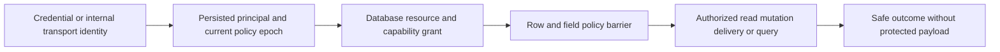

# ADR-014: Persisted principals, scoped RBAC, and row policy

Status: Accepted; all-interface GitHub qualification pending. Current persisted contract: principal/grant/api-key records in `src/KeyLoad.Abstractions/Contracts.cs`; current authorization enforcement is in `src/KeyLoad.Core/MutationAuthorization.cs`, identity/command persistence helpers in `src/KeyLoad.Core/DatabaseEngine.cs`, and shared policy primitives in `src/KeyLoad.Security/Features/Authorization/Execution/AuthorizationPolicy.cs`; product source [sections 14 and 29](../design/architecture-v0.3.uk.md).

## Context and decision

Public requests authenticate to a persisted database principal. Grants are scoped by database/resource and capabilities; row policy and field-use/write policies constrain data operations. A client never supplies a trusted role. Credential verification, policy epochs, revocation, and authorization happen at each relevant request/page/delivery boundary. Internal cluster membership authority is protected separately from public API keys.

## Rationale and consequences

Persisted grants replicate and survive failover, unlike process-local role claims. Scope checks prevent a broad administrator label from silently authorizing unrelated resources. Revocation can invalidate cursors and cached payload access; this adds reads/barriers but avoids serving stale authority. Authentication does not itself grant a capability.

## Related requirements

Authorization `REQ-AUTH-001..003`/`AC-REP-005`, `AC-AUTH-002/003`, plus [REQ-AUTH-004..009 and matching AC-AUTH-004..009](../Features/Authorization.md#повний-public-authorization-contract) for persisted public identity, scoped row/capability checks, field read/use/write, current policy epochs, protected worker inputs, and sensitive diagnostics. DocumentStorage `REQ-DSTORE-003`; Messaging `REQ-MSG-001..003`; GraphTraversal `REQ-GRAPH-002`; QueryExecution `REQ-QUERY-003`. See [Authorization](../Features/Authorization.md) and the canonical data features.

## Implementation contract

1. Freeze principal identity, grant vocabulary, scope resolution, row/field policy, internal membership privilege, and revocation boundary.
2. Add real TUnit and SDK/MCP tests for missing/invalid/expired/revoked credentials, forged tenant/row scope, protected field use, policy epoch change, page/delivery/cursor reauthorization, and immutable internal principal.
3. Target ownership: `src/KeyLoad.Abstractions/Features/Authorization/`, `src/KeyLoad.Security/Features/Authorization/`, plus replicated persistence through `src/KeyLoad.Core/Features/Authorization/`; endpoints enforce the same policy through shared command/read boundaries.
4. Create current principal and grant records only through authorized administrative operations with least privilege. Publish credentials only after replicated verifier/grants commit; rollback revokes newly issued keys and preserves audit state. No trusted-role input field is accepted.
5. GitHub CI runs TUnit, real recovery, and RF3 SDK/MCP adversarial calls before/after failover and revocation. Security owner joins root with exact unchanged-effect assertions and redacted artifacts.

Dependencies: [ADR-001](ADR-001-partition-identity-affinity.md), [ADR-004](ADR-004-committed-read-views.md), [ADR-010](ADR-010-query-budgets-security.md), [ADR-013](ADR-013-authorized-query-ast.md), [ADR-015](ADR-015-sensitive-data-lineage.md), [ADR-022](ADR-022-policy-epoch-revocation.md), [ADR-023](ADR-023-journal-authority.md), [ADR-026](ADR-026-fenced-delivery-inbox.md), and [ADR-029](ADR-029-event-message-classification.md). Stop if a client-controlled field can establish authority or if a policy denial mutates data.

## KL-065 test-only implementation tranche, 2026-10-10

Ordered stages: preserve the two original incoming privacy refusals; revision-fenced persisted row-owner repair; independent complete healthy page; persisted reduced scoped grant refusal/no effects; persisted revocation refusal/no effects; higher-epoch exact grant repair; original store join and same-root reopen; current-authority full page; exact original root repair receipts/outcome bytes and unchanged document revisions on replay; joined cold disposal. Ownership: existing GraphIncomingPrivacyTests plus GraphIncomingRowAuthorityContinuation, GraphIncomingRowAuthorityAssertions and GraphIncomingRowAuthorityCold under Unit GraphTraversal. Dependencies reuse GraphCrossPartitionTestSupport, GraphShortestPathFullStoreImage, the original embedded TestDatabaseEngineFactory.Capture composition and native ZoneTree. No public, persisted, resource, clock or topology change and no migration; rollback removes only the additive test extension. Root integrates guarded docs before source and runs complete solution/native Linux gates. Local normal/scalar original-case results are development evidence, not all-interface qualification.

The source-proven embedded same-ID repair replay also retains the complete bounded native key/value image and physical cut: the cached path reauthorizes and returns before clock/effects, with no positive replicated apply index. Lexical cold-store ownership retains both the initiating operation failure and any distinct real disposal failure, emitted after cleanup.

The two original graph cases use the embedded null physical-owner composition, distinct from the native configured-owner fixture. Cold reopen reuses exactly that existing centrally validated engine factory/default profiles and original clock; it does not call the configured-owner constructor with the graph catalog fixture incarnation, change that constructor guard, bootstrap or rewrite owner/store identity.

## TASK-KL065-INCOMING-PUBLIC-CONTINUATION-002

Test-only extension of SAME GraphIncomingRf3Tests.PersistedSourceGrantHidesCrossRowsAndTargetGraphDenialIsExplicit; original declaration/UID/Args/deadline/native50/exclusiveheavy1 preserved. REQ/AC-AUTH005/007, GRAPH-XPART003/005, GRAPH002 under ADR014/102/125/117. Existing GraphIncomingRf3Scenario explicitly verifies three distinct atomic partitions on ONE physical RF3 owner. Different physical owner remains UnsupportedCapability. No public/persisted/product/options/clock seam.

Ordered flow: preserve original target-only source exclusion and target GraphRead denial. Retain full-reader original grants. Healthy admitted official MCP/SDK owner enters all four direct SDK/official MCP/Q1SDK/Q1MCP incoming routes through existing RequestCqrsRf3Callers and SqlRf3Protocol. Independent three-row literals retain all complete edges, full references, delivered revisions, redacted attributes and page version/projection; each call owns a fresh positive current cut. Persist epoch2 source database grant removal (local row only); epoch3 target DocumentsRead removal (PermissionDenied, no page); epoch4 original scoped repair (complete three rows); epoch5 Revoked (Unauthenticated, no protected page); epoch6 exact original scoped repair (complete three rows). All changes through existing authorized ConfigurePrincipal; full returned principal values compared, not caller role. Original MCP owner is created while healthy before revoke, then original requests reauthorize persisted state.

Each state operation brackets complete current administrator document images for ALL four vertices, all three partition outbox states and complete actual administrator incoming edge rows (cut observed independently, logical rows exact). All four refusal envelopes preserve errors and omit credentials/private marker; no global physical-position equality across replicated system commits or synthesized cut. Existing root administrator acts only as setup/current-state observer, never as substitute for reader admission.

Execute one real root expectedRevision1 PutDocument on original local source with identical literal document, keep exact original command/full receipt. All four stable-ID retries must return full original receipt and identical complete model/outbox images. Capture actual pre-stop NodeStatus per original three voters. Dispose caller sessions first; same fixture Kill ALL, BeginRestart ALL, Restart ALL, original readiness joined under SAME whole-flow token. Fresh callers/status after actual same-volume restart: exact NodeId/incarnation, nondecreasing ReadGeneration/Applied, full reader page/vertices, all four original receipt replays no second revision/outbox effect, then genuine fresh root expectedRevision2 write and complete healthy literal results. No cache/grant/owner/protocol bypass, new limits, retries or timeout changes.

Failure ownership uses existing RequestCqrsRf3Callers.RunOwnedAsync and ServerFailureObserver joined ledgers, fixture owns topology/root cleanup; original failures retained before disposal. New helpers only after native NotSupported creation checks. Private Integration graph build/discovery plus relevant Unit/API controls allowed; Docker heavy1 waits actual handoff. Native discovery must bind original UID, no guessed count/identity. Linux/fullsolution/RF3/coverage/cacheExplain complete KL065 remain OPEN until genuine results.

## Native refusal-envelope preflight correction

Actual existing SqlModelViewRf3AuthorizationAssertions.AssertDeniedAsync establishes that a revoked persisted credential reaches MCP HTTP authentication before tool dispatch: official Client CallAsync throws HttpRequestException with HTTP401; no structured dispatched error is fabricated. Preserve both genuine official direct/Q1 denied calls, exact Unauthorized status, and bounded original McpUnauthorizedProbe safe Problem/no operation header under the same credential/node. Capability refusals remain dispatched PermissionDenied structured envelopes. SDK generic result no-body assertions distinguish reference Value null from JsonElement Undefined/Null, preserving the actual ExecuteSqlAsync<Result<JsonElement>> type. No fallback or accepted-success branch.

## Native target collection privacy fence

GraphIncomingEdgesReader.RequireVisible→TryRequireVisible catches target collection PermissionDenied as hidden visibility and returns exact NotFound. Epoch3 target DocumentsRead reduction requires NotFound/no page, independently from preserved original target GraphRead PermissionDenied. Source GraphRead absence omits remote rows. Original principals/policies and all native public codes stay unchanged.

## TASK-KL065-INCOMING-REPLAY-ARGUMENTS-002

TASK-KL065-INCOMING-REPLAY-ARGUMENTS-002 corrects only the new Incoming fixture replay composition. Authentic original R3 normal UID9e4e729a-e869-8544-dd9d-d87073e179d2 failed canonical Q1 SDK Validation at CompositionSqlColdAssertions.ReplayAsync39 after real direct SDK/MCP full receipt replay. Native McpCommandCatalog Batch binds stable ID inside CommandRequest; McpArgumentDecoder.Command calls Request(false), permitting exactly one request key. The reused generic helper supplied an extra outer commandId reserved for HeaderCommand. Replace only GraphIncomingPublicContinuation replay with exact request-only Q1 CALL while retaining original CommandId/full request/full receipt on all SDK/official MCP/Q1 routes, complete no-effects/cold/healthy/privacy models, same original case/UID/deadline/options. No product schema/decoder/auth/transport/retry/quota change and no relaxing Validation; original failed image/TRX/log/cleanup retained. Ordered dependency: immutable READY9 manifestf76213ec + READY7 manifestaaf8a906 + separate original R3 completion7f08c0a8 → this four-path predicted-ancestor successor. Root must compose docs append union; shared Composition helper is unchanged. Local normal/scalar execution is development only, Linux/RF3 task gates remain open. Rollback removes only this correction and appendix, restoring the original retained failed fixture composition, never overriding current public boundaries. ADR014/REQ-AUTH005/007/AC-GRAPH-XPART003 apply. Native preflight proven existing APIs; new/private helper is not yet live-compiled, native get_symbol_body NotFound permits private proposal. Root alone joins source/Git and required full solution checks.

## TASK-KL065-ROW-CANDIDATE-SWAP-001

Architecture KL065/29.3 and REQ/AC-AUTH-005/007 + REQ/AC-QUERY-004/005 under ADR014 map to the same four `AcAisql008ReversedPointAndIndexPredicatesPreservePersistedRowOwnership` arguments. Preserve first point/index ownership refusals, then real acknowledged two-document owner swap with exact original bodies/revision CAS, same-engine normal/reversed current row filtering, independently literal full row/plan/current-cut, whole native no-effect images, exact original receipt/outcome replay, and joined same-root cold/current-policy healthy work. This does not claim a cache hit or add cache/public/store contracts.

Ordered implementation: existing spec/ADR appendix → original case invokes feature-owned continuation → literal query/receipt/no-effect helper → original factory/cold cleanup helper. Native preflight all existing APIs and per-new-path creation refusal precede private code. Original typed limits, clocks, deadlines, four Args/UIDs and native50 remain. Rollback removes only this case extension/helpers and appendix, preserving every original case/assertion. Root joins main and runs required complete solution/Linux gates; local development controls are not RF3 or complete KL065 closure.

Embedded durability clarification: actual ZoneTreeIdentityFile.Open creates ProcessDurable; DatabaseEngine constructor retains that identity profile and ExecuteBatch writes it into the complete original receipt. The four Unit cases independently require literal ProcessDurable, preserving true synchronous native process durability and never manufacturing RF3 acknowledgement proof. Original R4 normal4 failures from an erroneous QuorumProcessDurable fixture oracle are retained; scalar was not executed on that failed oracle. Full original request/receipt/native bytes/read cut/row/plan/replay/cold invariants remain exact. The native discovery child completed before four runtime results, but the runner was launched before waiting its pending process result; preserve that original orchestration ordering mistake separately and use sequential completed discovery before the corrected run. No durability options/product/timeouts/defaults changed.

# TASK-KL065-TRAVERSAL-ROW-CONTINUATION-001

REQ/AC-AUTH-005/007 and original KL065 hidden-path acceptance, under ADR014, retain the SAME TraversalStopsAtHiddenIntermediateVerticesAndHandlesCycles case/UID/deadline/defaults. Native GraphTraversalReader.RequireStart/CanVisit runs in the original Store.Read/current principal; the old result and visible cycle use independent complete ordered vertices/EdgeRecords, not a sampled count. Preserve every original assertion.

Ordered stages: original hidden result and root cycle -> independently complete hidden result/native-byte no-effect -> real root revision-CAS b owner Bob to Alice (original JSON unchanged) -> literal complete visible cycle -> reduced graph grant epoch2 PermissionDenied -> revoked original grants epoch3 Unauthenticated -> repaired identical grants epoch4 healthy -> exact original root command receipt/outcome replay/no-effect -> genuine same-root joined Store close/cold open -> exact NodeId/incarnation, nondecreasing ReadGeneration, complete native bytes/cut -> current persisted healthy traversal and same-ID replay -> final healthy traversal and joined cleanup. Existing original embedded ProcessDurable, current policy and atomic mutation ownership remain unchanged. Store cut is observed separately from traversal's DTO; no invented cursor/cache hit/Explain/public authority.

Ownership: existing Cases/GraphTraversalTests.cs and new feature-local Helpers/GraphTraversalRowContinuation.cs, Helpers/GraphTraversalRowCold.cs, Assertions/GraphTraversalRowAssertions.cs. No product/persisted/public format/API/provider/clock/quota changes. Root alone joins/builds/delivers. All initiating, cleanup and fatal failures retained by the existing ServerFailureObserver ledger, disposal remains genuine. Rollback removes extension/helpers/docs together. Native per-new-path NotSupported is recorded before creation; private canonical TUnit50 normal/scalar proof is development only, required full solution/Linux/public RF3 gates stay open. Docs append union with separately sealed Equality/Incoming predecessors; C# disjoint and no dependency on them.

# TASK-KL065-PROJECT-ROW-CONTINUATION-001

REQ/AC-AUTH-005/007 and original KL065 owner/project predicate acceptance under ADR014. Existing SecurityAndQueryTests.RowScopeAndTenantCannotBeForged is owner-only, ending in own-row id/hidden Get null/foreign Tenant PermissionDenied. Preserve SAME case/UID and ALL original assertions. Native RowAccess OwnerId/ProjectId are exact immutable fields0/1; current CanReadRow authorizes the OR of actual owner equality and ordinal membership in freshly persisted PrincipalRecord.Projects. No caller-trusted roles, cached membership authority, added team/public/persistence fields or ID-set claims.

Finite test-only phases: original owner/scoped denials -> literal full original SQL rows/EXPLAIN/current native cut and noeffects -> root CAS revision1 of existing hidden row keeps ownerBob/JSON{} while adding the actual projectAlpha -> current principal epoch2 OwnerAlice/RestrictRows/ProjectsAlpha and identical original scoped DocumentsRead+Query grants -> independent complete ordered hidden+mine row model through same QueryEngine -> epoch3 removesProjects, complete mine-only row/EXPLAIN/nativebytes noeffect -> epoch4 revoke original grants/project -> exact Unauthenticated/no protected page/noeffects -> epoch5 exact original project+grants repair -> complete healthy rows -> original root command sameID full receipt/outcome/native-byte noeffect -> genuine Store joined close and same-root native reopen -> exact NodeId/incarnation/nondecreasingReadGeneration/complete original bytes/cut -> fresh current principal SQL rows/EXPLAIN/replay/healthy. No request cursor is copied; each result compares actual call cut against current store.

Use exact existing ConfigurePrincipal/Batch/PutDocument/RowAccess/QueryEngine/ZoneTreeStore and TestDatabaseEngineFactory original embedded composition. Mutation receipt independently ProcessDurable/current original root epoch, no quota/default/deadline/timeprovider changes. Errors+cleanup/fatal ledgers preserved. Helpers/Assertions remain feature-local with method64/class200 bounds. Native newpath NotSupported before creation; existing intent-preserving previews before root join. Docs append union with owner/traversal/incoming predecessor docs only; C# independently guarded against actual main.

Bounded independent complete native key/value/outcome image is test-only authority oracle, not a provider/compatibility path. This contract is private source design, not implementation/PASS. Canonical native TUnit50 normal/scalar original case required; actual full solution/Linux/public RF3/caches/generation-scoped ID set and team-specific design remain honest separate gates. Root sole main writer/build/integration/Git; no Docker concurrent launch while IncomingR4 heavy1 owns resources.

# TASK-KL065-TEAM-ROW-POLICY-001

Frozen before private implementation. Architecture29.3/KL065 and REQ/AC-AUTH-005/007 require real declared team membership, distinct from existing owner/project coverage. Existing CanReadRow supports only owner/project. This tranche adds actual persisted team row policy and whole native operation controls; generation-scoped ID sets and exact cross-tenant acceleration cache implementation/qualification remain separate OPEN criteria.

Append PrincipalRecord.Teams at native Id11, initialized to the valid empty ImmutableArray; append RowAccess.TeamId at native Id2 with optional null. Existing aliases, IDs, constructor arguments and owner/project OR semantics stay exact. Both fields are ordinary public JSON through current native schema/SDK/MCP/Q1 codecs; neither is a trusted caller role. Only the existing persisted administrator ConfigurePrincipal operation publishes membership, with strict increasing PolicyEpoch. Tenant/capability checks remain before row visibility. Protected cluster and runtime-journal principals require empty teams as well as their unchanged exact original fields.

Use the existing 256 project-membership admission as a combined Projects+Teams ceiling: teams may consume remaining membership slots, never increase that ceiling. Default arrays/invalid identifiers fail Validation before catalog write. Blob current metadata validates optional TeamId exactly as owner/project, mapping malformed persisted metadata to existing Corruption. Document Put validates TeamId before row authorization/publication; Patch preserves access and cannot forge membership. No new quota, schema fallback, internal format conversion, migration, provider, policy clock or trusted-state cache.

Ordered stages: this feature/ADR appendix -> additive existing native contracts -> current policy and bounded validation/protected identity checks -> original native ConfigurePrincipal/Batch/SQL/Get operation sequence -> joined same-root cold replay/healthy literal -> current native build/discovery/normal+scalar -> delivered Linux full-suite/process/public RF3. All original cases/UIDs/Args remain untouched; new meaningful team case has no invented UID. New controls prove configured team-only row read/write, independent full literal ordered query/EXPLAIN/current cut, actual denied forged membership and other-team write, removal/revoke/higher-epoch repair, old command current-epoch refusal, original immutable outcome bytes, new current receipt and same-ID replay, actual cold NodeId/incarnation/nondecreasing generation/full native image and healthy work. Combined membership invalid-scope rejection must preserve principal state then genuine valid grant repair/work, not a property-only test.

Ownership: Abstractions AuthorizationContracts/DocumentStorageContracts; Security AuthorizationPolicy; Core ProtocolValidation, DocumentMutationCommands, BlobMetadataRules, ClusterPrincipalPolicy and RuntimeJournalIdentity; new Authorization Cases/Helpers/Assertions; append Authorization.md and ADR014. No Orleans routing/storage owner change. Native API reads and per-new-path NotSupported precede new C#. Root joins live/source/Git; isolated Unit build/testing are development only. Existing source/image/UID/coverage and RF3/recovery gates remain mandatory. Rollback removes additive team code/tests/docs together from a first-release source image; no legacy reader or conversion is supplied and no runtime compatibility rollout is claimed.

Team graph source map: same new whole team case also seeds an actual collection of owner-a/team-b/owner-c vertices and actual ab/bc graph edges via original authorized Batch. Team membership yields complete ordered a,b,c and ab,bc; removal yields onlya/noedges, revoke rejects without page, higher-epoch repair and same-root cold yield complete original graph again. Existing GraphVertexVisibility actual source owns synchronous current-principal lookup; no cache hit or reusable ID-set claim. New Assertions/TeamGraphVisibilityAssertions.cs owns independent literal vertices/edge records and full native byte/cut invariance.

## KL-065 generation-scoped native visibility ownership

Architecture 29.3 / KL065 and REQ/AC-AUTH-005/007 require a genuine generation-scoped document-ID visibility acceleration set. Team tranche READY15 is a required source predecessor for team semantics; original owner/project checks remain. This is disposable current-source state, with no persisted/public fields, aliases, protocol changes or replacement storage provider.

Exact existing APIs: KeyLoad.ICacheMemoryBudget.TryReserve(bytes, entries, out ICacheMemoryReservation) and CacheMemoryBudget, DatabaseEngine.WithQueryView, DocumentEpoch, ReadExecutionBudget.VisitRange, QueryCandidateReader.Candidate/Visit and GraphVertexVisibility.CanVisit/ReadVisibility. Core already grants Query and Server friend access. Native receipts retained beside this contract. PartitionHost creates CacheMemory before OpenCanonicalDatabase; existing shutdown joins maintenance/coordinator/materializer before CacheMemory and canonical stores. No IAtomicStore or IKeyValueView expansion.

Minimum actual scope: Core/Authorization owns an internal RowVisibilityCache, scope identity and disposable build/lookup leases; one DatabaseEngine owns it for one actual store, explicitly borrowing the SAME PartitionHost CacheMemory. Composition closes the cache after operations/apply join and before CacheMemory; embedded test fixture owns its same validated shared budget and cache lifecycle. No separately sized cache ceiling or per-query substitute. Default embedded owners without this collaborator preserve the existing canonical path and cannot be credited as cache tests.

Identity is an exact structured tuple: actual Store.Identity NodeId/incarnation/read generation, current Store.Position observed INSIDE original read view, full PartitionRef (including tenant), collection, resource schema version, source DocumentEpoch, current persisted principal ID/tenant/policy epoch. Existing strict principal epoch CAS is membership version, including owner/project/team changes. No signing key, credential, document JSON, retained PrincipalRecord, live IKeyValueView or caller role is cached.

Fill reuses ONLY the original authorized full collection scan already performed by QueryCandidateReader. It accumulates actual visible document IDs after existing current row policy checks; it does not issue a second scan, affect point/index paths, change their access-path labels, skip original scan/result limits or accept a partial prefix. Publish only after original native scan reports HasMore=false, original cancellation/budget remains valid, and owning scan has completed successfully. Partial/failed/cancelled scans dispose the unpublished draft and all accepted reservations, retaining initiating/cleanup failures. Schema/filter/SQL projection does not define visibility: every candidate in the actual complete collection scan contributes independently of residual predicate, paging or result limit.

A later matching full scan may exclude IDs absent from this COMPLETE set before current row policy; all positive IDs STILL deserialize current records, check Deleted and current CanReadRow before materialization. Native scan/byte/cancellation accounting stays exactly the original scan. Graph may borrow the same matching complete set after its current collection authorization/resource check: known-negative IDs avoid canonical vertex decode; positive IDs STILL perform current canonical read/current CanReadRow, and misses/unsupported/incomplete sets use existing actual canonical path. Never infer completeness from count, requested result limit or a graph traversal's visited IDs. No cache-hit performance claim from result equality.

Bounds/lifetime: modeled retained charge includes scope strings and tuple/index/node/list capacity, each actual copied document ID string, reference/ordinal index state and every cache/build/lookup lease; reserve the original shared byte+entry grant BEFORE owned allocation/copy. Fixed implementation representation-size terms are accounting constants, not new operational limits or measured CLR heap. Refusal to retain accelerator state leaves original canonical execution intact; it cannot authorize/deny a row or change operation outcomes. No unlimited dictionaries or uncharged growth. Retire stale same-scope entries on new current scope/epoch/cut; bounded admission may retire unpinned entries. Retired pinned entries retain the same original charges until actual final lease Dispose. No lease evicted from under caller; no advisory invalidation needed for correctness. On cache Dispose close admission and retire entries; retain uncertain/pinned ownership until actual closure. Restart reconstructs an empty disposable cache using fresh identity; old cursors/sets never bind the new generation.

Required complete operation controls: real team/owner/project corpus with same-ID cross-tenant documents; original SQL complete scan warms a real set, graph/page positive+negative paths retain complete independent literals and fresh final policy. Root revision-fenced row-owner/team changes, delete and real policy membership reduction/revoke ACK yield exact hidden/denied no-effect results despite old pinned set; higher epoch repair fresh healthy set/results. Actual shared budget contention refuses only accelerator retention, original native bounded healthy operation remains exact; cancelled original scan publishes no partial set, then fresh healthy scan. Same-root joined cold retains canonical full bytes/receipts and returns current literal pages/graph with empty new cache. Observation of cache reuse/reservations is test-only internal actual owner evidence alongside full operations, not a getter-only test. No fake clock, synthetic trusted state, quotas, deadline changes or performance claims.

Ordered owners: docs/ADR014 first; Core internal cache/scope/retention; actual DatabaseEngine composition; Query full-scan draft/terminal publication and final row checks; Graph matching lookup/current checks; PartitionHost/TestDatabase lifecycle; whole Unit normal/scalar and real existing SDK/MCP/Q1/cold acceptance. Root joins main/Git. Source/DLL/PDB/native UID/cleanup and mandatory full solution/Linux/RF3/coverage remain OPEN. This finite contract freezes integration before new native seams; implementation and passes are not claimed.

Current-cut graph bridge before source: retain only the actual SchemaVersion scalar with the ORIGINAL bounded collection-decision entry (no second map/resource object). After its original persisted collection capability/resource check, match actual store NodeId/incarnation/read generation/Position, full partition/collection, actual schema version and fresh principal tenant/id/epoch. Under SAME unchanged live native read gate, exact current physical position proves the full-scan entry's actually observed DocumentEpoch unchanged; snapshot replacement requires a new read generation and cannot match. No second scan or metadata-read budget is introduced. The full entry still records original actual DocumentEpoch; query acquisition compares it exactly with already observed ResolveCursor.SourceEpoch. Graph positive IDs still canonical-read/current CanReadRow; negative closure is valid only for this exact current cut. Existing graph collection-decision metadata reserve includes this scalar; no new collection index/map, new quota or authority.

### TASK-KL065-GENERATION-VISIBILITY-001 whole-operation regression closure

`GenerationVisibilityTests` owns two real-store operations: complete SQL/graph visible images, a foreign tenant with the same row ID and independent JSON, a held original cache pin across persisted removal/revocation/repair, original-command epoch refusal and current-command exact replay, then joined cache/store closure and same-root cold reconstruction with an empty disposable cache. The second operation exhausts the SAME original shared memory admission before a complete canonical scan, releases the genuine competing reservation, exercises actual cancelled caller refusal with complete no-effects, and ends in repaired healthy SQL/graph and same-root cold continuation. Cancellation is a real already-cancelled caller control, not a claim of a mid-scan barrier. All copied IDs and collection/index metadata remain charged through actual pin release; cache observations support the whole operation and do not replace complete literal public rows/native bytes/receipts. These are Unit normal/scalar development gates; process, RF3, authentic census/coverage and Linux task graduation remain open. No persisted/public ID, quota, clock or transport contract changes.

The retained-byte model includes pointer-aligned object/string footprints, the retained PartitionRef object, cache/lease/entry/ID/reservation and sorted-set metadata, plus conservative native Lock/wait-event/safe-handle managed metadata reserved before owner creation. The .NET10 Lock fields are source-linked to the [official runtime v10.0.12 Lock implementation](https://github.com/dotnet/runtime/blob/v10.0.12/src/libraries/System.Private.CoreLib/src/System/Threading/Lock.cs); ulong thread identity covers the larger macOS layout and conservatively overcharges the Linux uint layout. This is modeled shared admission, not measured CLR heap/RSS or kernel-memory qualification. An uncertain reservation-release failure is latched by the original owner; a later idempotent native Dispose cannot be treated as a new successful release. Retired failed entries/leases keep their original identity and charges.

The Query closure owns either its exact completed-set lease or its unpublished draft, never both: Begin is called only when Acquire returns null. Both direct nullable Dispose calls remain visible in the lexical finally; the initiating scan error is retained before cleanup and any cleanup refusal is aggregated outside finally. No second cleanup resource can be skipped because of the exclusive original acquisition path.

Final responsibility ownership: pure RowVisibilityScope/CurrentScope stay in Models; the retained mutable entry and its actual reservation closure belong to Lifecycle/RowVisibilityEntry.cs, and the modeled native layout/byte admission calculator belongs to Admission/RowVisibilityMemoryModel.cs. Execution owns the current node cache/database composition, Admission owns draft/transfer construction, QueryExecution/Queries owns the original full-scan closure. No public namespace, alias, field ID, effect or authority changes accompany this private source-role correction.

Node composition remains in the original PartitionHost: the existing canonical DatabaseEngine construction/runtime-journal preparation is factored into StorageRecovery/Hosting/PartitionDatabaseComposition, with the same store/configuration/clock/physical-owner arguments and the original shared CacheMemory. This helper owns no store or extra service. The host receives the original engine/cache pair before its unchanged transfer/log/snapshot/bootstrap stages. Direct typed field disposal after text closure and before CacheMemory closure preserves every failure in the host's original ledger, including construction refusal; failed cache ownership is never cleared or replaced.

## TASK-KL065-GENERATION-ADMISSION-EXTRACTION-003

The cache retains its original lock, closed check, scope lookup, invalidation and retirement ownership. Native lease reservation and successful constructor-to-pin transfer are owned by the existing `Admission/RowVisibilityTransfers.CreateLease`; the call occurs under the same cache gate. Direct nullable-reservation disposal and initiating/cleanup error preservation remain unchanged. No new owner, callback, quota, public/persisted contract or policy is introduced. Both original GenerationVisibilityTests whole operations verify cross-tenant/revoke/repair/replay, pinned retirement/admission/cancellation and same-root cold continuation in normal/scalar profiles. Canonical formatting, build and authentic runtime gates remain required.

## TASK-KL065-GENERATION-WRITE-VISIBILITY-002

The same two GenerationVisibilityTests operations additionally retain the original negative ID set while a real root-authorized row CAS changes its team visibility, retain the subsequent positive set through a real tombstone and resurrection, and verify full independent current SQL/point/native-record values. All three genuine root command receipts and original outcomes replay with no effects before and after same-root cold. Old pinned sets are data only; current positive candidates still pass fresh persisted row policy. Original tenant/epoch/revoke/repair/admission/cancel/retirement assertions, declarations, deadlines, budgets and cold ownership remain unchanged. This test-only continuation changes no public or persisted contract; local evidence is separate from Linux/RF3/resource gates.

## TASK-KL065-OWNER-PROJECT-GENERATION-CONTINUATION-019

REQ/AC-AUTH005/007 and architecture29.3 / ADR014. This is a genuine missing whole-operation regression, not a missing cache provider or proven product defect. Canonical generation-scoped visibility already exists. Original GenerationVisibilityTests identities, existing team/cross-tenant/quota/cancel/full raw bytes/receipt/cold checks remain exact.

Extend original GenerationVisibilityFlow with a separate actual persisted restricted principal and separate collection in the same original store/cache/budget. Real root Batch seeds owner-visible, project-visible and neither-visible rows with independent literal bodies. Genuine full authorized SQL scan publishes a completed native visibility set. Retain actual lease through acknowledged owner CAS, current project membership removal, actual revoke, higher-epoch repair, owner-restoring CAS and project-restricting CAS. Verify OR semantics: owner still authorizes when project is foreign, current project membership is genuine persisted authority, cached old-positive/old-negative sets never decide current output.

Each read brackets complete native key/value image+cut, checks complete ordered literal QueryRows/access path/null cursor/actual cut and all three full point DocumentResults. Revoke returns original Unauthenticated for both Query/Get and leaves all bytes/cut unchanged. All real root command IDs/complete receipt fields/native original outcome bytes remain captured; exact same-ID direct native replay must add no effects or outcome rewrite. Cold reuses the existing one original GenerationVisibilityCold owner/callback, proves unchanged original rows/cut before reads, then complete owner/project literal result and original receipt/outcome replay. No new cold owner, cache-hit claim, API, alias/Id/quota/clock/provider/migration/fallback.

Ordered implementation: this contract + additive Authorization/ADR014 before new owning Helpers/Assertions and exact original Flow callback extension. Root owns current main join. Native previews/new exact NotSupported receipts required; private normal SIMD native50 focused original two cases and original source/image/cleanup proof required. No RF3/performance/Linux acceptance borrowed from Unit. Activation migration is distinct open runtime gate; snapshot/read generation correctness remains existing source scope.

### TASK-KL065-PARTIAL-SCAN-AND-NATIVE-CUTS-003

REQ/AC-AUTH-005/007, REQ/AC-QUERY-004/005 and ADR014 preserve both original GenerationVisibilityTests operations and all original results, receipt/replay/revoke/repair/cold/no-effect and shared-admission assertions. R24 failed originals remain immutable.

The new partial-scan owner runs after the complete original occupied-budget and cancelled-caller controls. Native RowVisibilityCache.ReserveEntry legitimately retires unpinned sets under pressure; the supporting new Reader set must not prepopulate the old exact admission baseline. No old occupied snapshot expectation is removed, weakened or replaced.

The snapshot operation freezes two distinct original facts before capture: ZoneTreeStore.Position is the local durable journal cut, while DatabaseEngine.LastApplied is genuine replicated metadata. CreateSnapshot requires that original LastApplied value; full captured and installed Position must equal the original local cut and AppliedPosition must equal that original replicated cut. Original whole raw rows/outcomes, node/incarnation and exactly-next ReadGeneration remain independently checked. No synthetic applied metadata, position equality assumption, owner substitution, timeout, provider or product API change.

Private development lane only. R20/R23 originals remain sealed; R25 is their complete same-intent successor. Main source/bin/obj remain root-owned, full Linux/task qualification remains open.

Preserve the complete R25 contract, all original two case UIDs, exact cache pressure/cancel/bounds, distinct native local/applied snapshot cuts, immutable old leases, full original mutations/receipts/outcomes, revoke/repair/strict failed replay and cold continuation. R24/R25 failures remain immutable.

The unrestricted supporting Reader oracle has two distinct independently specified phases. Warm seed expects ForeignTeam revision1. The original GenerationVisibilityWriteFlow then commits visible revision2, tombstone revision3 and resurrection revision4, validating each original receipt/record/outcome/replay. The cold Reader oracle therefore explicitly uses existing ResurrectedRevision4 with original JSON and compares the complete sorted two-row payload including the main row's actual independently specified healthy revision/content. Every cursor/cut/access-path/cache-membership/full image assertion stays intact. Never construct expected rows from an observed result. No original mutation, public API, policy, deadline or quota changes.

Private development evidence only; Main root-owned. Full Linux/product qualification remains open.
