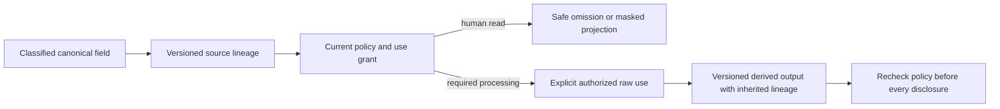

# ADR-015: Sensitive-data omission, use, and lineage

Status: Accepted; complete cross-projection privacy qualification pending. Current policy contracts are in `src/KeyLoad.Abstractions/Contracts.cs`, enforcement in `src/KeyLoad.Core/MutationAuthorization.cs` and `src/KeyLoad.Core/DatabaseEngine.cs`, and shared policy primitives in `src/KeyLoad.Core/Authorization/Execution/AuthorizationPolicy.cs`; product source [sections 14, 26, 29–30, and 44](../design/architecture-v0.3.uk.md).

## Context and decision

Sensitive data can flow through documents, events, message payloads/headers, graph attributes, text/vector/search projections, query aliases, diagnostics, backups, and replay. Classified fields carry versioned policy/lineage. Human-readable outputs omit protected fields by default. A computation requiring raw fields needs an explicit data-use grant; redacted replacement is not silently substituted when it would change business semantics. Derived projections inherit source classification and policy epoch, and every read/replay/export boundary rechecks current restrictions.

## Rationale and consequences

Omission and lineage reduce accidental disclosure through search, logs, aliases, and replay. Reclassification/revocation may invalidate projections and cursors and may require rebuild. Historical raw bytes are not erased by response omission; retention, physical purge, backups, and crypto-erasure need separate verified lifecycle decisions. Hashes can themselves be sensitive.

## Related requirements

Authorization `REQ-AUTH-001..003` plus [REQ-AUTH-004..009 and matching AC-AUTH-004..009](../Features/Authorization.md#повний-public-authorization-contract), particularly field read/use/write, policy-epoch enforcement, protected processing inputs, and sensitive-data lineage/diagnostics. Search `REQ-SR-002/005`, DocumentStorage `REQ-DSTORE-003`, Messaging `REQ-MSG-002/003`, GraphTraversal `REQ-GRAPH-002`, and EventStreams `REQ-EVENT-003/006` also apply. ADR-014 defines authority; ADR-029 expands event/message classification.

## Implementation contract

1. Freeze classification vocabulary, schema lineage, required-input behavior, omission rules, derived-provider metadata, and safe diagnostic format.
2. Add canary tests across document, event/header, queue/DLQ, SQL alias/sort, graph edge, search/vector, export, trace, and replay; assert both allowed raw use and denied omission/failure.
3. Target owners: `src/KeyLoad.Security/Authorization/`, each canonical source slice, and the existing `src/KeyLoad.Query/Search/` projection slice; no generic endpoint may bypass source ownership or create a separate search technical root.
4. Reclassification increments policy/schema epochs and invalidates stale derived generations before exposing output. Rollback cannot restore permissive reads without restoring authorized policy state; purge operations must report copy/archive boundaries.
5. GitHub CI runs TUnit and real RF3 SDK/MCP privacy cases. Root joins Security, Search, Messaging, and backup owners; retain sanitized evidence only.

Dependencies: [ADR-004](ADR-004-committed-read-views.md), [ADR-006](ADR-006-strict-derived-indexes.md), [ADR-009](ADR-009-search-provider-boundaries.md), [ADR-010](ADR-010-query-budgets-security.md), [ADR-013](ADR-013-authorized-query-ast.md), [ADR-014](ADR-014-principals-rbac-row-policy.md), [ADR-018](ADR-018-global-rank-fusion.md), [ADR-019](ADR-019-managed-ann.md), [ADR-022](ADR-022-policy-epoch-revocation.md), [ADR-029](ADR-029-event-message-classification.md), and [ADR-030](ADR-030-retention-paused-restore.md). Stop on missing lineage or unsafe replay; do not infer erasure from omission.

## TASK-KL067-CLASSIFICATION-WHOLE-001 execution contract

Related REQ/AC-SEARCH-LINEAGE-WHOLE-001, REQ/AC-AUTH-009, AC-SEARCH-003/005 and AC-LINEAGE-002/003. The current native VectorProjectionEligibility already evaluates current source visibility/field use and exact source/target classifications, and the native text scope binds persisted principal policy/schema. The identified gap is the original revoked-reader test's error-only oracle: it does not prove a full protected payload, read-only canonical state, healthy repair and cold continuation together. Extend that original operation, not the product policy or an unrelated ranking implementation.

Order: freeze Search requirements and this contract; retain exact native bodies and guards; expand the original case through feature-local complete-result and lifecycle helpers; root reviews/previews and joins; root performs coherent Release/compiler/formatter and selected normal native50 Unit operation; remaining exact-source Linux process/RF3 SDK/official MCP qualification stays open. Same actual fixture/principals/limits/CT, canonical source event, vector effect, native text provider, genuine persisted ConfigurePrincipal repair and same-root reopen are mandatory. No fake provider, trusted role, default-authority bypass, new quota, retry, timer or source-format migration.

The complete oracle independently fixes the target EntityRef/revision, redacted empty JSON and ordered /input,/embedding paths, one rank contribution 1/61, null explanation and exact vector [1,0]/space. Retained native vector/lineage bytes and actual original effect receipt remain stable; full canonical rows/position are checked around read/refusal/healthy/cold operations. Original failures and native provider cleanup failures are retained in joined scope handling. Rollback removes only these qualification changes; no database bytes/contracts are changed. Root is the sole shared integrator/build/test writer; private native previews are supporting source evidence, not PASS.

### TASK-KL067-CLASSIFICATION-CORRUPTION-002 guarded successor

Depends on the immutable TASK-KL067-CLASSIFICATION-WHOLE-001 five-path source packet. Existing EventProjectionCorruptionTests only checks Corruption after its own direct lineage-row fault. Extend that original operation, preserving the malformed SourceEventRevision=0 and whole protected-vector refusal. Native ZoneTreeStore.Commit publishes changed rows then SetPosition(nextPosition); SetPosition only updates the provider-owned position, so the exact fault/repair postimages can preserve all other canonical raw records while acknowledging two real storage commits. No canonical AppliedBytes/receipt is invented.

Capture original lineage bytes/vector/full raw rows and actual successful command receipt before the fault. Once-encode the explicit malformed row and use actual IAtomicTransaction.Put, retaining those exact bytes as the injected operation input. Require one matching original row, exact full damaged postimage and +1 measured provider position; refused search changes neither. Restore only captured original bytes, require exact original full row image and +2 provider position, same-root reopen, full independent literal vector/text results and18 lineage fields, then SAME commandID receipt replay with unchanged full image/position. Join native provider and fixture resources on every path and retain primary/cleanup exceptions. No test-only trusted roles, mocks, public API/schema/ID/fallback or new limits. Root joins after docs, executes coherent Release/analysis/format/normal native50 using the SAME original corruption case; existing process/RF3 gates remain open.

### TASK-KL067-CLASSIFICATION-RF3-ORACLE-003 — complete independent caller payload

REQ-SEARCH-LINEAGE-RF3-ORACLE-003 / AC-SEARCH-LINEAGE-RF3-ORACLE-003 strengthens the existing AC-LINEAGE-001..003 SDK/official MCP operations: each result must independently match the complete original literal reference (partition, collection, ID), revision1, derived/baseline JSON, redacted=true, ordered `/input` and `/embedding` omissions, unchanged expected rank-fusion score and absent explanation. Caller agreement alone is insufficient. The exact existing scenario seeds and policy grants determine these literals; no result is adopted as expectation.

Implementation owner: IntegrationTests Search/Assertions/Projections/EventProjectionRf3Assertions.cs only. Existing EventProjectionRf3Tests retain all original command IDs, receipts, changed-payload conflict, stale input/reclassification refusal and baseline-only results; the node-loss case retains original kill, receipt replay, restart and all-node checks. Both SDK and MCP are compared against the independently constructed full DTO. Unknown expected document IDs fail closed. No product schema, alias/ID, authority, deadline, retry, resource bound or topology changes.

Ordered dependency: CLASSIFICATION-WHOLE-001 READY5, CLASSIFICATION-CORRUPTION-002, then this additive oracle successor; preserve every earlier doc appendage. Rollback removes only this assertion refinement. Runtime gates remain exact-source Linux Aspire RF3 for all three original EventProjectionRf3Tests methods, including node-loss/restart. Source review/native preview alone does not qualify or close KL-067.

## TASK-KL067-CLASSIFICATION-REPAIR-COLD-005

REQ/AC-AUTH006/007/008/009, AC-LINEAGE001..003 and original weaker-target refusal require a complete original classification repair operation. SAME EventProjectionInputTests.AcLineage002RejectsAWeakerTargetClassificationAtomically retains every original PermissionDenied/vector-null/lineage-null assertion; capture its actual first failed CommandId through the exact unchanged Harness.Submit→Database.Apply→Get<CommitReceipt> path. First definitive failure genuinely persists an outcome/clock, so do not claim unchanged global rows/cut for that first admitted command. Subsequent SAME failed-ID replay, including after repair, must preserve complete raw rows/cut and PermissionDenied rather than rewrite it as success.

Actual root ConfigureResource CAS schema1→2 repairs ONLY original /embedding Classification from projection-public to projection-sensitive; all other resource identity/policies/grants remain. Independent complete persisted replacement is checked. A genuinely NEW worker command creates its first actual canonical projection with full literal mutation receipt, vector [1,0]/space/revision1 and all18 lineage fields, including actual source+target schema2 and original worker epoch1. Real native text and vector independently return full redacted target literals through READY5. No grants/epoch/cursor/generation are forged or relaxed.

Join original provider before same-root reopen, check complete native rows/cut. Cold retains exact vector/lineage bytes, all18 schema2 facts, old failed-ID PermissionDenied and new successful-ID exact receipt/no-effect replay; fresh text/vector healthy reads leave full rows/cut unchanged. Owners: existing Unit/Search/Cases/EventProjectionInputTests.cs + new Helpers/ProjectionClassificationRepairFlow.cs; feature/ADR015 append only. Dependency original READY5→corruption4→RF3oracle3→original-policy4 doc chain (ADR015 exact R3 postimage). Existing native transaction/outcome/history/authorization/format/aliases/Ids/limits/deadlines remain unchanged. Rollback removes only continuation/original failed-ID capture, preserving original assertions and immutable reports. Required unchanged original normal native-SIMD50 selector /*/*/EventProjectionInputTests/AcLineage002RejectsAWeakerTargetClassificationAtomically and full exact-source Linux gates remain OPEN; source/preview is not PASS.

### TASK-KL066-067-NATIVE-RECEIPT-EPOCH-010

REQ/AC-SEARCH-LINEAGE-WHOLE-001 and AC-LINEAGE-002/003 require the existing original warm/replay/cold flows to compare all native MutationReceipt values: Kind, Resource, Id, Revision and ordered CompositionReferences. Generated record equality includes ImmutableArray backing identity and does not prove decoded semantic equality. Retain every complete raw-row/cut and captured vector/lineage byte assertion. No persisted format, alias, field ID or product equality contract changes.

The existing FilteredPolicy cold continuation must genuinely ConfigurePrincipal with checked current persisted PolicyEpoch plus one, read from its owning native store; a new principal begins at the existing initial epoch. Retain original grants/revocation, ordered command/outcome, complete healthy literals and both same-root cold passes. No policy bypass, clock/limit/deadline changes or fabricated authority. Existing mapped native SIMD50 operations and required exact-source Linux/RF3 gates remain mandatory; source and compiler receipts are not operation PASS.

## TASK-KL067-PUBLIC-LINEAGE-REPAIR-COLD-013

REQ-SEARCH-LINEAGE-PUBLIC-013 / AC-SEARCH-LINEAGE-PUBLIC-013 refine REQ-LINEAGE-002/003, AC-LINEAGE-002/003 and current persisted authorization under ADR-015/022/089. Extend SAME original AcLineage002SourceHiddenFromPersistedReaderCannotProduceVisibleDerivedVector after its complete baseline-only SDK/official MCP oracle. Keep original worker Node1, SDK reader Node2 and official MCP Node3 calls, same command/credential/partition/event/vector/row policy and deadline. Preserve the actual original full projection receipt.

Configure the actual returned reader principal at checked current epoch+1 with Revoked=true. The original SDK and official MCP search must return Unauthenticated without protected result/credential/source disclosure. Full privileged ordered source/derived/baseline document literals and SAME physical query cut bracket those read-only refusals; acknowledged policy mutation and admitted receipt replay are not called globally no-effect. Genuine next-epoch ConfigurePrincipal repair retains original capability and field grants, removes only source-hiding row restriction/owner. Healthy SDK/MCP return independent complete redacted derived+baseline results, original references/revision1/ordered input+embedding omissions/rank1/61+1/62/null explanations.

Warm owners settle before two fixture-owned all-three same-volume cold passes. Begin all original restart owners before health waits. Fresh real SDK/MCP clients must preserve complete literal model/vector results and SAME original receipt bytes, the physical query cut remains a separate same-node fact. Replayed successful commands never fabricate or rewrite receipt IDs/cuts. Existing ServerFailureObserver and RequestCqrsRf3Callers.RunOwnedAsync retain primary/cleanup failures and genuine HTTP/MCP lifetime. No new product API/schema/Id/quota/timeout/retry/provider or trusted roles.

Exact original public declarations and native UIDs are bound by isolated compiler/discovery proof; declarations do not establish runtime PASS. Local-image enrollment is ONLY three exact original EventProjectionRf3Tests methods, with current native typed admission verified before source join. Existing AcRpol004PolicyAckFencesReadersCursorsAndStaleRetriedUpdatesAcrossRf3 remains unchanged as KL066 four-route current-policy/cursor/repair/cold owner. Read-owned BuildInputs READY4 is an explicit separate dependency. Owning private compiler/analysis, fresh source/producer/copy guards, exclusive fixture-owned normal SIMD50 RF3 and delivered exact-source Linux coverage/fault gates remain OPEN. Rollback removes only this original-case continuation/helpers/exact selector additions; no canonical bytes or policies migrate.

### TASK-KL067-OFFICIAL-MCP-REVOKED-TRANSPORT-016

REQ/AC-LINEAGE-002/003 and ADR015/022 preserve the same original public AcLineage002 operation. Its genuine revoked official MCP request is refused by native HTTP authentication before tool dispatch, yielding HttpRequestException with HTTP401 rather than CallToolResult. The owning fixture must assert that actual exception/status and absence of original credential/source canary; reuse McpUnauthorizedProbe on the same original node/key to validate bounded canonical five-field Unauthenticated Problem and absent operation GUID. Preserve original SDK refusal, complete privileged model/cut before and after, persisted next-epoch repair, complete healthy vector and original receipt replay, and BOTH all-three cold passes. No transport/product/provider change, extra timeout/cap/retry or synthetic result. Original failure remains immutable; private successor requires owning compile and the same original whole-operation runtime.

### R17 original public refusal and cold capture ownership

Implementation joins TASK-KL066-PUBLIC-AUTH-REFUSAL-R17 and TASK-KL067-COLD-CAPTURE-OWNER-R17. Existing PolicyEpochPublicRefusals plus its Continuation/Cold callers own authentication-before-dispatch HTTP401 assertions; existing ProjectionPublicPolicyCold owns exactly three independent captures and deterministic joined results. Every original model, policy, mutation receipt, privacy, cold status and same-node read-cut assertion remains. Shared restart dictionaries are not concurrently accessed. A non-generic Task.WhenAll settlement is awaited before the existing ServerFailureObserver collects each actual terminal task in node order. Runtime qualification remains open: retained R15 authentication FAIL and R16 cold cancellation FAIL are immutable; compile or discovery is not whole-operation PASS. No public API, native alias/Id, persistence, migration or fallback changes.
