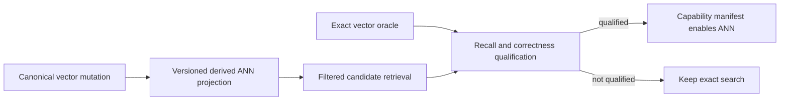

# ADR-019: Managed-first ANN provider qualification

Status: Accepted for the bounded first-party managed HNSW candidate stage on 2026-10-04. Online projection, persisted index format and public ANN capability remain unqualified and gated by later contracts.

## Context and decision

Exact vector scans are the correctness oracle and current public source path. The product prefers a managed-first ANN implementation; a native provider adds deployment, license, persistence, concurrency, deletion, and memory-ownership risks. The selected approach is an independently authored KeyLoad-owned packed managed HNSW candidate for the first computational stage, with no new package, native binary or project. This decision approves implementation of the bounded candidate and its independent real-store tests; it does not qualify recall, an online projection, a persisted format or a public capability.

Select a provider only after a pinned-source audit and real-store comparison against exact search. Required evidence includes recall by filter/selectivity, update/delete/reinsert behavior, concurrent access, persistence/rebuild, memory accounting, and platform/license dependencies. ANN remains optional until the exact oracle and fallback semantics are measurable.

## Alternatives and consequences

- Always scan exact vectors: dependable oracle but scaling cost remains.
- Add an unreviewed native package: rejected until transitive binaries, licensing, and ownership are audited.
- Audited Hnsw.Net 0.1.4: not admitted. Its first vector chunk allocates 256 MiB, search/build lack cancellation and work admission, and pooled visited state has no retained concurrency cap. A consumer-side wrapper cannot supply cancellation inside its synchronous unbounded algorithm. This is a third-party package, not a ManagedCode-owned dependency repair.
- First-party packed managed HNSW: selected as the bounded computational candidate; lifecycle and public integration remain separate qualification stages.

## Related requirements and implementation contract

Related: `REQ-SEARCH-001/AC-SEARCH-001`, `REQ-SEARCH-003/AC-SEARCH-003`, `REQ-SEARCH-004/AC-SEARCH-004`, `REQ-SEARCH-005/AC-SEARCH-005`, `REQ-SEARCH-006/AC-SEARCH-006`, ADR-006, ADR-009, ADR-018, ADR-022. Current source: canonical vectors are document-revision-bound records in `src/KeyLoad.Core/GraphAndSeries.cs`, with the exact oracle in `src/KeyLoad.Query/Search/Queries/QueryExecution/SearchEngine.cs`. The node-local canonical vector and document-revision authority stays outside any provider; Search owns only a rebuildable derived ANN index/projection. The Search slice under `src/KeyLoad.Query/Search/` owns the provider unless a separate assembly is accepted.

1. Freeze provider, license/platform matrix, score/filter API, exact-oracle boundary, and rebuildable generation contract.
2. Add real-store property/differential tests for recall, mutation, deletion, filtered retrieval, concurrency, restart, and corrupted generation rejection.
3. Implement projection generation and provider adapter in Search; never move node-local canonical vector or document-revision authority out of Core.
4. Roll out behind an explicit capability setting; rollback disables the projection and rebuilds from canonical data without changing document state.
5. Qualify the exact candidate source and workload on Linux GitHub CI, retaining scalar portability checks; publish exact source/package versions and resource/quality evidence.

No external ANN package or persisted index format is approved here. The owner-authorized local development workflow applies: actual TUnit tests run through Aspire, and local results remain development evidence. Delivered-source Linux CI, recovery, Docker/Aspire cluster and genuine GitHub comparison gates remain required. The current historical benchmark is not ANN qualification.

## Accepted candidate layers

The computational API, bounds, requirements, acceptance criteria and refinements are frozen in [ManagedAnn](../Features/Search/ManagedAnn.md) and the canonical input seam and outbox pin contract in [ManagedAnnSeed](../Features/Search/ManagedAnnSeed.md). Six heavyweight ANN fixture flows are isolated with unkeyed `[NotInParallel]` (REQ/AC-ANN-013); there is no assembly-wide serialization. The implementation refinements (insertion-work correction, worst-slot cache, bounded dual-heap search, simple DotProduct neighbor selection, packed-owned validation, prepared-value construction, adjacency-count packing, duplicate budget-check removal and the reciprocal insertion invariant) preserve the public contract, canonical data, scores, tie order and every work, deadline and cancellation limit. One current persisted-policy read cut captures owned visible full-space vectors with scalar source/applied/outbox metadata; this seed is a computational input, not pinned replay, a durable generation or public approximation.

1. Computational kernel: the immutable packed computational candidate with independently authored real-ZoneTree metric, budget, filter, recall and rebuild tests. Public exact search and canonical stored data remain unchanged.
2. Native projection: first accept an exact native-generated ZoneTree manifest/chunk and source-cut/outbox replay contract, including atomic publication, locks, leases, cancellation, corruption and crash recovery. Only then implement the node-local disposable projection.
3. Public read: first accept versioned SQL/SDK/MCP approximation, completeness, fallback, eligibility and freshness metadata. Only then integrate an explicit ANN capability with persisted authorization in one scoped read cut and genuine replicated-cluster tests. No silent approximation or branch truncation is permitted.
4. Scale qualification: retain actual loaded corpora, quality/resource counters, normal/scalar reports and exact-source Linux qualification. Global performance still requires the mandated 100,000/1,000,000-record matched GitHub workloads; the kernel's 10,000-record recall control is not that evidence.

Background generation and projection work does not check leadership: Orleans StatelessWorker grains buffer events and, on an Orleans timer whose interval is a typed option, write the batch through the normal grain to ZoneTree owner path. Open ZoneTree handles remain with the silo-local owner.

The algorithm reference is the primary [HNSW paper](https://arxiv.org/abs/1603.09320v4), algorithms 1–5. Code is independently authored within KeyLoad's own source ownership and root LICENSE; no source code or package is imported. The immutable source ordinal seeds bounded geometric levels, base degree is at most twice Connections and upper degree at most Connections. Metric-specific selection uses the unchanged exact similarity oracle: diversification for Cosine/Euclidean and the paper's simple highest-score selection for DotProduct.

Vector-only PutVector updates can preserve DocumentRevision. Projection freshness therefore must bind committed source cuts and actual outbox positions, not only document revision. Logical index identity includes partition, collection, field and the complete VectorSpace; store incarnation and read-generation binding belong to the later projection contract. Orleans routes logical ownership and admission; open ZoneTree handles remain with the silo-local owner.

Rollback of the kernel removes the unused candidate. Projection or public-read rollback disables the derived capability and rebuilds from canonical ZoneTree data without changing acknowledged writes, native WAL or atomic recovery journals. The kernel changes no public wire or persisted data; the projection and public read require their own accepted contracts before implementation.
