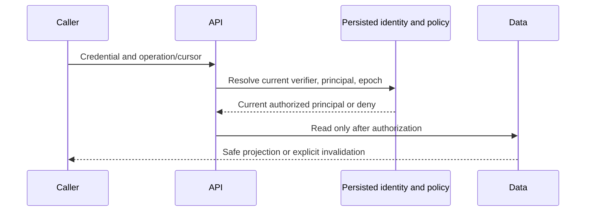
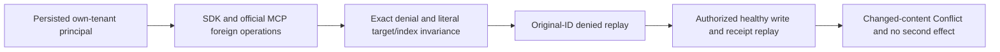
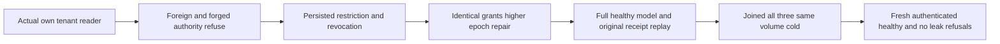
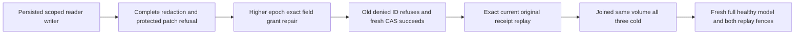
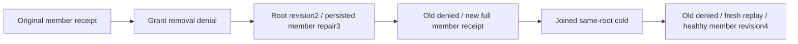

# ADR-022: Policy epoch reauthorization at request and page boundaries

Status: Accepted; full RF3 and all-caller qualification pending.

## Context and decision

Credentials, principals, grants, row restrictions, field classifications, and policy epochs are database-owned. Public callers cannot supply trusted roles. A previously authorized page cursor or cached command receipt must not preserve access after revocation or relevant schema/visibility changes.

Every request resolves identity and policy from persisted state at the authoritative read/apply cut. Signed cursors bind principal and policy epoch plus relevant schema, row-visibility, incarnation, and resource scope. Reauthorization happens before payload projection or cached outcome disclosure. On a stale binding, fail closed with an explicit invalidation response and require a fresh authorized read.

## Rationale, alternatives, and consequences

Long-lived in-memory role caches permit stale grants. Caller-supplied identity/role fields cross the trust boundary and are rejected. Epoch binding adds token invalidation and requires clients to resynchronize after policy changes; that behavior is explicit and safe.

## Related requirements and implementation contract

Related: `REQ-AUTH-004..009/AC-AUTH-004..009`, `REQ-REP-005/AC-REP-005`, `REQ-FEED-002/AC-FEED-002`; ADR-014/015, ADR-029; KL-061..068, KL-066. Current source: `src/KeyLoad.Core/DatabaseEngine.cs`, `MutationAuthorization.cs`, `src/KeyLoad.Security/Features/Authorization/Execution/AuthorizationPolicy.cs`, Query and ChangeFeeds cursor validation.

1. Freeze epoch advancement and the exact state covered by each token/cache within the current persisted and public contracts.
2. Test invalid/expired/revoked credentials, tenant/row forgery, field grants, cursor/cache invalidation, leadership change, and no-effect denial.
3. Implement in Authorization-owned policy/core helpers; Query, Search, EventStreams, Messaging and ChangeFeeds must call common authoritative checks.
4. Validate epoch fields under the current contract; rollback must not reactivate revoked access or accept stale unsafe tokens.
5. Qualify through GitHub TUnit, real-process recovery, and Docker/Aspire RF3 with .NET and official MCP callers; include before/after failover denial.

Current tests include `SecurityAndQueryTests` and `ChangeFeedTests`; path references are traceability, not CI results. Root owns shared host identity and RF3 fixture integration; feature owners own business checks. Dependency: pending ADR-036 cluster foundation.

## TASK-KL015-CROSS-TENANT-RF3-001

REQ-AUTH-KL015-001 / AC-AUTH-KL015-001 supplements REQ/AC-AUTH005/009 and REQ/AC-CLIENT005/006 under existing ADR002/022/039. A persisted non-admin principal belongs to one native tenant, with persisted document read/write/query grants on its resource. Actual SDK and official MCP foreign-tenant GET, bounded full scan, indexed predicate and immutable Batch write must return exact PermissionDenied/safe scope detail and disclose no credential or payload canary. Canonical foreign/owned documents and actual indexed membership remain literal and unchanged after rejection/retry. Same-ID denied replay remains PermissionDenied; authorization precedes fingerprint selection, so different payload under that still-unauthorized ID must likewise remain denied. An authorized healthy command proves exact revision/effect, stable same-ID receipt replay and changed-content Conflict with no second effect.

ADR002 definitive failed writes remain logged: first denied command may advance persisted failure/clock/replica watermark without changing target documents/indexes. Same-ID public retry is stable in result/target effect, not a fabricated global storage position promise. Separate public reads do not guarantee equal cluster-wide cuts while metadata changes; positive cut and complete literal state are checked, and query errors expose no partial page. No pre-submit authorization, product lock, timeout or catalog change is introduced. Telemetry privacy proof remains the real signed native AcOrl012RealSignedOperationsExportBoundedPrivateNativeTelemetry (original4e18 normal/scalar pass), which inspects exported spans/metrics and canaries. This RF3 scenario separately checks actual public failure envelopes; those envelopes alone do not prove every server exporter. Native exact-source execution and original receipts are mandatory before any KL015 closure.

Canonical ownership: IntegrationTests Features/Authorization Cases/Helpers/Assertions. Existing shared ClusterFixture owns Docker/Aspire RF3 endpoints/lifetime; official session is joined with original primary+cleanup errors preserved. Existing standard catalogs/selectors remain unchanged; no LocalImage expansion.

## TASK-KL066-CURSOR-REPAIR-COLD-001

REQ/AC-AUTH007, architecture29.4 and ADR022: extend SAME original `SecurityAndQueryTests.RevocationInvalidatesCurrentPageAndNeverReturnsCachedPayload` through actual revoked epoch2 denial, persisted epoch3 repair with identical original scoped grants, old epoch1 CursorExpired/no native key-value or cut effects, independently full a/b fresh pages under one current cut, genuine same-root cold NodeId/incarnation/current generation and complete native bytes, old epoch1 refusal and fresh complete healthy pages. Original declarations, payloads, defaults/deadlines and initial denial remain. Helpers/PolicyEpochCursorContinuation and Assertions/PolicyEpochCursorAssertions own the finite test-only continuation; no product/public/storage schema or compatibility seam. Direct joined store cleanup preserves original and cleanup failures. Native50 normal/scalar required; Linux/public RF3/all-caller closure remains open.

## TASK-KL066-PUBLIC-CURSOR-COLD-002

REQ/AC-AUTH-007 and AC-RPOL-004: SAME original AcRpol004PolicyAckFencesReadersCursorsAndStaleRetriedUpdatesAcrossRf3 retains V1..V4 resource CAS, field-use refusal, administrator feed/live invalidation, original V3 retry and V4 reader repair. Its bounded test-only continuation adds an actual second acknowledged document, complete independently literal LIMIT1 pages on SDK/official MCP/Q1 SDK/Q1 MCP, persisted field-grant reduction then revoke then higher-epoch identical scoped repair, exact old-cursor refusal/no protected page, full unchanged privileged images and original seed receipt replay. The original warm clients genuinely join before all-three same-volume cold; begin all three restart owners before health waits, acquire fresh clients, compare original node/incarnation and nondecreasing generation/replication Applied separately from physical query cuts, preserve original receipt and complete current pages. Query physical horizon is independently bracketed by full privileged queries on the SAME node, never NodeStatus.Applied. Original deadline, case declaration, API/serializer IDs, grants, quotas and topology remain unchanged. Helpers/PolicyEpochPublic* and Assertions/PolicyEpochPublic* own this finite test-only flow; no product seam, retry, forced checkpoint or compatibility. Native build/discovery then normal/scalar actual RF3/source-image/cleanup and exact-source Linux coverage are required; source is not acceptance closure.

Typed no-page oracle: the direct SDK reference QueryPage failure has null Value; the Q1 SDK Result<JsonElement> failed value is its actual CLR default Undefined, never an object/array page. Both retain exact native problem code and full RFC7807 Problem, together with the exact IsSuccess/default-value refusal fields; do not serialize a failed Result<JsonElement> CLR default as a legacy public wire envelope. This corrects an impossible generic null assumption in the new test helper, changes no decoder/dependency behavior, and does not accept success/unknown/cancellation.

## TASK-AUTH-NESTED-CURRENT-REPAIR-COLD-001 complete original-case continuation

REQ/AC-AUTH-006/007/009: the SAME original NestedSensitiveFieldsAreOmittedAndAliasedPredicateAndSortAreDenied case retains every nested wildcard/odd-name redaction and protected predicate/sort refusal. Existing native SensitiveFieldPolicy defaults require persisted pii.read and pii.use; the continuation uses the same scoped reader at higher epoch2, independently complete original JSON arrays and literal odd.name value, then persisted revoke3 with Unauthenticated/no protected body/no byte/cut effects, repair4 with identical grants and full healthy reads. A genuine root revision1→2 CAS command returns the independently expected mutation receipt, exact same-ID full receipt replay and no second native effect. After actual original store closure, same-root ZoneTree cold reopens with exact NodeId/incarnation and nondecreasing ReadGeneration, complete native byte/cut identity, original receipt replay and complete current JSON/SQL healthy work. The existing TeamRowPolicyAssertions native full-image oracle and existing fatal/primary/cleanup observer are reused. No new product API, serializer/format/clock/quota, cached policy, private caller role or compatibility path. These are native store operations, not a cache-hit or RF3 claim.

Owner 2026-10-11 requires the affected combined batch to run only normal native-SIMD execution under the native50 admission; prior scalar receipts remain immutable history and are not current qualification. Public AcRpol004 remains its exact original declaration/UID/deadline and four routes, with actual fixture-owned all-three cold, fresh persisted policy and joined original warm clients. The public resource-list oracle is the native complete six-field AdminResourceInfo value; existing full V1..V4 ResourceDefinition assertions remain unchanged in the original warm case. Runtime/discovery/source-image/cleanup and Linux gates remain OPEN until authenticated actual execution. Rollback removes only these test-owned extensions and preserves all original cases and failure reports.

## TASK-KL068-FORGED-AUTHORITY-CURRENT-COLD-001

REQ/AC-AUTH-004/005/007/009, AC-MCP-002/003 and original architecture KL068: extend SAME `McpPersistedAuthorizationTests.AcMcp002CrossTenantAndForgedAuthorityAreDeniedWithoutChangingTheDocument`, preserving its original declaration/UID/deadline/native50/fixture and every foreign PermissionDenied, explicit forged principalId/roles Validation, owned Reference/Revision assertion. No new product API, grant type, persisted format, clock, quota, transport fallback or trusted caller role. Native DatabaseCredentialResolver resolves the real bearer through signed Authenticate and persisted state; McpHttpPipeline installs that native principal before endpoint execution. The existing argument decoder continues rejecting supplied authority.

Authorization-owned AdversarialAuthority Contracts/Models/Assertions/Helpers retain two genuine original seed commands and complete actual receipts. Independently literal complete original owned/foreign DocumentResult and MutationReceipt values are required. Full document and OutboxStatus images for both partitions bracket refusal/replay with unchanged semantic values; this is not a native byte or global static-cut claim. The same real own-tenant DocumentsRead principal has persisted grants removed at epoch2, revoked at epoch3, and identical original grants repaired at epoch4. SDK refusals have null Value, exact code and complete serialized-result canary/credential omission. Official MCP PermissionDenied and forged Validation retain exact safe tool envelopes. Revoked authentication is the existing native HTTP401 HttpRequestException BEFORE dispatch, with bounded canonical unauthenticated Problem/no operation header via McpUnauthorizedProbe; it is not a fabricated tool result. Higher-epoch repair does not confer foreign or administrator access.

All warm original clients join with initiating and cleanup errors retained before KillALL→BeginRestartALL→RestartALL→HealthyALL on the same original token and owned volumes. Actual immediately pre-stop/postrestart statuses preserve NodeId/incarnation and nondecreasing ReadGeneration/replication Applied; no copied physical horizon or inferred readiness. Fresh SDK/official MCP callers then require complete literal healthy owned models, foreign/forged refusal with no protected output, and exact original complete seed receipt replay/no second document/outbox effect. Public logical images do not require unchanged replication Applied during legitimate ordered replay.

Ordered integration: this frozen contract and ADR022 appendix → seven feature-local role helpers → same original case body. Shared fixture/ClientApi helpers, persisted policy and connection pipeline remain unchanged. Main writer/build/test/Docker/Git remains root; this packet has native source/API/precreation/guard proof only. Canonical normal native-SIMD50 whole RF3 execution, source/DLL/PDB/image/native UID/cleanup and authenticated Linux evidence are mandatory and OPEN. No forced-disabled/scalar profile or source-only acceptance. Q1, other models, inference/alias/highlight/export/trace and timing/statistics security-domain criteria remain OPEN; this slice does not close KL068. Rollback removes only the owning helper continuation/appendix and restores the exact original case body, retaining original failure history.

## TASK-KL068-SENSITIVE-FIELD-REPAIR-COLD-002

REQ/AC-AUTH006/007/009 and AC-MCP002/003/007 under ADR014/015/022/104/125/117 map to the SAME original McpFieldAuthorizationTests.AcMcp002FieldProjectionAndDeniedPatchHaveTheSameCanonicalAuthorityAcrossClients. Keep every original projected parity/redacted-path/private omission, denied Patch, unchanged projected body and root revision1/private-canary assertion, original UID/deadline/fixture/native50. Add independent full redacted body/metadata, complete failed envelope omission, full privileged document/outbox refusal bracket and genuine persisted higher epoch2 repair retaining identical own-tenant DocumentsRead|DocumentsWrite grants plus only native pii.read/pii.write. No pii.use/Query/foreign/admin promotion or caller-provided role.

Native SensitiveFieldPolicy defaults and AuthorizationPolicy.Project are authority: projection removes denied JsonNode paths and may normalize public Unicode/quote spelling with ToJsonString. Independent literal expected body is compared as COMPLETE semantic JSON values (array/order/null included), every DocumentResult metadata field and omission list exactly, and the original SDK/MCP serialized full-document parity remains. Do not substitute actual JSON into expected data or claim canonical stored-byte proof. Root full public OutboxStatus/document images must remain exact across refusal/replay; global replication/storage positions may legitimately advance for definitive logged errors/ordered replay.

Native DatabaseEngine.ValidateCachedResult refuses an original epoch1 failed command after epoch2 before outcome disclosure. That exact old command remains PermissionDenied/no protected body/no logical effects; healthy work is a genuinely NEW Patch GUID with actual expected revision1. It preserves the entire original public field and changes only /secret to the original conflict-canary value. Independently literal patchDocument/resource/entity/revision2 mutation and complete actual CommitReceipt are retained, and both real SDK/official MCP replay the exact new command with full original receipt/no second effect. No further epoch change is introduced in this slice; READY10 independently covers revoke/repair and cannot qualify this sensitive result.

Original warm clients join before immediately pre-stop full image/status capture and true KillALL→BeginRestartALL→RestartALL→HealthyALL, SAME original token/volumes. Fresh callers after cold require same NodeId/incarnation/nondecreasing actual generation/replication Applied, full literal revision2 raw document, original current epoch2 full receipt replay/no second effect and original epoch1 denied command still refused. Existing authenticated native client/policy/connection/cold APIs only; no new product/format/clock/quota/deadline or compatibility path. Exact native READY10 WithRootAsync is the unchanged shared bounded root HTTP/primary+cleanup owner; all new clients retain initiating/fatal/cleanup failures and throw outside finally.

Ordered dependency: actual READY10 manifest44dde6980f26b86bf04dfc457bcc2d26c3f0f476babef6abfc90880e0a847360 → this current-base append-only ADR/feature contract → eight Authorization role helpers → SAME original ClientApi case. Root alone joins main/build/test/Docker/Git; native source/precreation/guard proof is not runtime qualification. Normal native-SIMD50 original whole RF3, fresh source/DLL/PDB/image/native UID/cleanup and exact-source Linux mandatory gates remain OPEN. Wider Q1, inference/alias/highlights/export/trace/statistics/timing criteria and KL068 overall remain OPEN. Rollback removes only this test-owned continuation while restoring original case body and retaining original reports.

## TASK-KL068-AUTH-CLIENT-OWNERSHIP-004

The original forged-authority/current-policy/cold flow retains its exact clients, order, deadline and assertions. Four SDK CA2000 ownership sites use original nullable locals declared before try; actual Connect/Create is inside try and direct nullable disposal is in finally. Existing initiating/fatal/all-cleanup ledger emits only after finally. No trusted-role, protocol, quota, retry, error or result change; warm owners settle before cold. Native code-fix preflight returned NotFound at each original SDK position. Source repair remains unqualified until integrated analyzer/build and genuine original normal native-SIMD50 RF3/Linux execution.

## TASK-KL068-SQL-LABEL-INFERENCE-COLD-003

REQ/AC-AUTH006/007/009 and AC-GSEARCH006: SAME original SqlGraphSearchRf3Tests.AcGsearch006SqlGraphLabelsUsePersistedFieldGrantAndEmptySetsStayEmpty gains complete labeled-result inference refusal→persisted graph.label.use repair→healthy→revocation→identical higher-epoch repair→joined same-volume cold. Original Test/UID/deadline/fixture/node clients and original PermissionDenied/empty-label/full SDK-MCP parity stay; first original case is byte-exact. No Graph product/seed/helper, signed/persisted/public format, grant scope, clock, quota, retry or timeout changes.

Eight Authorization role owners retain original node2 SDK/node1 official MCP ownership and all initiating/fatal/cleanup errors, direct nullable finally disposal before cold. Exact existing Q1 CALL wrapper adds both Q1 transports. Independent complete alpha/beta/gamma GraphSearchResult documents/ref/revision/body/redaction/omissions/order/RRF scores/null Explanation/null Expansion and exact empty result are required on all four routes. Initial missing label grant refuses all four with no protected page; SDK/Q1 problem/default-value fields and official safe canonical error envelopes omit credential/label canaries. Revoked real persisted principal refuses SDK Unauthenticated and official HTTP401 before dispatch plus original bounded unauthorized probe. Repair restores only original scoped grants and graph.label.use, not raw read/admin/foreign privilege.

Seven independent literal complete original document values and complete OutboxStatus bracket refusals, healthy reads and genuine same-ID epoch4 ConfigurePrincipal replay/no second semantic effect. This is a public semantic model/outbox oracle, not native bytes/global static replication cut. Warm original owners settle before KillALL→BeginRestartALL→RestartALL→HealthyALL. Same-volume cold checks actual pre-stop/postrestart NodeId/incarnation/nondecreasing ReadGeneration/Applied/RoutingReady; fresh clients require complete original results, current policy result replay and unchanged full public images. No QueryPage.Source field or physical/replication cut conflation.

Docs/ADR first→eight new helpers→same original case body; depends only on actually joined AdversarialAuthorityTrial.WithRootAsync (its ownership successor is separately guarded), preserves READY11 sensitive-field packet. Native new-path NotSupported/current existing preview guards precede integration. Runtime/coverage/Linux and wider KL068 inference/statistics/highlights/export/timing domains remain OPEN. No native UID synthesis or source-only PASS; exact focused original normal native-SIMD50 RF3 required before acceptance.

## TASK-KL066-PROJECTION-ORIGINAL-POLICY-004

REQ/AC-AUTH007/008/009, REQ/AC-SEARCH-LINEAGE-WHOLE-001 and original AC-LINEAGE-003 require current persisted worker policy before disclosing a cached projection outcome. Extend SAME original EventProjectionReplayTests.AcLineage003NativeReopenPreservesEffectLineageAndStableReceipt after every original assertion. Capture its genuine original CommandId before first Apply. Real ConfigureWorker revocation makes that exact original success retry Unauthenticated without altering the full native row image or cut. Persisted repair advances the policy epoch: original success remains PermissionDenied under existing ValidateCachedResult, never rewritten or disclosed as current authority. Healthy continuation MUST use a genuinely NEW ID at the repaired epoch. Existing canonical effect reuse preserves the original full mutation receipt/vector/18-field lineage; its genuine new outcome/clock is not misreported as globally no-effect.

After actual new-ID settlement, same-ID replay must retain full receipt and exact complete raw rows/cut. Real native text and vector reads independently match complete redacted literals through the prior CLASSIFICATION-WHOLE-001 helper. Dispose/join the original provider before genuine same-root Harness.Reopen; check actual NodeId/incarnation/nondecreasing ReadGeneration, complete canonical rows/cut, old-ID PermissionDenied, current new-ID full receipt/no-effect replay, exact original lineage/vector and full fresh native text/vector result. Original constructor/fixture disposal and failures remain; provider directly disposes on success and preserves initiating plus cleanup errors on refusal.

Owner paths: Unit/Search/Cases/EventProjectionReplayTests.cs and new Helpers/ProjectionOriginalPolicyContinuation.cs; Search feature and ADR022 append only. Dependencies READY5→corruption4→RF3oracle3 docs; exact native ApplyCommittedCommand/ExecuteAndBuildOutcome/ReplayCommand/ValidateCachedResult/PersistCommandOutcome implement the unchanged product contract. No new API, token, aliases/Ids, stored format, grants, quota, clock, cancellation/deadline, retry or policy relaxation. Rollback removes only this test-owned continuation and original-ID capture, preserving all original assertions. Required unchanged native normal-SIMD50 selector /*/*/EventProjectionReplayTests/AcLineage003NativeReopenPreservesEffectLineageAndStableReceipt and full Linux gates remain OPEN; private native preview/source is not execution/PASS or completed KL066/067.

## TASK-KL068-LATER-LEAF-INFERENCE-CURRENT-COLD-005

REQ/AC-AUTH005/007/009, REQ/AC-PQUERY002/006 and original KL068 cross-interface row inference: SAME AcPquery002LaterPersistedLeafDenialReturnsNoSdkOrMcpPageAndLeavesNextReadHealthy preserves original Test/UID/deadline/fixtures, node1SDK/node2official clients, later-leaf PermissionDenied and original administrator first-leaf complete healthy oracle. The two real database partitions are SAME tenant/physical RF3 owner; replicas are not independently placed query shards. No request/public/storage/authorization/placement/default contract change.

After original denial/no protected partial page through SDK/official MCP/both Q1 routes and full unchanged two literal source documents/complete per-partition OutboxStatus, persist ONLY the missing second DB resource DocumentsRead|Query scope at epoch2. Require complete independent merged row references/revision1/value-only JSON, exact order, present initialized empty omissions/no redaction/null Sources and Version1/Complete true on all4. Exact two ordered leaf partitions carry actual nonnegative separate cuts, current principal PolicyEpoch, original resource SchemaVersion1 and bounded-full-scan access path. Native leaf WithQueryView captures principal/resource/owner evidence and QueryCandidateReader has no equality index input; no synthetic global cut, replica-Applied comparison or production-derived expected rows. Original full PartitionQueryRf3Assertions oracle is retained as an additional check.

Persist second-scope reduction3 and require whole-page PermissionDenied/no effect on all4. Persist revoke4 and require SDK/Q1 Unauthenticated/default no value; official HTTP401 before dispatch and original bounded safe unauthorized probe. Repair5 restores exact original two scoped grants with original tenant/identity/field/row/team state and no administrator privilege. Retain genuine root ConfigurePrincipal command/full native PrincipalRecord result; same-ID replay requires exact original current result and unchanged model/outbox. All failures omit credential and original protected row IDs/body canaries.

Join all original warm clients, capture actual immediately pre-stop statuses/model images, KillALL→BeginRestartALL→RestartALL→HealthyALL on owned same volumes/token, then fresh callers require same NodeId/incarnation and nondecreasing generation/Applied, current routing ready, complete original images/full all4 healthy merged rows and actual original policy command replay. Original parameterless NotInParallel class is globally exclusive under pinned TUnit1.73.19, not merely a fixture key; no scheduling weakening. Initial/source helpers, pure query/merge/storage/Graph/Events/Queue/ANN/HybridExplain/distributedsearch code stay unchanged.

Docs/ADR first→eight Authorization role owners→same original case body; actual existing WithRootAsync reused, other sealed sensitive/SQL-label packets remain independent. Native API/new-path NotSupported/existing preview N/current guard/reconstruction are source proof only. Canonical current SDK analyzer/build, normal native-SIMD50 genuine RF3, Linux source/DLL/PDB/image/native cases/cleanup/coverage and wider shared timing/statistics noninterference remain OPEN. No source-only PASS/closure or unsupported highlights/export/statistics seam.

## TASK-KL068-LEXICAL-CLIENT-OWNERSHIP-006

Eight actual CA2000 acquisition sites in AdversarialAuthorityTrial, SensitiveAuthorityClients and SqlLabelAuthorityClients replace the previously unqualified nullable/direct-finally pattern with native lexical using/await-using. Same actual node clients/acquisition order/reverse disposal, signatures, operation branches, full assertions/receipts and deadlines. Body failures are recorded before implicit child disposal; surrounding catches retain actual child acquisition/disposal failure before parent disposal; final catches retain parent acquisition/disposal errors. Original fatal/nonfatal classification and exception identities remain, and existing ServerFailureObserver emits only after all scopes settle. No detached ownership, suppressions, retry, quota or protocol change. Warm clients join before original cold. Adversarial owning operation body factors privately to stay within nesting bounds without changing any operation. Original eight native code-fix checks returned NotFound; integrated SDK/native analyzer/runtime evidence remains required and OPEN. Prior packets/failures remain immutable history.

## TASK-KL068-SQL-BETWEEN-CURRENT-COLD-007

REQ/AC-AUTH006/007 and AC-SQLC006A under ADR022/054 retain SAME SqlBetweenBudgetAndAuthorityTests.AcSqlc006ABothBoundFieldsAreAuthorizedBeforeRangeExecution, original two protected-bound denials, administrator result/cut and case identity. Actual persisted use-only epoch2 permits the range but independently requires number-only revision1 JSON with ordered /lowerBound,/upperBound redactions; read+use epoch3 requires full original literal body. Revoke4 refuses without complete native-image/cut effects, identical scoped repair5 returns full healthy page. Joined same-root native close/reopen preserves NodeId/incarnation, nondecreasing read generation and all original native bytes/cut; cold reduce6 and repair7 verify current projection/privacy. No new write grant, product field, clock, quota, callback or synthesized receipt. Feature-owned Continuation/Results/Cold retain original and all joined cleanup failures. Source-only supporting Unit flow; actual native SIMD50 execution and Linux/public SDK/MCP/Q1/RF3 matrix remain OPEN.

## TASK-KL068-DISCOVERED-SESSION-CURRENT-COLD-008

REQ/AC-AUTH004/005/007/009 and AC-MCP002 under ADR022 retain SAME original McpPersistedAuthorizationTests.AcMcp002CurrentPersistedPrincipalControlsEachCallAfterDiscovery, Test/UID/deadline/scenario/credential, exact ListTools-before-read and original dispatched PermissionDenied/new-request-ID/canary/SDK denial. SAME official Node2 client survives actual persisted repair3, revoke4 and identical scoped repair5; no cached discovered session authority or reconnect masks current policy. SDK Node1 and official MCP require independent full original DocumentResult, no value on errors, native revoked HTTP401/header-free probe and complete root document/OutboxStatus no-effects brackets. Retain real repair5 ConfigurePrincipal GUID/full result for exact SDK same-ID replay before/after cold; official MCP continues actual document operation, not an invented policy envelope. Warm client owners join, all3 owned volumes Kill→BeginRestart-all→Restart-all→healthy, real current pre/post NodeStatus binds same NodeId/incarnation/nondecreasing generation/Applied and fresh current callers recover full literal document/outbox/replay. Parameterless class NotInParallel prevents parallel shared-fixture cases under pinned TUnit1.73.19; cross-process heavy1 remains mandatory. No new public/persisted field, role/clock/default/grant promotion, retry/deadline change or product cause claim. New feature-local State/Protocol/Values/Refusals/Flow/Clients/Cold preserve all original+cleanup errors through lexical ownership. Native preflight/preview/actual source/image/UID/normal-SIMD50/Linux/RF3 remains OPEN; native outage draft is not a sealed runtime-qualified packet.

## TASK-KL068-CREDENTIAL-CURRENT-COLD-009

REQ/AC-AUTH004/007/009, AC-MCP002 and ADR022 extend SAME McpCredentialLifecycleTests.AcMcp002PersistedCredentialChangesRejectTheClientAfterDiscovery original false/true Args/UIDs/deadlines/ListTools/original real-past ExpiredOffset and initial SDK/MCP401/privacy/admin-revision assertions. Source-confirmed ExecuteConfigureApiKey validates current persisted active principal, protected/verifier/identifier/movement fences then exact native PutRecord; administrator repair stores the genuinely original credential without new key, grant, role, epoch, clock, fallback or schema. Retain actual booltrue ACK/stable commandGUID and full SDK sameID bool replay; SAME old official client and SDK become healthy only after actual repair, with independent full DocumentResult and actual complete rootdoc/OutboxStatus noeffects brackets. Only common Discovery Values are reused; original MCP→native401 probe→SDK refusal ordering remains exact; its principal mutation/replay/cold are not executed. Warm owners joined→all3samevolume cold with actual status identity/generation/Applied/routing→freshfullhealthy and original credential repair replay. Lexical failure scopes retain all initiating/fatal/cleanup errors. Source-only supporting public acceptance extension; actual source/image/UID/SIMD50/Linux/RF3 and wider matrix remain OPEN. Required docs/source predecessor is READY10 Discovery after READY6 BETWEEN; no inventories or public/native fields changed.

## TASK-KL068-INITIAL-CREDENTIAL-CURRENT-COLD-010

REQ/AC-AUTH-004/009 and AC-MCP-002: the original two missing/unconfigured credential instances retain their initial HTTP401 and native probe. A separately persisted minimal scoped reader exercises complete literal SDK/official-MCP document reads and original acknowledged command/full-receipt no-effect replay. The original invalid credential remains invalid before and after all-three same-volume cold. Original warm clients join before cold; fresh clients verify full retained document/outbox images, current native status identity and healthy continuation. CredentialAuthorityCold factors only its unchanged restart sequence for reuse. Original deadlines, native50/heavy1 admission, SIMD, persisted trust and all failure ledgers remain unchanged. Source/discovery is not runtime or Linux qualification; the exact initial-case local-image enrollment and actual RF3 gate remain OPEN.

## TASK-KL066-LIVE-CURRENT-POLICY-COLD-001

REQ/AC-AUTH-007 and REQ/AC-FEED-002/003/005 under ADR022 retain the original PolicyChangeAndRowAclChangeRequireANewSnapshot method and every original ACL/epoch assertion. The joined SQL PolicyEpochCursorContinuation already covers SQL page revocation/repair/cold; do not duplicate it. This exact scalar-live case currently ends at epoch2 invalidation.

Extend after that original denial: actual persisted reader revoke epoch3 rejects both fresh snapshot and original post-ACL continuation with Unauthenticated, no returned page and complete native key/value+position unchanged. Persist root-owned revision2→3 CAS of the same original document back to ownerAlice, unchanged original statusopen JSON; original full CommandRequest/CommitReceipt is retained. Persist reader epoch4 repair with identical original scoped Query+DocumentsRead+ChangesRead grants and Alice restriction. Both original epoch1 live cursors (before and after the ACL change) remain TokenInvalidated. A genuinely fresh authorized snapshot is independently exactly a/revision3/statusopen/unredacted/empty omitted fields/no Sources, logical horizon3 and actual local cut.

Acknowledged root revision3→4 replacement with statusclosed produces exact sequence4 Remove/revision4/nullRow under the fresh epoch4 cursor; same-ID root command returns full original receipt without a second effect. The consumed cursor yields full empty terminal page and complete ordinary query rows empty. All refusal/read/replay brackets retain complete original native bytes/current physical cut.

Genuine joined Store closure then same-directory native reopen uses original validated options and the original configured factory, retaining NodeId/incarnation, nondecreasing ReadGeneration, complete native bytes and exact position. Fresh current persisted authorization still rejects original post-ACL epoch1 cursor; epoch4 original cursor repeats exact acknowledged Remove/commit/entity/revision/null row under its current local cut. Original root command replays full receipt without effects. Fresh authorized snapshot/query remain empty. Cold owned store closes before original fixture cleanup; original operation and cleanup errors retained via existing observer with lexical store ownership.

Test-only scope: Authorization helper plus the one disjoint original LiveQueryTests callsite; no product/API/format/quota/clock/cached trust/change of deadline/default. Case-file preimage is explicitly pending KL079 READY4 postimage, preserving its separate retention extension. Native preview against current Main checks an equivalent disjoint callsite patch; final root join requires exact predecessor guard. No new TUnit case or fabricated UID. Focused normal nativeSIMD50 compilation/discovery/runtime, current-process/RF3/Linux/coverage remain OPEN.

## TASK-KL015-STANDARD-ASPNET-AUTH-001

Native snapshot 135dd266dcb24f519b6e254009589803 proves ServerConfiguration has no Authentication/Authorization registration or middleware. DatabaseIdentityMiddleware currently authenticates by native signed connection request and stores PrincipalRecord only in Items.

REQ-AUTH-ASPNET-001: one ASP.NET Core authentication scheme resolves the credential through the existing DatabaseCredentialResolver, actual connection-owned Orleans Authenticate request and persisted quorum authority. Its ticket contains only the actual persisted principal identifier, never role/capability claims.
AC-AUTH-ASPNET-001: genuine SDK/MCP valid, absent, malformed, revoked and expired credentials retain original success/problem/no-effects oracles; standard authentication is observable on the actual public request, credential resolution happens once.

REQ-AUTH-ASPNET-002: standard authorization requires authenticated identity on the existing public database/MCP boundary. Static GET/HEAD allowlist, health and internal signed-peer boundaries retain their exact existing scope.
AC-AUTH-ASPNET-002: supplied role headers or ClaimsPrincipal cannot create database authority; persisted revoke/repair affects the SAME SDK/MCP connection; health/internal visibility cannot grant public data access.

REQ-AUTH-ASPNET-003: existing Core signed authorization, current policy epoch and native Orleans RequestContext remain authoritative for every operation.
AC-AUTH-ASPNET-003: exact denied business outcome, unchanged canonical models/receipt, authorized repair, fresh operation, original replay and same-volume cold remain full independent oracles.

Implementation reservations:
- existing ServerConfiguration.cs: AddAuthentication/AddAuthorization; explicit UseRouting before owned identity admission, explicit global UseAuthentication after it (prevents WebApplication implicit earlier authentication), root UseAuthorization after exact exempt MapWhen/EndpointMiddleware branch. Both standard extension methods are explicit on the root builder; implicit earlier middleware must not escape admission.
- existing DatabaseIdentityMiddleware.cs: original HTTP lease/body/error owner calls standard AuthenticateAsync, binds actual native principal; no direct alternate authenticator.
- existing McpHttpPipeline.cs: retain original McpRequestState, register private state before authentication, reuse its Authenticate once inside scheme; retain body/header/admission/disposal.
- new Authorization/Identity/DatabaseAuthenticationHandler.cs: native three-argument AuthenticationHandler<AuthenticationSchemeOptions>, original decoder/current token/errors.
- new Authorization/Identity/DatabaseAuthenticatedPrincipal.cs: private nonserialized feature contains only native principal; no trusted caller flag.
- new Authorization/Hosting/DatabaseAuthenticationComposition.cs: one scheme/default fallback RequireAuthenticatedUser and original closed public path classification.
No new packages, persisted fields, public routes, issuer, serializer aliases, user store, Azure Identity, parallel policy dispatcher, role authority or deadline.
ASP.NET authentication is HTTP admission only; tickets do not cache persisted permissions. Current native operation/receipt authorization is unchanged.
Runtime gates: owning compiler, actual standard-pipeline Unit operations, existing credential/context SDK/MCP RF3 cold/replay on exact new source, Linux qualification all OPEN. No previous cohorts promoted.

## TASK-AUTH-ASPNET-MCP-MUTATION-001

REQ/AC-AUTH-ASPNET-002/003 retain the original AcMcp002CurrentPersistedPrincipalControlsEachCallAfterDiscovery case and its actual three-node Aspire owner, native authenticated context, deadline and cold/replay operations. StandardAspNetAuthorityTrial currently adds forged role/principal headers to both SDK and official MCP connections but its mutation denial is SDK-only. Extend that same complete operation with official MCP Commit using the identical SDK-denied CommandRequest, then changed content under SAME CommandId: current persisted read-only grants must return PermissionDenied before effects/fingerprint conflict. Require complete structured error/real dispatch identity, no credential/private canary, independently unchanged literal document and every OutboxStatus field after EACH rejection. Keep existing healthy read, persisted revoke/repair and immutable repair receipt replay; same-volume cold reexecutes this same genuine refusal and healthy continuation. No new UID, credential/issuer/ClaimsPrincipal authority, role flag, scheme, public contract, storage format, deadline or quota.

Source ownership: IntegrationTests/Features/Authorization/Helpers/StandardAspNetAuthorityTrial.cs only; standard Server scheme/fallback and current Core/native context remain unchanged. Existing current-principal discovery/revocation, credential absence/expiry, RequestCqrs scope restoration and ConnectionAwaitedSettlement two-principal operations remain independent original mappings. Standard ticket once-per-request observability and exact-source Linux execution remain OPEN; source review alone is not runtime/coverage/task closure.

## TASK-AUTH-CONCURRENT-COMPLETE-RESULT-001

REQ/AC-AUTH-ASPNET-003 and REQ/AC-AUTH-004/005 preserve AcMcp002DistinctOfficialClientsKeepTheirOwnTenantsDuringConcurrentCalls, its existing arguments/UID/keyed Aspire fixture, four concurrent original calls, unique native identities and every old rejection/canary assertion. Require independently literal FULL DocumentResult (actual reference, revision1, original exact JSON, Deleted=false, empty original metadata) for both successful official SDK results, rather than Reference-only equality. Capture both canonical documents and both complete OutboxStatus DTOs with the existing genuine root SDK before requests and after both foreign PermissionDenied responses. Compare complete native/public serialized content on the SAME original capture owner; do not strip cut or counter fields. Send following healthy owned reads through each SAME original official client, check full literal results and complete image again. No write/capability repair is needed because each original persisted grant remains correct; no extra cold or duplicate case substitutes for the distinct existing revoked/repair/cold owners.

New assertion helper owns only actual root SDK reads/full serialization and independent document literals; no test issuer, fabricated principal, fake outcome/image/cut, provider/migration, new scope, capacity or deadline. Existing native RequestContext signatures remain the authority; four overlapping official operations remain overlapping. Runtime/compiler/native50/SIMD/current-source Linux gates remain OPEN. Source ownership: existing ClientApi/Cases/McpConcurrentIdentityTests.cs and new Authorization/Assertions/ConcurrentPrincipalAuthorityAssertions.cs.

## CLIENT005 current-policy receipt replay after actual member repair (2026-10-12)

REQ/AC-CLIENT-005 and REQ/AC-AUTH-007: SAME original AcAuthReplay001RemovedGrantRejectsCachedSuccessWithoutChangingItsReceiptOrClock preserves original grant-removal denial, native outcome bytes/clock/full inventory and original root revision2. Independently validate the original full receipt, then repair SAME member at epoch3 with identical scoped DocumentsWrite grant. Old epoch1 receipt remains PermissionDenied/no protected result/no native effects under ValidateCachedResult; no public success is inferred from retained local outcome bytes. A NEW member revision3 command returns independently literal complete receipt/document and exact same-ID original-result replay/no second effect. Join original resources, reopen actual same-root native ZoneTree/current-format owner, compare exact identity/current bytes/position and nondecreasing ReadGeneration; old denial and fresh replay persist, followed by genuine member revision4/complete replay and literal body. The existing declaration/UID/deadline/native50/normal SIMD remains; no new API/format/clock/limit, compatibility or trusted roles. Native compiler/discovery/runtime/Linux/public/RF3 gates remain OPEN until authentic execution.

## TASK-AUTH-ASPNET-MALFORMED-CREDENTIAL-001

REQ/AC-AUTH-ASPNET-001/003 and REQ/AC-AUTH-004 preserve both original AcMcp002NativeDiscoveryRejectsMissingAndUnconfiguredCredentials arguments and UIDs. Native current DatabaseCredentialResolver accepts only the exact Bearer prefix before dispatch. Existing complete initial-credential flow covers absent/unknown keys, healthy SDK/official MCP, original write receipt replay and same-volume all-three cold, but does not submit a malformed prefix with an actually valid stored key.

Extend its existing refusal owner with two real protected /mcp requests: unsupported Basic scheme carrying that persisted key, and Bearer without its required separator/key. Neither may adopt that otherwise valid principal. Require HTTP401, absent operation request header, the complete independent five-field Unauthenticated Problem with detail `An API key is required.`, existing error-byte bound and absence of key/document canaries. Compare the complete original document and every OutboxStatus field after EACH refusal; then retain the existing healthy SDK/official MCP reads and acknowledged write replay. The same original cold owner repeats these requests and complete healthy/replay checks. Original deadlines, arguments, native50/SIMD, actual Aspire endpoints and disposal remain unchanged. No new case/UID, endpoint, scheme, provider, test issuer, trusted role, quota, format or product behavior change.

Once-per-request credential resolution remains OPEN: neither a cached AuthenticationTicket feature nor a global phase histogram provides a request-bound execution count, and the existing telemetry fixture does not run production authentication. This packet does not claim that criterion or runtime/Linux qualification.

## TASK-CLIENT-MCP-CANCELLED-IMAGE-R86

REQ/AC-CLIENT-005/006 and REQ/AC-AUTH-ASPNET-001/003 retain the original McpDiscoveryTests.AcMcp005CancelledNativeReadDoesNotPreventTheNextRealCall declaration, UID, keyed Aspire fixture, deadline, pre-cancelled official capabilities read and following capabilities assertion. Seed a uniquely owned real persisted document through the existing SDK scenario, independently require its complete literal revision1 DocumentResult and capture every OutboxStatus field on Node3 before cancellation. After the actual original OperationCanceledException, the complete image must remain unchanged. The genuine SDK and SAME original official MCP client must then each return the independently literal full document, with complete image equality after each read. No reduced cut/counter oracle, fake task, dispatcher, provider, identity/role authority, new limits, transport schema or format change.

This covers caller cancellation before official invocation only. It does not establish server callback cancellation, handler lookup count, disconnect settlement, cold durability or a fresh runtime/Linux PASS. Those criteria keep their original separate operation mappings. Source ownership is the unchanged existing ClientApi case and feature-local Authorization/Assertions/CanceledCredentialAuthorityAssertions, with the child contract docs/Features/Authorization/StandardPipelineCancellation.md. Original HTTP/client/token owners remain lexical and joined; native50/default SIMD and fresh-image discovery/compiler/runtime remain required.

## TASK-AUTH-ASPNET-REQUEST-OBSERVATION-001

The existing standard ASP.NET scheme may borrow a nonserialized internal fixture observer only through explicit internal composition. It observes the original native Authenticate execution and the validated subject-only ticket, without credential/payload/role-value export or additional database work. It never supplies principal authority or caches permissions. Dedicated real HTTP/SDK/official MCP calls retain current persisted principal/resource policy, credential revoke/expiry, safe refusal, exact repair, original acknowledged receipt replay and two fully joined same-volume cold cuts. See [the stable child requirements and operation map](../Features/Authorization/RequestBoundAuthenticationObservation.md). Native six-host support is not Aspire/Docker RF3 qualification; all current compilation/runtime/Linux gates remain open until their original evidence exists.

## TASK-KL066-DIRECT-AST-CURSOR-COLD-003

REQ/AC-AUTH-007 and AC-RPOL-004 under ADR-022 preserve the SAME original AcRpol004PolicyAckFencesReadersCursorsAndStaleRetriedUpdatesAcrossRf3 declaration, persisted principal/resource CAS and original receipts. Its current four-route continuation directly tests SQL SDK/official MCP and EXEC SQL wrappers; it lacks direct QueryAst SDK/official MCP cursor consumers. Extend the same route-count-owned operation with two typed AST consumers using independently declared star projection, native document MetadataIdPath ordering and LIMIT1. Original SQL callers use current T-SQL TOP1/TOP2 while retaining exact query shape/cursors/full rows. No public DTO, serializer, policy, cursor or product change.

Each route obtains literal full first/second pages, retains its original signed cursor and physical cut, then observes privileged complete literal data/resource state after every page. Same live callers see persisted field-grant reduction and stale CursorExpired without protected page, actual principal revoke/Unauthenticated, higher-epoch identical scoped repair, old-cursor refusal and fresh healthy full pages. Preserve original first seed receipt replay and complete privileged images after EVERY refusal. The original clients join before two SAME original state/all-three same-volume cold invocations; each retains node/incarnation/current generation/Applied and physical query cuts as separate witnesses, reopens genuine SDK/official clients, refuses old cursors, returns full fresh literal pages and replays original receipt. Original token/deadline/fixture attributes and unrelated QueryOnlyEpochR46 operation remain unchanged.

Automated map: original ResourcePolicyUpdateRf3Tests; PolicyEpochPublicProtocol/Calls/Assertions/Refusals/Cold. No new case/UID or mocked provider, trusted role, deadline/quota increase, memory/counter/power-loss claim. Native source preview, compiler, actual original whole-flow and exact-source Linux RF3 remain separate OPEN gates.
