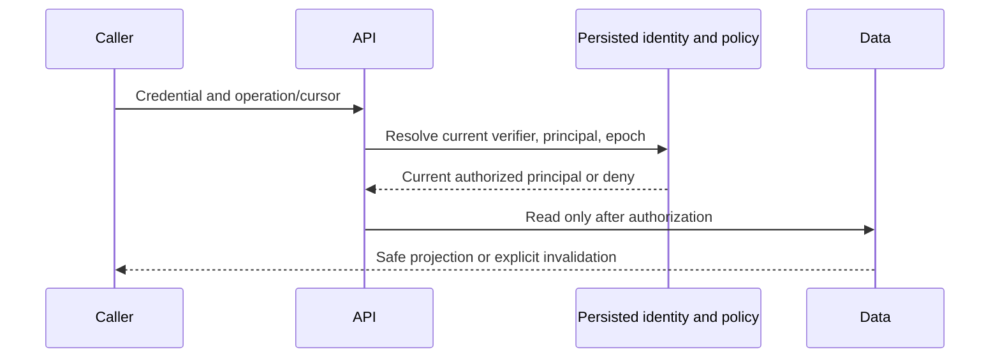

# ADR-022: Policy epoch reauthorization at request and page boundaries

Status: Accepted; full cluster and all-caller qualification pending.

## Context and decision

Credentials, principals, grants, row restrictions, field classifications, and policy epochs are database-owned. Public callers cannot supply trusted roles. A previously authorized page cursor or cached command receipt must not preserve access after revocation or relevant schema/visibility changes.

Every request resolves identity and policy from persisted state at the authoritative read/apply cut. Signed cursors bind principal and policy epoch plus relevant schema, row-visibility, incarnation, and resource scope. Reauthorization happens before payload projection or cached outcome disclosure. On a stale binding, fail closed with an explicit invalidation response and require a fresh authorized read.

## Rationale, alternatives, and consequences

Long-lived in-memory role caches permit stale grants. Caller-supplied identity/role fields cross the trust boundary and are rejected. Epoch binding adds token invalidation and requires clients to resynchronize after policy changes; that behavior is explicit and safe.

## Related requirements and implementation contract

Related: `REQ-AUTH-004..009/AC-AUTH-004..009`, `REQ-FEED-002/AC-FEED-002`; ADR-014/015, ADR-029. Current source: `src/KeyLoad.Core/DatabaseEngine.cs`, `MutationAuthorization.cs`, `src/KeyLoad.Core/Authorization/Execution/AuthorizationPolicy.cs`, Query and ChangeFeeds cursor validation.

1. Freeze epoch advancement and the exact state covered by each token/cache within the current persisted and public contracts.
2. Test invalid/expired/revoked credentials, tenant/row forgery, field grants, cursor/cache invalidation, node failover, and no-effect denial.
3. Implement in Authorization-owned policy/core helpers; Query, Search, EventStreams, Messaging and ChangeFeeds must call common authoritative checks.
4. Validate epoch fields under the current contract; rollback must not reactivate revoked access or accept stale unsafe tokens.
5. Qualify through GitHub TUnit, real-process recovery, and Docker/Aspire cluster with .NET and official MCP callers; include before/after failover denial.

Current tests include `SecurityAndQueryTests` and `ChangeFeedTests`; path references are traceability, not CI results. Dependency: [ADR-036](ADR-036-orleans-foundation.md).

## Standard ASP.NET Core authentication and authorization

REQ-AUTH-ASPNET-001: one ASP.NET Core authentication scheme resolves the credential through the existing DatabaseCredentialResolver, the connection-owned Orleans Authenticate request and persisted authority. Its ticket contains only the persisted principal identifier, never role or capability claims.
AC-AUTH-ASPNET-001: genuine SDK/MCP valid, absent, malformed, revoked and expired credentials retain their success/problem/no-effect oracles; standard authentication is observable on the actual public request and credential resolution happens once.

REQ-AUTH-ASPNET-002: standard authorization requires an authenticated identity on the public database/MCP boundary. The static GET/HEAD allowlist and health endpoints keep their exact existing scope.
AC-AUTH-ASPNET-002: supplied role headers or a ClaimsPrincipal cannot create database authority; persisted revoke/repair affects the same SDK/MCP connection; health or internal visibility cannot grant public data access.

REQ-AUTH-ASPNET-003: signed Core authorization, the current policy epoch and Orleans RequestContext remain authoritative for every operation.
AC-AUTH-ASPNET-003: the exact denied business outcome, unchanged canonical models and receipt, authorized repair, fresh operation, original replay and same-volume cold restart remain complete independent oracles.

ASP.NET authentication is HTTP admission only; tickets never cache persisted permissions. The scheme is registered with `AddAuthentication`/`AddAuthorization` on the root builder, with `UseAuthentication` after the owned identity admission and `UseAuthorization` after the exempt-path branch. No new package, persisted field, public route, issuer, user store, Azure Identity, parallel policy dispatcher or role authority is introduced.
