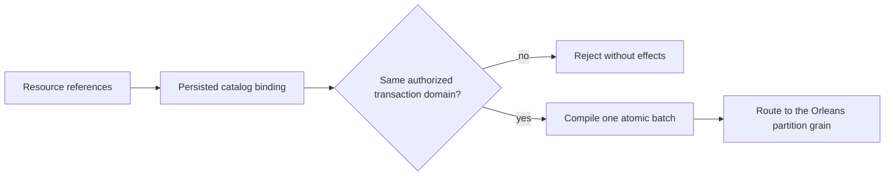

# ADR-024: Catalog-bound shared TransactionDomain

Status: Accepted; complete replicated-cluster qualification pending.

## Context and decision

Atomic document, event, and local queue effects require a server-verified shared transaction scope. Equal literal partition keys must not merge resources from different tenants, databases, transaction domains, or partitions. The atomic partition is a logical identity, independent of which silo hosts its Orleans partition grain.

Resolve every resource through the persisted catalog and bind it to a `TransactionDomainId` and atomic partition before compilation. A multi-resource batch is atomic only when all participating resources resolve to the same permitted atomic scope. Cross-domain or cross-partition effects fail before partial apply. Orleans may move the partition grain activation between silos without changing the atomic identity or its committed state.

## Alternatives and consequences

Partitioning only by a user-supplied string is rejected because it permits accidental cross-resource aliasing. Equating the silo that hosts a grain with the atomic partition is rejected. Catalog validation makes stale bindings explicit and requires the catalog binding to participate in recovery checks.

## Related requirements and implementation contract

Related: `REQ-DSTORE-001/AC-DSTORE-001`, `REQ-DSTORE-004/AC-DSTORE-004`, `REQ-EVENT-004/AC-EVENT-004`, `REQ-MSG-005/AC-MSG-005`, `REQ-FEED-001/AC-FEED-001`; ADR-001/005, ADR-023/025.

1. Freeze catalog binding, atomic key identity, and cross-resource failure semantics.
2. Test same/different-domain resources, duplicate literal keys, failed mixed batches, and recovery using real stores and the replicated cluster.
3. Implement binding and compiler checks in DocumentStorage/Core, with routing owned by OrleansExecution.
4. Verify catalog bindings before routing; never merge domains.
5. Qualify exact source through GitHub unit, process-recovery, and three-node SDK/MCP tests before claiming replicated-cluster atomicity.

Current identity types and checks are in `src/KeyLoad.Abstractions/Contracts.cs`, `src/KeyLoad.Core/DatabaseEngine.cs`, and `PartitionRef`; `TransactionTests.SameLiteralPartitionKeyCannotCrossTransactionDomains` is existing source evidence. Current delivered-source qualification remains pending.
