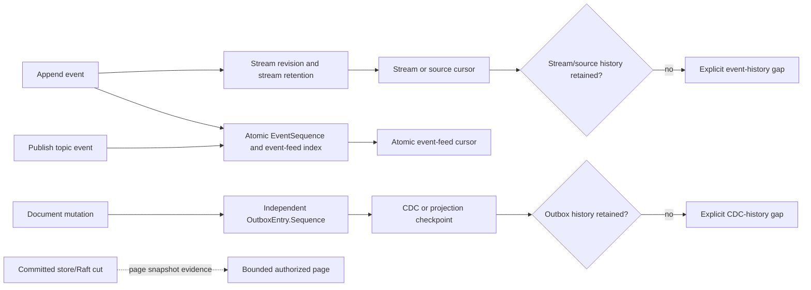

# ADR-025: Stream revisions and stable per-atomic event-feed positions

Status: Accepted; cluster movement and retained-history qualification pending.

## Context and decision

The event, CDC, and commit-order paths have separate position domains. A stream revision orders records within one stream and is its append/OCC and stream-read cursor. Current `Events.cs` allocates a per-atomic-partition `EventSequence` for canonical stream records and stores those records in the `event-feed` index. `EventSources` increments the same partition sequence for topic events while retaining a topic-local source `Position`; its current topic path does not populate the shared `event-feed` index. The product target in section 38.3 requires the stable sequence and feed index to travel with canonical event state. The committed store/Raft cut describes the snapshot at which a page was read, not an event cursor. CDC uses `ProjectionOutbox`'s independent per-partition `OutboxHead.Tail` and `OutboxEntry.Sequence` for document-mutation delivery. Neither event sequence nor outbox sequence is a command sequence or Raft `LogIndex`.

Keep those domains distinct in contracts and ownership. EventStreams owns stream revisions and retained stream history; Messaging owns topic/event-source reads and event-feed sequencing; ChangeFeeds owns the document-change outbox, its cursor/checkpoint, and retention pins. Event/source retention and outbox retention report gaps independently. A source cursor may be scoped to a stream or topic; a future multi-partition atomic event-feed cursor may use a bounded vector of per-partition EventSequence values, but no new wire contract is selected here. Canonical event positions move with canonical event state across physical placement changes; they are not mechanically translated as group-log positions. Invalidate a cursor when its incarnation or ownership epoch is stale; do not translate it across epochs. A read page's committed cut remains separate evidence of read consistency.

## Alternatives and consequences

Using stream revision as an atomic feed cursor fails when streams interleave. Reusing CDC outbox sequence for event-feed order couples independent retention and consumer lifecycles. Treating the committed read cut as a cursor confuses snapshot evidence with continuation. Using raw group-local log indexes fails after movement. Atomic EventSequence gives per-partition event order but exposes filtered gaps and needs event-history retention. Multi-partition vector cursors add bounded state and merge policy.

## Related requirements and implementation contract

Related: `REQ-EVENT-001` (bounded work/deadline/cancellation; `AC-MP-005`), `REQ-EVENT-002` (complete page result limit; `AC-MP-005`), `REQ-EVENT-003` (revisions, retention, and payload/header policy; `AC-MP-005/012`), `REQ-EVENT-004/AC-EVENT-004`, `REQ-EVENT-005/AC-EVENT-005`, `REQ-EVENT-006/AC-EVENT-006`, `REQ-MSG-003/AC-MSG-003`, `REQ-FEED-002/AC-FEED-002`, `REQ-FEED-005/AC-FEED-005`; ADR-023/024/027/030; KL-016, KL-081/083/084/089/098/099. Current source: `src/KeyLoad.Core/EventStreams/Execution/Events.cs` assigns stream revisions and EventSequence; `src/KeyLoad.Core/EventStreams/Execution/EventSources.cs` keeps topic/source Position distinct from EventSequence; `src/KeyLoad.Core/ChangeFeeds/Execution/ProjectionOutbox.cs` assigns an independent outbox sequence; `src/KeyLoad.Core/ChangeFeeds/Execution/ChangeFeeds.cs` reads CDC positions. Product section 38.3 likewise distinguishes EventSequence from StreamRevision, CommandSequence, and Raft LogIndex.

1. Freeze each cursor's domain, fields, retention-gap errors, and movement behavior under the current persisted format; preserve the separation between stream/source positions, atomic EventSequence, outbox sequence, and committed read cut.
2. Test concurrent append/read, expected revision conflicts, filter gaps, retention loss, cursor scope/revocation, reopen, and snapshot movement.
3. Keep stream revisions and canonical atomic EventSequence under EventStreams, topic/source positions and event-feed sequencing under Messaging, and document CDC/outbox positions under ChangeFeeds; token/cursor ownership-epoch handling belongs to ClusterReplication. Canonical event positions move with canonical event state, not as group-log indexes.
4. Validate supported cursor versions and invalidate stale incarnation/epoch bindings; never rewind acknowledged positions.
5. Qualify event and feed behavior through GitHub TUnit, process recovery, and RF3 .NET/MCP tests.

Target ownership is `src/KeyLoad.Abstractions/EventStreams/`, `Features/Messaging/`, and `Features/ChangeFeeds/` for shared contracts; `src/KeyLoad.Core/EventStreams/` for stream revisions and canonical event sequence, `Features/Messaging/` for topic/source positions and event-feed sequencing, and `Features/ChangeFeeds/` for document CDC/outbox sequence; `src/KeyLoad.Query/ChangeFeeds/` for query-facing CDC cursors; and matching `tests/KeyLoad.UnitTests/` slices. Existing unit tests are evidence paths, not passing current CI. Owners: EventStreams/Messaging/ChangeFeeds leads; root owns token and movement integration.

### TASK-KL084-STABLE-STREAM-STAGE-A-001 — current product implementation contract

REQ-EVENT-READ-DIRECTION-001 / AC-EVENT-READ-DIRECTION-001 requires complete independent forward/backward retained-event pages, exclusive bounds, current field/header redaction, byte refusal without partial publication, cancellation/refusal followed by a healthy operation. REQ-EVENT-READ-CUT-001 / AC-EVENT-READ-CUT-001 freezes original traversal tail/floor and snapshot cut, with subsequent append excluded until a new traversal; current CutPosition remains actual same-view position. Original generation/history, signed source feed and every global gate remain mandatory.

ReadStreamRequest IDs0..2 remain unchanged; Direction3 (Forward0/Backward1), MaxBytes4 (0 means original centrally validated MaxBatchBytes), Cursor5 are additive current contracts. StreamPage0..4 remain unchanged; Cursor5 and SnapshotCutPosition6 are appended. Head is the captured immutable traversal head; fresh current head separately proves original range remains available. Complete native result, including cursor/head metadata, must fit the original constrained result budget. Over-budget produces a closed refusal, not a partial page. Native reverse VisitReverseRange retains exclusive LOWER afterKey and exclusive UPPER untilKey, with original counting/cancellation reader. The new undelivered traversal cursor field6 SchemaVersion uses the actual ResourceDefinition.SchemaVersion long type without narrowing; existing alias, field IDs, constructor shape and authorization comparisons remain fixed.

The generated native stream-traversal cursor alias is keyload.core.stream-traversal-cursor.v1: 0Version,1Purpose,2Incarnation,3Stream,4PrincipalId,5PolicyEpoch,6SchemaVersion,7PlacementEpoch,8Direction,9CapturedTailRevision,10CapturedFirstAvailableRevision,11SnapshotCutPosition,12NextExclusiveRevision,13ExpiresAt,14LogicalPlacementRevision,15DirectoryFence. Fields7/14/15 are actual AtomicPartitionPlacementResolution PlacementEpoch/Revision/DirectoryRevision; no scalar reinterpretation. Original owning signer and EventSourceExecutionOptions.CursorLifetime supply MAC/expiry; continuation does not renew original expiry.

Core authenticates current persisted principal and EventsRead before token decode or event payload. On that SAME bounded native view, actual catalog and registered owner/directory/logical placement resolve and verify exact borrowed configured PhysicalShardRecord (including ordered voters), store incarnation, and current selected owner. Original ConnectionReadCapabilities supplies only its existing DI PhysicalShardRecord to the Stream branch. Core verifies the tuple; it grants no caller roles. Public Core request/scalar paths acquire native default catalog authority and refuse if it is not this store; nondefault owner paths must provide genuine configured authority which is revalidated. No administrator-read workaround, fabricated default epoch or parallel dispatcher.

Ownership/mapping: Abstractions EventStreams DTO/enum; Core EventStreams Contracts/Queries/Execution; existing Orleans GrainCoreReadCapabilities + ConnectionReadCapabilities only Stream dispatch; Client current ReadStreamAsync request transport unchanged; existing SDK/MCP/Q1 same public request and complete schema/result controls; Unit native real-store controls and RF3 same-root cold traversal. All original reader/producer cleanup and failure trees remain. Native source preview precedes root join, actual strict fresh metadata and Linux normal/scalar/process/RF3 evidence follow. Stage A does not implement vector-map admission or live registration/backpressure Stage B/C and cannot close KL084. No migration/fallback, policy/deadline/limit change or runtime PASS is asserted.

Stage A boundary details: negative or above-captured-bound AfterRevision and invalid Direction/MaxBytes are Validation, as frozen in the approved traversal proposal; original Limit<1/>MaxResults remains BudgetExceeded. Cursor requests use AfterRevision=0 rather than a second competing boundary. Exhausted traversal returns Cursor=null. The existing scalar Core signature delegates to this one current reader; no retained legacy reader is introduced. UTC expiry control in native Unit tests borrows the original timer/monotonic owner and exact same EventSourceExecutionOptions instance; it is a supporting expiry operation, not natural RF3 time qualification.

## TASK-KL084-PUBLIC-CATCHUP-COLD-001

REQ/AC-EVENT-006 and architecture38.3/KL084: existing forward ReadStream numeric exclusive-revision continuation must not lose an append at an observed empty tail. Freeze one real original stream/generation and append receipt, read its complete three-event catch-up, then start an empty-tail read concurrently with one exact3 append. The race page is validated against its actual committed cut: complete empty old head3 or complete one-event new head4 only. After both original operations settle, consume the original after3 continuation through SDK/official MCP and both Q1 routes, exact independently authored event4/full record/page, empty continuation and immutable original append receipt replay. Current wrong-generation denial on all routes precedes healthy continuation. Dispose original caller owners, kill/restart the same Aspire-owned RF3 resources with original clocks/deadline/roots and native readiness, reconnect fresh clients with same persisted credential, assert unchanged node/incarnation/voters and nondecreasing actual generation, and require the same original continuation and full four-event history/receipt.

This finite test does not claim notification registration, backward read, signed stream cut/cursor, vector cursor/discovery-map or >RAM qualification. Current DTO IDs0Stream/1AfterRevision/2Limit and forward same-cut native operation remain unchanged. Architecture38.3 still requires backward, maxBytes, vector cursor and catch-up/register race; ADR025 explicitly has no chosen vector wire yet. Those are real remaining implementation gates, not replaced by this test or by document CDC cursors. No clock/limit/retry/provider/topology/schema/auth modification; no new operational option. Existing Unit range/work/result/privacy/cancellation/retention tests and process/restore/movement scopes remain mandatory. Exact-source Linux native discovery/source+PE/PDB, normal/scalar original outcomes and joined resources/reader cleanup required. Docs precede source; rollback removes these fixture-only files and appendage coherently.

The existing ReadEventSource stream path already supplies a signed scalar SourceCursor with incarnation, exact source, persisted principal/policy/schema and expiry, plus stable per-atomic EventSequence. This is preserved and exercised: retain its original caught-up cursor before append, consume the identical cursor through all four routes before/after cold, verify complete independent event4 and empty continuation. No claim that this existing scalar token is a vector cursor or stable historical ReadStream cut.

## TASK-KL084-OPERATION-KIND-RESERVATION-001

REQ-EVENT-READ-CUT-001 / AC-EVENT-READ-CUT-001 and the pending KL084 Stage B/C control-map admission reserve the exact native operation values EventFeedControl=36 and EventFeedSourcePhase=37; target-only CommitInbox retains its already frozen value38. These are consecutive distinct operation discriminants, never flags or combinations. The reservation does not implement or qualify Stage B/C.

Before the verified control/source implementation is joined, both reserved operations must remain unavailable: the existing generic CreateNativeOperation factory refuses them with UnsupportedCapability, public JSON normalization records the existing unsupported refusal, and no public endpoint, MCP operation tool or native payload decoder is added by this reservation. Stage B/C must independently authorize actual control36 admission and private source37 execution through the owning trusted receiver; it cannot enable either via the generic public factory. Existing operation identities, aliases, field IDs and receipts are unchanged.

Implementation ownership: Abstractions/Contracts.cs only for these exact enum values, under EventStreams/ADR025 traceability; root composes the declarations after this contract and retains the existing closed factory/normalization branches. The Stage B/C agent rebases its shared declarations rather than duplicating them. Root verifies full build and affected native operation/refusal regressions, then exact-source Linux normal/scalar/process/RF3 complete Stage B/C flows before acceptance. Rollback of this undelivered reservation must remove the related undelivered consumers together; no persisted migration, fallback or legacy path is authorized. Runtime qualification and KL084 closure remain pending.

### TASK-KL084-NATIVE-READ-TRANCHE-001

REQ-EVENTS-VECTOR-PRIVATE-READ-001 maps to AC-EVENTS-VECTOR-PRIVATE-READ-001: purpose-only native EventVectorCoverage69, EventVectorOriginalOutcome70 and EventVectorSources71 run through the current ConnectionReadExecution owner. Generic public read construction refuses these kinds; no public HTTP/MCP/Q1 decoder or tool is added. Existing QueueTransferCoordination72 and every previous ordinal remain unchanged. Current persisted subject authorization, original expiry/cancellation, configured physical owner and same-view catalog/registered placement precede protected native reads. Coverage contains the complete bounded roster/origin/resource/head facts; an actual absent empty-topic head never creates a generation or pin. Source pages preserve all canonical events/cursors/read cuts. Original outcome observation returns actual retained raw native bytes after identity/fingerprint/retained-scope checks and cannot renew or resend a phase.

This source prerequisite implements the three bounded readers and their R7–R21 typed schema/identity/validation dependencies. It does not activate control/source commands36/37, R22 first-issuance state, public vector control/tail tools, remote endpoint or stream provider registration. Those remain required in the complete guarded B/C stage. No new policy values, default authority, migration, fallback or history-release claim. Abstractions owns request shapes; Core EventStreams owns bounded query/validation/identity/serialization; Orleans EventStreams owns signed internal read codec and closed purpose admission, with four additive ClusterRouting joins.

Acceptance is still OPEN: root canonical compiler/analyzers and genuine denied purpose/owner/current-policy/cancel/budget → unchanged full image/cut → fresh healthy complete native coverage/source/outcome operations; cold unknown outcomes must remain observed without resend. Full B/C SDK/official MCP/Q1, source-pin/partial-refresh/release/first-issuance/provider/callback/recovery gates remain mandatory. Native source preview and declared cases do not close any criterion.

### TASK-KL084-NATIVE-READ-CONTRACT-COMPILATION-002

REQ/AC-EVENTS-VECTOR-PRIVATE-READ-001 retains the exact native read ordinals, closed purpose admission, current persisted authorization, bounded same-view reads and original expiry/cancellation. Complete the existing public shape's XML descriptions without changing any field, alias or identity. Keep EventVectorReadEnvelope in the owning EventStreams Serialization role: it validates the same actual read kind before observing the same TimeProvider, uses existing RemoteRead lifetime/incarnation/payload constraints, then applies the original source purpose. The existing GrainRequestCodec method still signs that exact envelope once. Extract only this cohesive construction to keep the aggregate codec within its existing 200-code-line bound; no dispatch, authority, timing, signature, quotas or generated contracts change.

Root integrates these documentation and envelope-construction edits before a fresh native/compiler/formatter stage. Original generic public refusals and all Unit/process/Aspire RF3 source/image/UID gates remain required; source correction alone closes no criterion. Rollback removes only this helper and restores the same body and property documentation coherently. Full B/C remains OPEN.

### TASK-KL084-NATIVE-READ-CURRENT-POLICY-002

REQ/AC-EVENTS-VECTOR-PRIVATE-READ-001 retain the same actual DatabaseEngine.Authorization IAuthorizationPolicy throughout ParentOutcomeRead → ParentObservationRead → ParentLookup → ParentScopes. Active and terminal retained source scopes require current persisted SubscriptionsManage and EventsRead/TopicsRead before protected phase decoding. Cleanup phase validation borrows the same policy instance; it creates no policy, default authority or caller role. The control-partition grant uses the actual requested resource (Scope.Resource, topic or streamSet), preserving the native wildcard-or-exact resource matching API.

The finite Core correction also moves the two local coverage CancellationToken parameters last with all original calls, and names the existing zero values for empty identity text and equal scope ordering. No field, alias, ordinal, receipt, expiry, arithmetic bound or validation sequence changes. Current source gates still require canonical compiler/analyzers and full authorization/refusal/cold/healthy operations; this correction adds no execution or acceptance claim. Docs precede the guarded Core postimages; root alone integrates and verifies.

## TASK-KL084-BOUNDED-NATIVE-PROVIDER-OPERATION-030

REQ/AC scope: approved KL084 B/C advisory-provider admission and disposable native pubsub resource ownership. The purpose-owned EventFeed provider borrows the actual pinned Orleans10.4 MemoryAdapterFactory, native IQueueAdapter/cache, and registered Serializer<MemoryMessageBody>; Microsoft.Orleans.Streaming is explicitly centrally pinned at the SAME10.4 version to expose those native APIs. There is no replacement/copied provider. Queue slots, cache batch slots, and encoded fixed-hint bytes remain distinct; MaxAddCount is not a memory bound.

Native keyed EventFeedPubSubStorage uses actual public IGrainStorage/GrainId/registered serializers, exact encoded key/state-name/ETag/value charges, SAME configured MaxResults and MaxQueryReadBytes, per-entry min(MaxBatchBytes,MaxQueryReadBytes), ETag CAS, detached state and joined original owner cleanup. The two complete EventFeedPubSubStorageTests operations exercise original complete value+ETag, stale/no-effect quota/cancellation/foreign-state refusal, actual clear/replacement, encoded-byte refusal, disposal refusal and fresh disposable state. This stage does not activate public feed control, qualify native callback subscription/loss/drain, durable pins, RF3 or process recovery, or claim a durable memory provider. Those whole KL084 B/C gates remain mandatory and OPEN.

Verification: private isolated source/build/output lane only; original build/test reports and exact source/compiled-image receipts are required. Local results qualify only these supporting native resource operations, never delivered Linux acceptance. Root integrates the reviewed source and reruns all affected mandatory gates.

### TASK-KL084-NATIVE-PUBSUB-EMISSION-032

The same registered serializer measures and admits the complete native row before allocation. Native buffer size hints are not emitted byte counts: `SerializeToArray` supplies the original native allocation protocol, followed by exact admitted-versus-emitted length verification. Only the owned counting writer actual byte-admission refusal maps to ResourceExhausted with its full original cause; serializer errors remain untouched. The full native CAS/quota/cancellation/disposal/refusal→unchanged state→healthy replacement/restart operations are required; capacities and default provider semantics are unchanged. The isolated native macOS development normal/scalar controls passed both cases after original failures; Linux integrated, provider callback/tail, process-kill recovery and RF3 qualification remain open.

### TASK-EVENT-VECTOR-CODEC-RESPONSIBILITY-033

The bounded event-vector phase additions retain the original GrainRequestCodec API. Its exact native payload verification responsibility moves to feature-local `ClusterRouting/Serialization/GrainRequestPayloadVerification`; the façade borrows the same codec, engine and captured maximum token length. Evaluation remains token-length → native signature verification → original scope validation → configured MaxBatchBytes → native payload validation → DecodedGrainRequest. No new authority, configuration capture, allocation, alias, field ID, fallback or exception order is introduced. Existing signed-request negative/healthy operation tests remain the verification gate; source extraction and private compilation are not Linux/RF3 qualification.

## TASK-KL084-RESERVED-LOCAL-PROFILE-001

Traceability: existing REQ-EVENTS-FIRST-OPEN-ORDERED-001 / AC-EVENTS-FIRST-OPEN-ORDERED-001 and TASK-EVENTFEED-FIRST-RESERVED-OWNER-001, plus the R22 immutable failed-replay/abandonment/cleanup chain.

The fixture-only EventVector reserved-phase enrollment explicitly selects the genuine two-RF3 protected query profile under a validated local image. It preserves the independent NativeDiscoveryOmission branch and ordinary local-profile refusal. The existing signed first-dispatch reserved barrier, original expiry, all six source/image/StartedAt identities and joined all18 locks remain required. R104 was a pre-operation profile rejection; profile admission, compilation and native provider Unit controls do not qualify FirstOpen or Linux RF3 acceptance. See the finite EventVectorReservedProbeProfile owner and original EventFeedFirstOpenRf3Tests whole-operation gate.

# KL084 complete ACK/Release public operations — private contract

REQ-EVENTS-VECTOR-ACK-001 / AC-EVENTS-VECTOR-ACK-001: an exact original Offer may be acknowledged only by the same current persisted principal/control scope after current all-source authorization. The real parent uses the existing ConnectionGrain call-local owner, native Leader source-admission proof, ordered Advance, authenticated original outcomes and terminal PublishAcknowledgement. Every source must settle; partial/unknown source effects remain charged and observable, never implicit resend or false rollback. Full original public result/receipt/cursor replay remains immutable after later append, ACK, source policy change/repair and same-root cold.

REQ-EVENTS-VECTOR-RELEASE-001 / AC-EVENTS-VECTOR-RELEASE-001: ordinary map Release uses the same owners and genuine current retained Pin frontier; it preserves original first-Pin identity/body/expiry and settles each exact Release outcome before terminal CompleteRelease. Retained unknown tombstones keep map/source charges. First-issuance abandonment cleanup remains its distinct R22 path and cannot fall through ordinary map release. No new quota, TTL, retry, schema field or public authority is added.

Public traceability: typed SDK AcknowledgeEventFeedAsync and ReleaseEventFeedAsync reuse EventFeedControlRequest and EventFeedControlResult, existing native HTTP signer/connection transport, and commandId. Exact routes /v1/event-feeds/acknowledge and /v1/event-feeds/release; official MCP tools keyload_acknowledge_event_feed and keyload_release_event_feed use the same full native generated schema/strict public JSON decoder and exact SubscriptionsManage capability/effect contracts. Q1 routes bind the same request/action through the canonical operation gateway. Existing request IDs0..12 and result IDs0..10 are unchanged. Generic factories36/37 remain closed. Current main activation is unchanged; only a complete guarded candidate can expose these operations after genuine owner proof.

Runtime controls: fresh actual complete Offer→ACK→late append/new Offer→Release, concurrent same-public-ID no second SourceEffect, caller cancel/expired/wrong-purpose/changed payload/policy/owner/budget refusals with original effects accurately retained, known original exact replay, cold unknown no-resend, source-only revoke→refusal before protected decode→actual repair→exact original full replay. Every test keeps full independent page/header/reference/revision/vector/source-cut/receipt/counter/state and original task/reader/HTTP/AppHost cleanup. SDK/official MCP/both Q1, normal/scalar/process/six-owner RF3 and Linux gates remain OPEN until executed; declaration/compile is not acceptance.

Join: approved BC/read106/R22/current authority prerequisites, first-Admit/complete-FirstOpen and Offer, source-Admit wrapper and same-view settlement/source-reply ownership, complete typed routes/catalogs plus independent complete catalog/family oracles, then actual owning build and original operations. Rollback removes only this undelivered coherent candidate; no migration/fallback or current persisted format support branch. Root alone joins main.

Exact names follow the already delivered EventFeedOfferProtocol route/tool naming convention; original contract artifact remains immutable.

# Native responsibility extraction

Actual isolated R80 KLD0032 measured the existing McpToolDescriptions.For switch at66 executable lines after the four event-feed operation bindings. Move only those exact four lookup arms into the feature-owned executable McpEventFeedDescriptions.Find helper; the existing switch delegates by null-coalescing and retains every prior arm/error/message. No public contract, hints, identity, visibility or analyzer limit changes. Native codefix returned NotFound for the private document. Compile and complete existing independent catalog test remain mandatory.

## KL084 ordered first-Admit producer and original cleanup result successor

# KL084 fresh first-Open ordered producer correction

REQ-EVENTS-FIRST-OPEN-ORDERED-001 / AC-EVENTS-FIRST-OPEN-ORDERED-001: a genuinely new authenticated public Open reaches the existing native Leader Admit owner. Strict private70 FirstIssuanceLookup remains observation of an already issued original operation, never proof of first absence. Its genuine missing-Admit RecoveryRequired refusal must not be misused as a prerequisite that prevents all new Open operations.

Source proof: EventVectorFirstAdmitParent currently invokes ParentFirstObservation before CaptureAndOpen; FirstIssuanceLookup.Read invokes FirstAdmitOutcome.Observe and unconditionally throws RecoveryRequired for a null actual original Admit outcome. Remove only that incorrect pre-Admit strict lookup call. Retain the complete terminal original outcome/current-source authorization lookup first. The read-only current configured coverage capture creates only a candidate AdmitFirstIntent, not the retained first Open or any source effect. Existing authenticated rounds plus SAME ProtocolGate current outcome/owner/grant check and bounded raw unapplied suffix probe alone distinguish genuine first append from known/pending/cold/unknown.

Only the actual successful fresh Leader append after joined quorum/apply returns FirstAdmitAppendResult bound to original server RequestId, operation and real index/term. FreshOpenCompletion validates that wrapper before any CaptureFirstOpen/ReserveFirstOpen/Open/Pin/ACK/PublishOpen effect. Original domain failures return unchanged; known success without fresh wrapper is observation-only UnknownWriteOutcome, pending/suffix exhaustion/cancel cannot append or dispatch. The candidate coverage read does not alter or recapture an already retained first phase, renew its expiry or authorize a source effect. Generic36/37, strict lookup schema/aliases/Ids and original first identity/deadline remain unchanged.

Tests: the existing genuine six-owner public SDK/official MCP/Q1 case executes fresh Open, complete data Offer, ACK, Release and original same-root cold replay with complete result/receipt/vector/page literals. Genuine Leader known/pending/exhausted/cancel/current-revoke controls and current/source-only policy repair are required separately; source presence or compile is not runtime proof. Root remains sole main integrator, isolated development evidence is not Linux delivery.

Join/rollback: exact owning parent call removal after dependency-complete BC/current authority successor; preserve all preceding terminal/Offer/ordinary settlement routing and failure/cleanup owners. No new API/storage fields/quota, duplicate dispatcher, absence cache or compatibility branch. This corrects an undelivered candidate only.

# KL084 R22 public first-issuance cleanup result and immutable failed replay

Source gap: ordinary map ACK/Release now has full parent/source-admission implementation. A distinct Release selecting Request.Id12 is not an ordinary map release. Existing first-issuance Abandon/Cleanup returns EventVectorFirstIssuanceResult (native alias keyload.core.event-vector-first-issuance-result.v1, exact IDs0 Version/1 NativeCommandId/2 Issuance/3 Receipt), and currently has no retained complete public DTO or public-parent terminal pointer. Routing this request through fresh Open or ordinary map settlement is forbidden. Main remains disconnected.

Freeze one append-only private Id4 OriginalPublicResultBytes on that existing result, canonical Empty for Admit/Capture/Reserve, required only for actual authenticated public Abandon/Cleanup. Public EventFeedControlResult0..10 is unchanged: actual public command ID, original target MapId, Revision/Coverage0, Pages empty, OfferDigest/Cursor null, actual native terminal receipt, Released iff actual first issuance Released, otherwise Retained. Mint/encode once in the SAME original ordered apply view/transaction; measure/cap before allocation, charge every byte to existing encoded row/result/outcome/history limits. No JSON fallback, second public DTO or new family/quota.

Use existing event-vector-parent-outcome-v1 family/ParentOutcomeIndex alias0..11 for the fresh cleanup PUBLIC ID. Stage exact original cleanup phase bytes/native ID/fingerprint, source scopes, original retained first-Open phase/native ID (canonical empty only when genuinely never captured) with the corresponding actual native StoredOutcome in the SAME transaction. Fresh lookup requires current control/source authorization, actual current configured physical owner and original first-issuance/target binding before protected decode; read only the known original pointer/outcome. Specialized first-issuance result validation preserves actual raw/public bytes, original receipt/expiry and Released/Retained without treating a first-issuance result as a map/token authority.

The original premature Cleanup failure must remain failed after expiry under the SAME public ID. Therefore the owning outer Reset/fallback hook needs a separate narrow successfully authenticated FIRST-CLEANUP eligibility, distinct from R21 first-Open eligibility. Capture it only after current persisted control and all retained source grants, actual configured owner, exact Request12/phase15/original target/charged row and full existing action-specific carrier validation. Retain exact phase bytes/ID/digest/scopes across real Reset; re-stage the failure pointer beside the ACTUAL fallback StoredOutcome in its SAME commit. Pre-auth/foreign/malformed/ineligible failures get no locator. If locator plus genuine failure cannot fit, abort rather than acknowledge an unreplayable result. No fake outcome, implicit retry, renewed old Pin/first expiry, released history charge or eligibility based on caller data.

Existing original first expiry stays immutable; a genuinely fresh Release has its own actual signed expiry. Abandon creates the real charged barrier. Cleanup requires actual owning clock past original first expiry and actual row/previous dispositions; known terminal cleanup is observation-only. Unknown first or pending ownership cannot be deleted; a published map refuses this branch and must use ordinary map release. New healthy repair/cleanup uses a DISTINCT public ID and genuine fresh authority.

Required whole controls: real reserved original first→fresh Abandon barrier→late original Open refusal/no effects; premature Cleanup actual failed outcome and exact same-ID failed replay after real expiry; new-ID authorized post-expiry cleanup→cold terminal exact replay; wrong target/owner/principal/body/current source revoke/corrupt pointer/missing outcome refusal before protected decode→exact fixture repair→original replay, then fresh healthy Open/data/Offer/ACK/Release. Reuse same genuine six-owner AppHost and existing owning clocks/tasks/readers; no deadline increase, timer proof, synthetic pin, new dispatcher or fake RF3. All compile/runtime/Linux gates remain open. Root approved this exact private implementation on 2026-10-10; runtime gates remain open.

# KL084 reserved original expiry observation schema

TASK-EVENTFEED-FIRST-RESERVED-OWNER-001 / REQ-EVENTFEED-FIRST-ISSUANCE / the existing R22 abandonment, immutable failed replay and fresh cleanup acceptance chain.

The actual audited GrainRequestPhase ordinals 0..19 remain unchanged; EventVectorFirstDispatchReserved appends 20. The actual server RequestCqrsProbePhase ordinals 0..25 remain unchanged; the same named phase appends 26. This is a private profile-only Hold arm with nonempty original public CommandId and no ReadKind, partition, target, adjunct or source RequestId. The callback borrows the original ConnectionGrain IGrainContext after actual Reserve outcome validation and before original Open submission. No new dispatcher, authority, receipt or scheduling decision.

A separate private JSON record RequestCqrsEventVectorExpiryRecord has exactly Version (existing protocol version), RequestId, CommandId, OriginalExpiresAt. All four fields required; unknown/duplicate/escaped fields reject through the existing bounded strict shape reader. OriginalExpiresAt is the actual signed original envelope expiry, UTC offset zero; no configured-duration reconstruction. This record has no alias or durable native fields because it is fixture-owned disposable diagnostic JSON. The filename event-vector-expiry-{original RequestId:N}.json lives only inside the same validated profile root, owner file, original file lock and immutable-control ledger. MaximumRecordBytes, MaximumFiles and MaximumAggregateBytes remain the same existing validated bounds. Publication requires the same active arm and original marker/claim identities; inventory rejects foreign or changed identities, missing immutable files or modified bytes. Snapshot readers and joined fixture cleanup include it. No body, principal, role, secret, payload, outcome or fabricated authority in the record.

GrainRequestProbeIdentity receives an internal OriginalExpiresAt init property populated only by From(actual envelope). Existing constructor fields and all old marker schemas stay unchanged. Default null observer allocates no record or observer state. Only the selected new profile arm writes the record; its original ProducerDisposed marker remains the actual existing producer lifecycle, not the reservation callback.

Required operation evidence remains full genuine reserved Open -> fresh Abandon -> late original refusal -> premature Cleanup immutable failure -> distinct post-original-expiry Cleanup -> same-root cold exact terminal replay -> fresh Open/data/Offer/ACK/Release, plus malformed/foreign/revoked/cancelled cleanup and every initiating/disposal failure. Compile and source are separate from native RF3 qualification.

## Native source audit refinements before fixture admission

Traceability uses existing REQ-EVENTS-FIRST-OPEN-ORDERED-001 / AC-EVENTS-FIRST-OPEN-ORDERED-001 plus the already frozen R22 cleanup contract; TASK-EVENTFEED-FIRST-RESERVED-OWNER-001 adds the genuine reserved-owner operation oracle. The initial shorthand REQ-EVENTFEED-FIRST-ISSUANCE was not a new canonical requirement identifier.

OriginalExpiresAt is populated only for the actual EventFeedControl parent purpose; every prior probe identity remains canonical default in this added property. This preserves existing native manual canonical/job probe identities. Fixture node selection derives from the actual immutable owner record Voter, not URI-as-resource-name. The expiry file publishes before the Observed marker; the brief same active Hold-arm interval is explicitly unqualified, and the observed marker therefore guarantees the complete bounded record is already available. Existing owner/path/immutable/count/byte validation and cleanup own both records.

# KL084 genuine public FirstOpen local-image selector

TASK-EVENTFEED-FIRST-RESERVED-OWNER-001 and existing REQ/AC-EVENT-006/R22 first-issuance operation require the actual complete EventFeedFirstOpenRf3Tests case through the canonical Aspire-owned test entry. C# LocalRf3ImageSelection already admits the exact filter /*/*/EventFeedFirstOpenRf3Tests/ActualSixOwnerFirstOpenPinsReplaySourceRevocationRepairAndSameRootCold; the JavaScript entry does not. Add only that exact closed local filter, retain every current canonical selector, all inherited-image/GitHub identity refusals, native50, original case deadline, full runner/TestSession/AppHost image/source receipt and cleanup. No filter UID is invented and no new generic wildcard, topology, endpoint, timeout or quota is introduced. This enables candidate preparation only; actual native six-owner/full operation remains required and unqualified. Ordered join: R98 complete candidate + this script/docs successor, then fresh isolated source/image census/build if producer drift, canonical normal and scalar operation after heavy1 settlement. Main remains root-only and public gate OFF.

## TASK-EVENTFEED-TAIL-OWNER-001 implementation contract

Related REQ/AC: REQ-EVENTS-TAIL-OWNER-001/002 and AC-EVENTS-TAIL-OWNER-001/002. Stage order: exact receiving-only read70/private carrier→current original Offer/StoredOutcome validation→call-local native Subscribe/register/recheck/unsubscribe→progress/public native SSE/MCP adapter→complete positive/negative/cold/source policy and Linux gates. Preserve unchanged original map/offer/pin/result identity and strict effect CAS; read-only observation checks exact original signed admitted revision separately from monotonic actual current map revision, with all fixed fences unchanged. No synthetic header/witness, implicit effects or result/token/receipt rewriting.

Owning map: Core EventStreams Queries EventVectorTailObservationRead; Orleans EventStreams Streaming EventFeedTailSignalOwner/Stream/Execution and existing EventVectorParentExecution/IEventVectorParent, native progress; Server EventStreams TailObservation plus existing authenticated ParentLookupCall/receiver/FirstAdmitParent; actual Abstractions public progress and declared Tail protocol; Client existing authenticated native SSE owner; existing canonical gateway/node executor/stream-consumer and official MCP adapter only additive scoped joins. Existing provider/cache/pubsub owners unchanged. Root guards and main integration remain separate from private output/image/proof.

Shared joins preserve root concurrent authority/connection/capability/format bodies. Pinned Communication10.3.4 CqrsStreamHttpResults.ServerSentEvents and CqrsHttpClientExtensions.SendForCqrsStreamAsync supply actual native framing; official MCP2.2.0 awaitable NotifyProgressAsync supplies actual joined progress, not fire-and-forget Report. Exact transport bounds/configuration must be frozen before its dependent code; no new arbitrary numeric defaults or copied framing. Native stream validation and owner lifetimes remain single algorithm; existing terminal callers retain behavior.

Rollout/rollback: new current unpublished Tail stage, no migration/fallback/old reader. Main PublicFirstOpen stays disconnected until complete reviewed candidate and genuine operation evidence. Private compile does not qualify SDK/MCP/Tail/notification/cold/RF3; all whole-flow gates above remain OPEN.

## Verified native progress admission
NativeCqrsStreamAdmission currently admits more than the fixed Started/terminal pair only for text maintenance; Tail progress would therefore be refused. The same NativeCqrsStreamPurpose may enable Tail only from the verified ParentPurpose/command36 and its actual public Action Tail. Generic/private36 cannot enable it. Reuse MaximumTotalFrames, MaximumStartedBytes and MaximumAggregateBytes with no new defaults. Started remains empty including Tail Id5. Tail progress carries exactly the original RequestId and only the Tail payload, version1, same MapId/coverage, nonempty actual public/terminal identities, monotonic actual receipt positions and at most original Limit offers. Completed requires a prior actual delivered offer; failed/cancelled/provider paths remain failures with original joins. Instantiate Tail shape only after verified Tail progress; ordinary paths allocate no Tail observer/shape.

Tail-only progress retains a complete original result and is measured against the existing MaximumCompletedBytes, while Started/text phase frames keep MaximumStartedBytes. MaximumTotalFrames/MaximumAggregateBytes and database read/result grants stay unchanged; complete deliveries plus final original evidence must all fit. Public JSON/framing is measured separately and never inferred from native encoded size.

### Tail SDK composition join
ClientApi owns centrally bound native CqrsStreamClientOptions and shared borrowed HTTP transport; EventStreams owns TailEventFeedAsync/typed progress. Additive four-argument KeyLoadClient constructor supplies explicit streaming policy; three-argument terminal callers remain unchanged. No stream-byte default is invented: absent/null/unbounded/invalid configuration fails before Tail HTTP. The original native client SSE parser receives the once-created authenticated request, original cancellation and canonical KeyLoad JSON projection. No options instance shared by Communication defaults is mutated. Actual Unit/public SDK/MCP/RF3 proof remains required.

SDK size audit: the business Tail operation is EventFeedTailClientExtensions.TailEventFeedAsync over the existing assembly-internal shared transport, matching BlobClientExtensions responsibility. The additive policy constructor remains on KeyLoadClient; no aggregate type-size waiver or public transport/authority is added.

### Owning validated-progress transport join
The shared native GrainRequestStreamConsumer adds an internal awaited progress callback overload over its existing NativeCqrsStreamLifetime validation/enumeration; original terminal overloads delegate with no callback. OrleansNodeRequestExecutor reuses the same readiness/cohort/catalog, original deadline/caller/shutdown token and same ConnectionGrain for this overload. Gateway Tail uses only verified parent-purpose/control36/Tail as read intent; effect actions stay writes. Callback completes before the next native chunk, and failure/disconnect closes and joins the original enumeration before terminal. No second dispatcher or materialized list.

The common signing/preparation is extracted to CanonicalOperationRequestPreparation with the exact original cancellation -> middleware principal -> credential wrappers -> server RequestId/codec signing -> headers/dispatch diagnostic ordering. Its call-local Prepared value carries only the same original principal/signed request and server intent; no new authority/persistence/API. This keeps the original gateway method within64 without a formatting/partial-size waiver. Tail-specific verified read intent is the only behavior change.

REQ-EVENTS-TAIL-TRANSPORT-001 / AC-EVENTS-TAIL-TRANSPORT-001: exact public route /v1/event-feeds/tail and tool keyload_tail_event_feed consume the same original ConnectionGrain CQRS enumeration. Native SSE/SDK chunks and actual awaited official MCP progress carry complete original EventFeedTailProgress; one original terminal result remains distinct from delivery. McpCatalogTests includes the independent87-tool literal tuple and strict native public Tail decode/unknown authority denial→healthy. EventFeedFirstOpenRf3Flow exercises actual SDK progress and official MCP progress plus full original terminal equality both before and after same-root cold, preserving its original independent source-page/receipt oracle and Offer replay. Receiving cancellation, multi-offer wakeup, stale/policy refusal, bounded pressure and real RF3 execution remain required open gates, not source-completed claims.

### KL084 Tail current source authorization controls
The existing whole FirstOpen RF3 case exercises the same admitted original Offer through SDK SSE and official MCP progress while the actual remote source principal is revoked. Every refusal must retain PermissionDenied, emit zero protected progress/success payloads, and preserve the original immutable Offer for an exact full-result continuation after actual persisted policy repair. This uses the existing source-only revoke/repair owner, original deadline, native client enumeration and joined official notification owner; no additional source effect or Tail receipt is admitted. Warm and same-root cold positive deliveries remain required. These new assertions are source-only until the exact candidate RF3 image executes.

### KL084 original caller cancellation after actual Tail delivery
The same whole RF3 operation cancels SDK SSE and official MCP Tail only after one actual complete original Offer delivery. Limit2 leaves the original receiving operation open without ACK/new Offer or a timer. Each caller owns one linked original CTS, observes the real native first delivery, cancels that operation, and joins the original enumeration/CallTool task and caller disposal. It then verifies exact full original Offer via SDK/MCP/Q1 and continues healthy Tail. No new source effect, receipt, expiry or provider outcome is inferred from caller cancellation; server callback/producer cleanup remains the native owner contract and the full joined RF3 fixture gate. Runtime evidence remains open until executed on the exact candidate.

The official cancellation control observes the SAME actual native CallTool operation alongside its bounded first notification. If that original operation settles before notification, its actual error/terminal is observed immediately and retained; the test does not wait for an impossible notification until the original deadline. Native ValueTask.AsTask is invoked once to retain that actual operation for race observation and final joining, not to create a dispatcher or fabricate settlement.

## TASK-EVENTFEED-TAIL-JSON-TERMINAL-001

REQ-EVENTS-TAIL-TRANSPORT-001 / AC-EVENTS-TAIL-TRANSPORT-001 require reservation of one failure terminal inside the existing centrally configured Tail JSON aggregate and frame grants before starting the original producer. Measure the complete static ResourceExhausted chunk with the largest admitted native sequence; measure every actual emitted chunk again. Progress consumes only the remaining grant, and the original terminal consumes the reservation. These are JSON-body bytes, not SSE physical-wire bytes. No new limit/default or provider implementation is introduced.

On an owning JSON/frame admission refusal, cancel, dispose and join the SAME original enumeration before emitting the typed failed terminal. Retain original and cleanup failures in order; cancellation/fatal/mixed cleanup failures are not quota. A grant unable to hold the failure terminal refuses before original producer execution. Native capacity-one backpressure remains unchanged. Focused genuine producer quota→settlement→typed refusal→healthy continuation and cancellation controls are supporting evidence; full public SDK/official MCP, original result replay and cold RF3 gates remain required and OPEN.

## TASK-EVENTFEED-TAIL-TWO-OFFERS-001

AC-EVENTS-TAIL-OWNER-001/002 and AC-EVENTS-TAIL-TRANSPORT-001 additionally require two distinct actual original Offer results through one admitted Tail, first via real SDK SSE and then via official MCP awaited progress. Use the genuine existing ACK operation between offers; its unchanged coverage/source manifest and increased map revision are the existing monotonic Tail observation contract, not relaxed effect CAS. Publish the next literal source event through its original authorized remote owner; full independent source pages, exact actual terminal receipts/tokens, original replay and final true same-root cold remain required. No public API, quota/default, timer, dispatcher or authority changes. Original single-delivery/cancellation/source-revocation/refusal→repair/cold flows remain. The same existing six-owner whole case owns every producer and cleanup. Private source/compile are supporting only; authentic public RF3 execution remains OPEN.

## TASK-KL084-CODEC-CURRENT-SCOPE-001

The complete current-main B/C/Tail union reached a genuine aggregate GrainRequestCodec KLD0031 limit (201/200). Preserve every existing API, signed envelope purpose, alias, field ID and native payload byte. Extract only the existing current-scope validation body to ClusterRouting/Serialization/GrainRequestCurrentScopeValidation: read the same borrowed database incarnation, then the same original clock UTC and centrally validated MaximumFuture, construct the same GrainRequestScopeCut, and invoke the same GrainRequestPurposeObservation.Validate with the original observer. The codec delegates with those original owners; no new policy, lock, token lifetime, dispatcher, authorization or public seam. The original Verify/token/payload order and all effect admission remain unchanged. Related existing KL084 signed-owner/first-issuance/receiving-only Tail requirements and whole FirstOpen SDK/MCP/cold case remain open until executed; owning build and focused controls are supporting gates. Root integrates only an exact guarded coherent successor.

## TASK-KL084-OFFER-ORIGINAL-SOURCE-ORACLE-001

Existing AC-EVENTS-TAIL-OWNER-001 and full Offer source-page acceptance require the actual page identity to equal the independently constructed original authorized source request, including partition, resource, kind, stream ID and native generation. EventFeedOfferRf3Flow.SourceAsync compares the complete EventSourceRef returned by the real SDK with that exact original request before it becomes the expected source for the Offer oracle. Preserve every existing literal event/head/source-position/read-cut/cursor/receipt and SDK/MCP/Q1 replay/cold assertion. This is an existing acceptance-oracle repair, with no product contract, alias, field ID, generation, quota, deadline or caller authority change. Private source/native preview and compiler evidence are distinct from still-required authentic six-owner RF3 execution.

## TASK-KL084-CONCURRENT-ORIGINAL-FIRSTOPEN-001

Existing REQ/AC-EVENTS-FIRST-OPEN-ORDERED-001 requires the actual same public CommandId to remain observation-only when its original authenticated owner already reserved first dispatch. In the existing six-owner first-cleanup operation, after the genuine EventVectorFirstDispatchReserved marker and original expiry are validated, keep that same original SDK producer held and issue one fresh authenticated SDK invocation of the exact same public request through its existing caller. The second invocation must return the existing UnknownWriteOutcome and must not settle the held original producer. Its known original Admit outcome has no fresh append wrapper and cannot authorize Capture/Reserve/Open/source effects. Then retain the original Abandon, late original refusal, native ProducerDisposed/join, immutable premature failed replay after original expiry, distinct cleanup, cold exact replay and healthy FirstOpen/Offer/ACK/Release operations. No new public case, authority, quota, deadline, phase, alias or field is added. This control exercises concurrent distinct server-generated request identities for the same public operation; identical authenticated native RequestId admission and measured journal suffix exhaustion remain distinct required Leader gates, not inferred from this control. Private source/build and real RF3 execution are separate evidence.

### TASK-KL084-CONDITIONAL-JOURNAL-STARTUP-001

The Stage53 aggregate OrleansNode plus complete KL084 Tail exceeds the unchanged 200-line type bound. Move only the existing Local-or-RemoteDocumentReads journal-startup selection into RuntimeJournalStartup.InitializeConfiguredAsync. Pass the same IServiceProvider, PartitionHost, actual catalog administrator, NodeOptions, ServerRuntimeOptions and original cancellation token. Preserve catalog publication and initialization before journal selection, and original PublishAndAttachAuthority after joined journal startup. The false branch returns the existing completed Task without accessing a provider; the true branch calls the unchanged InitializeAsync. No authority, readiness, scheduling, alias, field ID, quota or public API changes.

REQ/AC: existing KL084 public connection-owner and joined lifecycle acceptance remains unchanged; this is responsibility extraction needed to compile the complete implementation under KLD0031. Verification requires actual owning Release build and existing full-operation normal/scalar controls; RF3 remains separate and open. Rollback is the exact original conditional block and helper removal. Root integration is guarded; this private candidate does not mutate main.

### TASK-KL084-PARENT-TERMINAL-RESPONSIBILITY-001

Canonical formatting exposed KLD0032 in EventVectorParentCommit.Write. Extract only its existing terminal locator construction and write into a private WriteTerminal responsibility, called at the identical terminal branch in the same ordered transaction. Preserve all aliases, IDs, original phase/result bytes, authorization, native operation fingerprint, charges, mutation ordering and errors. This implements the existing first-parent outcome requirements; no new product contract, compatibility reader or acceptance claim. Verify owning Core compilation and existing complete first-issuance/cleanup/public operation gates.

### TASK-KL084-NATIVE-PENDING-FRONTIER-001: original prepared parent observation

REQ/AC-EVENTS-FIRST-OPEN-ORDERED-001 and the existing first-dispatch/replay acceptance retain the actual authenticated parent and ordered Leader append as the only effect authority. Fixture-only CapturesReady and AdmitPrepared phases observe settled authentic captures and verified native operation preparation before the original issued Admit. A closed SourceArmId/SourceRequestId pair may hold a distinct second server RequestId only after the first arm has a genuine observed marker. This marker supplies correlation only; it cannot authorize an append, quorum, receipt or replay. Single-arm early claim, existing sample/receiver pairs, producer cancellation/disposal joins and all original bounds remain unchanged. Genuine public concurrency, pending suffix, exhausted suffix, cold unknown/no-send and fresh healthy acceptance remain open until their real six-owner operations execute. No public API, serializer IDs, trusted flags, retries, expiry renewal or quota change.

The already authored ReplicaAdmittedJournalReadTests supporting operations are enrolled in this isolated tranche: a real exhausted original ReadExecutionBudget refuses native retained row admission before copy/decode; an actual missing persisted entry charges its real key before Corruption, then exact fault-owned row repair returns the original complete native entry/bytes. ReplicaLifecycleFixture exposes only its SAME already-owned replica store for this exact row fault; its direct original disposal remains unchanged. These two raw-reader operations are explicitly not authenticated first-Admit Leader, suffix-absence, six-owner RF3 or firstOpen qualification. They use original native limits and original owners/cut; no doubles or fabricated journal authority.

Marker placement refinement: an arm is broadcast identically to the three original A voters, but an actual Observed marker is written only by its producing voter. Structural pair/source-arm/session/principal/command validation therefore remains in bounded inventory validation; the exact local marker and original SourceRequestId are required only before claiming a matching Prepared arm. Missing, duplicate or foreign local markers reject the matching attempted claim before any hold or effect. Unrelated voters/readers do not invent or replicate marker evidence. The primary original RequestId never claims its adjunct. The existing lifecycle lock rejects a second claim for the same arm, including a third concurrently prepared request. This adds no lock, ordinal reinterpretation, receipt or effect authority.

## TASK-KL084-TAIL-SLOW-CONSUMER-001

Existing receiving-only Tail acceptance is strengthened in the existing two-offer SDK operation: the actual consumer waits after the first complete delivery while genuine next-offer operations settle, verifies no second received progress and complete first/next results, then resumes that same enumeration for exact second progress and terminal. Cancellation and cleanup join the original enumerator. No new product schema, authority, timer, limit, provider or physical-wire bound is introduced. Original source-only Linux/RF3 gates remain open.

Traceability: REQ-EVENTS-TAIL-OWNER-001/002 → AC-EVENTS-TAIL-OWNER-001/002 and AC-EVENTS-TAIL-TRANSPORT-001 → TASK-KL084-TAIL-SLOW-CONSUMER-001 → existing ActualSixOwnerFirstOpenPinsReplaySourceRevocationRepairAndSameRootCold. The slow-consumer assertion strengthens that whole case; actual provider loss/pressure and expiry-versus-caller controls remain separate open gates.

## TASK-KL084-REFERENCED-OUTCOME-RECOVERY-001

REQ-EVENTS-TAIL-OWNER-001/002 and AC-EVENTS-TAIL-OWNER-001/002 require RecoveryRequired when a genuinely referenced original native outcome is missing or its scoped locator is inconsistent. EventVectorParentOutcome performs the narrow owning selection: only a typed Corruption from the existing scoped selection becomes RecoveryRequired with the original exception retained as cause. Generic CommandOutcomeKeyResolver keeps its existing Corruption contract. Authorization, owner, budget, cancellation and fatal failures are not translated; existing aliases, IDs, identities, outcomes and receipts remain unchanged.

The existing six-owner FirstOpen whole case supplies a genuinely committed Offer and its actual terminal index/outcome. After original AppHost disposal and all eighteen native locks have joined, a fixture-owned stopped-store operation deletes only that exact required outcome, separately truncates its native encoded suffix, then separately corrupts only its exact locator. Each fault commits through the native storage owner with an actual +1 store position; it is not a no-effect database operation. The owning read must refuse with RecoveryRequired retaining the actual Corruption cause, while the complete faulted raw image and store position remain unchanged. Exact original bytes are restored in a real native commit, full original rows return with the independently expected +1 repair position, then same-root six-owner cold startup and complete original SDK/MCP/Q1 Offer and Tail replay continue. This offline owning read is a supporting operation, not public negative RF3 evidence or power-loss qualification. No online raw mutation, synthetic outcome, fault endpoint, authority bypass or replacement reader is introduced.

Traceability: TASK-KL084-REFERENCED-OUTCOME-RECOVERY-001 → ActualSixOwnerFirstOpenPinsReplaySourceRevocationRepairAndSameRootCold → EventFeedReferencedOutcomeRf3Flow. Source and private compile remain separate from required current-source Linux RF3 execution.

## TASK-KL084-SETTLEMENT-CURRENT-SOURCE-AUTHORITY-001

Existing R22/current-source authorization and REQ/AC-EVENTS-TAIL-OWNER-001/002 distinguish original Pin identity from current authorization. A new source Release after source-only revoke/repair must use the actual current policy epoch from the already authenticated, Core-validated fresh source capture, while preserving original Pin bytes/ID/epoch/first expiry/outcome and every original owner/schema/placement fence. Existing settlement incorrectly inherits its epoch from the original Pin body, which native current-principal apply correctly rejects. Retain bounded per-source current policy values separately in call-local prepared settlement; never adopt a new data cut/page or caller scalar. All source epochs for Advance must equal the retained pins before any phase admission; a changed fence refuses instead of partially advancing the first source. Same-epoch effects remain unchanged.

The existing six-owner flow retains the source-only denial, actual policy repair and exact old terminal replay. A changed-policy old ACK refuses before source admission; actual new authorized Release cleans only its original known pins, with complete result/receipt and cold replay. A distinct fresh public Open/MapId admits current-policy pins and runs the complete independently authored late-append/two-delivery/ACK/Release/cold flow. Original issued requests/outcomes never become new success, replay never recaptures/resends, and no alias/Id/public schema/quota/deadline/generic factory changes. Private source/build and supporting operations do not close required Linux SDK/official MCP/Q1 RF3 gates.

Traceability: REQ/AC-EVENTS-VECTOR-ACK-001 and REQ/AC-EVENTS-VECTOR-RELEASE-001 own the current-policy settlement repair; REQ/AC-EVENTS-TAIL-OWNER-001/002 own immutable old result and genuine new-map Tail/cold continuation. The existing ActualSixOwnerFirstOpenPinsReplaySourceRevocationRepairAndSameRootCold case executes all three public caller surfaces. Its authentic RF3 gate remains OPEN.

### TASK-KL084-PUBLIC-REFRESH-001

# KL084 public Refresh — finite implementation contract R154

Source prerequisite: immutable R153, manifest 9a973e2391f2777fe4cd21faf82f656f31fe12dc8aa2a3a0bd1703526d60d0e4. Main integration order remains Stage55 -> R150 -> R153; this successor is private and unqualified.

## Proven missing operation
Native EventVectorFirstAdmitParent.ExecuteAdmitAsync branches for Offer, Acknowledge and Release, then invokes CaptureAndOpenAsync for Refresh3. Existing Core PublishRefresh6, EventVectorControlRefreshAdmission and EventVectorRefreshSettlement are implemented, but no complete public Refresh parent/protocol flow uses them. This is a source counterexample, not a historical RF3 failure diagnosis.

## Required contract
REQ-EVENTS-VECTOR-REFRESH-001 / AC-EVENTS-VECTOR-REFRESH-001: the same authenticated ConnectionGrain call-local parent may refresh a current Active map only with exact current revision/coverage, original admitted principal/control owner/resource/scope, fresh persisted control and every-source grants, valid existing map token and no unacknowledged Offer or pending child. Refusal occurs before child admission/effects. Replayed terminal parents return only their original retained outcome after current authority checks.

Obtain complete actual configured roster/resource/head captures through existing EventVectorCurrentSourceRound/receiver/native reads, with original parent expiry and original task joins. A genuine absent empty-topic head produces no source generation/pin; a later actual Publish supplies its persisted head to a distinct Refresh. Coverage capture is not a page or source-position authority.

Core prepares candidate entries in one bounded owning read using EventVectorRefreshEntries: retained entries preserve acknowledged positions/sequence, current capture cuts cannot rewind, required retention floors must remain available, and all original owner/incarnation/placement/principal/policy/schema/directory fences remain exact. R153 policy repair does not authorize old-pin Advance or relax Refresh epochs; such old maps need current Release followed by a distinct Open.

Retained sources use genuine next-coverage Advance, newly discovered sources genuine Pin, removed sources original-coverage Release. Every intended phase is charged and admitted by the existing ordered control transaction and genuine fresh Leader append witness tied to the exact authenticated parent RequestId/phase/body. Known/pending/unknown/cold results only reconcile original outcomes; never resend, recapture or renew. Partial failure retains actual candidate proof/pins and charges; original R21 authenticated cleanup union remains required, with no false cross-partition rollback.

PublishRefresh6 runs only after all genuine original source dispositions validate under EventVectorRefreshSettlement; same native transaction retains actual terminal StoredOutcome, parent locator, public complete result and receipt. Original replay never recaptures current coverage/pages or rewrites receipt IDs/cuts. Native aliases/Ids/public request fields and all current limits remain unchanged. Generic36/37 remains closed.

## Ownership and ordered implementation
1. Feature EventStreams and ADR025 append this contract before source.
2. Core EventStreams Execution/Lifecycle: prepared Refresh owner with bounded exact retained bytes and same-view current auth/placement; reuse existing admission, RefreshEntries and pin validation.
3. Server EventStreams Execution: Refresh parent + completion through original ConnectionGrain/Leader/current source round, joined cleanup ledger; add explicit Refresh branch preserving R147 observations and existing branches.
4. Abstractions/Client/Server public transport/MCP/Q1: complete declared Refresh protocol and typed existing request/result schema; independent complete catalog/hint/decoder oracles, no partial endpoint or parallel dispatcher.
5. Existing six-owner whole operation: genuine empty Topic Open -> actual Publish -> new Refresh -> Offer/ACK, complete independent pages/coverage/receipt; original Refresh replay after later Publish and same-root cold. Negative unacked-offer, stale revision/coverage, source-only revoke/fence/retention/cancellation/budget before-effects and fresh repair healthy continuation. Partial/unknown source original outcomes remain charged and genuine cleanup is separately validated.

All authored changes privately guarded against native fresh bodies, exact shared hunk composition; no main writes, no Docker before fresh source/image handoff. Private owning builds and supporting normal/scalar operations are distinct from Linux RF3 acceptance. No source declaration closes an AC.

### TASK-KL084-PUBLIC-REFRESH-PROTOCOL-001

# R154 exact additive public Refresh transport

REQ/AC-EVENTS-VECTOR-REFRESH-001 uses existing EventFeedControlRequest IDs0..12, EventFeedControlResult IDs0..10 and EventFeedControlAction.Refresh3 unchanged. No serializer alias or native private field changes. Complete typed SDK method RefreshEventFeedAsync requires that exact action and original CommandId; HTTP route /v1/event-feeds/refresh invokes the existing EventFeedParentApi and authenticated current ConnectionGrain parent owner. Official MCP/Q1 identity keyload_refresh_event_feed registers the SAME typed complete request/result and EventFeedParentArguments.Refresh, existing command36 parent purpose and existing command effect hints (readOnly=false, idempotent=false, destructive=true). Guidance: Refresh complete authorized source coverage only after every original source Pin, Advance and Release disposition settles, preserving acknowledged positions and the original terminal result.

No stage-only endpoint, generic36/37 factory, public child payload or new transport owner. Existing current authorization, native signed context, original expiry, scoped work/bounds and original cleanup ledger remain. SDK/official MCP/Q1 successful full result and refusal -> healthy/cold replay are required; catalog/decoder controls are supporting, never proof of effects. Independent literal schema/route/tool/effect oracles must include the complete original public request and result; add only this exact tuple to the existing full catalog inventory without production-derived expected count or deleting prior tuples.

## TASK-KL084-TAIL-REFRESH-FENCE-001

# TASK-KL084-TAIL-REFRESH-FENCE-001 — private R155

Prerequisite is immutable R154 manifest cb54458dfd0a4d2f32e7e272186cdbb885547517d70d57a7558b7233bb11eef4. This is one test-only whole-operation successor under existing REQ/AC-EVENTS-TAIL-OWNER-001/002 and REQ/AC-EVENTS-VECTOR-REFRESH-001; no product/API/schema/limit change.

Native DatabaseEngine.RequireEventVectorTailCursor permits monotonic map revision only while admitted coverage, source digest, principal/control policy/incarnation and original expiry remain exact. A genuine successful public Refresh changes coverage and digest, so the original admitted Tail must terminate TokenInvalidated even when the historical original Offer still legally replays unchanged under fresh authorization. Do not replace this terminal with PermissionDenied merely because the existing source-revoke helper hardcodes it.

Extend the existing typed refusal helper through an internal expected-code overload; its original entry delegates PermissionDenied unchanged. SDK enumeration must produce exactly one Failed terminal, no progress and exact typed safe error/status, awaiting original enumeration disposal/join. Official MCP must return the same original terminal error with absent awaited progress. Use the original signed request/token and same current map/owner/credential, fresh source/control auth, existing current stream options and original cancellation/deadline.

In the EXISTING genuine six-owner operation, invoke this refusal after next Refresh before new Offer/Release; then actual newly admitted Offer with acknowledged empty pages runs existing full SDK+official MCP Tail assertions before ACK. Preserve all original result/token/receipt identities and native page/head/read-cut assertions. No new case/profile/deadline/quota, mock, callback authority or Docker launch before root handoff. Q1 remains terminal-only and is not streaming proof.

Docs/ADR append before source; exact native guarded edits, isolated owning build and supporting controls. Genuine Linux RF3 old-Tail refusal/new-Tail healthy/cleanup/cold gate remains OPEN until original execution. No source declaration or catalog control is a PASS for it.

### TASK-KL084-TAIL-CANCELLATION-HEALTHY-001

The existing full Tail operation first cancels and joins its original SDK and official MCP enumerations, verifies exact original Offer replay, and then executes fresh complete SDK/MCP progress and terminal results on that unchanged Offer. REQ/AC-EVENTS-TAIL-OWNER-001/002 retain all current authorization, token, read-cut, resource and cold assertions. No new case, profile, deadline or product contract. Source/build evidence remains distinct from genuine six-owner runtime qualification.

### TASK-KL084-TAIL-RELEASED-MAP-001

The genuine complete Release deletes settled current map admission rows and frees their exact native capacity while retaining immutable original outcomes/indexes. Existing Tail requires a current header and therefore refuses a deleted map with RecoveryRequired before protected Offer decode; this is distinct from TokenInvalidated for a still-present map with changed coverage. In the same six-owner flow, verify exact original successful Offer SDK/MCP/Q1 replay and then SDK/official MCP Tail refusal with zero progress after genuine Released=true and late Publish, both before and after the existing joined same-root cold. No production classification or corruption policy changes. REQ/AC-EVENTS-TAIL-OWNER-001/002 remain runtime-open until actual execution.

## TASK-KL084-PRIVATE-SOURCE-ROUTE-UNIQUENESS-001

REQ-EVENTS-VECTOR-PRIVATE-ROUTE-001 / AC-EVENTS-VECTOR-PRIVATE-ROUTE-001 require exactly one canonical POST EventVectorRemoteProtocol.Path registration in each actual server. ServerConfiguration.Build owns EventVectorEndpoints.Map; RemoteDocumentEndpoints.Map owns only its existing DocumentStorage route. The R158 original six-owner normal log retained the real duplicate-source-route AmbiguousMatchException; native reference/body review identified the obsolete cross-feature mapper call. Removing that call preserves every original receiver readiness503, raw-byte bound, MAC/pin/replay-before-decode, persisted authorization, source/phase identity, deadline/cancellation and joined work contract. No mapper cache, alternate route, router workaround or fallback is introduced.

Ordered implementation/join: preserve original failure and settlement proof; append this feature/ADR contract; native guarded removal at src/KeyLoad.Server/DocumentStorage/Transport/RemoteDocumentEndpoints.cs; scoped owning Server compilation; root coherent union/build; unchanged ActualSixOwnerFirstOpenPinsReplaySourceRevocationRepairAndSameRootCold through six actual RF3 owners and SDK/official MCP/Q1 including original replay, cancellation/refusal, source-only revoke/repair and same-root cold. Public Open/Offer/Refresh/ACK/Release/Tail mappings, aliases/IDs, fresh current authority and all limits are unchanged. Rollback is exact source rollback with no persisted-format change; its prior duplicate registration remains a known failure. Private compile/source review does not close the Linux/runtime gate.
