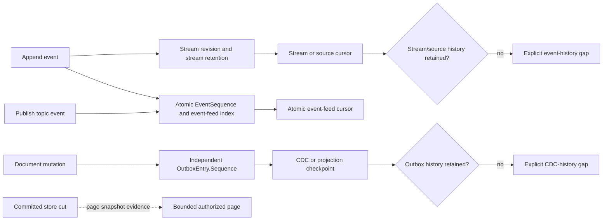
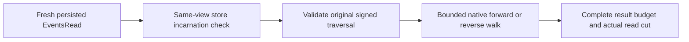

# ADR-025: Stream revisions and stable per-atomic event-feed positions

Status: Accepted; retained-history qualification pending.

## Context and decision

The event, CDC, and commit-order paths have separate position domains. A stream revision orders records within one stream and is its append/OCC and stream-read cursor. Current `Events.cs` allocates a per-atomic-partition `EventSequence` for canonical stream records and stores those records in the `event-feed` index. `EventSources` increments the same partition sequence for topic events while retaining a topic-local source `Position`; its current topic path does not populate the shared `event-feed` index. The product target in section 38.3 requires the stable sequence and feed index to travel with canonical event state. The committed store cut describes the snapshot at which a page was read, not an event cursor. CDC uses `ProjectionOutbox`'s independent per-partition `OutboxHead.Tail` and `OutboxEntry.Sequence` for document-mutation delivery. Neither event sequence nor outbox sequence is a command sequence.

Keep those domains distinct in contracts and ownership. EventStreams owns stream revisions and retained stream history; Messaging owns topic/event-source reads and event-feed sequencing; ChangeFeeds owns the document-change outbox, its cursor/checkpoint, and retention pins. Event/source retention and outbox retention report gaps independently. A source cursor may be scoped to a stream or topic; a future multi-partition atomic event-feed cursor may use a bounded vector of per-partition EventSequence values, but no new wire contract is selected here. Canonical event positions travel with canonical event state. Invalidate a cursor when its store incarnation is stale; do not translate it. A read page's committed cut remains separate evidence of read consistency.

## Alternatives and consequences

Using stream revision as an atomic feed cursor fails when streams interleave. Reusing CDC outbox sequence for event-feed order couples independent retention and consumer lifecycles. Treating the committed read cut as a cursor confuses snapshot evidence with continuation. Atomic EventSequence gives per-partition event order but exposes filtered gaps and needs event-history retention. Multi-partition vector cursors add bounded state and merge policy.

## Related requirements and implementation contract

Related: `REQ-EVENT-001` (bounded work/deadline/cancellation; `AC-MP-005`), `REQ-EVENT-002` (complete page result limit; `AC-MP-005`), `REQ-EVENT-003` (revisions, retention, and payload/header policy; `AC-MP-005/012`), `REQ-EVENT-004/AC-EVENT-004`, `REQ-EVENT-005/AC-EVENT-005`, `REQ-EVENT-006/AC-EVENT-006`, `REQ-MSG-003/AC-MSG-003`, `REQ-FEED-002/AC-FEED-002`, `REQ-FEED-005/AC-FEED-005`; ADR-023/024/027/030. Current source: `src/KeyLoad.Core/EventStreams/Execution/Events.cs` assigns stream revisions and EventSequence; `src/KeyLoad.Core/EventStreams/Execution/EventSources.cs` keeps topic/source Position distinct from EventSequence; `src/KeyLoad.Core/ChangeFeeds/Execution/ProjectionOutbox.cs` assigns an independent outbox sequence; `src/KeyLoad.Core/ChangeFeeds/Execution/ChangeFeeds.cs` reads CDC positions. Product section 38.3 likewise distinguishes EventSequence from StreamRevision and CommandSequence.

1. Freeze each cursor's domain, fields, and retention-gap errors under the current persisted format; preserve the separation between stream/source positions, atomic EventSequence, outbox sequence, and committed read cut.
2. Test concurrent append/read, expected revision conflicts, filter gaps, retention loss, cursor scope/revocation, and reopen.
3. Keep stream revisions and canonical atomic EventSequence under EventStreams, topic/source positions and event-feed sequencing under Messaging, and document CDC/outbox positions under ChangeFeeds.
4. Validate supported cursor versions and invalidate stale incarnation bindings; never rewind acknowledged positions.
5. Qualify event and feed behavior through GitHub TUnit, process recovery, and replicated-cluster .NET/MCP tests.

Target ownership is `src/KeyLoad.Abstractions/EventStreams/`, `Features/Messaging/`, and `Features/ChangeFeeds/` for shared contracts; `src/KeyLoad.Core/EventStreams/` for stream revisions and canonical event sequence, `Features/Messaging/` for topic/source positions and event-feed sequencing, and `Features/ChangeFeeds/` for document CDC/outbox sequence; `src/KeyLoad.Query/ChangeFeeds/` for query-facing CDC cursors; and matching `tests/KeyLoad.UnitTests/` slices. Existing unit tests are evidence paths, not passing current CI.

The event-feed vector-map control operations (Open, Offer, Acknowledge, Release, Tail, Refresh) and their native read purposes are specified by the REQ-EVENTS-* requirements in [EventStreams](../Features/EventStreams.md). They use the connection grain, fresh persisted authorization and ordinary Orleans stream/grain calls; none of them checks leadership.

### Stable stream traversal

REQ-EVENT-READ-DIRECTION-001 / AC-EVENT-READ-DIRECTION-001 requires complete independent forward/backward retained-event pages, exclusive bounds, current field/header redaction, byte refusal without partial publication, cancellation/refusal followed by a healthy operation. REQ-EVENT-READ-CUT-001 / AC-EVENT-READ-CUT-001 freezes original traversal tail/floor and snapshot cut, with subsequent append excluded until a new traversal; current CutPosition remains actual same-view position. Original generation/history, signed source feed and every global gate remain mandatory.

ReadStreamRequest IDs0..2 remain unchanged; Direction3 (Forward0/Backward1), MaxBytes4 (0 means original centrally validated MaxBatchBytes), Cursor5 are additive current contracts. StreamPage0..4 remain unchanged; Cursor5 and SnapshotCutPosition6 are appended. Head is the captured immutable traversal head; fresh current head separately proves original range remains available. Complete native result, including cursor/head metadata, must fit the original constrained result budget. Over-budget produces a closed refusal, not a partial page. Native reverse VisitReverseRange retains exclusive LOWER afterKey and exclusive UPPER untilKey, with original counting/cancellation reader. The new undelivered traversal cursor field6 SchemaVersion uses the actual ResourceDefinition.SchemaVersion long type without narrowing; existing alias, field IDs, constructor shape and authorization comparisons remain fixed.

The generated native stream-traversal cursor alias is keyload.core.stream-traversal-cursor.v1: 0Version,1Purpose,2Incarnation,3Stream,4PrincipalId,5PolicyEpoch,6SchemaVersion,8Direction,9CapturedTailRevision,10CapturedFirstAvailableRevision,11SnapshotCutPosition,12NextExclusiveRevision,13ExpiresAt. Original owning signer and EventSourceExecutionOptions.CursorLifetime supply MAC/expiry; continuation does not renew original expiry.

Core authenticates current persisted principal and EventsRead before token decode or event payload. On that SAME bounded native view, Core verifies the store incarnation against the cursor; it grants no caller roles. No administrator-read workaround, fabricated epoch or parallel dispatcher.

Ownership/mapping: Abstractions EventStreams DTO/enum; Core EventStreams Contracts/Queries/Execution; existing Orleans GrainCoreReadCapabilities + ConnectionReadCapabilities only Stream dispatch; Client current ReadStreamAsync request transport unchanged; existing SDK/MCP/Q1 same public request and complete schema/result controls; Unit native real-store controls and cluster same-root cold traversal. All original reader/producer cleanup and failure trees remain. Linux normal/scalar/process/replicated-cluster evidence is required. Vector-map admission and live registration/backpressure are not part of this contract. No migration/fallback, policy/deadline/limit change or runtime PASS is asserted.

Traversal boundary details: negative or above-captured-bound AfterRevision and invalid Direction/MaxBytes are Validation, as frozen in the approved traversal proposal; original Limit<1/>MaxResults remains BudgetExceeded. Cursor requests use AfterRevision=0 rather than a second competing boundary. Exhausted traversal returns Cursor=null. The existing scalar Core signature delegates to this one current reader; no retained legacy reader is introduced. UTC expiry control in native Unit tests borrows the original timer/monotonic owner and exact same EventSourceExecutionOptions instance; it is a supporting expiry operation, not natural time qualification.
