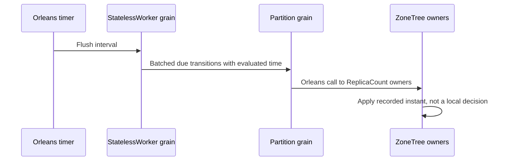

# ADR-028: Persisted scheduling with logged evaluation time

Status: Accepted; scheduler workers and failover qualification pending.

## Context and decision

Queue due times, retries, lease expiry, and recurring work must transition consistently across restart and across the `KeyLoad:ReplicaCount` copies. A time-based state transition is never decided independently from a local wall clock: the evaluation instant is taken from the owning `TimeProvider`, recorded in the command envelope, and applied from that recorded instant by every ZoneTree owner.

Make time-dependent transitions deterministic from a canonical logged evaluation instant and persisted schedule state. Background due work does not check leadership and has no leader clock gate. Orleans `[StatelessWorker]` grains accept due events and hints, buffer them in memory and, on an Orleans timer whose interval is a typed option (for example five seconds), write the batch to the database through the normal grain to ZoneTree owner path; the owners apply the recorded instant. No worker-local timer is canonical authority, and a lost buffer is rebuilt from persisted schedule state.

## Alternatives and consequences

Each node consulting local time is rejected because skew creates divergent state. A per-message timer is rejected because it is not restart durable and scales allocations with queue depth. Leader-gated scheduling is rejected: leadership is not a database concept here. Logged evaluation time yields deterministic apply but requires bounded scheduler lag and a bounded in-memory buffer.

## Related requirements and implementation contract

Related: `REQ-MSG-004/AC-MSG-004`; ADR-003, ADR-026, ADR-031. Current source: `src/KeyLoad.Core/Messaging/Execution/Messaging.cs` and `src/KeyLoad.Core/DatabaseEngine.cs`. The persisted scheduler belongs under `src/KeyLoad.Core/Messaging/`; the StatelessWorker grains belong to the cluster routing slice, with message contracts in the canonical Messaging slices.

1. Freeze evaluation-time encoding, the flush-interval and buffer-bound options, and transition semantics.
2. Test due/not-due boundaries, retry jitter determinism, restart, lease-expiry races, node skew and node failover.
3. Implement a persisted bounded scheduler/seek index under `src/KeyLoad.Core/Messaging/` and append transitions with the canonical evaluated time; `TimeProvider` supplies every current-time read and timer.
4. Use the current schedule-record contract and replay tests; rollback pauses scheduling while retaining canonical pending entries.
5. Qualify process recovery and replicated-cluster behavior through GitHub Actions only.

A waiting saga's deadline is constructed from the owning evaluation clock; the persisted deadline and the due-work hint carry the identical instant, without widening, clamping or retry.

### Queue deadline advancement

REQ-MSG-DEADLINE-ADVANCE / AC-MSG-DEADLINE-ADVANCE: the per-silo due-work owner selects canonical pending scheduled, lease and lifetime metadata under bounded count, byte and cancellation budgets and submits the direct `AdvanceQueueDeadline` batch effect with fresh scoped QueueConsume and worker-input permissions, an exact state/version/lease/deadline/index compare-and-set and the native signed evaluated time. A not-due Conflict, stale RevisionConflict, paused DispatchPaused or revoked-permission refusal retains complete message bodies, metadata, index and counters; an exact original receipt replay survives cold opens and fresh healthy work follows. A configuration never grants roles.
