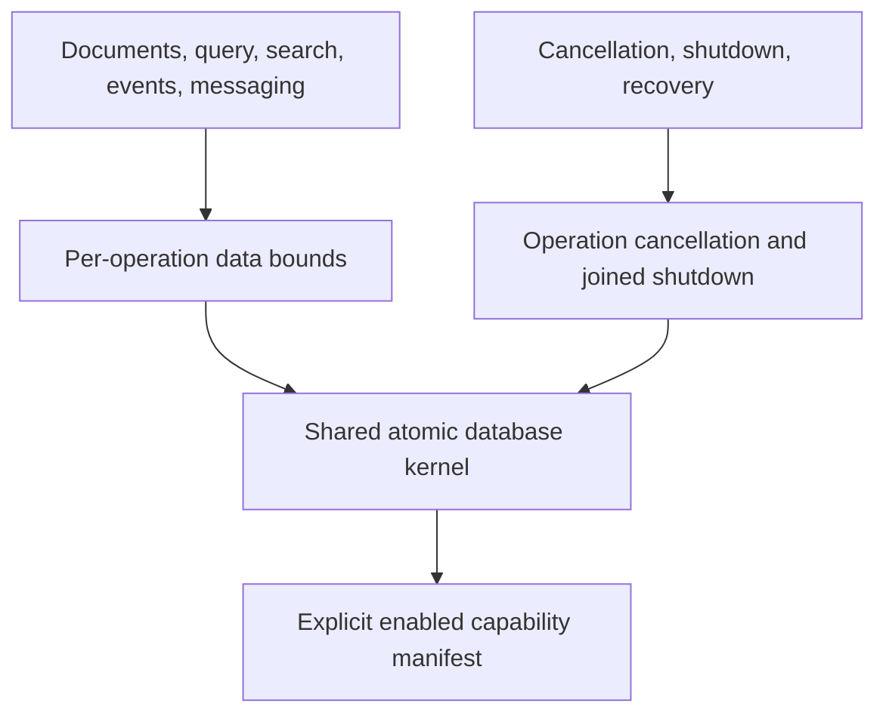

# ADR-031: Modular all-in-one deployment and capability manifest

Status: Accepted; mixed-load liveness and capability-manifest qualification pending.

## Context and decision

KeyLoad is one repository and one deployable data system with optional capability modules. A resource-intensive search, replay, queue, or projection workload must not prevent cancellation, shutdown, or recovery from completing. Optional modules must not imply that every feature is enabled or qualified.

Expose enabled capabilities through an explicit manifest. Keep one repository and shared persisted authority, but give query/search, eventing, messaging, backup, and cluster routing their canonical ownership and per-operation resource bounds. A modular profile may omit optional providers; it must report unsupported capability instead of weakening semantics silently.

Liveness does not come from reserved control capacity. The server keeps no control lane, control pool or reserved budget and throttles no caller ([ADR-145](ADR-145-no-request-throttling.md)). Each operation carries its own cancellation, Orleans schedules all accepted work, and shutdown closes new work and joins running operations before storage closes.

## Alternatives and consequences

Splitting into unrelated repositories is rejected by the single-repository architecture. Always enabling every feature is rejected because optional providers and their readiness may not be available. Reserved control budgets are rejected by ADR-145: overload appears as latency for all work, and operators size hardware for their load.

## Related requirements and implementation contract

Related: `REQ-MP-003/AC-MP-007`, `REQ-MSG-004/AC-MSG-004`; ADR-020/028/036/145. Policy is in root `AGENTS.md`.

1. Freeze the capability manifest and the unsupported-capability behavior.
2. Test that shutdown, cancellation, and recovery complete while application work saturates the node; test that unsupported capabilities fail clearly.
3. Implement per-capability registration in AppHost/Server/Orleans composition; business slices own their own per-operation work budgets.
4. Qualify real mixed-load and failure scenarios through GitHub replicated-cluster workloads and recorded resource evidence; no local benchmark or assumed liveness claim.

Modular deployment, the final capability manifest, and mixed-load qualification remain pending.
