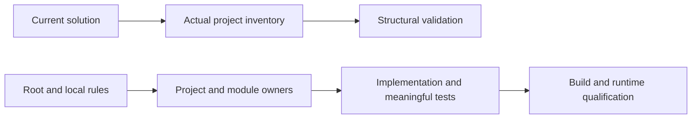

# ADR-032: Current repository governance

Status: Accepted.

## Decision

The root `AGENTS.md` and local ownership policies describe the current product
and execution rules. Each C# project groups named slices directly under its root,
with populated responsibility folders. Documentation uses one current feature
contract and stable acceptance criteria per capability.

The structural validator derives projects from `KeyLoad.slnx` and compares them
with the actual repository. It validates root/local policy, required documents,
source layout, safe paths and working-file hygiene. Its source of truth is the
current solution and filesystem.

Use native TUnit entry after build. Fixtures own Aspire resources and joined
cleanup. Build and Tests, Benchmarks, Website and Release have separate delivery
responsibilities. Structural checks do not qualify database behavior, public
client interoperability, recovery or performance.

The requirements, native tool and regression mapping are in
[RepositoryGovernance](../Features/RepositoryGovernance.md). Keep the
[architecture map](../Architecture.md) and [root policy](../../AGENTS.md) current.
