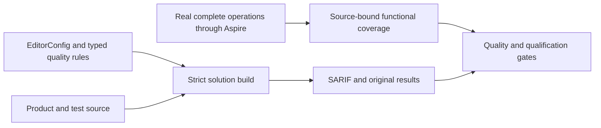

# ADR-033: source-owned code quality and evidence gates

Status: Accepted; implementation and complete qualification remain pending. Related requirements, acceptance criteria and current slice ownership are canonical in [CodeQuality](../Features/CodeQuality.md).

The three genuine packed-ANN stress arguments remain required and execute exclusively through TUnit scheduling; their results cannot contribute ordinary product coverage or performance figures (REQ-CQ-009 and AC-CQ-018/019/039).

## failure constructor classification, 2026-10-09

REQ/AC-CQ-EXECUTION-EXCEPTION-001 under ADR-125 require existing KeyLoadException constructors to remain intact with generated serialization. KLD0021 governs Orleans DTO constructors; a System.Exception hierarchy is a runtime failure, not a DTO. The analyzer classifies actual direct or indirect Exception inheritance in analyzers/KeyLoad.Analyzers/Analyzers/RuntimeContracts/OrleansContractConstructorAnalyzer.cs using the active compilation symbol and SymbolEqualityComparer, with real framework Roslyn inputs in the existing OrleansContractConstructorTests. No name/namespace-based whitelist, suppression, severity change or ordinary DTO-constructor exemption is allowed; existing positive/negative cases and compiler-success assertions remain mandatory.

This does not change persisted/public formats or add a runtime dependency. Rollout is one coherent analyzer/regression source stage. Rollback restores those changes together; removing legitimate constructors or silencing the diagnostic cannot substitute for qualification. Analyzer tests run in their original GitHub gate; actual Serializer<Exception> and capacity/wrong-owner RPC execution independently verify the repaired runtime failure path.

## Decision

Roslynk 2.1.0 is a pinned repository-local
development tool and project-scoped Codex MCP server. The matching
REQ/AC-CQ-ROS-001..003 implementation contract in
[CodeQuality](../Features/CodeQuality.md#roslynk-semantic-tooling-owner-direction-2026-10-09)
owns installation, actual MCP interoperability, complete workspace loading,
located diagnostics, reviewed fixes, rollback and the final verification join.
Use its semantic APIs while retaining the selected analyzer catalog,
EditorConfig and every independent build/format/TUnit/Aspire/Linux gate.
Upstream advice to replace builds with workspace diagnostics does not apply.
The tool and disposable loopback workspace own no database execution or storage.

Use the repository EditorConfig unchanged, the .NET SDK analyzers at `latest-all`, build-time style checks and warnings-as-errors across every solution project. Keep the eight applicable imported rules, excluding the four whose contracts do not apply to KeyLoad. Own editable Roslyn rules in the central source analyzer project and test them through actual SDK Roslyn compilations with TUnit. Keep compiler SARIF 2.1 reports available for successful and failed builds. Preserve the pinned compiler-host package selection; analyzer tests use SDK Roslyn references rather than a second loader.
Keep `GenerateDocumentationFile` enabled for the IDE0005 build diagnostic.
Missing public documentation remains an error; no imported suppression list is permitted.

The exact analyzer catalog, semantic rules, test boundaries and source ownership live in the CodeQuality feature specification. Tests execute real product operations or the real compiler/analyzer and assert observable state or diagnostics. Reading implementation source and asserting tokens or implementation shape is not functional proof. Do not use mocks, fakes, stubs or service doubles to replace actual behavior. Generated-code policy, public contracts, error identity, authorization, cancellation, resource bounds and existing operation order remain enforced.

## Requirements and acceptance

The CodeQuality feature is the canonical requirements-to-test map. This ADR retains its current IDs and decision boundaries:

| Requirement | Acceptance criteria retained |
|---|---|
| REQ-CQ-001: strict, unchanged shared editor and SDK analysis | AC-CQ-001 |
| REQ-CQ-002: editable analyzer rules with real compiler cases | AC-CQ-002, AC-CQ-004 |
| REQ-CQ-003: independent compiler SARIF including failed-build diagnostics | AC-CQ-003 |
| REQ-CQ-004: preserving repairs and honest quality qualification | AC-CQ-005, AC-CQ-006, AC-CQ-022, AC-CQ-023, AC-CQ-025, AC-CQ-026, AC-CQ-027 |
| REQ-CQ-005: preserving benchmark prerequisites | AC-CQ-007 |
| REQ-CQ-006: executable numeric maintainability and coverage gates | AC-CQ-008, AC-CQ-009 |
| REQ-CQ-007: preserving CLI, query, search, storage, site, and lifecycle behavior | AC-CQ-010, AC-CQ-011, AC-CQ-012, AC-CQ-013, AC-CQ-015, AC-CQ-016 |
| REQ-CQ-008: bounded qualification workflow concurrency | AC-CQ-017, AC-QUAL-001, AC-QUAL-002, AC-QUAL-003 |
| REQ-CQ-009: source-bound functional coverage and uncovered-flow repair | AC-CQ-018, AC-CQ-019, AC-CQ-020, AC-CQ-021, AC-CQ-039, AC-CQ-040, AC-CQ-041, AC-CQ-042, AC-CQ-043, AC-CQ-044, AC-CQ-045, AC-CQ-046, AC-CQ-047, AC-CQ-048 |
| REQ-CQ-010: typed synchronization | AC-CQ-025, AC-CQ-026, AC-CQ-027 |
| REQ-CQ-011: named runtime values | AC-CQ-029, AC-CQ-030, AC-CQ-031, AC-CQ-032 |
| REQ-CQ-012: complete runtime literal analysis | AC-CQ-033 |
| REQ-CQ-013: centralized typed operational options | AC-CQ-034, AC-CQ-035, AC-CQ-037, AC-CQ-038 |
| REQ-CQ-014: complete-operation behavioral test ownership | AC-CQ-049, AC-CQ-050 |

The executable maintainability limits remain 400 source lines per file, 200 code lines per type, 64 code lines per executable unit, and nesting depth 3. KLD0030–KLD0033 remain enabled errors at those boundaries. The numeric compiler fixtures verify the exact legal and rejected boundary and diagnostic span; the same current limit applies to every qualified source cohort.

Functional coverage includes only complete functional operations. Load, stress, performance, and database-comparison tests do not contribute. Preserve the 80% module line, 70% module branch, 90% critical-pipeline thresholds, module no-decrease rule, and source-mapped CRAP requirements. CRAP combines source-mapped complexity and functional coverage from the same source/build cohort. Missing, stale, skipped, failed, unbound, mixed-cohort, or incomplete results are unmeasured or failed, never zero-filled or relabelled.

Original MTP/TUnit reports, source and compiled identities, module and image identities, settings, failures, and coverage exports remain immutable evidence. Coverage requires the exact source inventory and matching DLL/PDB/MVID/portable-PDB identity; cluster server contribution comes from the three actual AppHost-owned server processes. Line hits may be unioned only for matching source identities. branch outcomes are merged only when original reports identify each outcome; coarse covered/total fractions remain per-run evidence and merged branch coverage stays unmeasured otherwise. Healthy and rejected operations must preserve their original state, errors, cancellation identity, owned-process settlement and cleanup behavior.
Retain the existing evidence admission bounds: XML is at most 32 MiB, the source inventory at most 5,000 files, and the distinct source-line inventory at most 100,000 locations. Source and run manifests retain their separate 64 MiB and 4 MiB ceilings, and output retains its 64 KiB bound. Reject DTD/external resolution, paths outside the captured source root, duplicate conflicts, absent identities and invalid counts before producing derived coverage. These limits remain distinct from configurable stream buffers and manifest policy.

## Execution and ownership

The CodeQuality feature owns the current implementation sequence, exact file ownership, test mapping and report schemas. Shared configuration, AppHost, CI, inventories, documentation and cross-slice consumers have a single owner; guarded, disjoint slice changes preserve actual APIs, and an ownership or contract conflict stops the affected stage for review.

Use the Aspire-owned suite entry point for analyzers, unit, scalar, recovery and cluster operations. Unit and scalar do not require a cluster topology; cluster operations use the discovered three-node Docker topology and the real SDK and official MCP client flows. Every process, collector, file reader and application resource must settle under its existing validated bounds before receipt verification or owned-root cleanup. Preserve the primary failure and all cleanup failures; a failed cleanup or missing report cannot produce a successful receipt.

A local build, focused run, static inventory, source review, or one passing cohort is development evidence only. Delivered-source qualification requires the exact Linux CI source SHA, successful required suites, original reports and verified source/image identities. Build, format, analyzer, governance, normal unit, scalar unit, recovery, cluster, functional coverage, and delivery gates remain separate. No skipped suite or unrelated workflow event substitutes for a required gate.

## Rollout and source checkpoint

This ADR changes quality tooling and evidence contracts; it does not change database bytes, SQL or external client protocols, Orleans activation migration, storage authority or the replicated-cluster topology. Roll out one reviewed source checkpoint containing its analyzer, tests, settings, inventory and documentation joins. A rollback restores the coherent source/configuration pair and retains every original report; it does not disable a rule, reduce a limit, or relabel prior reports as evidence for changed source.

The decision remains Accepted until the complete implementation and all mapped exact-source gates pass. Qualification must bind to its exact source, run, job and original reports. The functional contributor partition, descriptor and census contracts (REQ-CQ-039/040) are specified in [CodeQuality](../Features/CodeQuality.md).
