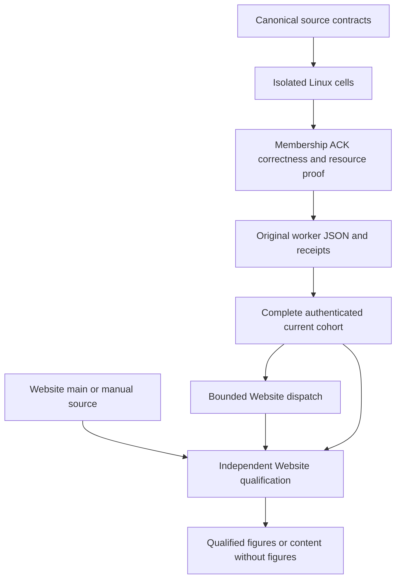

# ADR-034: database comparisons and authenticated results

Status: Accepted; complete runtime and publication qualification remains open.
Date: 2026-10-06. Owner: benchmark integrator.
Related: REQ-BC-001–009/019/021/050–058, AC-BC-001–009,
AC-PERF-001–009, AC-ISO-001–009,
AC-HOST-001–007 and AC-KLEVENT-001–003 in
[BenchmarkComparisons](../Features/BenchmarkComparisons.md).

## Decision

The canonical comparison targets are KeyLoad, PostgreSQL + pgvector, Qdrant,
RabbitMQ, Redis, Neo4j, MongoDB, OpenSearch, KurrentDB, SurrealDB and HelixDB.
[ADR-142](ADR-142-shared-live-benchmark-sessions.md) owns the current 22 shared
sessions: eleven databases at one/three-node topologies. Active scale
requirements retain 100,000 and 1,000,000 actual records and at least 100,000
measured operations per applicable workload. The document session starts with a
measured million-record corpus; it does not complete remaining model-family or
physical 100,000-corpus qualification. A small control fixture cannot qualify a
scale profile. Derive inventories and supported dispositions from actual source.
Single/Replicated library values describe comparison profiles; they do not
establish physical membership. Product KeyLoad execution remains genuine cluster.
A benchmark topology requires its explicitly qualified contract.

Each database, node count and workload cell uses its own isolated Linux GitHub
runner, topology and load generator. Name job groups by database. Engines
must not share runners, containers, volumes or measurement sessions. Docker
resources, readiness, test dependencies, execution and joined shutdown belong
to Aspire. clients execute the same applicable workload/corpus, operation
schedule, metric/filter/accuracy target and effective resource/durability contract.

Unsupported execution/community topologies remain unavailable with their precise
reason; independent standalone instances cannot stand in for a cluster.
Configured node count, observed membership, data-copy placement and acknowledged
copies are distinct facts. Preserve authentic failures and avoid equivalence
claims unsupported by each engine's consistency and durability contract.

## topology and caller contracts

| Engine | Required proof and boundary |
|---|---|
| KeyLoad | The configured number of ready Orleans silos (three by default) with `KeyLoad:ReplicaCount` silo-local ZoneTree owners; persisted authorization and required-copy acknowledged receipts. Process-kill proof does not establish power-loss durability. |
| PostgreSQL + pgvector | Actual primary/standby membership, configured synchronous quorum and observed replication/WAL state. Exact, HNSW and IVFFlat workloads require their own accuracy and concurrent-update results. No automatic-failover claim follows from a replication probe. |
| Qdrant | Actual peer agreement, collection replication/write-consistency settings and active seeded shard copies. No transactional/WAL equivalence is inferred. |
| RabbitMQ | Connected nodes and online quorum-queue members; persistent messages, publisher confirms, manual ACK and ordered barriers. |
| Redis | Actual primary/replica membership and AOF settings; checked WAIT/WAITAOF receipts on the same dedicated write connection. Connection replacement cannot preserve an unverified receipt. No sharding, linearizability or automatic-failover claim follows. |
| Neo4j Community | Genuine single-node operations; clustering requiring Enterprise remains unsupported. No license activation or simulated cluster. |
| MongoDB Community | Actual data-bearing replica members and primary/secondary health, majority write concern with journaling and declared read semantics. |
| OpenSearch | Actual connected data/manager nodes, active shard copies, request translog durability, checked active-shard acknowledgements and document/vector operations. |
| KurrentDB | Actual gossip membership, leader/follower/checkpoint probes, expected-NoStream append and bounded readback. Use the centrally pinned, license-permitted topology; do not enable unavailable paid clustering. |
| SurrealDB | Genuine centrally pinned deployment and observed topology under its source-owned capability contract. Unsupported membership or workload cells remain unavailable. |
| HelixDB | Genuine centrally pinned deployment and observed topology under its source-owned capability contract. Standalone or unsupported configurations cannot be relabelled as replicated. |

Keep `IComparisonTarget` / `IComparisonSession`, client ownership,
`ClusterEvidence`, corpus hashes, external image digests, actual DLL/PDB/process identities, source revision and
raw per-operation results. Targets own created SDK/transferred HTTP clients;
sessions borrow them. Aspire owns cluster resource startup. HTTPS trust, transport
security and production authorization are mandatory on benchmark paths.

Point reads, writes, queue enqueue/receive/ACK, graph neighbors/traversal,
vector search, stream append/read and intensive CRUD qualify only their defined
operations. Stream inputs use deterministic event identities, expected
absence, one-event cardinality, normalized first revision and exact JSON
readback outside timing. Duplicate append tests use a distinct event identity
so idempotent retries cannot masquerade as conflict detection.
KeyLoad and PostgreSQL public session reads must return the actual stored event
or absence through existing SDK/operations; timing success without public
readback fails AC-KLEVENT-001–003 / AC-PERF-004.

## infrastructure, source and publication contracts

The primary KeyLoad AppHost runs server project processes with in-memory
RapidMembership for Orleans membership. A separate LoadTests AppHost owns selected comparison database
infrastructure, readiness, discovered endpoints and joined cleanup. The workload
client runs as a process outside that graph. External databases use pinned
images, image entry points/users and anonymous session volumes. Remove
only resources owned by that execution. Ordinary build/start/test/load does not
publish or run KeyLoad or workload-client images; SDK `PublishContainer` belongs
to explicit release/publication.

The compiled runtime and actual process observations bind server/client DLL/PDB,
source composition and process start identities. A deliberate fault uses the
AppHost-owned identity-checked process command and awaits actual exit.
Graceful shutdown is not abrupt-fault proof. Local sessions have absent GitHub
provenance; public aggregation independently requires authenticated original
source/run/attempt/job/artifact evidence. Matched resource qualification for
server processes remains open and must not be inferred from Docker stats
or a successful workload.

Validate the distinct KeyLoad HTTP(S) node origins (three in the default topology), with the primary
matching index zero, before client allocation. Bind these discovered resource
endpoints through the AppHost. RabbitMQ management uses the actual resource's
endpoint/user/password references and an owned authenticated client. Invalid
configuration returns a safe diagnostic before allocation; partial construction
must join cleanup. Credentials and private payloads never enter report metadata.

Each worker retains source/run/attempt/target/topology/profile-bound original
JSON, actual corpus counts, correctness, latency/p95/p99, throughput, allocations,
server memory and applicable index-build/recall evidence. The single aggregator
validates the complete source-derived inventory, schemas, provenance and
comparable settings. Terminal failed/null rows may coexist with successful
measurements in a ready authenticated aggregate, but remain visibly unavailable.
Missing, corrupt, mixed-source or unauthenticated inputs cannot refresh metrics.
No fabricated zero or winner is permitted where required comparison evidence
is unavailable.

[ADR-076](ADR-076-current-cohort-publication.md),
[ADR-080](ADR-080-benchmark-failure-isolation.md) and
[ADR-112](ADR-112-independent-website-publication.md) own current publication.
Four workflows remain separate: Build and Tests, Benchmarks, Website and Release.
Benchmarks ends with a bounded dispatch of Website. Website independently
qualifies main/manual source changes, consumes the newest ready authenticated
aggregate when available, and publishes without figures otherwise. It must not
wait for unrelated ordinary CI or fabricate measured inputs.

## Implementation, join and rollback

1. Freeze each workload/topology/source/caller packet against the owning feature
   requirements and exact source contracts. Keep feature paths disjoint; shared
   contracts, packages and AppHost/workflows are single-owner.
2. Implement clients and real membership/ACK/readback checks before
   measurement. Preserve current operation signatures, source schemas, bounds,
   resource ownership, cancellation and terminal outcomes.
3. Join exact-source reviewed packets, update the complete REQ/AC/task/test
   traceability, and run the canonical solution build, formatter and governance.
   Local functional development uses the TUnit test entry and
   discovered resources; it is distinct from delivered-source qualification.
4. Run every required exact-source Linux GitHub ordinary/scalar, recovery,
   Aspire cluster, comparison, coverage/complexity and publication gate. The genuine
   .NET and official MCP callers remain mandatory for their owning contracts.
   Retain original run/job/artifact identities; no failed or skipped suite passes.
5. Publish figures only from admitted originals and complete current website
   source/coverage/browser/freshness gates. Select optimization from comparable
   measurements, using .NET intrinsics first and Rust only after profiling.
   Preserve scalar correctness, bounded Orleans work, read cuts and ordered apply.

[ADR-043](ADR-043-comparison-library-host.md) owns executable/library separation:
retain the public library assembly, namespaces, registration and contracts.
Only the sole CLI host owns executable startup and safe terminal lifetime.
[ADR-036](ADR-036-orleans-foundation.md) owns the Orleans foundation; this ADR
cannot authorize experimental APIs or change database execution ownership.

Rollback stops failing qualification/publication and repairs the owning source.
Keep original measurement artifacts immutable; no legacy reader, previous-format
path, alternate topology, weaker bound or alternate execution is authorized.
Source implementation, local development and a pushed commit alone do not mark
this decision Implemented or establish a performance winner.

## Exact clean source checkout

REQ-BC-SOURCE-001 / AC-BC-SOURCE-001 require execution `verifySourceCheckout` in
`source-checkout.mjs` to reject unignored untracked files and tracked changes
before delivered-source runtime packaging, receipts and GitHub outputs. Execution
Git honors repository ignore rules; revision equality and bounded joined child
execution remain mandatory. `SourceCheckoutIdentityTests` uses its existing real
committed checkout fixture: it admits the real HEAD, rejects an added untracked
source for the expected diagnostic, admits the same HEAD after removing only that
file, accepts ignored generated output and preserves tracked bytes. This proves
source admission only; actual runtime/process and GitHub qualification remain
separate gates. Failed admission preserves original evidence and fails closed.
