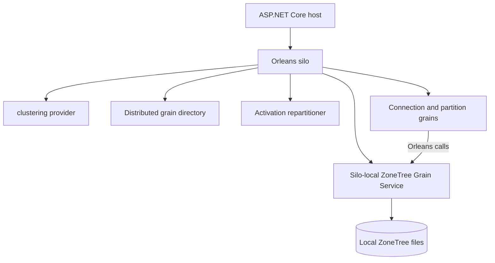

# ADR-036: Orleans foundation

Status: Accepted; rewritten 2026-10-18 under the owner's "Orleans is the whole cluster" direction. Implementation and delivered-source qualification in progress. Owner: KeyLoad lead. Related: [ADR-136](ADR-136-orleans-partition-ownership.md) (cluster and storage concept), [ADR-125](ADR-125-connection-owned-execution.md) (connection grain), [ADR-143](ADR-143-independent-silo-replica-topology.md) (silo and replica counts), [ADR-110](ADR-110-orleans-execution-primitives.md) (execution primitives), [ADR-082](ADR-082-cqrs-streams.md) (CQRS streams), [ADR-116](ADR-116-first-release-current-format.md) (current format). Features: [OrleansExecution](../Features/OrleansExecution.md), [StorageReplication](../Features/StorageReplication.md), [TestInfrastructure](../Features/TestInfrastructure.md).

## Decision

Orleans is KeyLoad's runtime and its whole cluster. One server process hosts one Orleans silo inside the ASP.NET Core host. KeyLoad does not add a second clustering stack, does not make any silo a required primary and does not implement membership, discovery, placement, movement or consensus of its own.

Silo configuration uses only Orleans calls:

- clustering provider: Azure Table storage through the Aspire-provided connection string, or localhost clustering for local development;
- `AddDistributedGrainDirectory()` and `AddActivationRepartitioner()` — the owner-authorized experimental opt-ins `ORLEANSEXP003` and `ORLEANSEXP001` are suppressed only around these two calls;
- `AddGrainService<...>()` for the silo-local ZoneTree owner and other per-silo services;
- Durable Jobs and Journaling under ADR-110 (`ORLEANSEXP005` confined to that provider, its registration and tests);
- generated Orleans serialization with stable `[GenerateSerializer]`, `[Id]` and `[Alias]` contracts for every internal payload;
- OpenTelemetry through ServiceDefaults and the Orleans/ASP.NET Core integrations.

No global analyzer suppression is allowed.

## Security and errors

Persisted database identity and authorization stay authoritative; clients cannot supply trusted roles. The verified subject travels between grains in execution `RequestContext` through ManagedCode.Orleans.Identity; it never replaces the fresh persisted permission check of each operation. Error translation preserves caller cancellation, safe domain errors and possibly-dispatched write uncertainty without retrying an operation. Diagnostics contain no credentials or payloads.

## Lifecycle

Startup registers options, serialization and telemetry, opens the local ZoneTree files in the storage Grain Service initialization, lets the silo become Active, then admits public traffic once fresh persisted identity is readable. Shutdown stops admission, drains accepted operations and background work, then closes the ZoneTree files. A failed or canceled silo start is not reused in-process.

## Verification

Development builds and Aspire-owned TUnit tests may run locally as development evidence. Qualification requires the exact delivered source on Linux GitHub Actions: Release build with warnings as errors, format, analyzers, TUnit unit and scalar suites, real process recovery and Aspire cluster tests through the real .NET SDK and official MCP client. Process-kill tests do not prove power-loss durability. This ADR stays Accepted until that evidence exists.
