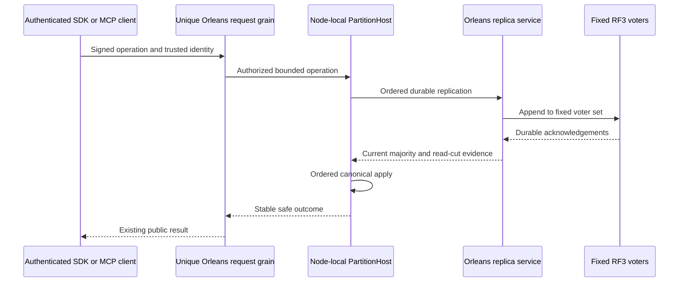
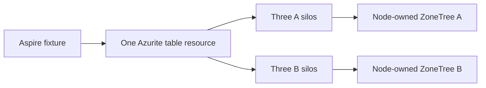
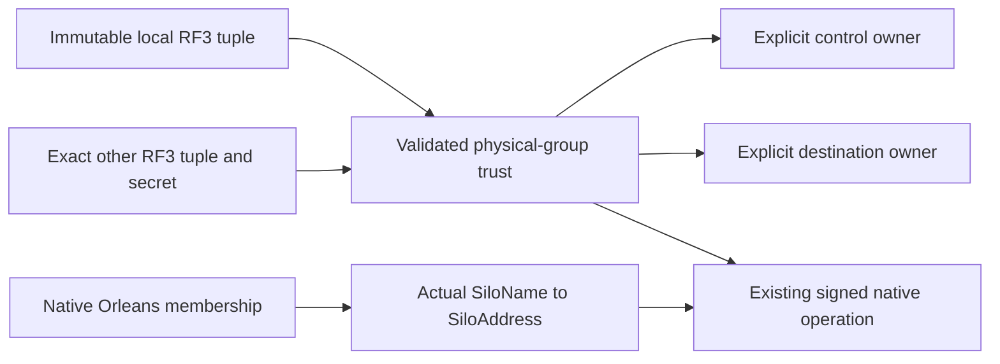
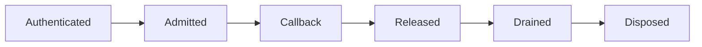
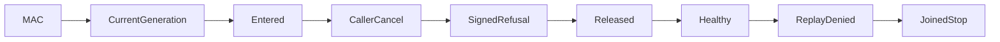

# ADR-036: Orleans foundation and client-driven qualification

Status: Accepted; implementation and delivered-source qualification remain in progress. Owner: KeyLoad lead. Original decision date: 2026-10-01; current contract: 2026-10-06. Related requirements: REQ-REP-001..006 in [ClusterReplication](../Features/ClusterReplication.md), REQ-ROUTE-001..010 in [ClusterRouting](../Features/ClusterRouting.md), and REQ-TEST-001..003 in [TestInfrastructure](../Features/TestInfrastructure.md). Related decisions: [ADR-007](ADR-007-replica-consensus-bootstrap.md), [ADR-082](ADR-082-native-cqrs-streams.md), [ADR-110](ADR-110-native-orleans-execution-primitives.md), [ADR-116](ADR-116-first-release-current-format.md).

The owner policy’s ADR-034 evidence reference remains in force for the distributed-directory and activation-repartitioner opt-ins; this foundation decision defines their two-call composition scope. ADR-034 remains the separate cluster-comparisons decision. ORLEANSEXP005 scope is governed by ADR-110.

## Decision

Orleans is KeyLoad's cluster, request-routing and activation-movement foundation. The server uses one fixed RF3 voter group for the production database. It does not add a second clustering stack or make one silo a required primary. Every public database operation enters its own distinct Orleans request grain and calls the relevant database capability. Writes route to the canonical atomic-partition actor; reads use an independent request-scoped read actor. Distributed grain directory and activation repartitioning are enabled; moving a grain activation never transfers node-local stores, file locks, journals or apply ownership.

`PartitionHost` owns the physical node's current canonical and replica stores, locks, replication log, snapshot/catch-up resources and ordered apply gate. Replica coordination uses Orleans-hosted per-silo services and signed, bounded native calls. A command is acknowledged only after its required durable majority barrier; each public read passes a current-term quorum barrier before reading persisted authorization or data. The signed request binds its unique request identity, current incarnation, authenticated persisted principal, operation kind, stable command identity where applicable, exact encoded payload and expiry. Apply remains ordered against canonical state. Recovery uses the current verified snapshot plus ordered tail and preserves stable command outcomes and replicated authorization. Current backup/restore and failure recovery retain their owning StorageRecovery and BackupRestore contracts; neither a benchmark run nor activation movement is a recovery proof.

Persisted database identity and authorization remain authoritative. The internal cluster principal is protected, is not a public API credential, and may apply only the permitted membership operations. Clients cannot supply trusted roles. Signed replica messages bind their purpose, method, sender/recipient, incarnation, freshness and nonce; strict bounds and replay admission preserve reserved capacity for consensus and membership control. Error translation preserves active caller cancellation, safe domain errors, read ownership loss and possibly-dispatched command uncertainty without retrying an operation or claiming storage damage. Bounded diagnostics use only closed stage/category/error values and an operation identifier; they never retain caller payload, principal identity, credentials or raw exception text.

Default-deny grain-call enforcement admits only declared application transitions. Native system-target calls do not enter application telemetry tracking as ordinary grain calls; any required filter repair belongs in the owning Graph dependency and must be published before KeyLoad consumes it, with no consumer-side bypass. The owner-authorized experimental opt-ins are narrowly scoped: ORLEANSEXP003 and ORLEANSEXP001 apply only to the distributed-directory and activation-repartitioner configuration calls; ORLEANSEXP005 applies only to the matching native journal provider, Durable Jobs integration, registration and tests under ADR-110. No global analyzer suppression or unrelated diagnostic suppression is allowed. Journal metadata remains RF3-authoritative and separate from creator-authorized business effects. The exact per-method use of StatelessWorker, OneWay, interleaving, Durable Jobs, Grain Services, local lifecycle services and telemetry remains governed by ADR-110 and its feature-level acceptance. The selected native journal-backed Durable Jobs path remains pending its owning implementation and runtime gates. Selection of a native primitive does not change ordered data effects or establish its runtime qualification. Orleans runtime Streams and persisted KeyLoad EventStreams remain distinct delivery contracts. Native CQRS result and long-operation streams remain a separate ADR-082 product workstream using the owning Communication APIs; they do not justify a parallel dispatcher or alter current SQL, .NET SDK, or official MCP interoperability contracts.

## Stable requirements and acceptance

The feature specifications own full tests and observable predicates. This ADR retains their stable traceability:

| Requirement family | Required outcomes |
|---|---|
| REQ-REP-001..006 / AC-REP-001..006 | Orleans carries replication and snapshot traffic; node-owned state is process durable before acknowledgement; fixed RF3 majority and current-term read barriers hold; snapshot plus tail recovery preserves a complete cut; persisted principals remain authoritative; bounded anti-replay admission protects control traffic under load. |
| REQ-ROUTE-001..010 / AC-ROUTE-001..010 | Unique request identity, directory/movement, multi-silo membership, declared call graph, partition/placement identity, bounded private diagnostics, correct RPC failure outcomes, client transport and cancellation semantics remain intact. |
| REQ-TEST-001..003 / AC-TEST-001..003 | TUnit/Microsoft.Testing.Platform remain the .NET test stack; Docker RF3 tests run under Aspire with real .NET and official MCP SDK clients; generated locks, local data, secrets and test artifacts remain out of source control and Docker context. |
| AC-AUTH-002, AC-AISQL-011, AC-AISQL-013, AC-CLIENT-010, AC-DIAG-001..004, AC-TEST-007 and AC-MP-012 | Persisted authorization through recovery, initial RPC read/write uncertainty, incoming-token cancellation, client-visible error/privacy, bounded diagnostics, retained original test reports and configured coverage/complexity evidence remain governed by their owning feature specs. |

Current native replication and request behavior have no compatibility fallback for prior KeyLoad formats or wire generations. Use the single current strict format and reject unsupported input as specified by ADR-116. External SQL/client protocol interoperability and official MCP interoperability remain separate public compatibility requirements; they are not prior-KeyLoad-format support.

## Lifecycle, rollout and verification

Startup orders node-local storage ownership, authenticated discovery, native membership and Orleans admission so that transport readiness alone never implies a committed read cut. Shutdown stops admission, drains accepted operations and background work, then releases physical stores and locks in their owning order. A failed or canceled native silo start is not reused in-process unless the native runtime contract proves complete rollback; failed-start recovery must observe the real owned process/container boundary. Any bounded wait retains and observes its original work, and a timeout is not reported as successful cleanup.

A source rollout uses one coherent current implementation across the fixed voter set and its current data directories. It preserves the current snapshot/backup format, node authority, authentication, ordered effects and current request contracts. Rollback uses the matching coherent source checkpoint and does not mix independent storage authorities.

Development builds and Aspire-owned tests may run locally under the required AppHost entry point; their results are development evidence. Qualification requires the exact delivered source on Linux GitHub Actions: the enabled full Release build, formatting and analyzers, TUnit normal/scalar suites, real process recovery, Docker/Aspire RF3, actual SDK/MCP operation and failure flows, plus configured coverage/complexity evidence. Keep run, job, SHA and original report/artifact identities. Source review or a historical run cannot close a current gate. Power-loss durability and endurance remain separate until their own fault evidence passes.

The owning feature specifications are the canonical implementation and test plans. The ADR remains Accepted until every mapped requirement, implementation and exact-source evidence gate is complete.

## TASK-REP-COHORT-TERMINAL-DISCRIMINATOR-001

REQ-REP-004 / AC-REP-004; REQ/AC-TEST-007; TASK-REP-COHORT-TERMINAL-DISCRIMINATOR-001; ADR036. This is bounded diagnostic evidence, never readiness, membership or authorization authority.

Original b392 17 final prerequisite observations pass transport, configured non-null leader, positive term/commit, materialized coverage and stop at false cohort. They cannot distinguish local protocol/current-reader/transport, fresh peer incompatibility, or insufficient fresh ready observations. Preserve the exact original ordered short circuit and majority predicate.

Introduce native-local readonly ReplicaCohortAdmissionStatus with one closed enum and six integer counts (required majority, evaluated remote, fresh remote, missing remote, expired remote, ready including local). Codes: NotObserved, GrainFactoryUnavailable, HostUnavailable, DiscoveryStopping, LocalProtocolMismatch, LocalReaderMismatch, LocalTransportUnavailable, PeerProtocolMismatch, PeerReaderMismatch, InsufficientFreshReady, Compatible. No identities, addresses, strings, payload, roles, credentials, exceptions or timestamps. Missing and expired derive from the exact existing cache lookup/TTL/removal, not another read.

Old public bool property retains its signature and result and delegates the same evaluation, discarding a value-type status. Add only native diagnostic method on existing discovery client, no inter-grain/publicHTTP/MCP/persistence formats, serializer aliases/Ids or trusted inputs. Discovery stopping and node unavailable are closed codes. Server captures exact status in existing prerequisite observation at the same gate; final existing generated Warning event1016 adds code/counts. No extra event, log loop, discovery request, timer, deadline, allocation of observer state or option. Default status values are native structs; only existing startup observation instance remains.

Original cache checks, native auth/signature/current contract/current incarnation, fixed voter mapping, placement, majority, startup task and shutdown stay unchanged. Both valid and invalid current-layout admission remain strict; separate sealed042 directory repair is not Linux-cause proof.

Map original89 cases and existing complete public/cohort negative→healthy/cold flows to fresh Linux RF3 evidence. Root runs original six owners and all deadlines and authenticates new reason plus complete operation/cleanup outcomes. Unit getter assertions are not qualification and no synthetic provider/discovery test is introduced. Original b392 remains failure. Join docs first, then existing guarded sources and exact new diagnostic files. Rollback only observation additions, no stored-format migration.

### TASK-NATIVE-COHORT-WHOLE-CONTROLS-001 — genuine signed admission/refusal controls

REQ/AC-REP-001 and REQ/AC-REP-004 and REQ/AC-TEST-007 map to RequestCqrsCohortObservationWholeFlowTests: SignedReadinessRefusalPreservesOriginalIdentityThenFreshMajorityAdmits, SignedFirstInvalidPeerOverridesReadyMajorityThenExactRecordsRepairAdmission, and OriginalSignedCacheNaturallyExpiresThenUnavailableRefusalAndFreshHealthyAdmission. The existing three-silo Orleans fixture and original three Kestrel peers supply actual nonce-bound native bytes signed by ReplicaEnvelopeAuthenticator. Production discovery verification/cache/admission evaluates every operation; tests never populate its cache.

Preserve the same configured voter/cluster/incarnation/silo identities, 1.5-second lower-election TTL, original RPC limits and 20-second whole-case deadline. Compare all closed branch counts with absence of observation-triggered HTTP work, retain actual OwnershipLost plus exact original NoLeader/IncompatibleCohort/InvalidDiscovery safe details, then restore exact original signed records and require fresh native address resolution and compatible admission. Natural expiry removes the original cache entries before fresh healthy resolution. Supporting TestCluster/signed HTTP flows are distinct from mandatory exact-source Docker RF3 startup and KL042/KL079 SDK/official MCP/Linux gates; no source/test declaration is a PASS. No schema/alias/field-ID/authority/provider change.

### TASK-KL079-COLD-NATIVE-COHORT-ACQUISITION-001

REQ/AC-FEED-005, REQ/AC-REP-004 and REQ/AC-TEST-007: catalog prerequisite must actively obtain missing/expired genuine signed native cohort observations rather than waiting for unrelated outbound replica work. Catalog startup currently precedes RuntimeJournalStartup acquisition; incoming replica RPC does not fill the private discovery cache. A current cold follower may therefore materialize leader heartbeats while its own cache is empty. This is a source-proven liveness counterexample; original b392 seventeen RoleFollower/cohortFalse observations do not identify the historical branch and remain failed/unknown.

At the same original cohort short circuit, after all existing native consensus guards, await the existing owned signed EnsureCompatibleCohortAsync with the original readiness token/RPC deadline/current-contract/MAC/fixed-voter/TTL checks. Only its exact existing OwnershipLost/NoLeader maps to an insufficient-ready value for the unchanged heartbeat poll; all other original errors and cancellation propagate. After actual acquisition/work settlement, evaluate the same closed predicate/status, which remains mandatory before admin auth/catalog bootstrap/admission. No cache injection, extra loop/retry, new provider/endpoint/option, relaxed majority, changed clock/deadline or persisted/public schema.

RequestCqrsColdStartupAcquisitionTests.ColdFollowerAcquiresItsOwnSignedCurrentCohortWithoutUnrelatedOutboundWork and OriginalUnavailableAndIncompatibleRefusalsAndCallerCancellationPrecedeHealthyAdmission execute genuine existing3-silo/Kestrel nonce/native-MAC operations with complete original identity/address and refusal→healthy assertions, zero-request cancellation, all counts and joined client/endpoint/signer cleanup. Supporting native tests do not replace original exact-source Linux KL079 full SDK/official MCP/Q1 snapshot/tail/privacy/reconnect/revocation/cold operation or KL042 whole restore gates. Selectors/old b392 TRX identities are retained separately; fresh current native UID/image/runtime outcomes are required. Join discriminator13 → signed-cohort5 → this guarded successor; no source declaration is qualification.

## TASK-KL035-POISONED-INSTALL-COLD-001

REQ-REP-004 / AC-REP-004: preserve both original ReplicaTermMetadataFailureTests InstallPrepared/JournalSwapped cases, original stage callback, actual RecoveryRequired poison, rejected-read accounting and exact original repeated-disposal assertions. Their missing finite continuation is same-directory native recovery after all original target handles have retired. Freeze this implementation before source: retain the genuine complete four-record original replica image, hard state, position and identity before the fault; after original close, open only the same configured directory/incarnation with existing validated execution options and no fault observer. Require byte-exact complete original image and hard state, unchanged position/NodeId/incarnation and the actual installation's one read-generation increment. Then append the independently specified real entry2/term2, commit2 and applied2, verify complete expected hard state/entry and five-record image, close every owner, reopen again and require the complete same healthy image/state/cut.

Use existing native ZoneTreeStore/DurableReplicaLog and ReplicaMaterializerLifecycleErrors for initiating+cleanup identity-preserving joins; no new fault API, provider, authority, schema, migration, clock, deadline, budget, case/Args/UID or selector. The unchanged original process-kill/snapshot/public RF3 cases remain separate mandatory gates. Private normal/scalar owning full cases are development evidence only; delivered Linux process/RF3 and whole KL035 acceptance remain OPEN. Rollback removes only this supporting test continuation and its helper. Root owns guarded integration; private source/image checks and independent reconstruction precede sealing.

## Native six-silo readiness view (2026-10-11)

REQ-NATIVE-MEMBERSHIP-VIEW-001 / AC-NATIVE-MEMBERSHIP-VIEW-001: replace the custom table/DNS readiness reader with the SAME retained ReplicaNativeDiscoveryRuntime.ReadActiveMembership local metadata operation. Capture expected six opaque names from the three configured Peers and three PhysicalGroupTrust.ForeignVoterIds. The view must contain exactly these distinct ordinal names, six distinct canonical full native SiloAddress values including generations, and the actual local address. Centrally validated MaximumRows and MaximumAddressBytes apply to every observed name/address. Cancellation checks retain the original token.

The unchanged snapshot is Version=1, ActiveSilos=6, MembershipRows=6 (observed native Active entries, not Azure table/history rows), and the existing full-address fingerprint. RegisterPhysicalOwners, RemoteDocumentReads, RemotePartitionQueries and public DataReady are deliberately absent from this metadata predicate. Native runtime verifies current local membership before/after its bounded owned read. No table implementation, DNS, HTTP-to-native-port mapping, new clocks, retry, timer, provider, storage family or public schema. Existing ReadNodeAsync asynchronous caller contract/nonfatal-null/caller-cancellation behavior stays.

AC-NATIVE-MEMBERSHIP-VIEW-002: a real native six-silo TestCluster supplies both independent configured handle identities and current ISiloStatusOracle view. Verify complete snapshot/fingerprint with registration/query disabled, wrong expected name refusal with unchanged native view, exact repair, original cancellation and subsequent healthy read; restart one same silo and require new generation fingerprint, refuse old local address and return complete healthy current snapshot. Actual original deploy/restart/stabilization/stop/dispose tasks join with original initiating and cleanup failures retained. No fake oracle. Supporting localhost runtime is not Azure/RF3 qualification.

Dependencies: Azure11 -> trust15 -> closure5 -> fixture6 -> HTTP39/provider12, and Root native-replica-discovery-union29. New runtime/entry APIs and typed trust are approved private predecessors, currently NotFound on Main. Existing six-owner Aspire methods remain actual public RF3/current-source Linux gates, with register=false / remote=false public 503 and OwnershipLost preserved. No source/runtime PASS claim.

## TASK-NATIVE-AZURE-CLUSTERING-001 — native membership metadata ownership

REQ-ROUTE-AZURE-001 maps to AC-ROUTE-AZURE-001: RF3 and two-RF3 startup uses published Microsoft.Orleans.Clustering.AzureStorage10.4.0, with the provider's genuine AzureBasedMembershipTable and TableServiceClient. Aspire.Hosting.Azure.Storage13.6.1 supplies one fixture-owned AddAzureStorage/RunAsEmulator/AddTables resource per topology; every actual silo references the SAME table resource and waits for its native health prerequisite. Both physical RF3 groups share the same Orleans ClusterId/ServiceId and table provider, while their fixed voters, physical shard identities, database incarnations and canonical ZoneTree roots remain distinct. Azure membership metadata is disposable Orleans infrastructure, never the canonical KeyLoad database or an RF3 receipt authority. Missing connection selection fails closed, with no custom IMembershipTable or inferred public-origin silo address fallback. Native SiloOptions.SiloName equals the exact configured ReplicaConfiguration.LocalId.

AC-ROUTE-AZURE-002: the existing complete three- and six-silo SDK/official MCP movement, restore and cold cases must reach actual native membership, execute retained original outcomes and auth/no-effects controls, then join silo/resource/collector shutdown. Original voter-to-physical-owner checks, signed native grain calls, configured timing/count/byte limits, distributed directory and activation repartitioning remain. Removing bespoke authority HTTP membership also removes its A-before-B startup dependency; existing database readiness predicates are retained. AC-ROUTE-AZURE-003: genuine missing/unavailable table startup refuses before public database work and preserves canonical data/receipt files; restore the same backing selection then healthy/cold operations pass. These runtime/compiler/Linux gates are OPEN; source previews are not acceptance.

Implementation order: this contract and ADR036 append first; native resource/package/options/provider proposal; Root composes Source67 movement service registration and native discovery plus complete bespoke authority/settings retirement; one coherent build/format/native discovery; original complete SDK/MCP RF3 and cold/refusal operations, source/image-bound Linux reports. Do not qualify a partially composed provider transition. No public/persisted alias/Id change, migration, alternate dispatcher or credentials in diagnostics. Native provider failures remain original startup failures; fixture shutdown owns Azurite.

## TASK-NATIVE-PHYSICAL-TRUST-001 — provider-independent foreign RF3 trust

REQ-ROUTE-TRUST-001 / AC-ROUTE-TRUST-001 replace unreleased MembershipAuthority authority/proxy provider roles with explicit PhysicalGroupTrustOptions and PhysicalGroupTrustRole.Disabled/Control/Destination. The role selects the physical control owner, never membership storage. The current configured immutable local group remains authoritative; one symmetric ForeignPhysicalShardId/ForeignIncarnation/ForeignVoterIds/ForeignPeerSecret records the exact other fixed RF3 group. Active role requires original private nonbenchmark own-three admission, distinct physical/incarnation/secret, exact disjoint distinct three foreign voters and canonical bounded identities/secret. Disabled forbids all foreign fields and remote/registration flags. Unknown keys/shapes/roles fail closed; no old settings reader/alias/default authority is admitted.

AC-ROUTE-TRUST-002 preserves complete original physical registration, movement, signed request/reply, current persisted authorization, readonly foreign document/blob/query/transfer operations and refusal→exact repair→healthy/cold oracles. Control and destination tuples derive from explicit physical role; selecting a secret requires the exact current configured owner first. Native SiloName membership supplies actual silo address/generation; no configured TrustedGroupSiloEndpoints or HTTP+fixed-port inference remains. A and B use the same native Azure clustering provider and equal Orleans cluster/service identity, independent of this trust. Existing native50/SIMD whole operations and RF3 SDK/official MCP/cold/cleanup/source-image/Linux gates remain OPEN.

Order: docs before options/validator/config; Root composes native semantic consumer renames with external Source67/discovery and retires old HTTP/bootstrap/provider declarations; original genuine3/6-silo SDK/MCP whole operations, wrong group/node/credential/role no-effects→same-authority repair, exact receipt replay and two cold cuts then qualify. No alias/Id/schema migration, default policy, caller roles, new dispatcher, extra retries or widened deadlines. Source-only proposals are not passing acceptance.

### TASK-NATIVE-PHYSICAL-TRUST-CLOSURE-001

The same original NodeOptions configuration admission explicitly refuses any nonempty retired MembershipAuthority section before binding observation or node startup; removing the old property alone is insufficient because ordinary configuration binding ignores unknown fields. This is closed-shape refusal, not a compatibility reader. The actual all-six emitted-resource operation adds retired section input, observes the exact new trust validation error, then revalidates the unchanged original configuration and full NodeOptions. No identity, credential, config default, provider or runtime authority is synthesized. Native compiler/whole RF3 qualification remains required.

## TASK-NATIVE-SIX-SILO-FIXTURE-001 — membership and public admission are separate

REQ-ROUTE-NATIVE-FIXTURE-001 / AC-ROUTE-NATIVE-FIXTURE-001: every actual Aspire-owned two-RF3 resource uses the same native Orleans `/health/membership-ready` prerequisite. Its native observation must prove all six actual active SiloAddress/generations. A membership-only or register-only profile intentionally refuses public database admission (`/health/ready` 503 and exact OwnershipLost); that data predicate cannot be the fixture startup prerequisite. Remove the retired A-only authority-health dependency. Preserve native Azure/Azurite ownership, fixed two database RF3 groups, all six genuine silos, current typed PhysicalGroupTrust, original image/source/endpoint checks, cancellation and joined shutdown. No Boolean health surrogate replaces the full native membership fingerprint.

AC-ROUTE-NATIVE-FIXTURE-002 retains the original whole-operation declarations/Args: `TwoRf3MembershipProfileTests.AcMembership001To003UsesOneSixSiloMembershipAndKeepsBothDatabaseGroupsClosed` verifies actual silo and native membership health, all-six complete SiloAddress/generation fingerprint, wrong cluster/incarnation/credential rejection and exact SDK/official MCP read/write OwnershipLost; reobserves the unchanged original native membership after refusals. `PhysicalOwnerRegistrationRf3Tests.AcOwnerRegister001To003RegistersConfiguredOwnersThenJoinsAllNodesAndReopensLiteralDirectory` retains actual registration observation, full native fingerprint, both public refusals, joined shutdown/lock exclusion and independent complete reopened directory. Existing `PartitionMovementPublicParentFlowTests.ActualPublicParentMovesAllLinkedModelsAndOriginalReceiptsAcrossTwoRf3OwnersAndBackAfterColdReplay` retains all SDK/official MCP/Q1 linked models, signed original receipts, omitted-authority refusal/exact repair, two real same-volume cold cuts and healthy reverse move. Its public-data readiness remains the existing separate all-six `TwoRf3MembershipDataReadiness` operation. No case is removed, replaced or credited by the configuration control.

Source packet order: native Azure11→typed trust15→closed section5→this fixture port; Root integrates the current native membership view/DiscoveryRuntime handler. Original two emitted-resource Unit methods prove all6 actual annotations and strict symmetric trust configuration; positive annotation is membership-ready, public ready and retired authority health are excluded. Preserve original fifteen-minute membership/control lifetimes, original public-parent deadline, native50/SIMD and every image/provenance/no-effects/receipt/replay/cold/disposal oracle. Compiler, native discovery/UIDs, actual Docker Aspire SDK/MCP and exact delivered-source Linux gates remain OPEN; source inspection is not runtime qualification.

## Explicit native localhost movement fixture prerequisite (2026-10-11)

REQ-ROUTE-LOCALHOST-FIXTURE-001 maps to AC-ROUTE-LOCALHOST-FIXTURE-001: only the actual Unit/CrashHost controlled-movement owner may explicitly borrow an internal immutable NativeLocalhostClusteringOptions with an actual allocated IPv4 loopback primary silo endpoint. Defensive copies and valid nonzero port checks precede ownership. Internal optional-last construction passes the same explicit seed through ServerConfiguration, OrleansNode and OrleansSiloConfiguration; native UseLocalhostClustering uses named siloPort, gatewayPort, primarySiloEndpoint, serviceId and clusterId arguments. Null keeps the existing Azure Table path unchanged. No NodeOptions public mode, global environment, custom membership table, guessed public-origin native address or fallback is admitted.

AC-ROUTE-LOCALHOST-FIXTURE-002 requires six genuine production hosts in one Orleans cluster/service and two distinct fixed physical RF3 groups, each with its original private canonical/replica roots, native sender/receiver, MAC validation and persisted authority. SiloName is the opaque configured voter. Capture the running native discovery SiloAddress including generation. Issue all original starts before quorum/catalog readiness waits; close/join original request and movement work, silo, HTTP/application and PartitionHost before same-root cold reopen. Preserve initiating and cleanup failures; unjoined work retains physical ownership.

AC-ROUTE-LOCALHOST-FIXTURE-003 preserves direct-store fixture journal64/426 controls and their independently specified Prepare11/Capture19 as supporting storage evidence. Genuine addressed native RPC must separately prove complete original result, observed committed entry/term/receipt, bad-MAC/wrong-owner no-effects, fresh-nonce exact replay, changed-body conflict, healthy continuation and same-root cold. Never transplant local literal indices as production quorum evidence. Original cases/deadlines/bounds/assertions remain; local host proof does not replace Aspire Docker/Linux RF3 qualification.

### Native controlled-movement fixture initiating failure retention

The unpublished six-host fixture retains the actual initiating Create/Start exception in its owner before joining the same cached shutdown. A successfully joined cleanup must not delete the owned root after that initiating failure. The outer failure observer retains that original exception exactly once together with all cleanup failures; ordinary successful shutdown still deletes only fully joined owned roots. This is fixture lifecycle evidence, not database authority or a production recovery API. REQ-ROUTE-LOCALHOST-FIXTURE-002 and AC-ROUTE-LOCALHOST-FIXTURE-002 retain their existing deadlines, readiness and complete cold/RPC oracles.

## Native membership HTTP retirement (2026-10-11)

REQ-MEMBERSHIP-NATIVE-PROVIDER-RETIRE-001 / AC-MEMBERSHIP-NATIVE-PROVIDER-RETIRE-001 supersede the Authority/Proxy HTTP table publication, signed membership wire, route and authority-health owner. Native Azure Table clustering owns silo membership; PhysicalGroupTrust owns only independently configured physical database trust. The existing registration worker, authenticated physical roster/catalog, canonical journal/storage/receipts and native membership-ready/full six-SiloAddress+generation cut remain separate and unchanged. OrleansNode attaches the original Control registration worker after native silo/catalog/journal startup; it no longer publishes an IMembershipTable to an HTTP owner. Destination/register=false/remote=false admission and exact public503/OwnershipLost remain closed. Shutdown retains original request/probe/worker/remote/native-host joining.

The removed exclusive HTTP composition/codec/heartbeat declarations tested a retired wire, not the selected native provider. Their original history is retained; replacement acceptance is the original complete TwoRf3MembershipProfileTests, PhysicalOwnerRegistrationRf3Tests and PartitionMovementPublicParentFlowTests methods recorded in CONTRACT.md, including native six-member/generation fingerprint, wrong physical/incarnation/credential refusal, real SDK/official MCP/Q1, original receipt/model and two-cold continuation. Their runtime/Linux qualification remains OPEN. Direct ReplicaMembershipNativeTests/NativeStoreTests and canonical MembershipRecord remain pending the separately reviewed provider-storage reference closure. Deletion is conditional on the exact external native probe/discovery replacement and feature-owned original16-byte EventVector nonce; no guessed HTTP-to-11111 mapping or legacy authority fallback remains admissible.

### Native provider storage separation (2026-10-11)

REQ/AC-MEMBERSHIP-NATIVE-PROVIDER-RETIRE-002 remove the custom ZoneTree IMembershipTable and its exclusive snapshot/store/initialization/codec owners after native Azure registration and HTTP retirement. Native silo membership is not canonical database placement or the database-owned membership mutation family. Preserve Core MembershipRecord/MembershipMutation/OperationKind and aliases/IDs, existing internal-principal refusal/healthy controls, backup source authority, full atomic WAL/recovery and every movement receipt/cut/clock assertion. PartitionMovementNativeMembershipRf3Cut independently fixes its original key to literal membership/orleans-membership; no observed key or implementation-derived oracle replaces it. No canonical family/inventory deletion or legacy provider fallback.

The custom provider's seven exclusive declarations are retired with that implementation (exact list in packet manifest), not accepted as Azure proof or replaced with getter tests. Actual replacement acceptance remains genuine three/six-silo native Azure membership/generation and healthy/refusal/cold SDK/official MCP/Q1 operations; complete joining of native silo, backing resource and fixture remains mandatory. Compiler/runtime/Linux gates OPEN until the complete dependency union executes.

## Controlled movement fixture native API correction (R46, 2026-10-11)

The fixture borrows the existing `IAtomicStore` exposed by its genuine `PartitionHost.Database`; complete bounded raw-image pagination remains under one gated read, with unchanged row, identity and position oracles. It does not cast to a concrete provider or create another storage owner. The process issuer borrows the existing configured `PartitionMovementPeerAdmission.CreateControlMac()` instead of retired membership configuration. Current physical tuple/role validation, original native bytes/signature, admission, fresh persisted administrator checks, original operation identity and joined failure/disposal semantics remain unchanged. Existing direct-store controls and native six-host quorum evidence remain distinct; compiler and runtime acceptance stays open until actually executed.

## R45 complete process companion (source-only)

REQ-ROUTE-NATIVE-PROCESS-001 maps to AC-ROUTE-NATIVE-PROCESS-001: the new genuine six-host native movement process companion issues the original mixed-model and full blob corpus through signed request-grain commands. It independently reads each actual committed entry/index/term under the existing scan/read grants before comparing the complete QuorumProcessDurable receipt; local direct-store indices11/19 are not production expectations. A genuine signed outer request with invalid inner MAC must refuse with the complete six-owner raw images, cuts and journals unchanged before the healthy original Prepare.

AC-ROUTE-NATIVE-PROCESS-002 preserves the once-encoded original Prepare/envelope/first expiry. After joined warm shutdown, a real CrashHost starts the same six native owners, is killed at its original ready marker, then a second real child opens those same roots and observes the original native outcome without effect redispatch. Only current actual caller SiloAddress and fresh read-query nonce/expiry change. Complete original models, blob full/partial bytes, receipts, private rows and signing identity remain; joined cold election no-ops are permitted only as independently inspected contiguous positive-term operation-null entries and their exact applied-row/cut delta. No generic row exemption is admitted.

AC-ROUTE-NATIVE-PROCESS-003 requires original outcome and same-ID seed/blob replay without new effects, a distinct healthy authorized command with its complete independently expected receipt, and a second same-root cold replay. Native processes, both original pipe readers and all six request/silo/HTTP/PartitionHost owners join before lock checks and root deletion. Initiating plus cleanup failures retain the owned root. Original five direct-storage process cases and all deadlines/readiness/quota/MAC predicates remain unchanged. These are scoped local process/host controls, not Docker/Linux RF3, power-loss or task-closure evidence.

The companion is connected at RecoveryTests.Features.ClusterRouting.ControlledPartitionMovementNativeProcessTests.GenuineSixHostOriginalPrepareSurvivesKilledOwnerAndColdOutcomeObservationWithoutRedispatch and the two exact CrashHost process modes controlled-movement-native-hold/controlled-movement-native-observe. Generated fixture-only aliases use IDs: host-input0..5, process-input0..1, process-snapshot0..4, process-result0..3. Captured arguments remain in bounded owner-only native files and never become public authority/diagnostics. The original configured owner tuples, current persisted authorization and real native sender/receiver still validate each protected request.

# Retirement of HTTP/DNS pin controls and native address admission port

REQ-ROUTE-NATIVE-ADDRESS-001 maps to AC-ROUTE-NATIVE-ADDRESS-001: the deleted ReplicaMembershipAuthorityAddressPins HTTP/DNS publication invariant has no active native equivalent and remains retired. The three former pin cases are ported to actual six-silo TestCluster discovery via the existing NativeSixSiloMembershipReadinessFixture, real ISiloStatusOracle and ReplicaNativeDiscoveryMembership.Resolve/IsCurrent. Configured native names resolve to the actual running handle's complete SiloAddress/generation; an actual different active silo cannot be adopted as that configured voter's current address. Positive native admission must independently prove the full six-handle fingerprint and exact native view. No mocked oracle, DNS answer, custom IMembershipTable or localhost11111 is retained.

AC-ROUTE-NATIVE-ADDRESS-002 maps the former pre-cancelled pin flow to actual bounded ReplicaMembershipReadiness.ReadView admission: preserve original caller cancellation and prove the complete original native active rows/fingerprint unchanged, then an independent authorized configured-name resolution/readiness succeeds. AC-ROUTE-NATIVE-ADDRESS-003 maps twelve former concurrent pin calls to twelve actual concurrent native resolution/admission calls, all started before their original join. Every call resolves the same current full native address/generation and independently verifies the actual six-silo fingerprint; complete active membership remains unchanged and a healthy follow-up succeeds. These are transport/membership controls, not database effects, RF3 quorum or coverage contributors.

The original15-second operation deadline is retained for native admission after fixture deployment; deployment/shutdown use the original TUnit lifetime token and the fixture's actual native provider. Initiating failures and every original StopAllSilos/Dispose failure are retained through ServerFailureObserver. Existing genuine restart/current-generation-fence case is unchanged. The old three names map to new NativeCallerAddressMatchesConfiguredVoterAndRejectsAnotherActualSilo, PreCancelledAdmissionLeavesNativeMembershipUnchangedThenIndependentResolutionSucceeds, and TwelveConcurrentNativeResolutionCallsObserveOneCurrentFullAddress. Native discovery must supply their real UIDs; no legacy UID or skipped/PASS assertion is inferred from this source port.

Owning paths: Unit ClusterRouting Cases/ReplicaMembershipAddressPinTests.cs, Fixtures/NativeSixSiloMembershipReadinessFixture.cs (existing Read helper internal visibility only), Helpers/NativeMembershipAddressAdmissionFlow.cs. Root native full builds and actual operation execution remain open.

# R47 fixture Retire observer and joined-stop prerequisite

REQ-ROUTE-NATIVE-RETIRE-FIXTURE-001 maps to AC-ROUTE-NATIVE-RETIRE-FIXTURE-001: the existing six-owner native test fixture adds CreateAsync(observerFactory, cancellationToken), preserving CreateAsync(cancellationToken). The factory is evaluated once per configured owner during initial creation and its six nonnull original observers are reused for same-root restart. The existing Host.CreateAsync optional observer passes only to the actual ServerConfiguration.Build sealedObserver parameter. Production BorrowAsync eligibility remains Retire plus actual ReceiverEffectAdmission; no Prepare gating or caller authority is added.

AC-ROUTE-NATIVE-RETIRE-FIXTURE-002: StopAsync retains the existing roots/settings and joins the original pending restart before stopping all six actual hosts. Success requires actual IsJoined for every host. Restart joins that cached original stop before recreating the same six configured owners. Final disposal observes pending restart/stop plus original six disposals, retaining initiating and cleanup failures; it cannot delete roots with failed/unjoined work. The existing first close retaining-root/deletion decision remains immutable. The same original CT/runtime shutdown budgets apply. No new lock/queue/product dispatcher or public composition setting is introduced.

This prerequisite connects only to Movement's real Retire cancellation/Stop companion, with original source/target cuts, inner/outer authenticated bytes, retained original outcome and two cold continuations. Source readiness is not runtime acceptance. R45 process-companion Cold postimage is an explicit predecessor; every Root composition/current Nodes/Root property remains intact.

AC-ROUTE-NATIVE-RETIRE-FIXTURE-003: an assertion/producer failure outside creation calls fixture RetainRoots() before the first close. This disposition preserves the exact six original roots even when native shutdown subsequently succeeds; cleanup still fully joins and propagates its own failures. This flag authorizes no effect, suppresses no failure, and creates no product recovery API. The test owner retains the initiating exception separately.

# Genuine canceled native host stop and same-root continuation

REQ-ROUTE-NATIVE-HOST-LIFETIME-001 maps to AC-ROUTE-NATIVE-HOST-LIFETIME-001: one complete original signed mixed/blob/Prepare operation on the six actual native owners independently captures original entries/receipts/full images before a selected caller's already-canceled Stop wait. Preserve the actual initiating TaskCanceled/OperationCanceled exception tree; do not relabel another native failure as caller cancellation or fabricate a no-effects return. The original cached six-host shutdown continues; final close observes its original failure and joins each actual node disposal. Every node must report genuine IsJoined and both canonical/replica ownership locks must be released before same-root native reopen. Roots are retained on the expected canceled wait and on unexpected initiating/cleanup failures.

AC-ROUTE-NATIVE-HOST-LIFETIME-002: same six original configured roots/identity/MAC secrets/native ports reopen. Only independently proved contiguous positive-term election no-ops and their exact Applied-row/cut delta may differ. Original Prepare outcome observation, complete seed/blob receipts, original models/full-partial blob bytes and all other raw rows remain unchanged without redispatch. A genuine distinct healthy signed operation and exact same-ID healthy replay follow, with full six-owner no-effect images. Final successful disposal deletes only after all genuine native owners join; unexpected failure retains evidence. Existing deadlines, physical ownership, signed purpose, admission and production Retire observer eligibility remain unchanged. The regression does not qualify Docker/Linux RF3 or power loss.

Source prerequisites R45 READY31 and R47 READY5. It reuses the existing full WarmAsync test producer/oracles (internal fixture helper visibility only), not a synthetic NativeOperation, fake issuer, Boolean-authority hook or replacement dispatcher. New actual case: ControlledPartitionMovementNativeHostLifetimeTests.CanceledOriginalStopJoinsAllSixOwnersThenOriginalColdOutcomeAndHealthyReplayRemainExact.

## Native discovery admission and resource-owner closure

# TASK-REP-NATIVE-DISCOVERY-CLOSURE-001

REQ-REP-NATIVE-DISCOVERY-CLOSURE-001 / AC-REP-NATIVE-DISCOVERY-CLOSURE-001: preserve native membership alias/Ids and exact authenticated caller/destination full generation, payload, nonce and expiry verification. Auth consumes the SAME centrally bound validated IOptions<ReplicaConfiguration> supplied by its genuine authenticator owner, not a new configuration reader or ConfigurationBinding exception. The one original caller argument must pass configurationOptions; root composes that adjacent one-line hunk separately.

REQ-REP-NATIVE-DISCOVERY-CLOSURE-002 / AC-REP-NATIVE-DISCOVERY-CLOSURE-002: native discovery admission remains zero-time, configured MaximumAdmissions, no queue or timer. Use native WaitAsync(ImmediateAdmissionMilliseconds, original token). The synchronous membership metadata owner consumes only the immediately completed zero-time bool task; command execution awaits it. Read uses original lifetime shutdown token, Execute uses original caller token. Every admitted finally releases before operation lease exits.

REQ-REP-NATIVE-DISCOVERY-CLOSURE-003 / AC-REP-NATIVE-DISCOVERY-CLOSURE-003: validate all constructor arguments before allocating owned resources. Close admission, cancel original callbacks, join actual original leases, then idempotently dispose admission semaphore and owned stopping source through the SAME lifetime callback. Explicit DisposeAsync path invokes the same guarded semaphore cleanup after original lifetime settlement for analyzer ownership visibility; no early disposal or borrowed authentication disposal. Keep original error mapping and cleanup exception retention.

Existing genuine native tests, not duplicated getters: PeerDiscoveryOwnershipTests all3 original methods; PeerDiscoveryReplayTests and PeerDiscoverySecurityTests complete original declarations/Args; original native fixture obtains actual ISiloStatusOracle/TestCluster, never a mocked membership table. Root coherent compiler/analyzers, original native50/SIMD operation execution, exact source/image Linux and Aspire RF3 gates remain OPEN. No limit/default/schema/public identity/provider, retry, trusted role, timeout or global analyzer change.

### Server-local generated contracts and native trust ownership

The generated movement and producer-disposal envelopes are internal Server implementation contracts, coherently with their native grain-service interfaces. Their exact Orleans aliases, field IDs and closed method/channel values are unchanged. Native authentication and configured physical-group trust borrow the original centrally validated IOptions wrappers, without copied policy, fallback identity, caller roles or inferred addresses. Unsigned signature shape requires an exact nonnull empty value. Canonical nonce decoding and three-member configuration remain fail-closed; constructor cleanup preserves initiating and disposal exceptions. Existing complete wire/MAC/refusal/producer operation oracles remain unchanged. This compiler-source closure is not runtime or RF3 qualification.

## Native Server original lifetime compiler closure (R61)

REQ/AC-SESSIONREAD-002..004 and the existing bounded native model contract retain the original memoized ReplicaDiscoveryLifetime.StopAsync: original stopping cancellation, joined active operations, then idempotently guarded admission/replay/CTS cleanup. Explicit DisposeAsync awaits the same lifetime and exposes direct owned disposal without a second shutdown task. Every cleanup failure remains retained and later owned resources still close. Event-vector disposal preserves replay/callerMac/localMac order and endpoint reset; document runtime preserves receiver/client/work/endpoint shutdown order and complete actual task faults/cancellation. Immediate receiver admission is the existing zero-millisecond admission via native WaitAsync with the original caller token, with unchanged configured limits and original expiry. Native model wire/service visibility is internal; generated aliases, version, request IDs0..11, reply IDs0..5 and channel0/1 are unchanged. Named constants and LoggerMessage preserve original values, Error/default EventId/content-free diagnostic and exact uncertainty bool. Null error Signature remains refused. Existing original MAC mutation/roundtrip and full receiving operation controls remain mandatory. This is source-only compiler repair, not native/runtime/Linux qualification or a change to effects/Unknown classification; external effect-boundary work is a separate coherent union.

## Authenticated native caller cancellation and healthy continuation

# TASK-REP-NATIVE-CALLER-CANCELLATION-001

REQ-REP-NATIVE-CALLER-CANCELLATION-001 / AC-REP-NATIVE-CALLER-CANCELLATION-001: the existing native callback executes only after genuine group MAC, configured voter/full generation/current local membership and replay admission. A bounded one-shot observer retains original native bytes and SAME cancellation; its Entered task causally marks that authenticated cut. Cancel the real original caller CTS, retain exact signed OwnershipLost/empty payload/error-only shape, independently verify the sender's real MAC/nonce.

REQ-REP-NATIVE-CALLER-CANCELLATION-002 / AC-REP-NATIVE-CALLER-CANCELLATION-002: cancellation releases the one configured original admission slot before a fresh request under SAME receiver owner. Preserve real membership view/full actual metadata, fresh healthy original generated bytes, and exact duplicate-nonce refusal. Close the SAME original Stop task, join callbacks before resource disposal; repeated Dispose/Stop keeps the original task and borrowed authenticator usable on a genuine native GrainService call.

Implementation ownership is one appended PeerDiscoveryOwnershipTests declaration plus two feature-local helpers. Existing3 declarations and every original assertion unchanged. Real existing PeerDiscoveryNativeCluster/ISiloStatusOracle, generated serialization, original Replay nonce and signer; no fake oracle, fabricated payload/MAC, provider/dispatcher, production hook, retry, new timer/deadline or budget widening. Independently configured test owner MaximumAdmissions1 and ReplayNonceCapacity2, existing centrally validated bounds. Runtime/code after R2 coherent predecessor, compiler/native UID/actual native50 SIMD operation/RF3/Linux OPEN. This native owner support does not substitute for public Aspire RF3 or current-format cold qualification.

### Native generation-bound discovery refusal

The real receiver first validates the original signed typed discovery request. A changed caller SiloAddress generation with genuine original credential is rejected by the current native membership fence before replay admission. The operation proof verifies exact Unauthenticated and unchanged full Active entries, then sends the unchanged original current-generation request with the same nonce and validates all discovery fields. No endpoint-to-address inference, fake membership oracle, protocol change or restart claim is introduced.

### TASK-REP-NATIVE-DISCOVERY-COHERENT-UNION-001

The current native RequireCurrent authenticates configured voter and complete caller/destination SiloAddress generation before replay admission. A genuine re-signed changed caller generation returns Unauthenticated; the unchanged original generation with SAME nonce must then succeed. OwnershipLost remains the separate original canceled admitted callback result. Both typed errors retain exact signed nonce/empty payload/empty discovery signature. All original case declarations, capacity/forgery/replay controls and all eight generated discovery fields remain required. Cancellation closes/releases the original one-slot owner, joins the actual original task and SAME memoized Stop before direct disposal in finally; fatal/nonfatal original disposal errors remain ordered and retained. The receiver authenticator is borrowed and must remain usable for the subsequent genuine native GrainService call. No fake membership, generation adoption, timeout/capacity change, retry, UID inference or runtime PASS. Current compiler/native50/LINUX/public RF3 remain OPEN.
