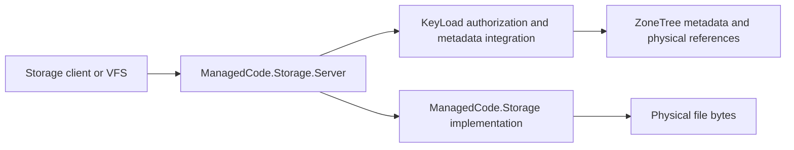

# ADR-038: ManagedCode.Storage file API and physical payload ownership

Status: Accepted design; replacement implementation and qualification in progress.
Decision updated by the owner on 2026-10-19.
Related: [BlobStorage](../Features/BlobStorage.md), [ADR-136](ADR-136-orleans-partition-ownership.md).

## Decision

KeyLoad exposes the existing ManagedCode.Storage file-storage contract (`IStorage`,
with VFS where applicable). Compose the library implementation directly; do not
implement a KeyLoad IStorage adapter or a second multipart/transfer engine.
Reuse ManagedCode.Storage.Server upload, streaming,
range-download and chunk-transfer implementations. KeyLoad owns fresh persisted
resource/row authorization and the metadata publication lifecycle. A separate
KeyLoad public binary upload protocol is not part of the approved design.

ZoneTree stores file metadata, policy, version/publication state, quotas, physical
provider references, lengths and integrity hashes. File payload bytes and binary
parts live outside ZoneTree, through the selected ManagedCode.Storage provider.
Neither a persisted database command, its outcome nor a replica journal carries
file content. Physical provider choice is separate from the public file contract;
S3 support uses the existing ManagedCode.Storage provider implementation.

## Publication and failure boundary

1. Authorize the current principal and reserve bounded metadata capacity through
   the existing connection-grain and storage-owner execution path.
2. Persist immutable physical objects through the provider. Generate their
   identities from the complete case-sensitive database scope and upload identity.
3. Register only physical references, lengths and hashes in the database. Publish
   the visible metadata head using the existing revision condition.
4. Open physical streams only after fresh metadata and row authorization. Bounded
   reads verify provider content against the authorized version metadata.
5. Retirement, failed uploads and physical reclamation retain explicit metadata
   state. An unknown publication outcome never authorizes deleting physical data.

An atomic metadata transaction cannot atomically commit an external file or
bucket write. Replicated metadata does not prove replicated payloads. Backups of
ZoneTree metadata do not include physical file content unless an explicitly
verified physical-object backup operation includes it. Restore must verify
physical references before a restored file can be treated as readable.

## Provider ownership

A configured shared provider must expose the same object identities to every
participating silo. filesystem storage is suitable for one silo or an
explicit common directory with qualified filesystem behavior. Independent local
paths are not a cluster-wide payload store. Physical stream lifetimes stay with
the provider; Orleans activation movement does not move open file handles.

## Removed design

The previous raw-parts-in-ZoneTree decision and public `/blobs` binary protocol
are replaced. No dual read/write path, persisted-data conversion, old serializer
alias reuse or unpublished dependency reference is introduced. The private backup
archive transport has its own contract and is not a user-file API.

## Qualification

The accepted design is not delivery evidence. IStorage/server behavior,
physical content separation, fresh authorization, cancellation, concurrent
publication/deletion, cleanup, metadata/physical restore consistency, shared
provider multi-silo execution and exact-source Linux checks require independent
verification. Earlier raw-part tests do not qualify the replacement.

## Current source state

The custom KeyLoad BlobStorage engine and its raw-part DTOs, HTTP/SDK/MCP
transport, restore processing and exclusive serializers are removed. The rejected
consumer IStorage adapter is removed as well. Module composition with
KeyLoad metadata/authorization integration remains open and must be verified
before exposing file access. The combined Storage repair is delivered in published
10.1.5 packages, with its Linux release and public-feed source identities verified.
KeyLoad uses those published packages; module composition and metadata
authorization remain open.
