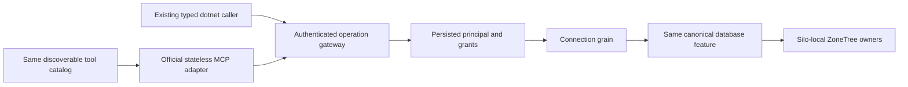

# ADR-039: Official MCP SDK and agent access to canonical operations

Status: Accepted for implementation; runtime and delivery qualification pending. Date: 2026-10-02. Related: [ClientApi](../Features/ClientApi.md), REQ-CLIENT-004–007 / AC-CLIENT-004–007; [Authorization](../Features/Authorization.md), [BlobStorage](../Features/BlobStorage.md), [TestInfrastructure](../Features/TestInfrastructure.md).

Current tool discovery uses the three gateway meta tools and static agent
resource/prompt guidance specified in [ADR-104](ADR-104-mcp-gateway-tool-discovery.md).
Canonical typed operations, persisted authorization, official SDK transport and
signed Orleans execution remain governed by this ADR.

## Context and direction

Root policy requires a simple agent API and the official MCP C# SDK server for
all database, search and storage operations. Current source includes the official
stateless MCP host, canonical typed operation adapters, three gateway tools and
static resource/prompt guidance. Actual SDK and official MCP caller parity,
authorization, resource bounds, recovery and replicated-cluster delivery remain required
qualification gates.

Direction: protocol adapters belong to ClientApi, while business behavior and requirements stay in the owning DocumentStorage/EventStreams/Messaging/GraphTraversal/TimeSeries/Search/ChangeFeeds/BlobStorage slices. Identity comes from persisted server credentials; model/tool arguments cannot substitute trusted roles. Every operation runs in the caller's connection grain (ADR-036, ADR-125) and uses the same canonical authorization, bounds, outcomes and unknown-write retry semantics.

Use the centrally pinned official SDK 2.2.0, stateless Streamable HTTP
`/mcp`, the canonical typed operation inventory and shared Orleans execution.
The agent-facing API is the three-tool discovery/schema/invocation flow under
ADR-104, with fresh persisted authorization for each invocation. Acceptance is specified in [ClientApi](../Features/ClientApi.md).

The Server centrally pins `ModelContextProtocol.AspNetCore` 2.2.0; the official integration
caller uses `ModelContextProtocol.Core` 2.2.0. Source was reviewed at official tag
[v2.2.0](https://github.com/modelcontextprotocol/csharp-sdk/releases/tag/v2.2.0),
commit 6fa3825973949a9c4f0cd8af344e15a8db09dc35. public composition is
AddMcpServer/WithHttpTransport with HttpServerSessionMode.Stateless and MapMcp.
Use WithListToolsHandler/WithCallToolHandler and no competing reflection-discovered
ToolCollection. The shared host registers IHttpContextAccessor explicitly.

DatabaseIdentityMiddleware continues resolving the persisted bearer credential on
every request. Its principal stays in HttpContext.Items, never caller arguments or
captured initialization/session state. Do not add RequireAuthorization without a
real authentication scheme. Every tool effect runs in the caller's connection grain,
which calls the existing capability/partition grain with a reloaded persisted principal.

## Canonical operations and wire contract

ADR-098 adds its direct and SQL graph-path tools as additive version-one reads;
AC-MCP-001 independently verifies the complete current catalog, typed schemas
and effect hints. Persisted administrator authorization remains enforced by the
connection-grain path. Runtime replicated-cluster confirmation remains pending.

Outer arguments are strict: a body-bearing tool accepts only `request`; the four
header-command-ID tools additionally require nonempty GUID `commandId`. No-body
tools accept `{}`. Write identities inside canonical DTOs remain unchanged:
Receive/ReceiveSubscription use request.RequestId; other commands use
request.CommandId. MCP request IDs and Orleans actor IDs never replace them.

| Stable tool name | Canonical request | Result | Existing lane route / capability |
|---|---|---|---|
| keyload_documents_get | GetDocumentRequest | DocumentResult or null | /documents/get; Document |
| keyload_streams_read | ReadStreamRequest | StreamPage | /streams/read; Stream |
| keyload_events_read | ReadEventSourceRequest | EventSourcePage | /events/read; EventSource |
| keyload_subscriptions_status | GetSubscriptionRequest | SubscriptionInfo | /subscriptions/status; Subscription |
| keyload_messages_inspect | InspectMessageRequest | MessageInspection or null | /queues/inspect; Message |
| keyload_graph_traverse | TraverseRequest | GraphTraversal | /graph/traverse; Traverse |
| keyload_graph_shortest_path | GraphShortestPathRequest | GraphShortestPathResult | /graph/shortest-path; GraphShortestPath |
| keyload_query_graph_path | SqlGraphPathRequest | GraphShortestPathResult | /query/graph-path; SqlGraphPath |
| keyload_series_read | ReadSamplesRequest | SampleRecord array | /series/read; Samples |
| keyload_query_execute | QueryRequest | QueryPage | /query; Query |
| keyload_query_ast | AstQueryRequest | QueryPage | /query/ast; AstQuery |
| keyload_query_capabilities | none | QueryCapabilityManifest | /query/capabilities; QueryCapabilities |
| keyload_changes_read | ReadChangeFeedRequest | ChangeFeedPage | /changes/read; ChangeFeed |
| keyload_query_live_start | StartLiveQueryRequest | LiveQuerySnapshot | /query/live/start; LiveQueryStart |
| keyload_query_live_read | ReadLiveQueryRequest | LiveQueryPage | /query/live/read; LiveQueryRead |
| keyload_outbox_status | GetOutboxStatusRequest | OutboxStatus | /admin/outbox/status; OutboxStatus |
| keyload_projections_read | ReadProjectionBatchRequest | ProjectionBatch | /admin/projections/read; ProjectionBatch |
| keyload_search_execute | SearchRequest | RankedDocument array | /search; Search |
| keyload_admin_backup | none | BackupReceipt | /admin/backup; Backup |
| keyload_admin_status | none | NodeStatus | /status; NodeStatus |
| keyload_documents_commit | CommandRequest | CommitReceipt | /commands; Batch |
| keyload_messages_receive | ReceiveRequest | ReceiveResult | /queues/receive; Receive |
| keyload_messages_complete | DeliveryCommand | CommitReceipt | /queues/delivery; Delivery |
| keyload_messages_process | ProcessingRequest | CommitReceipt | /queues/process; Processing |
| keyload_resources_configure | ConfigureResourceRequest + outer commandId | ResourceDefinition | /admin/resources; ConfigureResource |
| keyload_principals_configure | ConfigurePrincipalRequest + outer commandId | PrincipalRecord | /admin/principals; ConfigurePrincipal |
| keyload_credentials_configure | ConfigureApiKeyRequest + outer commandId | boolean | /admin/api-keys; ConfigureApiKey |
| keyload_admin_dispatch | boolean request + outer commandId | boolean | /admin/dispatch; SetDispatch |
| keyload_subscriptions_configure | ConfigureSubscriptionRequest | SubscriptionInfo | /subscriptions/configure; ConfigureSubscription |
| keyload_subscriptions_seek | SeekSubscriptionRequest | SubscriptionInfo | /subscriptions/seek; SeekSubscription |
| keyload_subscriptions_receive | ReceiveSubscriptionRequest | ReceiveSubscriptionResult | /subscriptions/receive; ReceiveSubscription |
| keyload_subscriptions_complete | SubscriptionDeliveryCommand | CommitReceipt | /subscriptions/delivery; SubscriptionDelivery |
| keyload_subscriptions_process | SubscriptionProcessingRequest | SubscriptionProcessingResult | /subscriptions/process; SubscriptionProcessing |
| keyload_subscriptions_pause | SetSubscriptionPausedRequest | SubscriptionInfo | /subscriptions/pause; SetSubscriptionPaused |
| keyload_projections_configure | ConfigureProjectionConsumerRequest | ProjectionConsumerInfo | /admin/projections/configure; ConfigureProjectionConsumer |
| keyload_projections_commit | CommitProjectionBatchRequest | ProjectionBatchResult | /admin/projections/commit; CommitProjectionBatch |
| keyload_projections_release | ReleaseProjectionConsumerRequest | ProjectionConsumerInfo | /admin/projections/release; ReleaseProjectionConsumer |
| keyload_outbox_purge | PurgeOutboxRequest | OutboxHead | /admin/outbox/purge; PurgeOutbox |

Authenticate is internal and absent. Batch retains all ten
canonical mutation discriminators. Backup is a physical side effect, despite
read-dispatch routing; ReadOnly/Idempotent annotations must be explicit per entry.
Stable canonical commands are retryable only with the same ID and payload; a
conflicting payload is rejected. Backup retries may create additional archives.

Input schemas describe actual canonical JSON including nullable values, required
constructor parameters, strict immutable arrays, base64 byte memory, enums and
polymorphism. Decode with JsonDefaults.Options and enforce outer keys explicitly.
Schemas do not themselves authorize or validate an operation. Custom converter
schemas use the reviewed private schema-only options projection and exporter
in the plan. Runtime decoding keeps canonical options; no enum handling is narrowed.

Success StructuredContent is one bounded object `{result, requestId}`: `result`
contains the exact canonical result JSON and requestId is the new execution GUID.
Failures use IsError=true and `{error, requestId}` with a safe Errors.Problem value;
requestId is null if execution never started. Output schemas cover this wrapper
and nullable/array/primitive canonical values. TextContent is a short summary,
never a second full serialized result. The total MCP response has its own explicit
bounded envelope limit above the existing 16 MiB canonical reply limit.

## Request bounds, cancellation and resources

The MCP POST body is bounded by the server-wide request body limit
(`KeyLoad:ServerExecution:MaximumBodyBytes`), the same limit as every other route;
a declared `Content-Length` above it is rejected before the body is read. A strict
UTF8/JSON resource preflight bounds depth/tokens/properties and rejects duplicate
names in a private bounded wire buffer; it does not implement the MCP protocol.
Incoming SDK filters then authenticate the fresh persisted principal and select the
actual catalog operation before typed arguments allocation. The canonical payload
ceiling equals the server body limit; whitespace and RPC metadata count toward it.
Delivery/SubscriptionDelivery/SetDispatch replies use the control reply ceiling
(`McpExecutionOptions.MaximumControlReplyBytes`, default 64 KiB); other replies use
the data reply ceiling (`MaximumDataReplyBytes`, the existing 16 MiB canonical
ceiling). Owned body/result documents survive execution SerializeToNode/SSE writes
until the middleware pipeline and actual session drain finish. No request-count,
concurrency or retained-memory pool applies to MCP callers
([ADR-145](ADR-145-no-request-throttling.md)).

Stateless calls pass handler cancellation and RequestAborted. Cancellation
notifications on another stateless HTTP request cannot target an earlier call.
Disconnected accepted writes retain UnknownWriteOutcome/same-command retry
semantics. SDK disposal awaits actual handlers. SDK full-JSON Trace and
raw-exception logging are disabled for its category; safe KeyLoad diagnostics do
not contain keys or private payloads. Error sanitization is reviewed before join.

Blob resources remain gated by ADR-038 acceptance and implementation. Their URIs
must be opaque and authorization checked on each read, with bounded range/page
limits. BlobResourceContents.FromBytes receives raw bytes; official clients
use DecodedData, avoiding double base64. resources/read has no IsError;
unresolved URIs use safe protocol InvalidParams for the current revision. No
unfinished blob tool or resource may be advertised. The current canonical
inventory contains the operation names, including the ten BlobStorage operations
frozen by ADR-038 and the read-only [AdminDashboard](ADR-051-admin-dashboard.md)
operations. The complete independent schema/effect oracle is
[McpCatalogExpectations](../../tests/KeyLoad.IntegrationTests/ClientApi/Assertions/Mcp/McpCatalogExpectations.cs).
All operations are reached through authorized on-demand gateway discovery and
invocation; the initial public list contains three gateway tools. A catalog count
cannot qualify operation semantics or replace runtime and delivery gates.

## Alternatives, rationale and consequences

- Separate implementations of business operations for MCP/agents: rejected, they break canonical authority and parity.
- Trusted roles from the caller/tool payload: forbidden by mandatory policy.
- A hand-written MCP protocol instead of the official C# SDK: does not meet the requested integration.
- Implicit tool discovery/protocol drift during implementation: rejected; the table above and the SDK compatibility review freeze this version.

A single operation set simplifies AC parity and protects against role escalation. Accepted
means implementation contracts are frozen; it does not
declare MCP coverage, runtime qualification or future blobs complete.

## Implementation contract

1. The table maps current core operations; the independent full catalog oracle and each owning feature freeze the complete names, schemas and effects. ADR-038 owns the ten BlobStorage operations. Any further unfinished blob operation remains gated by its owning accepted contract and implementation.
2. Shared protocol composition belongs to Server/ClientApi; the `.NET` DTO shape does not change implicitly. New helpers/tests mirror `Features/ClientApi/`; business tests live in the owning feature. Current host composition and typed transport stay in their owning ClientApi slices; existing structural debt remains governed by ADR-032.
3. AC-CLIENT-004/005 and AC-MCP-001–007 map to real operation/error/retry regressions; AC-MCP-008 retains genuine large/range storage after BlobStorage acceptance. The .NET SDK adds its missing BackupAsync and SetDispatchAsync surfaces for complete parity.
4. Adapter/schema, SDK caller/tests and owning-feature operation scopes stay separate; a new tool contract, trust weakening, missing upstream SDK contract or overlap stops for review.
5. Canonical GitHub Actions build/analyze/format, TUnit, process recovery and replicated-cluster suites use the actual .NET/MCP clients without doubles and record the exact source SHA/run/jobs/artifacts and the parity of every exposed operation. The capability manifest does not advertise unfinished operations.

Prerequisites: ADR-036 Orleans request/host lifetime, Authorization current principal/policy epoch, ResourceExecution budgets, owning operation contracts; BlobStorage additionally requires the accepted ADR-038 implementation.

## Rollout, rollback and verification

REQ-CLIENT-006, AC-MCP-001/003/005/007 and AC-ROC-006: the official client must retain default protocol negotiation for discovery-first
stateless HTTP; pinning the client revision disables its server/discover path and
forces an initialize handshake which the current stateless protocol does not use.
Keep the server's current protocol, official transport and per-request persisted
bearer authentication unchanged. Use the pinned official SDK's negotiation without protocol emulation.

The official caller retains default negotiation and per-request persisted
authentication. ADR-104 owns discovery tests: exactly three meta tools, the
65,536-byte cap, nonempty cursor and one-byte-short rejection, fresh mutable Tool
isolation, and complete canonical operation/schema parity through graph
search and invocation. Every existing negative/authority scenario remains. A
present empty header is one empty StringValues element; a no-values header is
absent in this abstraction. No reflection discovery, duplicate catalog source or
protocol workaround is permitted. The current discovery contract is exercised
through its real tools and cursor boundaries.

This additive version-one adapter does not change database schema or existing HTTP
JSON. Tool names and wrappers are versioned; later incompatible contracts require
an explicit version/ADR. Credential deployment uses existing persisted API keys,
never an adapter-only secret store. Rollback removes the adapter but cannot undo
committed commands. Timeout/cancellation is not rollback. Existing HTTP source
and tests are a baseline, not official MCP evidence. All new runtime gates remain
pending; this ADR is Accepted, not Implemented.

REQ/AC-EVENT-004/005/006 and AC-MCP-002/005/007 require official-MCP event parity tests: compare canonical event bytes and explicit event identity, order, head and continuation; every actual read cut covers the append receipt and sequential cuts cannot regress. The current public request cannot pin the physical cut. No fake transport, direct-store proof, new provider or runtime contract; this adds no persisted or public format change. A failure or blocked cluster does not qualify the EventStreams capability.
