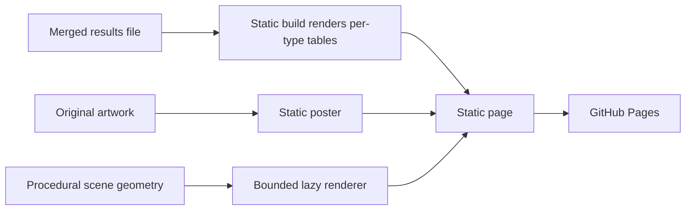

# ADR-040: Static product website and conceptual Three.js scene

Status: Accepted. Website and renderer source are present; Pages publication is
proven only by a successful Website run. Owner: BenchmarkComparisons.
Related: [BenchmarkComparisons](../Features/BenchmarkComparisons.md) (REQ-BC-029),
[ADR-053](ADR-053-unified-visual-identity.md), [ADR-150](ADR-150-per-type-benchmark-jobs.md).

## Decision

Deliver a semantic, responsive static product site from
`site/Features/BenchmarkComparisons/`. Product text, navigation, the benchmark
tables and a poster remain available without JavaScript, browser graphics, reduced
motion or WebGPU. The benchmark tables are rendered into static HTML at build time
from one merged results file ([site protocol](../../site/Features/BenchmarkComparisons/protocol.md));
the browser only filters types and shades scrolled table edges.

The lazy Three.js figure is conceptual: it must not imply live node readiness,
replication timing, traffic or measurement values. The hero illustrates composable
models around one database; it does not depict the replicated cluster topology.

Use the pinned same-origin Three.js 0.186.1 MIT distribution, one lazy
WebGPURenderer and its WebGL2 backend selection; use public lifecycle and error
APIs and no CDN or compatibility shim. Keep procedural geometry only. Bound the
renderer to one canvas, DPR <= 1.5, <= 1,000,000 drawing-buffer pixels, <= 30 draw
calls and <= 120,000 triangles. Render on initialization, resize and bounded input;
animate only while visible, playing and permitted by motion preferences. A paused
or reduced-motion pose settles within 500 ms with no idle loop. Stop hidden or
offscreen work, and dispose unpublished resources after cancelled initialization.
Resize-to-zero, repeated disposal, pageshow restoration and unrecoverable graphics
failure leave the static poster and text usable.

Keep the official vendor bytes, hashes and license in the feature inventory.
Authored JavaScript stays at most 40 KiB gzip and authored CSS at most 20 KiB gzip;
vendor bytes are accounted separately. The builder uses Node built-ins only.

## Original-artwork presentation contract

REQ/AC-BC-PRESENTATION-005 defines the hero illustration
(`site/Features/BenchmarkComparisons/assets/agent-context.png`): a central
three-layer steel and glass database, a human agent above it, upper-left table/SQL,
upper-right graph, left-middle time series, right-middle vector cloud, lower-left
event orbits, front-left queued cards, front-right file folders and lower-right
document pages. Eight cables join the eight model platforms to the database. The
live canvas uses procedural geometry, never a raster plane; the original artwork
is the accessible static fallback. No generic client boxes, repeated scene logo or
silo/grain interpretation appear.

The geometry graph supplies `data-scene-models=8`, `data-scene-agents=1`,
`data-scene-links=8` and `data-scene-clients=0`; these attributes describe the
illustration, not cluster membership. All model names remain in a semantic sr-only
list. Geometry is built and batched in `scene-geometry.mjs`, semantics live in
`index.html` and `scene.css`, and lifecycle and graph attributes in
`scene-lifecycle.mjs` and `scene-observers.mjs`.

## Acceptance

| Requirement | Acceptance boundary |
|---|---|
| REQ-BC-011 | Responsive product purpose and navigation at desktop, tablet and mobile widths; no page overflow or clipped controls; wide tables scroll horizontally |
| REQ-BC-012 | One pinned bounded conceptual Three renderer with real init, cancel, disposal, resize and pause behavior |
| REQ-BC-013 | Accessible semantic labels and focus; usable no-JavaScript, reduced-motion, coarse-pointer and unavailable-graphics content |
| REQ-BC-016 | Canonical feature assets, exact vendor bytes, isolated clean output and the authored JavaScript and CSS budgets |
| REQ-BC-029 | The shared KeyLoad visual identity of ADR-053 |
| REQ-BC-PRESENTATION-005 | The original-artwork composition, eight model platforms, one agent, eight cables and the exact original static fallback |

`tests/KeyLoad.WebsiteTests` runs the real merge and build scripts through Node.
Scene motion, visual composition and graphics-device loss are reviewed manually in
a local preview; that review is development evidence. Package, data format, public
API, cluster topology, benchmark workload and database storage decisions are
outside this ADR.

## Consequences and rollback

Readers get a fast static page whose figures come only from Benchmarks result
files, and a bounded conceptual illustration. Rollback restores a coherent site
asset and source set through a source revert; it never adds synthetic figures.
