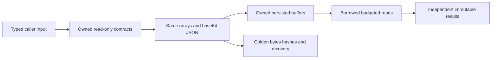

# ADR-041: read-only public collections with stable wire bytes

Status: Accepted implementation contract; implementation and qualification pending.
Owner: KeyLoad under the existing strict-analysis and complete
memory/read-work repair directions. Related: ADR-033, ADR-035, ADR-036.

## Problem and decision

The dependency-enabled strict build found 49 CA1819 array-property diagnostics
and CA1716 on IKeyValueView.Get. These block compiling the product under mandatory
analysis. Public mutable DTO arrays and repeated dense-vector conversions also
conflict with the resource goal. Wire/persistence/fingerprints must survive together.

Use ImmutableArray<T> for 41 ordinary ordered Abstractions sequences and three
float-vector properties. Nullable arrays become nullable immutable arrays, retaining
null versus empty. Required initialized properties use []; default immutable arrays
are invalid where the former required array could not be null. Freeze caller arrays
once through [.. values]; materialize result builders directly into their final
immutable collection. No per-candidate vector ToArray. PreparedSimilarity holds
read-only memory and uses spans with the same SIMD/scalar summation grouping.
The equivalent public Core AuthorizedDocumentChangePage<T>.Changes sequence also
uses ImmutableArray<T> in the owning ChangeFeeds slice. Its generic projection
builder freezes once; JSON array shape, cursor/cut, redaction and order stay exact.

Use ReadOnlyMemory<byte> for KeyValueRecord.Key/Value, StorageMutation.Key and
StoreIdentity.SigningKey; StorageMutation.Value is ReadOnlyMemory<byte>? so null
tombstones remain distinct from empty values. A strict byte-memory converter
rejects null for nonnullable buffers and uses the official reader/writer base64
operations; the nullable wrapper still retains null tombstones. This is a read-only
API view, not deep immutability: the provider
still owns buffers and public scan results remain independent of provider state.
Trusted deserialized frame buffers may be used without recopying keys; caller
buffers cannot become mutable store truth. Signing consumes private key spans.
The public provider configuration ZoneTreeStoreOptions.SigningKey uses nullable
ReadOnlyMemory<byte> as well. Null still requests a newly generated key; an explicit
key is cloned once on store initialization and compared by span against persisted
identity. Caller mutation after construction cannot change the store identity or
signatures. Existing identity/reopen checks and a caller-buffer mutation regression
cover this provider configuration extension.

AC-ROC-002/004/005 and AC-PSW-002..004 restore the nullable-null contract at the
owning producer: Delete is projected by ZoneTreeTransaction.PrepareChanges as an
explicit nullable null, never a live empty value (real-store
StorageRecovery/TombstoneValueTests). Keep legitimate empty Put, reader/replay/
format/version, cache/copy and flush/apply order, and null frame overhead=2
identical. WAL byte equality, borrowed/owned absence, range, empty value,
reopen and snapshot counts are mandatory. Rollback reverts the projection and
keeps regressions.

Strict converter registration lives in JsonDefaults and new Abstractions
Features/ResourceExecution converter files. ImmutableArray conversion delegates
the complete element/array protocol to System.Text.Json's T[] serializer with the
same options. Only freshly deserialized private arrays may be attached through
ImmutableCollectionsMarshal.AsImmutableArray; serialization borrows the backing
array without mutating or exposing it. No extra full-array copy, custom JSON array
parser or default-to-empty fallback. Reject JSON null and IsDefault on the required
immutable type. Nullable wrappers continue to accept null; an explicitly present
default immutable value remains invalid. Missing required constructor parameters
remain rejected by RespectRequiredConstructorParameters. The tests-first fixtures
cover these negative paths before converter integration.

Rename the one owned point-read contract to ReadOwnedValue(byte[] key). Remove
Get from that interface/implementations and update semantic storage callers once.
No alias, shim, duplicate lookup algorithm or severity change. Borrowed ReadValue
and owned Scan remain distinct active contracts. Unrelated log/JSON/private helper
Get methods are outside this rename.

This intentionally changes CLR property/constructor/interface signatures. Rebuild
all solution consumers together; external compiled consumers must recompile for
the development API. Type/namespace names, JSON names/order, enum values, array/
base64 forms, nullable defaults, signatures and persisted format versions stay
identical. Compilation does not establish persisted-format guarantees beyond the current format.

The Client query factory also moves from KeyLoadQuery<T>.From to the non-generic
KeyLoadQuery.From<T> to resolve the actual strict CA1000 prerequisite. Keep the
same initial AST and instance builder behavior, with an internal constructor and
one factory under Client/Features/QueryExecution. All QueryAdapter/LiveQuery/cluster
SDK callers and README examples use the current factory. The generated query JSON
remains identical. No alias, second builder algorithm or analyzer suppression.

The public KeySpace.Applied/Clock properties expose read-only byte memory with
unchanged canonical encoded bytes. Core keeps assembly-private cached input
buffers for trusted gated lookup/write calls; external storage callers create
their owned byte[] once at that API boundary. No new key format or public mutable
array property. ReadExecutionBudget orders its optional business clock before the
CancellationToken, retaining parameter names and the system-clock default; all
named/positional callers join to satisfy CA1068 without a constructor shim.

## Requirements and acceptance

| Requirement | Acceptance and pass/fail | Tests/evidence |
|---|---|---|
| REQ-ROC-001: all located Abstractions properties expose read-only collections | AC-ROC-001: no exported property returns an array; all 49 findings resolved without suppression | Real reflection contract test and strict dependency-enabled build |
| REQ-ROC-002: exact wire/signed/persisted identity | AC-ROC-002: handcrafted base64/tombstone/empty/nullable/vector/polymorphic sequence fixtures round-trip to identical bytes and hashes; invalid required null/missing/default values reject | TUnit serializer/fingerprint goldens and existing retry/frame/recovery suites |
| REQ-ROC-003: owned input/results and efficient dense vectors | AC-ROC-003: freeze once, independent scan buffers, no per-score array conversion, unchanged exact ranks/scores | Real ZoneTree ownership and Search golden/allocation cases; source allocation review |
| REQ-ROC-004: one accurate owned-read API | AC-ROC-004: ReadOwnedValue retains hit/miss/independent buffers; no interface Get or alias | Interface/reflection and real provider read/counter cases, combined compile |
| REQ-ROC-005: all callers and persisted policies use the current contracts | AC-ROC-005: SDK/query/core/storage/security/cluster/tests/comparisons compile with unchanged success/negative/error behavior | Exact GitHub full TUnit/recovery/replicated-cluster SDK/MCP; no skipped/fake qualification |
| REQ-ROC-006: honest source verification and delivery | AC-ROC-006: strict build/format/governance and delivered-SHA CI succeed; docs disclose CLR break/evidence | Combined review, exact SHA/run/jobs/artifacts |

UI N/A: programmatic contracts. Wire/format conversion N/A: the exact current
wire shape and bytes are mandatory. Compilation is not throughput or resource proof; AC-MP-011 remains.

## Rollout, rollback and verification

### DatabaseEngine operation ownership

`DatabaseEngine` owns the shared execution context, validated policy snapshots and node-local admission state. Feature-owned static operation components implement commands, reads and validation through extension methods receiving that same context. There is one implementation of each operation and the existing silo-local atomic transaction and persisted authorization boundary remain shared. KLD0031 applies the same aggregate 200-line limit to every type without an assembly/type/date exemption; files remain bounded to 400 code lines and methods to 64. A strict local Core build passes the numeric rules after extraction. Complete verification still requires real-store, recovery and replicated-cluster execution for the exact delivered source. Existing ResourceProtocolFailureTests cover explicit null resource, retention and queue-policy inputs through the real commit path; retry, watermark and fingerprint behavior require their own execution evidence.

Rebuild all solution binaries together and deploy only after exact GitHub proof.
Valid persisted JSON/frame data needs no conversion. Rollback restores contracts
and all consumers as one verified source unit, with no shim or mixed binaries.
Invalid required null/default input rejects explicitly; nullable fields retain
their old null meaning. Real retry/fingerprint/frame/checksum/process-recovery,
hidden/redacted policy and cluster SDK/MCP regressions are required. Coverage/complexity
remain mandatory and unverified until the required collection/gates run.

Primary guidance: [CA1819](https://learn.microsoft.com/en-us/dotnet/fundamentals/code-analysis/quality-rules/ca1819),
[CA1716](https://learn.microsoft.com/en-us/dotnet/fundamentals/code-analysis/quality-rules/ca1716),
[JSON collections](https://learn.microsoft.com/en-us/dotnet/standard/serialization/system-text-json/supported-types),
[converter null handling](https://learn.microsoft.com/en-us/dotnet/standard/serialization/system-text-json/converters-how-to),
[owned immutable array attachment](https://learn.microsoft.com/en-us/dotnet/api/system.runtime.interopservices.immutablecollectionsmarshal.asimmutablearray?view=net-10.0),
[byte-memory base64 converter](https://github.com/dotnet/runtime/blob/v10.0.0/src/libraries/System.Text.Json/src/System/Text/Json/Serialization/Converters/Value/ReadOnlyMemoryByteConverter.cs).
