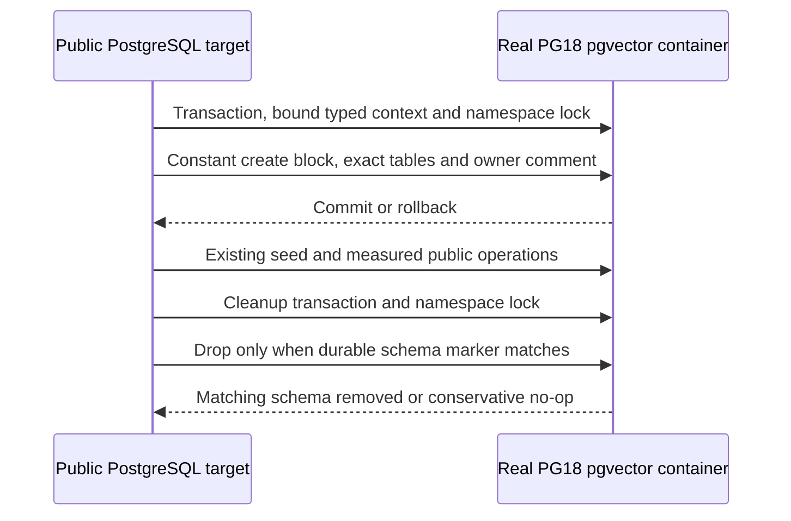

# ADR-045: Owned PostgreSQL comparison schemas and constant commands

Status: Accepted. Date: 2026-10-02.

REQ-BC-021 and AC-PG-001..006 are specified in the
[BenchmarkComparisons](../Features/BenchmarkComparisons.md) feature. Source and
runtime qualification remain incomplete; this ADR must not be marked Implemented
from a source packet or development build.

## Decision and boundaries

Keep the run Guid's existing bench_ schema name and exact measured workload. Add a
private per-target Guid lifecycle marker stored as the schema comment. Constant
client SQL binds native run/owner Guids, dimensions and deterministic namespace
lock key. A short explicit transaction supplies only transaction-local settings,
takes the namespace advisory lock and executes a constant server DO block with
quoted identifiers, checked numeric typmod and atomic schema/marker creation.
Cleanup takes the same lock and drops only a matching durable marker. It remains
safe when setup fails because another target owns the same namespace or when the
schema has already disappeared. Replication ALTER SYSTEM stays outside this DDL
transaction; native graph SQL branches assign exact existing constant statements.

Comments are visible lifecycle metadata, not secrets or database authorization.
The real database owner may alter them; marker mismatch conservatively prevents
deletion. No generic trusted-SQL wrapper, analyzer suppression or success-flag-only
cleanup. A commit-attempt hint is set only immediately before CommitAsync: it routes
uncertain responses to durable-marker verification, while a pre-commit rollback
closes the source without waiting again for a blocked namespace. It grants no
deletion authority. Cleanup errors may mask the primary setup failure; redesigning
that exception contract is outside this repair. No new measured query, table, API,
transport, topology or credential rule.

