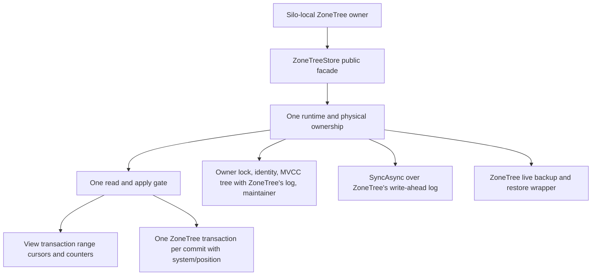

# ADR-046: Cohesive node-local storage owners under numeric gates

Status: Accepted. Date: 2026-10-02.
REQ-STORAGE-008; AC-SQ-001..008 in [StorageRecovery](../Features/StorageRecovery.md),
AC-CQ-008 and AC-MP-001/002/012.
This decision remains Accepted until delivered-source qualification is complete.

Maintenance disposal joins (REQ-STORAGE-MAINTENANCE-JOIN-001..003 and
AC-STORAGE-MAINTENANCE-JOIN-001..004 / AC-STORAGE-MAINTENANCE-SNAPSHOT-005 in
StorageRecovery) require the silo-local
ZoneTree owner to join its tracked merge threads and retire its Orleans
maintenance timer before releasing tree and owner file handles. Cleanup calls and
physical session close execute on the same captured Orleans owner context; no
periodic Task or synchronous Task join schedules engine work outside that context.

## Distinct-process owner regression

REQ-STORAGE-008 maps to the measurable AC-STORAGE-OWNER-001 in StorageRecovery.
Same-process StoreLifetime contention and sequential RecoveryProcess reopen tests do
not establish simultaneous distinct-process exclusion. StorageRecovery/Cases/
StorageOwnerProcessTests.cs reuses the existing real inspector process.

Ordered stages are: hold the actual parent store; launch and settle a denied
child with exact safe I/O failure and unchanged canonical identity/value/position;
verify a healthy parent commit/read; reject and settle another child; dispose the
parent; verify successful child inspection and exact ordinary reopen. Preserve
original process, pipe, outer-owner and deadline bounds. Normal and current-source
Linux recovery runs retain source, compiled identity and original receipts.
Storage-module coverage is supporting evidence; all other lifetime and product
gates stay open until actually qualified.

## Decision

Preserve the public ZoneTreeStore facade and every caller contract. Compose one
private runtime/handle owner with cohesive initialization/identity, commit
publication, position, read/transaction/range, maintenance and backup/restore
components. All feature code remains in the same repository and canonical slices.
No second gate, tree or log, partial-type loophole, quality exception or
grain-owned storage. The silo-local ZoneTree owner retains physical ownership as
Orleans activations move.

## Implementation contract

1. Actual source governs the AC-SQ criteria and signatures.
2. Real-store facade, failed-open, lock-reuse and double-dispose regressions live in
   StorageRecovery tests; no doubles, hooks or local qualification.
3. `StorageEngine/Execution` owns the runtime, commit publication
   (`ZoneTreeCommitPublication`), the persisted position (`ZoneTreeStorePosition`)
   and the tree factory that selects ZoneTree's write-ahead log mode.
   `Restore/Execution` owns `ZoneTreeBackup` and `ZoneTreeBackupCopy`
   ([ADR-011](ADR-011-current-format.md)).
4. The facade, runtime/initializer/identity, handles, read/range/transaction views
   and maintenance have a single owner. Startup opens the tree once and ZoneTree
   replays its own log. Preserve constructor-failure and normal disposal orders with
   finally-based complete cleanup. Borrowed views, counters and budget timing stay
   exact under the same gate.
5. Review every diff against the criteria and build with all SDK/style/XML/numeric
   rules. Canonical GitHub runs real TUnit/MTP unit, process recovery and
   Docker/Aspire replicated-cluster .NET/MCP suites for the exact delivered SHA.
   Retain run/job/SARIF/raw artifacts; no skipped suite is a passing gate.
6. Run the formatter, static governance and a final single-owner/format/fault-order
   review. Coverage, endurance and power-loss remain incomplete until their separate
   real gates pass.

Dependencies and joins: existing centrally pinned ZoneTree/.NET 10/TUnit only; no new
package or tool. Backup borrows the single runtime. Identity bytes and error codes
remain exact. Do not add alternate API paths or reassign node-local storage to
grains. Process kills qualify only their declared failure model, never power-loss
durability or production readiness.
