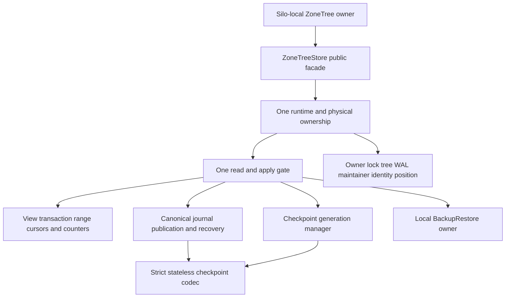

# ADR-046: Cohesive node-local storage owners under numeric gates

Status: Accepted. Date: 2026-10-02.
REQ-STORAGE-008; AC-SQ-001..008 in [StorageRecovery](../Features/StorageRecovery.md),
AC-CQ-008 and AC-MP-001/002/012.
This decision remains Accepted until delivered-source qualification is complete.

Maintenance disposal joins (REQ-STORAGE-MAINTENANCE-JOIN-001..003 and
AC-STORAGE-MAINTENANCE-JOIN-001..003 / AC-STORAGE-MAINTENANCE-SNAPSHOT-005 in
StorageRecovery) require the silo-local ZoneTree owner to join its tracked execution
merge threads and retire its Orleans maintenance timer before releasing
tree, journal and owner file handles. cleanup calls and physical session
close execute on the same captured Orleans owner context; no periodic Task or
synchronous Task join schedules engine work outside that context.

## Retired generation ownership repair

REQ-STORAGE-020 / AC-DBHP-009 extends AC-SQ-004.
A real post-InstallPrepared cleanup failure was found:
the retired maintainer/tree were successfully disposed during generation preparation
but remain referenced as live owners; final disposal repeats the maintainer call.
This is KeyLoad handle ownership, not a replacement or workaround for ZoneTree.

The preserving contract is a real-store two-stage regression for InstallPrepared and JournalSwapped (exact poison checks, explicit closing and repeated actual Dispose) and a change confined to `ZoneTreeStoreHandleDisposal.cs` and `ZoneTreeCheckpointGeneration.cs` that clears successfully retired handle ownership before the later fault boundaries. Other helpers, runtime/public interfaces, options, packages, callbacks and formats are out of scope.

Keep failed-open maintainer/journal/tree/ownership and normal
maintainer/tree/journal/ownership orders, independently required cleanup,
generation/identity publication, journal swap, poison and recovery semantics.
No swallowed ObjectDisposedException, diagnostics waiver, new callback, data or
deployment change. Rollback both product
helpers together after drain; retain the regression and failure evidence.
The decision remains Accepted until actual qualification; process kills do not
qualify power-loss durability.

## Distinct-process owner regression

REQ-STORAGE-008 maps to the measurable AC-STORAGE-OWNER-001 in StorageRecovery. Current same-process
StoreLifetime contention and sequential RecoveryProcess reopen tests do not establish
simultaneous distinct-process exclusion. The new StorageRecovery/Cases/
StorageOwnerProcessTests.cs reuses the existing real Release inspector.

Ordered stages are: hold the actual parent store; launch and settle a denied
child with exact safe I/O failure and unchanged canonical identity/journal/value/
position; verify a healthy parent commit/read; reject and settle another child;
dispose the parent; verify successful child inspection and exact ordinary reopen.
Preserve original process, pipe, outer-owner and deadline bounds. normal/scalar plus current-source Linux full
recovery run with source, compiled identity and original receipts retained. Execution
storage-module coverage is supporting evidence; all other lifetime and product
gates stay open until actually qualified. No production, format, dependency,
public API or deployment change is permitted by this test-only stage. Rollback
removes only the added regression.

## Decision

Preserve the public ZoneTreeStore facade and every format/caller contract. Compose
one private runtime/handle owner with cohesive initialization/identity, journal,
read/transaction/range, checkpoint-format/generation and BackupRestore components.
All feature code remains in the same repository and canonical slices. No second
gate/tree/WAL, partial-type loophole, quality exception or grain-owned storage.
The silo-local ZoneTree owner retains physical ownership as Orleans activations move.

## Implementation contract

1. Accept the AC-SQ criteria/signatures and this ADR before implementation; actual source governs.
2. Independent real-store facade, failed-open, lock-reuse and double-dispose regressions live in a new StorageRecovery test file; no doubles, hooks or local qualification.
3. New checkpoint writer/reader/frame/metadata files under StorageRecovery carry the frozen stateless signatures and shared constants. Preserve batches, headers, JSON/digest/modes/observers and footer stop during WAL replay; source review plus the existing CheckpointTests and process publication/recovery cases are the proof.
4. The facade, runtime/initializer/identity, handles/journal, read/range/transaction partial conversion, generation manager and shared format have a single owner. Startup opens and replays once. Preserve constructor-failure order maintainer/journal/tree/ownership and normal disposal order maintainer/tree/journal/ownership, with finally-based complete cleanup. Borrowed views, counters and budget timing stay exact under the same gate.
5. New ZoneTreeBackupRestore-prefixed files in BackupRestore follow once the runtime/identity interfaces freeze. Retain the exact verified local backup, clean restore with private new identity and paused authority-state recipe, and one ordinary restored facade.
6. Review every diff against the criteria and build with all SDK/style/XML/numeric rules. Canonical GitHub runs real TUnit/MTP unit, process recovery and Docker/Aspire replicated-cluster .NET/MCP suites for the exact delivered SHA. Retain run/job/SARIF/raw artifacts; no skipped suite is a passing gate.
7. Run the formatter, static governance and a final SOLID/single-owner/format/fault-order review. Coverage, endurance and power-loss remain incomplete until their separate real gates pass.

Dependencies and joins: existing centrally pinned ZoneTree/.NET10/TUnit only; no new package/tool. The checkpoint codec has no runtime backreference; journal replay uses its reader once. Snapshot verification remains gate-free. The checkpoint manager and backup borrow the single runtime.

Source-only refactoring: keep private responsibilities in canonical slices and
compose them through the facade. No data, public or wire contract change;
identity/checkpoint/WAL/backup bytes and error codes remain exact. Rollback this
entire private decomposition as one source unit; do not roll back enabled analysis,
add alternate API paths or reassign node-local storage to grains. Process kills qualify only their declared
failure model, never power-loss durability or production readiness.
