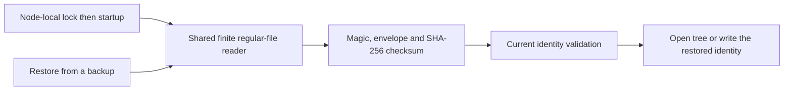

# ADR-048: bounded owned storage metadata

Status: Accepted; exact-source qualification pending.
Related: REQ-BACKUP-005, REQ-STORAGE-011, AC-BSM-001/003/005, AC-MP-006/012;
ADR-008/011/033/035/046.

The store identity file is the only KeyLoad-owned storage metadata
([ADR-011](ADR-011-current-format.md)); ZoneTree owns the format of its tree and
backup files. The identity reader must not allocate according to untrusted file
size. Its inclusive limit is the validated `MaximumIdentityFileBytes` storage
option, 4 KiB by default; the current envelope fits well below it.

Implementation contract:

1. One reader (`ZoneTreeMetadataFile.Read`) opens the existing regular file through
   the no-follow regular-file primitive, rejects a length above the limit before
   allocating and reads at most limit+1 bytes into one owned region. An
   authoritative count and final length reject growth above the limit. Oversize is
   `FormatUnsupported`, never a silent truncation; stream disposal is
   unconditional.
2. Store startup reads the identity after physical lock acquisition. Restore reads
   the backed-up identity with the same reader and limit before it creates the
   destination. Preserve error precedence and lock cleanup.
3. `MetadataEntryOpenTests` exercise the exact-length read, the one-under refusal,
   missing input and invalid entry kinds with unchanged files and a healthy reopen.
4. Strict builds, numeric gates, formatter and governance, then exact-SHA GitHub
   TUnit/recovery/cluster SDK/MCP and all required gates. Record source versus
   executed proof.

The current stored schema and writer output remain exact; persisted data, public
signatures and dependencies are unchanged. Multi-silo restore, power loss, endurance
and measured physical I/O remain outside this contract.
