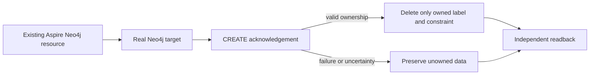

# ADR-049: Genuine Neo4j harness and acknowledged cleanup ownership

Status: Accepted; comparison qualification remains pending.
Related: REQ-BC-023 / AC-GH-001..007, REQ-BC-001/002/009; ADR-032, ADR-033, ADR-034, ADR-035, ADR-043, ADR-044, ADR-071, ADR-076, ADR-080.

## Decision

Use the separate ComparisonHost session owner and the selected Aspire database infrastructure. The benchmark target uses a real pinned Neo4j Community server and the real KeyLoad cluster target where applicable. Neo4j Community is a single-node topology; 2-node and 3-node Neo4j slots remain explicit unsupported-topology dispositions. Do not represent a standalone server as a cluster or fabricate missing capabilities.

Grant cleanup authority only after a valid CREATE acknowledgement confirms ownership of the label/constraint. On failure or uncertain acknowledgement, do not delete an unowned resource. Dispose each owned client and attempt every confirmed-owned cleanup while retaining primary and cleanup failures. An uncertain acknowledgement may leave an orphan; it is not proof of ownership or recovery safety.

Neo4j's HTTP Query API can return HTTP 202 for a query failure. Parse the documented JSON response shape: a successful CREATE may omit or contain an empty errors collection and must have the expected empty result shape, query type and opaque bookmark list. Reject malformed or missing claimed success and nonempty errors. Diagnostics must not include server messages or credentials.

## Acceptance and implementation contract

AC-GH-001..007 require genuine engine operations, acknowledged cleanup ownership,
preservation of foreign constraints after setup failures, valid response shapes,
measured writes with original readback and bounded cleanup. These remain observable
acceptance requirements; source inspection does not establish a pass.

The current target belongs to `benchmarks/KeyLoad.Comparisons`; the separate
`benchmarks/KeyLoad.ComparisonHost` owns selected live infrastructure, measured
workloads and original result artifacts. There is no comparison test project or
parallel protocol-test harness. Original workload evidence does not qualify
independent process faults, recovery or production readiness.

Run source checks and retain exact-source Linux engine and benchmark artifacts.
Historical receipts do not qualify changed source.
