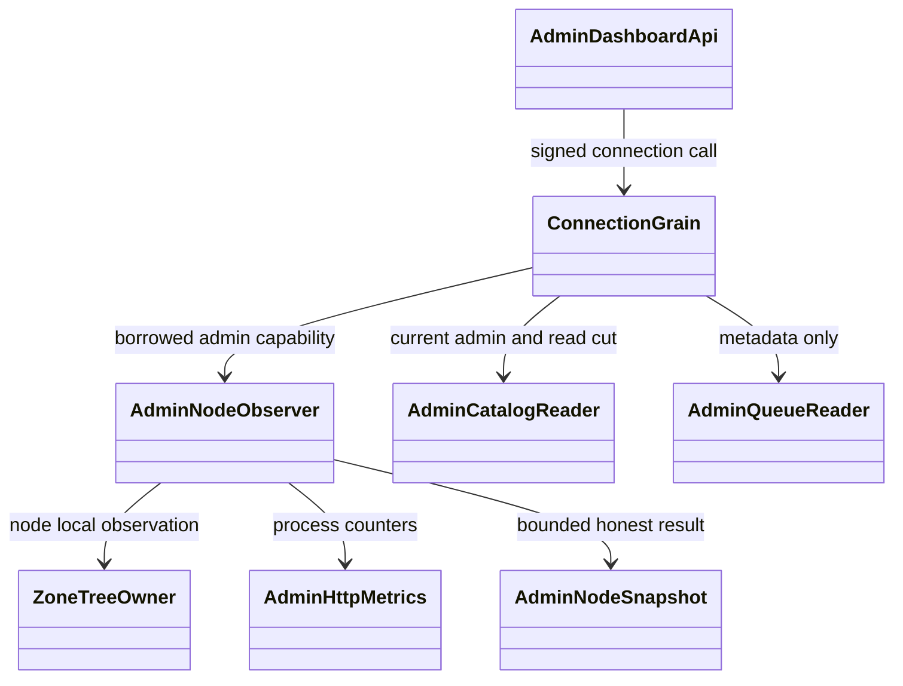

# ADR-051: same-origin read-only administration console

Status: Accepted. Date: 2026-10-02. Related: REQ-AD-001..007 / AC-AD-001..007; ADR-036 Orleans routing, ADR-035 resource bounds, ADR-038 blobs and ADR-039 official MCP.

## Decision and rationale

Host the credential-free console shell and finite same-origin asset whitelist in the Server `AdminDashboard` slice, using embedded static resources. Protect all data reads with existing persisted identity and current administrator authority through the connection grain. The public Pages site retains its benchmark-evidence boundary. Add no packages/frameworks, schema or storage owner.

Catalog and queue metadata are gated bounded read pages. Physical file observations and process HTTP counters are borrowed from the executing node; report that node explicitly, incomplete scans and process resets. Frontend polls sequentially and retains bounded measured history; it does not claim cluster totals or persistent metric history. Existing authorized query AST and blob-list operations remain their current owners.

## Implementation contract

1. The frozen DTO/protocol, acceptance, feature, shared enum/routing/composition, SDK/MCP and architecture documents are one contract. Existing enum numeric values remain intact by appending three read kinds.
2. New Core/AdminDashboard readers, new Server/AdminDashboard C# observers/metrics/API, plus the INodeAdministration and NodeAdministration bridge. Each request establishes a fresh applied barrier, reloads authority and uses bounded gated reads; filesystem observation retains node ownership with one concurrent scan, 2,048-entry/250 ms/200-output bounds and no symlink following.
3. Colocated Server/AdminDashboard/Assets implement the accessible desktop/mobile console and memory-only session against the frozen DTOs, existing query/blob operations, pagination, bounded real charts and disconnect/stale protections.
4. New matching UnitTests and IntegrationTests slices derive failing regressions from AC before production joins and exercise actual file stores, the replicated cluster, .NET/official MCP clients and the browser. No fake dependencies or local test execution.
5. Scoped relevant source is delivered through normal Git. Qualification occurs only through exact-SHA GitHub Actions with real artifacts; baseline failures and absent coverage remain explicit. The ADR stays Accepted until every required AC, documentation and qualification gate passes.

## API and rollout

Add GET `/v1/admin/dashboard`, POST `/v1/admin/dashboard/resources` and POST `/v1/admin/dashboard/queue`, their typed SDK methods and explicit read-only official MCP tools. Static `/admin`, `/admin/` and named assets are exact allowlisted GET/HEAD routes; data paths receive no auth exemption. HTTP telemetry counts completed `/v1` and `/mcp` requests excluding dashboard polling, admission/status observations, static, health and internal routes; metrics contain only global process counters and elapsed duration, no sensitive labels.

Rollout needs coordinated server/SDK catalog support and leaves stored data unchanged. Rollback removes the dashboard slice and composition in one release, never renumbers existing reads or changes stored data. Public operation contracts, Orleans placement, distributed directory and activation repartitioning remain as configured. Physical observations are time-bounded filesystem metadata, not a durability proof. Manual visual rendering closes only subjective design; production/endurance/power-loss/coverage gates remain open until actual proof.
