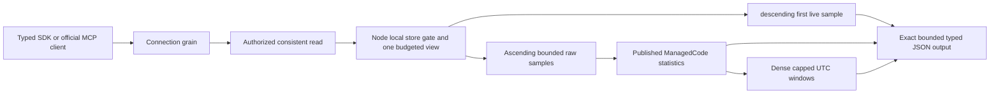

# ADR-052: bounded TimeSeries latest and raw aggregates

Status: Accepted; source joined, exact-SHA qualification and remaining gates pending.
Date: 2026-10-02.
Related: REQ/AC-SERIES-008..012; REQ-STORAGE-013 /
AC-RANGE-REV-001..003; ADR-004/005/010/014/035/036/041/050.

## Decision and rationale

Add typed read-only latest, whole-range statistics and dense fixed-window
statistics over the canonical persisted samples. Keep the existing inclusive
ReadSamples operation unchanged. Every new public request runs in the caller's connection
grain; silo-local ZoneTree storage and the existing required-copy acknowledgement and
consistent-cut behavior remain the owners of records and reads.

Use the published centrally pinned ManagedCode.TimeSeries 10.0.3 inside Core as
a bounded temporary numeric accumulator. It does not replace KeyLoad storage,
ordering, event deduplication, persisted authorization or replication. The initial
10.0.0 implementation used published source23632b9f8d49d5a7feb337caa6cbeb5b22d7575a.
Temporal rounding defects were subsequently repaired in the owning repository;
published10.0.2 source2c9118b6fbd45a5170682d345d66cba4ad6e8f2d passed1104/1104
tests and90% coverage in each module. The lead independently verified the
release/tag, actual package contents, NuGet signatures and duplicate-publication
fence in the delivery receipt (report removed from repository).
The following summer allocation patch is published10.0.3 at source
de44e91ecf38779b61fe79a51153ce7b7b4db0ea. Its owning Release run37077860613
passes1107/1107 tests, Core687/725 and Orleans205/212 covered lines. The lead
independently verifies the annotated tag, actual GitHub assets and both signed
NuGet payloads before the new central pin. Four repeated normal/scalar
profiles complete16 cases each, with20 result iterations per case; the
10.0.3 receipt (report removed from repository) keeps
source, package and measurement proof separate. The private static generic-state
callbacks preserve the public accumulator contract and add no consumer
workaround. The KeyLoad10.0.3 consumer change requires a new exact-SHA GitHub
unit/recovery/cluster qualification.

Three DoubleTimeSeriesSummer instances use Strategy.Sum/Min/Max,
TimeSpan.MaxValue and maximum bucket count1. Pass each real sample timestamp and
value in the canonical UTC/sequence order. Every representable UTC date tick is
less than half TimeSpan.MaxValue, so RoundUtc puts all values into one
bucket. This avoids unordered multi-bucket summation, retains actual dates and
uses raw DataCount. Raw average is Sum/DataCount; the library's documented
bucket Average operation is a different contract and is not used here. Empty
windows need no accumulator, and live accumulators do not retain samples.

## Public contract

| Operation | Input | Output / rules |
|---|---|---|
| Latest | ReadLatestSampleRequest(Partition,Set,SeriesId,AtOrBefore=null) | LatestSampleResult(SampleRecord? Sample); greatest UTC timestamp then greatest persisted sequence at/before optional inclusive cut; absent is null Sample; tags are projected by current persisted policy |
| Aggregate | AggregateSamplesRequest(Partition,Set,SeriesId,From,UntilExclusive=null,MaxSamples=10000) | SampleAggregate(Count,Sum,Minimum,Maximum,Average); complete half-open [From,UntilExclusive), UTC comparisons; null end includes the representable maximum timestamp |
| Windows | AggregateSampleWindowsRequest(Partition,Set,SeriesId,From,UntilExclusive,Width,MaxSamples=10000,MaxWindows=1000) | SampleAggregateWindowsResult(ImmutableArray<SampleAggregateWindow> Windows); each window has From, nullable UntilExclusive and SampleAggregate; dense ascending fixed-width UTC windows anchored at From, final window clamped |

Empty aggregate: Count=0, Sum=0, extrema/average=null. Equal range bounds are valid
empty ranges. Inverted range and nonpositive width give Validation. Finite input
whose accumulated sum is nonfinite gives Validation with a fixed safe message,
no partial response or mutations; a smaller following read remains healthy.
Raw average uses event counts, including multiple samples at equal timestamps.
Late committed data is visible on a new cut; event deduplication stays upstream.

The internal null-end tick is DateTimeOffset.MaxValue.UtcTicks+1, which fits long;
it is never constructed or serialized as a DateTimeOffset. Only a window ending
after the greatest representable tick returns null UntilExclusive. Bucket count
uses span/width and remainder, not overflowing span+width-1 arithmetic. End
advance clamps by remaining span before addition. Width may exceed the range.

Both caller caps must be positive and no larger than server MaxScanRecords /
MaxResults; invalid caps give BudgetExceeded. Check the calculated window count
against both caller and server bounds before allocation. A live matching sample
beyond MaxSamples is charged lookahead and makes the whole aggregate fail
BudgetExceeded; truncated statistics never count as success.

One ReadExecutionBudget.CreateView wraps the original gated view. Principal and
resource lookups, sample bytes and lookahead are charged exactly once. All new
operations require current persisted SeriesRead, including empty results. Check
cancellation/deadline during metadata, traversal, window fill and result writing.
Check the exact complete JSON output under the same configured MaxBatchBytes.
All result collections are immutable and retain ADR-041 array serialization.
The new HTTP and MCP canonical routes reserve the existing heavy-read ingress
working set under AC-SERIES-011, sharing capacity with query/search/range reads.
HttpAdmissionGovernor and its new TimeSeriesHttpAdmissionTests keep the existing admission ceilings and release semantics are unchanged.

## Shared reverse storage contract

Add IKeyValueView.VisitReverseRange with the identical prefix, exclusive lower
afterKey, exclusive upper untilKey, observer, cancellation and borrowed visitor
parameters as VisitRange. Only order changes to descending encoded keys.
Parameterize the existing private range merge and its cursors. Preserve
forward defaults, staged replacement/insert/tombstone precedence and counters.

The baseline uses pinned ZoneTree's CreateReverseIterator(NoRefresh); seek to
the lesser of caller upper bound and binary prefix successor. Empty/all-FF
prefix has no successor and uses reverse start. Filter exclusive bounds
explicitly and stop below the lower/prefix boundary. Staged data uses the execution
SortedSet.GetViewBetween(...).Reverse enumerator, not a buffered LINQ reverse.
Do not buffer/copy the full baseline, transaction changes or series history.
If seek throws, dispose the acquired iterator before rethrowing.

Charge matching examined key/value bytes before callback or live lookahead.
Visitor=false stops before further cursor advance. Every failure releases the
cursors and original storage gate. Latest stops after its first live
committed sample; its real-store logical baseline-entry delta is one, independent
of history size. Counters are logical work, not physical disk/RSS measurements.

## Verification and rollback

Each criterion maps to test-owned independent raw oracles and real provider/
SDK/MCP/fault operations in the TimeSeries feature. Preserve all existing
forward/inclusive/security/replication tests. No doubles, weakened assertions,
global suppression, new retries or increased bounds. seek-error disposal
requires source/lifetime review because no real provider failure-injection API
is available; it is not claimed as an executed environmental fault branch.

Persisted format and data remain unchanged. Public changes add read APIs;
roll back the contracts/routes/read catalog/reader slice together while
retaining existing numeric read kinds and storage formats. The separate ADR-050
comparison continues declaring its own measured operations; client-folded
statistics must not be relabeled measured server aggregation.

This ADR remains Accepted until all implementation, tests, docs and verification
exist. Numeric coverage, full comparison, endurance, power-loss, maximum speed,
activation migration, retention/rollups, SQL and compressed chunks remain open
gates/work. SMID waits for owner mapping; Orleans Streams remains an
independent first-priority architecture workstream under the root policy.
