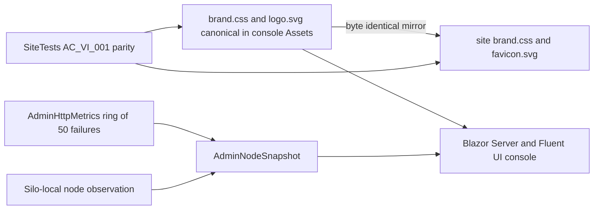

# ADR-053: one light KeyLoad visual identity for the console and the site

Status: Accepted. Date: 2026-10-02. Owner: KeyLoad lead. Related: REQ-AD-008..010 / AC-AD-008..010 ([AdminDashboard](../Features/AdminDashboard.md)), REQ-BC-029 / AC-BC-029 ([BenchmarkComparisons](../Features/BenchmarkComparisons.md)), ADR-040 site design, ADR-051 admin console.

## Context

The owner rejected the visuals of both surfaces:
- The runtime console (`/admin`) used a dark mint theme, a text monogram and a single polyline chart.
- The public site used a warm-paper/forest editorial style with serif display type.

The two surfaces shared no logo, palette, typography or components, so KeyLoad read as two unrelated products. The owner asked for:
- one style across both surfaces, starting with a simple, clear, light and attractive console;
- clear charts;
- convenient menus and categories;
- error logs, data volume, performance and nodes.

## Decision

- **One brand source.** `src/KeyLoad/AdminDashboard/Assets/Styles/brand.css` holds the tokens and the shared primitives (`kl-brand`, `kl-btn`, `kl-card`, `kl-glass`, `kl-badge`, `kl-chip`, reduced motion). It is mirrored byte-for-byte to `site/Features/BenchmarkComparisons/brand.css`, and `logo.svg` to `site/favicon.svg`. The SiteTests drift test `AC_VI_001` fails on any difference.
- **Style direction (owner, 2026-10-02).** Earlier candidates were rejected: a light-blue look, pastel/rainbow glass and a plain grey version. The adopted style is serious Apple-style Liquid Glass in the sibling brands' colours:
  - Managed Code: warm off-white, black ink and system typography.
  - Prostir: graphite instrument panels (`.kl-graphite`).
  - Accent: Managed Code's pastel iridescence (peach `#ffb08a` → lilac `#e3a6ff` → periwinkle `#9fb4ff`), used as a marker stroke, a selection edge, a status dot or the KeyLoad bar, never as a background wash. Green and lime are not brand colours .
  - Glass: translucent surfaces with specular top edges and large blur, capsule controls and large radii.
  - No Material Design and no decorative colour blobs.
  - The logo is a graphite squircle with white replica blocks and chevron, plus one iridescent replica.
  - Data colours: violet, peach-ink, periwinkle, orchid, graphite, amber, grey, red (`--kl-c1..c8`). There is no green data colour; the deep green `--kl-good` is reserved for semantic success status.
- **Console framework.** The administration UI uses Microsoft Fluent UI Blazor 5.0.1 with interactive server rendering. Fluent cards, inputs, buttons and data grids own the controls; the circuit owns navigation, authorized reads, bounded measurement history and cancellation. The shared logo and brand asset remain canonical for the public site.
- **CSP and fonts.** System fonts only and same-origin framework assets. Fluent's dynamic component geometry requires inline styles; script execution remains restricted to same-origin assets. The small visibility bridge reports tab visibility without owning application state.
- **Console information architecture.** Monitoring contains Overview, Performance and the filtered server failure log. Data contains the catalog, collections, queues and blob storage. Infrastructure contains actual Orleans membership and bounded physical file observations. Responsive navigation and independently scrollable Fluent data grids keep the page within the viewport.
- **Real data only.** Charts plot at most 120 comparable session samples and reset on process change, failure or reconnect. The error log is a new bounded server observation: `AdminHttpSnapshot.RecentFailures`, at most 50 newest-first entries holding the route template, normalised method, status, aborted flag and duration. It never holds a raw path, query, payload or credential.
  - The node figure shows the executing node's own observation. Other nodes are labelled as not observed from the executing node.
- **Site.** The landing is a new product page, not a restyle. Its numbered chapters (`01 — …`) run in this order:
  - a floating glass capsule navigation;
  - an editorial hero with an oversized black headline and an iridescent marker under "AI agents";
  - a glass stage holding the live Three.js scene: a carousel of eight data-shape cards around the KeyLoad core, a transparent canvas over the stage gradient, 19 draw calls and 37 triangles. It moves as soon as it is ready, except under reduced motion, and settles when paused;
  - a four-fact strip;
  - the anatomy of one agent call: a numbered timeline beside a graphite MCP/SDK terminal;
  - a data-shape bento of eight models with line art;
  - a graphite engine cross-section (callers → connection grain → partition grains → silo-local ZoneTree owners);
  - the evidence instrument: a toolbar, segmented scenarios, the chart and table, and a perforated evidence receipt for provenance;
  - a ledger of "open by default" items and items "not claimed yet";
  - a method rail, a graphite reproduce terminal and an editorial wordmark footer with "Developed by Managed Code".

  Every tested hook, budget and lifecycle contract is unchanged.

## Vector asset repair continuation, 2026-10-03

The owner's screenshot reports a pixelated K. REQ-VEC-001..003 and
AC-VEC-001..005 refine the existing public-site identity without changing its
canonical logo, layout, data or runtime contracts. See the exact
[feature continuation](../Features/BenchmarkComparisons/VectorAssets.md).

Use a real vector poster, and the existing canonical favicon as one decorative
DOM SVG image projected by the existing Three camera/root. Remove the separately
painted CanvasTexture K. The SVG stays outside the deliberately bounded GPU
buffer, uses its projected CSS size and follows ready/resize/pointer/reduced-motion,
pause/error/zero-size/disposal/restoration transitions. GPU budgets remain unchanged.
The symbol is foreground illustration; it does not express live cluster state.

Shared projection/lifecycle/HTML/CSS and requirements have a single owner; the
poster and new acceptance-driven source/CDP helpers are separate. Tests join
first, then source, then diff/development/static/manual review and the
complete exact-SHA GitHub website/analyzer/coverage gate and normal Pages receipt.
No local test execution, new dependencies or evidence-policy exemption. The
canonical favicon/poster paths remain stable; rollback reverts only the
coherent presentation change. Missing independent comparison evidence remains
an explicit publication blocker. This continuation remains Accepted until all
required verification exists.

## Icon and site metadata continuation, 2026-10-03

The owner's favicon/SEO/social-preview request adds REQ-SEO-001..006 and
AC-SEO-001..007 in [SiteMetadata](../Features/BenchmarkComparisons/SiteMetadata.md).
Preserve the canonical SVG and existing identity; derive six PNG/ICO files under
console Assets with byte-identical site mirrors. Static landing metadata and an
authored SVG/1200×630 PNG share card use the existing www canonical. JSON-LD
describes the actual project license from the root LICENSE (Elastic License 2.0 under ADR-107) without invented ratings/offers or measurements.
The console receives only those finite public GET/HEAD icon routes and noindex;
its authentication, CSP and data routes remain unchanged. Existing robots/sitemap
generation is extended within BenchmarkComparisons, not a second crawl source.

Implementation stages and acceptance are retained
in [SiteMetadata](../Features/BenchmarkComparisons/SiteMetadata.md#implementation-and-delivery-contract).
Join the exported bytes, emitted/static-host behavior and acceptance-driven real
builder/cluster tests before development/static/manual checks and normal
exact-SHA GitHub qualification/publication. No new dependency or persisted-data
change. Rollback coherently reverts the added head/assets/copy/whitelist changes.
Provider indexing/share-cache refresh is a manual external outcome; source push
or local rendering cannot establish it. Missing isolated evidence is reported,
never bypassed. This additive contract remains Accepted until required gates pass.

## Alternatives

- Restyle each surface separately. Rejected because drift returns.
- A shared npm or MSBuild design package. Rejected: it adds tooling and dependencies, the Docker context holds only `src/`, and the site build is a separate pipeline.
- Inline the logo into each page. Rejected because the favicon and logo bytes must stay one fact.

## Implementation contract

1. **Brand:** tokens and logo, mirrored to the site, land before the UI packets.
2. **Metrics:** ring buffer and middleware in `src/KeyLoad/AdminDashboard/AdminHttp*.cs`, with unit tests `AdminHttpMetricsTests` and `AdminHttpMetricsMiddlewareTests` written first; the DTO is frozen in Abstractions.
3. **Console:** `Components/`, circuit-owned `Execution/`, the SDK asset manifest and the `AdminStaticAssets` whitelist, plus the node observation fields and observer, with the `AdminDashboardClusterTests` assertions.
4. **Site:** site HTML/CSS/poster, colour constants in `measurements.mjs` and `scene-geometry.mjs`, `BUILD.assets` and SiteTests parity.
5. **Docs:** feature docs, this ADR, the Architecture map and exact-SHA CI evidence.

Dependencies:
- Contract additions are additive init properties with defaults. The SDK and the official MCP output pick them up from the DTO type.
- No schema, storage or routing change. The console uses the owner-approved Fluent UI package and native Playwright browser tests.

Rollout, rollback and verification:
- **Rollout:** a single release. The console and the site deploy independently.
- **Rollback:** revert the assets and restore the init properties with the original source. Stored data is untouched.
- **Verification:**
  - build-and-tests.yml unit tests: metrics ring and middleware.
  - Replicated cluster: failure-log route template and node observation through the real SDK and official MCP.
  - Playwright console flow: native locators, Fluent inputs and grids, all views, authorization failure, reconnect, disconnect and responsive screenshots.
  - website.yml SiteTests: unchanged hooks, budgets and the parity test.
  - Subjective beauty is judged from desktop/mobile screenshots of a real replicated cluster (manual exception). It never replaces a functional gate.

This ADR stays Accepted until exact-SHA unit, cluster browser and site qualification pass.
