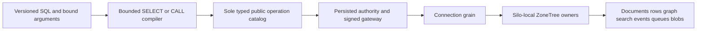

# ADR-054: Central SQL over canonical database operations

SQL serves one composable agent database, where
logical model resources reference and use one another. [ADR-067](ADR-067-composable-agent-database.md)
adds bounded queue-to-entity-to-graph and graph-to-queue server derivation inside
the existing atomic command/CALL. This extends the initial invocation stage below;
the no-multiple-statements/no-recursive-CALL contract holds. Full declarative
composition and clients remain mandatory under ADR-065.

Status: Accepted; implementation/qualification pending.

## Decision and contracts

One server/database serves AI agents across documents, typed rows, graphs,
vectors/text search, blobs, queues and events. SQL becomes the central versioned
language. Keep the current Q1 SELECT and AST1 contracts unchanged. Add SQL operation-envelope
version1: Q1 SELECT compiles to the existing QueryRequest; bounded
`CALL exact_public_operation(@arguments)` compiles using the sole public operation
catalog's strict typed decoder and enters the same signed Orleans gateway. The
argument is an object envelope containing existing `request` and, when required,
`commandId`; no-body operations use an empty envelope. Do not reflect arbitrary
methods, compose multiple statements, or allow SQL to call itself recursively.

SQL is a language adapter, never a parallel execution/authorization engine. Its
CALL result has the actual target operation type. Generic SQL MCP discovery uses
conservative non-read-only/non-idempotent/destructive hints. HTTP/MCP SQL wrapper
reserves the existing conservative heavy-read DATA lane before deserialize;
control CALLs may be rejected when it is saturated. Direct fenced control APIs
retain the reserved control lane. Exact target-route admission is a future
ingress-transfer optimization requiring bounded preclassification and qualification.

This first stage supplies procedural SQL for all implemented capabilities;
declarative multi-model SELECT sources/JOIN/fusion are required later contracts,
not implied by the new facade. SQL never performs generic writes to event/queue
internals. Existing command IDs, unknown outcome, leases, replay, redaction,
capability checks, cancellation, deadlines and bounds remain with target owners.

## Implementation contract

REQ-AISQL-001/003/004 -> AC-AISQL-001/005–010 in this ADR and
[QueryExecution](../Features/QueryExecution.md);
QueryExecution owns language, existing model slices own effects. The ordered contract is: freeze DTOs/grammar; author strict compiler tests and the compiler; preserve equality planner efficiency; then join endpoint, SDK, official MCP, conservative admission and replicated-cluster differential tests. Shared transport and authority are not altered by the compiler work.

The shared SQL operation contracts live in Abstractions/Features/QueryExecution/SqlOperationContracts.cs; the compiler helpers and matching SqlOperation* unit files are new Server/Features/QueryExecution/Sql* files; the server query/catalog/admission joins and Client/Features/QueryExecution/ complete the surface. Existing DTOs/route values retain semantics. The adapter rejects unsupported versions and invalid CALL grammar, targets or argument envelopes before routing. SELECT/EXPLAIN grammar is validated once by the authorized Q1 request path before a scan or effect; the adapter does not repeat parsing. Deployment is additive; rollback removes advertisement/new route, existing Q1 remains.

Dependencies: ADR-010/012/013/014/020/035/036/039/055. Tests: strict syntax/version/parameter/name/recursion rejection; Q1 equality; actual SDK/MCP read/write/error/retry/permission/cancellation/admission flows on the replicated cluster; comparison measurements. GitHub exact-SHA proof and artifacts are required. No acceleration, full SQL compatibility or production claim before qualification.

Typed blob SDK methods are feature-owned public extension methods in BlobClientExtensions, invoking the same assembly-internal Send transport with unchanged route/type/command ID/write classification; client and request are validated (null guards) before transport, with no second HttpClient or retry path. REQ-AISQL-003 and AC-AISQL-007 (under AC-DBHP-012) require the SQL admission case to observe both node and verified-scope control counts through genuine SDK admission calls with a caller-linked deadline and short polls: a received MCP result is not a server-drain barrier, and completion still requires both counts to be exactly zero. Budget, rejection, unchanged command-ID reuse, direct-control success and routing assertions stay; SDK errors and cancellation remain failures.
