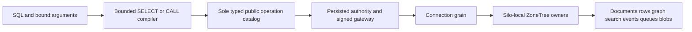

# ADR-054: Central SQL over canonical database operations

SQL serves one composable agent database, where
logical model resources reference and use one another. [ADR-067](ADR-067-composable-agent-database.md)
adds bounded queue-to-entity-to-graph and graph-to-queue server derivation inside
the existing atomic command/CALL. This extends the initial invocation stage below;
the no-multiple-statements/no-recursive-CALL contract holds. Full declarative
composition and clients remain mandatory under ADR-065.

Status: Accepted; implementation/qualification pending.

## Decision and contracts

One server/database serves AI agents across documents, typed rows, graphs,
vectors/text search, blobs, queues and events. SQL becomes the central
language. One current SQL operation envelope carries SQL and bound parameters. Scalar SELECT compiles to the existing QueryRequest; bounded
`CALL exact_public_operation(@arguments)` compiles using the sole public operation
catalog's strict typed decoder and enters the same signed Orleans gateway. The
argument is an object envelope containing existing `request` and, when required,
`commandId`; no-body operations use an empty envelope. Do not reflect arbitrary
methods, compose multiple statements, or allow SQL to call itself recursively.

SQL is a language adapter, never a parallel execution/authorization engine. Its
CALL result has the actual target operation type. Generic SQL MCP discovery uses
conservative non-read-only/non-idempotent/destructive hints. The HTTP/MCP SQL
wrapper has no request-count or reserved-byte admission
([ADR-145](ADR-145-no-request-throttling.md)); the server-wide request body limit
bounds its input and the target operation's own bounds limit its work.

This first stage supplies procedural SQL for all implemented capabilities;
declarative multi-model SELECT sources/JOIN/fusion are required later contracts,
not implied by the new facade. SQL never performs generic writes to event/queue
internals. Existing command IDs, unknown outcome, leases, replay, redaction,
capability checks, cancellation, deadlines and bounds remain with target owners.

## Implementation contract

REQ-AISQL-001/003/004 -> AC-AISQL-001/005–010 in this ADR and
[QueryExecution](../Features/QueryExecution.md);
QueryExecution owns language, existing model slices own effects. The ordered contract is: freeze DTOs/grammar; author strict compiler tests and the compiler; preserve equality planner efficiency; then join endpoint, SDK, official MCP, conservative admission and replicated-cluster differential tests. Shared transport and authority are not altered by the compiler work.

The current operation request is `src/KeyLoad.Abstractions/QueryExecution/Contracts/SqlOperationRequest.cs`. `src/KeyLoad/QueryExecution/Queries/SqlOperationCompiler.cs` compiles the Microsoft ScriptDOM tree to existing canonical operations, and `src/KeyLoad.Query/QueryExecution/` owns scalar and model query lowering. The SDK and official MCP use the same current typed request. Unsupported syntax trees, operation targets and invalid argument envelopes are refused before routing or effects; there is no envelope or dialect version selector. Parsing and operation-specific semantic validation retain the original cancellation and admission bounds.

Dependencies: ADR-010/012/013/014/020/035/036/039/055. Tests: strict syntax/parameter/name/recursion rejection; scalar equality; actual SDK/MCP read/write/error/retry/permission/cancellation flows on the replicated cluster; comparison measurements. GitHub exact-SHA proof and artifacts are required. No acceleration, full SQL compatibility or production claim before qualification.

Typed blob SDK methods are feature-owned public extension methods in BlobClientExtensions, invoking the same assembly-internal Send transport with unchanged route/type/command ID/write classification; client and request are validated (null guards) before transport, with no second HttpClient or retry path. REQ-AISQL-003 and AC-AISQL-007 (under AC-DBHP-012) require the generic SQL tool to report dynamic, non-read-only, non-idempotent and destructive effects and to be unreachable as a canonical operation that SQL could call recursively (`SqlToolDiscoveryTests.AcAiSql007SqlDiscoveryReportsDynamicEffectsAndCannotBeCalledRecursively`).
