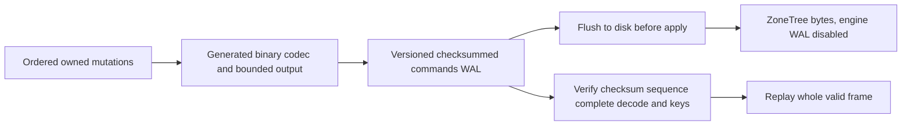

# ADR-057: Orleans binary atomic WAL

Status: Accepted. The current persisted format and current-source qualification are governed by [StorageRecovery CurrentFormat](../Features/StorageRecovery/CurrentFormat.md). Related REQ-STORAGE-015..019, AC-WAL-001..005.

## Decision

commands.wal mutation payload uses private generated Orleans DTOs with permanent field IDs and type aliases and a cached typed serializer. Fields0/1 carry key/nullable value; mandatory field2 is Put1 or Delete2, with default0 invalid. This prevents a missing field from implying deletion. Validate exact kind/value pairing before apply. A closed IFieldCodec<ReadOnlyMemory<byte>> registration to ReadOnlyMemoryOfByteCodec avoids generic per-byte serialization for nullable values. A direct Microsoft.Orleans.Serialization reference uses the centrally pinned version. ZoneTree Memory<byte> ByteArraySerializer and Sync WAL remain. No duplicate custom serializer, permissive JSON fallback or application-owned serialization loop. Serialized output is bounded by the existing configured MaxFrameBytes; exact binary length is checked before writing.

Use only the current WAL, identity and checkpoint contracts recorded in CurrentFormat. Generated Orleans DTOs, permanent field IDs/type aliases, explicit operation kinds, complete payload validation, sanitized corruption errors, durable flush ordering, poisoned unknown outcomes and node-local ZoneTree byte storage remain mandatory. Unsupported identity/checkpoint/WAL values and corrupt complete frames fail closed before state publication. Current torn-tail handling follows the current reader contract; this ADR defines no alternate-format path.

The checksummed `commands.wal` is the only redo log. Every open replays it from the last
checkpoint into the ZoneTree materialization, so the engine runs with
`WriteAheadLogMode.None`: its own synchronous WAL duplicated each mutation's fsync under the
commit gate without adding recovery coverage. `tree/0.meta.wal` remains the engine's segment
metadata log and is unaffected by that mode.

The commit gate is one `ReaderWriterLockSlim` per open store. A writer holds the
upgradeable lock while it compiles the transaction, appends the frame and runs
`Flush(true)`, so concurrent readers keep running through the fsync; it upgrades to
the exclusive lock only to apply the durable mutations and advance the position.
Readers wait for a writer only during that in-memory apply, and a frame becomes
visible only after it is durable.

## Current-format admission and rollback

Fresh stores use the current identity, WAL and checkpoint contracts. Valid current
identity and complete frames recover through the current reader. Unknown versions,
malformed headers, invalid checksums or corrupt complete frames fail closed before
state publication or mutation. Rollback preserves the current stored format and
requires a source release that can validate it; no conversion or alternate reader
is defined here.

## Implementation and join contract

1. Freeze requirements/acceptance; shared docs, dependencies and existing-file edits have a single owner.
2. New StorageRecovery DTO/codec/bounded-writer files and the StorageRecovery unit tests are separate; aliases and the package reference are integrated once.
3. PreparePayload/recovery integrate with the current identity, WAL and checkpoint contracts; preserve cache/reset/rejected-stage invariants and binary-safe accounting; validate current state before publication; keep checkpoint generations aligned with the current identity.
4. Verify restore returns the current identity and no corrupt frame is partially accepted. Existing SDK/MCP contracts remain.
5. Qualify build/analyzers/format/governance and real TUnit unit/process/replicated-cluster exact-SHA GitHub gates. Keep this ADR Accepted until all required source/tests/docs/evidence exists. Measured speed, power-loss and endurance remain separate unproven gates.

Canonical slice: src/KeyLoad.Storage.ZoneTree/StorageRecovery and tests/KeyLoad.UnitTests/StorageRecovery; existing real RecoveryTests and replicated-cluster integration suites are mandatory. Frontend/client API:N/A, private durable payload only. No authored public model change.

## Preserving recovery successor refinement

REQ-STORAGE-017 / AC-WAL-003 also rejects an overflowing successor before decode, apply or truncation. A verified checkpoint at long.MaxValue
remains a valid terminal cut; MaxValue-1 followed by frame MaxValue remains valid.
The header predicate short-circuits at terminal position before `position + 1`,
returning the existing sanitized Corruption. OrleansWalSuccessorTests constructs
and fully verifies real checkpoint bytes, uses the official generated frame
fixture, checks whole recovered values and authoritative-byte preservation,
probes released handles, and reopens the same failed-attempt derived tree after
removing only the corrupt tail to detect premature apply. The cases trace to exact-SHA GitHub gates.
This preserving reader fix introduces no format, ACK or serializer change.

Independent source review identified remaining decoded-memory/work admission and
complete-envelope/current-header proof gaps. They remain open and do not gain
qualification from this sequence guard or a development build. The ADR remains Accepted until its full original
unit/process/cluster and current resource evidence exists.

## Complete current-frame payload-length regression

This is a test-only requirement under REQ-STORAGE-017 / AC-WAL-003. The
existing preflight operation test adds one-byte-short declared payload-length
arguments to both direct ZoneTree open and the real RecoveryProcess inspector. The
frame remains physically complete and follows a real committed prefix; both
paths must return the existing Corruption category, leave the entire provider
file/tree inventory unchanged, and settle owner-lock cleanup. No production
format, cap, error category, or torn-tail behavior changes. The already-covered
short-header suffix remains an incomplete-tail case and is truncated only by
ordinary recovery. The regression is not qualified until actual
normal/scalar and applicable recovery evidence exists.

## codec refinement

The centrally pinned Orleans NullableCodec's generic codec resolution uses ReadOnlyMemoryCodec<byte> with per-byte tagged fields. Accept the framework's closed IFieldCodec<ReadOnlyMemory<byte>> → ReadOnlyMemoryOfByteCodec registration, with no custom wire codec. Nullable nonnull values then use length-prefixed raw bytes. The original size/4096-byte assertions remain unchanged. The current generated Orleans codec uses the accepted closed memory codec; no custom JSON or alternate-format decoder is supported. The active identity/WAL/checkpoint values and exact bytes remain those frozen in CurrentFormat.
