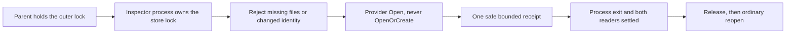

# ADR-059: Guarded original-store inspection

Status: Accepted; qualification pending.
Related: REQ-STORAGE-015 / AC-SG009-001..004 and AC-SG009P-001..004 in
[StorageRecovery](../Features/StorageRecovery.md#guarded-original-store-inspection).

## Decision

A guarded inspector examines an existing ZoneTree store without creating or
changing it. It rejects absent original files or changed identity before provider
recovery, opens with the provider's `Open` rather than `OpenOrCreate`, and checks
actual identity, data and position. The ordinary public open and codecs stay
unchanged. A separate inspection process keeps exclusive ownership of the original
store until the actual child has exited and both original output readers have
settled; only then may the parent release the outer lock, reopen or remove files.
This is process-settlement evidence, not a power-loss or copy-durability claim.

## Acceptance

- **AC-SG009-001..004:** file tests cover missing, mismatched, locked and invalid
  stores, then an ordinary reopen. Primary and cleanup failures remain
  independently observable.
- **AC-SG009P-001..004:** the canonical directory is lexical ordinal equality of
  the normalized full path; dot and dot-dot variants are rejected before ownership,
  and no symlink or rename resistance is claimed. Every guarded case runs in the
  genuine Release recovery process. The parent holds the fixture's outer lock and
  the child owns the canonical lock.
  - The request is strict case-sensitive `System.Text.Json` with exactly the known
    directory, node, incarnation and variant fields; unknown, duplicate or missing
    fields and integer or undefined enum values are rejected. The child drains
    stdin to EOF while retaining at most 4,096 characters; overflow rejects before
    parsing or guard execution.
  - A valid guard rejection returns one safe JSON line of at most 8,192 characters
    after cleanup; malformed or oversized requests exit 2 with no receipt. Receipts
    contain bounded identity, position, value and failure facts only (at most 64
    original exception type names), never messages, stacks, paths, keys or
    credentials.
  - The value edge returns the complete 256-byte record and rejects a 257-byte
    record as `InvalidDataException`, without truncation; after settlement an
    ordinary reopen preserves the original identity, journal bytes and record data.
  - The child suppresses ordinary console writers for the whole inspection; only
    the fixed readiness marker and the safe receipt use the captured writers. Parent
    stdout and stderr readers each retain at most 8,192 characters, and one child is
    admitted per fixture.
  - Execution is bounded to 30 seconds; cancellation or deadline kills the actual
    process tree. Neither EOF nor a cancelled or faulted wait proves exit:
    release, reopen and delete require the original process exit plus both original
    readers. The 10-second cleanup bound only warns; ownership stays held until
    settlement, with the GitHub job timeout as the final external bound.
  - The cancellation case waits for the ready marker, cancels, settles the process,
    input, readers and lock, then verifies ordinary reopen and data.

Rollback removes the inspector and its tests together; production open, recovery
and stored data are unchanged.
