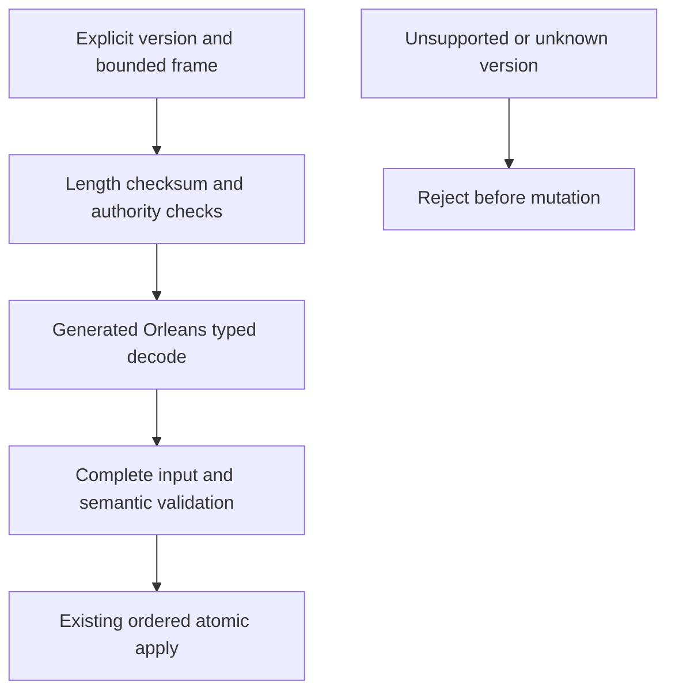

# ADR-060: generated internal serialization

Status: Accepted. Date:2026-10-03.

REQ/AC-DSTORE-008 (exact caller-owned document text, 2026-10-05): validation is separated from PutDocument text rewriting. The same canonical writer validates into a discard sink and the record retains the original validated string. Public JsonData.Validate output, canonical fingerprint digests, record aliases/field IDs, and data epochs remain unchanged. No automatic existing-record rewrite; patch/redaction retain their derived-text contracts. Real-store exact-text, replacement/replay and invalid-atomicity regressions, unchanged canonical golden tests, and actual Aspire replicated-cluster SDK/official MCP Unicode/restart cases are required before qualification. This is a repair of the frozen contract, not a new data format.

## Decision and contracts

Implement REQ-IS-001..009 / AC-IS-001..009 using centrally pinned Orleans generated codecs, stable aliases and explicit immutable field IDs across all owned internal concrete DTOs. Use pooled sessions and raw ReadOnlyMemory<byte> codecs; reject incomplete/trailing/malformed input and validate required semantic fields before effects. Do not use Orleans' optional JSON codec or a runtime JSON fallback. JSON DOM adapters represent structural ordered fields and original numeric lexemes; DOM materialization is a concrete boundary, not a persisted JSON subtree.

Concrete contracts retained: public HTTP/MCP JSON; exact caller-owned JSON document strings; canonical operation/idempotency golden digests; sortable KeyCodec1; ZoneTree ByteArraySerializer/WAL; fixed checksummed framing; raw blob chunks; HMAC/SHA; Cartograph archives. binary output must not be assumed canonical for unordered maps. Signed claims are versioned before changing signed bytes.

## Current format identity and rollback

Compaction preserves opaque JSON values. Current stores and metadata must use the required format identity and fail closed on unsupported identities before opening or mutating trees or truncating journals. Never promote or reinterpret an unsupported identity. Current backup and restore verify the complete source state before destination publication; unknown keys or failed verification prevent publication and preserve source. Rollback is a source checkpoint and never changes stored data or republishes a different format.

## Security, tests and evidence

header projection/skipping may not allocate decoded opaque payloads; control/data pools and all external capacity contracts stay exact. Existing state ownership, synchronous barriers, unknown outcomes, cancellation and caller-visible sanitized diagnostics remain.

codec/type-family/DOM tests, exact record byte accounting, actual current metadata corruption and unsupported-version fixtures, claims/tamper/version tests, existing canonical hashes, real-process recovery and genuine replicated-cluster SDK/MCP form the acceptance chain. Required commands are enabled solution restore/build and formatter/static governance, then canonical GitHub normal/scalar/recovery/analyzer/cluster jobs. No local runtime tests, no removed assertions or invented load tests. Performance, full memory amplification, power-loss, endurance and production proof are separately unqualified. Publication is not attempted again without explicit approval after the previous automatic-review rejection.

## Owner performance extension, 2026-10-03

REQ-IS-010/AC-IS-010 and REQ-IS-PERF-001..004 / AC-IS-PERF-001..004 add baseline diagnostics
for all shared serialization consumers: contracts; authentic public generated BDN fixtures and TUnit cases; original result
validation/provenance; workflow integration; exact-source CI and Linux measurement; and only evidence-selected bounded optimization.
The diagnostics live in BenchmarkScenarios Features/BenchmarkComparisons/Execution*Serialization*, mirrored by UnitTests, with new serialization-* helpers in scripts. Existing ADR047
public/unsealed generated-child contract and central package pins remain. A
scoped UnitTests friend declaration permits direct corpus/manifest regressions;
generated consumers still use public fixture methods and concrete return types.

No database format/API/routing/authority change. JSON is benchmark-only historical
typed UTF8 baseline and does not replace runtime or claim equal fault
contracts. Default workflow retains full matrix/aggregate/site proof; diagnostic
mode is explicitly separate and cannot refresh published website metrics.
Rollback removes additive diagnostics, without user data changes. Real generated
Dry execution and genuine24-case measured JSON/CSV plus executor/source/environment
receipts are required; local build or exit0 cannot qualify measurements.

## Approved immutable analytics maps, 2026-10-16

AnalyticsStore's public `ImmutableDictionary<string, string/double/long>` values
use the current centrally pinned Orleans 10.4.0 `ImmutableDictionaryCodec<TKey,TValue>`
(package-declared source `d114d7522a53b8cce4c6b97d44293e5c7273d766`).
KeyLoad admits only that exact built-in outer type and its generated surrogate:
field0 is one nonnull freshly encoded `Dictionary<TKey,TValue>` Values, field1 is
an optional default-null or already supported well-known string value comparer.
The same strict comparer rule applies to the surrogate Values dictionary key
comparer; ordinary standalone Dictionary admission remains unchanged.
The existing dictionary walker still validates count, complete key/value pairs,
types, references, UTF-8 and depth before generated allocation. Unknown members,
base scopes, missing/duplicate/null Values, custom comparers and other unverified
system surrogates remain refused. Postdecode required-member, graph, cycle and
work validation is unchanged. binary map output remains noncanonical.

This repairs KeyLoad-owned admission of an already selected generated codec.
The existing Orleans wire encoding, envelope, persisted field IDs/aliases,
public immutable DTOs, built-in codec, format identity, authority, capacity and
public JSON contract remain unchanged. The supported type inventory is
additive: older KeyLoad admission rejects immutable-map frames and the new
AnalyticsStore DTO aliases. This is not mixed-reader compatibility.

Before adoption or writes of the newly admitted types, deploy one homogeneous
current Orleans 10.4.0 exact-source, DLL and pinned-codec reader cohort and qualify its existing
current-format cold, process-recovery and public replicated-cluster paths. Older readers must
fail closed; no reader fallback, automatic migration or compatibility rewriting
is allowed. The package DLL/XML, declared source commit and writer APIs require their own
source-bound compiler and runtime qualification; source matching alone is not PASS. No wire provider or version bump is introduced by this admission
repair. The original byte, count, lifetime and persisted-authority budgets remain
mandatory. Focused qualification includes malformed/oversized map
frames, JSON batch normalization and ordered Analytics apply, complete raw
rows and all five actual aggregates through GrainValue and public JSON,
original receipt replay, cancellation/read/result limits and two joined cold
reopens of the same canonical journals on every copy. Source preparation alone does
not qualify compilation, recovery, public cluster or Linux execution.
