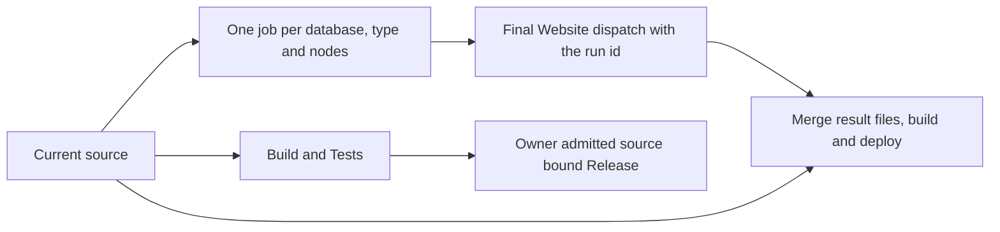

# ADR-062: Workflow responsibility and qualification boundaries

Status: Accepted; complete delivered-source qualification pending.
Features: RepositoryGovernance, BenchmarkComparisons.
Related: [ADR-064](ADR-064-workflow-release-delivery.md),
[ADR-150](ADR-150-per-type-benchmark-jobs.md).

## Decision

Use exactly four workflows. Build and Tests owns full solution restore/build,
format, analyzers, governance, unit/scalar, process recovery and genuine cluster.
Benchmarks owns every database comparison: one isolated Linux job per database,
data type and node count, each uploading its own result file. Website builds the
static site from one Benchmarks run's result files and publishes Pages. Release prepares source-bound versioned distributions;
publication waits for product readiness or a direct owner release instruction.

Each benchmark job runs alone with its database's actual topology. A one-node
benchmark never stands in for the production cluster. Every result, including a
failed case, keeps its real outcome; an unsupported cell has no number.

## Implementation and acceptance

1. Shared workflow identities, file ownership and REQ/AC are frozen before edits.
2. Disjoint workflow/composite changes are owned by infrastructure; product code preserves actual callers, image receipts and bounded shutdown.
3. Join exact workflow names, paths and events with the release context and all
   SDK/MCP test entry points. Never relabel results or bypass a failed gate.
4. Validate YAML/action contracts statically; source-shape assertions are infrastructure
   review. Actual operations and healthy follow-up operations run through the
   TUnit entry.
5. Combined source, build/format/governance and original Linux runs are reviewed.
   The review covers responsibilities, actual distribution artifacts and the Website
   publication of one Benchmarks run.

Rollout is one source checkpoint containing workflows, actual callers, source maps
and docs. Source rollback keeps the four mandatory responsibilities
and every required gate. Database bytes, credentials, replication and public operation
semantics are unchanged. Missing, failed or skipped results never become measurements or
qualification.
