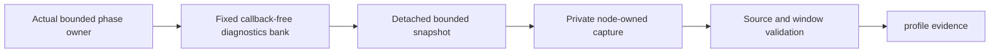

# ADR-063: Bounded database phase profiling

Status: Partially implemented in source; complete producer/capture and measurement qualification remain pending.
Related: REQ-RESOURCE-003..006 / AC-DBPROF-001..008; [ResourceExecution](../Features/ResourceExecution.md), [DatabasePhaseProfiling](../Features/ResourceExecution/DatabasePhaseProfiling.md), ADR-035, ADR-113.

## Decision

Provide opt-in, process-local phase diagnostics for bounded database operations. Profiling is disabled by default and is initialized before the storage owners begin work. Diagnostics are not database authority and do not change public requests, persisted records, wire formats, acknowledgements or operation results.

The callback-free BCL bank records scalar phase/outcome timings and counters. Ten current boundaries retain their IDs within a fixed capacity of 32 phase slots; undefined slots are invalid inputs. Keep six outcomes and 16 histogram buckets, four stripes by default (validated options allow 1, 2 or 4), and one-to-four bounded update attempts (default four). Startup options come from the centrally registered and validated DatabasePhaseExecutionOptions; do not create a second configuration owner or fallback. The bank's startup footprint remains at most 128 KiB. Saturation, contention, invalid input and overflow degrade quality; incomplete data cannot qualify a profile.

Capture is cold and bounded outside storage gates. It observes detached snapshots and actual process/resource counters, marks every file with source, image, node and sampling-window identity, and treats missing, degraded or incomplete data as unavailable. Profiling does not claim exclusive request latency: phase intervals may overlap and may include maintenance or independent tail work. No power-loss or durability claim follows.

## Preservation contract

The canonical phase inventory and exact source boundaries are in DatabasePhaseProfiling. Existing provider gates, lock order, operation calls, RPC deadlines, cancellation classification, required-copy apply semantics and original task ownership stay unchanged. In particular, a scheduling batch is not a group commit; a transport await is not isolated network time; and process resource deltas are not attributed to one request.

Every update is callback-free and bounded. No logger, listener, exporter, async-ambient value, allocation, task or database gate is introduced into a producer's hot path. Snapshot counters are cumulative/non-atomic; all overflow and dropped-update quality indicators remain visible. The cold exporter uses bounded snapshots/buffers/files and cannot change healthy database results.

## Acceptance, ownership and verification

REQ-RESOURCE-003/004 map to AC-DBPROF-001..004 for preserving real phase ownership and bank correctness. REQ-RESOURCE-005 maps to AC-DBPROF-005/007 for private source-bound capture. REQ-RESOURCE-006 maps to AC-DBPROF-006/008 for correctness and measured overhead. The feature owns all exact phase boundaries, test mapping, source paths and profile file constraints.

Core diagnostics owns the bank/schema/arithmetic; producer feature owners add scalar scopes only at the original operation boundaries; Server owns private capture and lifecycle. Tests use actual banks, ZoneTree/store operations, original tasks and Aspire resources; no fake clock/provider is used where the contract requires actual time or state.

Qualification requires enabled full source checks and exact-source Linux unit/scalar/recovery/cluster tests, real private capture verification, and repeated matched on/off profiles at current 100,000- and 1,000,000-record workloads where applicable. Benchmark comparisons and coverage remain separate gates. Source compilation does not establish measured overhead or benefit. Keep the ADR Accepted until every mapped implementation and evidence gate passes.
