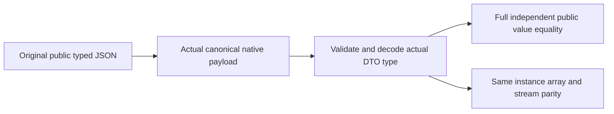
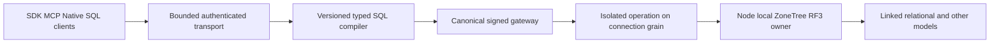
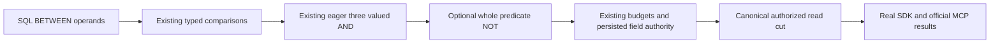
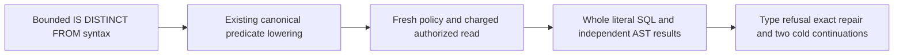
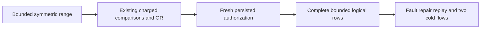
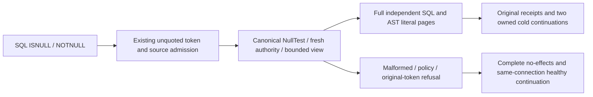
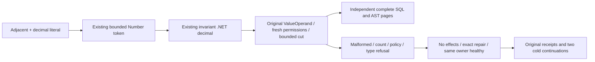
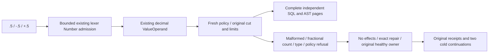
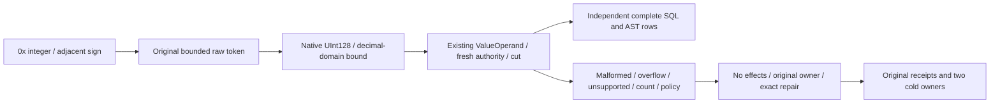

# ADR-065: Full SQL syntax and client protocol

Current owner selection 2026-10-13: T-SQL through Microsoft ScriptDOM, governed by [ADR-130](ADR-130-microsoft-scriptdom-tsql.md). This replaces the prior integration-owner PostgreSQL18 working dialect described below. Selected native parsing and closed lowering are source-integrated; complete execution and current Linux qualification remain open. PostgreSQL wire framing remains a separately qualified transport, not the chosen SQL grammar.

Owner clarification 2026-10-03 requires full SQL for one composable database,
not merely independent per-model calls. [DatabaseComposition](../Features/DatabaseComposition.md)
and [ADR-067](ADR-067-composable-agent-database.md) define the first bounded atomic
queue-to-entity-to-graph and graph-to-queue derivation stage through existing CALL.
This is a prerequisite building block; full declarative sources, joins and
data-modifying statements across the models remain this ADR's required outcome.

Status: Accepted staged implementation contract; full execution/native protocol
and exact-source qualification pending. Date2026-10-03. Integration owner: KeyLoad
root planning agent. Related QueryExecution/ClientApi/RelationalStorage/Search;
REQ-SQLC-001–011 and AC-SQLC-001–011 in the root sql-client-compatibility acceptance.
This extends ADR-012/054; the existing Q1/CALL implementation is a bounded initial
stage, not the full product. Existing SQL envelope1 and generated DTO IDs remain unchanged.

## Accepted public/native test-oracle stage

TASK-SQLC-P1 / REQ-SQLC-003 / AC-SQLC-003P defines the independent public-value
oracle for canonical native serialization. Native array and stream writers must
agree for the same decoded instance, and the complete typed DTO must roundtrip
without changing its public JSON value. Serializer defects belong to the owning
serializer; the SQL caller must not normalize payloads to hide them.
Ordered contract: first-author actual same-instance native array/MemoryStream
writer parity plus received-command/recursive DTO semantic regressions; then
bounded gpt-6-luna/high worker updates only UnitTests ClientApi canonical corpus,
command/read/polymorphic tests, QueryExecution SQL compiler/comment tests and
NEW ClientApi/McpNativePayload-prefixed files. Root reviews every diff and joins
frozen integrated build/format/static gates, scoped main delivery and real
GitHub normal/scalar/recovery/RF3 originals. No mocks/packages/local execution.

The full original public JsonElement is an independent value oracle; generic
test-only native-decode delegates retain the actual DTO type, validate/deserialize
native bytes and compare every resulting JSON field/union/value. Preserve kinds,
stable IDs, dictionaries, original JSON, safe invalid/null/unknown rejections and
exact SQL-native parity against the same real canonical descriptor. Post-disposal
tests compare an actual-byte copy taken while the source document lived and then
decode the complete DTO. No-body uses actual native int-zero/correct read identity,
not JSON/null text. All existing recursive/raw JSON value assertions remain.

A same decoded instance must produce exact equal native array/stream bytes and
valid typed round trips. Any genuine failure remains failing and escalates to
its serializer owner; no fixture avoidance, dropped assertion or consumer
workaround. No public format, storage, authorization, or transport change is in scope; rollback
the corpus and oracle changes together. FullSQL/native/coverage gates stay open.

## Current decision and conformance target

The owner-selected syntax is T-SQL through Microsoft ScriptDOM under [ADR-130](ADR-130-microsoft-scriptdom-tsql.md), with [ScriptDOM requirements](../Features/QueryExecution/ScriptDom.md) and the [active conformance inventory](../implementation/sql-client-conformance.json). Preserve REQ/AC-SQLC-001–011. Native grammar acceptance, closed authorized execution and actual client interoperability remain separate gates. General SQL remains required and OPEN; a parser or finite SELECT/EXEC/INSERT adapter does not complete it.

PostgreSQL wire3.0 and genuine Npgsql are independent bounded authenticated transport contracts. PostgreSQL wire3.0 is the first native client target; explicit real protocol3.2 negotiation fixtures are mandatory BEFORE advertising protocol3.2 support. They may carry selected T-SQL text; neither PostgreSQL grammar nor SQL Server TDS compatibility follows. PostgreSQL remains a native benchmark competitor.

Owner correction 2026-10-09 and [ADR-125](ADR-125-connection-owned-execution.md)
select one grain per actual connection, admitting bounded parallel independent
operations and commands without creating request/read activations. Signed
operation identity, principal, read cut, deadline and result remain call-local;
current persisted authorization is reloaded for every call. Connection close
stops admission, cancels and joins original work before native deactivation.
[ClientApi](../Features/ClientApi.md#persistent-connection-ownership) owns
REQ/AC-CLIENT-CONNECTION-001/002 and TASK-CLIENT-CONNECTION;
[ClusterRouting](../Features/ClusterRouting/ExecutionPrimitives.md#connection-and-request-lifetimes)
owns REQ/AC-ORL-013 and TASK-ORL-REQUEST-LIFETIME. Native SQL protocol work must
reuse this boundary while retaining its separately defined connection protocol
requirements. Runtime and matched Linux performance qualification remain open.

Previous [183 PostgreSQL command names](../implementation/sql-client-commands-postgresql18.json), [previous conformance bytes](../implementation/sql-client-conformance-postgresql18.historical.json) and parser-candidate research remain historical, inactive planning records. They authorize no old grammar, package or fallback. Microsoft [ScriptDOM](https://github.com/microsoft/SqlScriptDOM) is the syntax owner; [PostgreSQL protocol](https://www.postgresql.org/docs/18/protocol.html) and [Npgsql](https://www.npgsql.org/doc/types/basic.html) remain transport references.

## Superseded language implementation record

The PostgreSQL-specific grammar/parser tasks and CALL/lexical expansions below are historical, inactive implementation plans after ADR-130. Preserve their original evidence and mandatory typed-state, authorization, cancellation, receipt, recovery and interoperability acceptance; implement those criteria through selected T-SQL. Do not interpret later historical NEXT wording as current parser adoption.

### Original ordered implementation contract

1. TASK-SQLC-R1/R2/R3/R4: actual grammar/executor/security/client baseline and
   pinned FullTextSearch review. Root joins source hashes and real GitHub reports.
2. TASK-SQLC-I1: requirements/acceptance/plan before code; root owns Abstractions
   `Features/QueryExecution/SqlTriviaReader.cs`, `SqlTriviaState.cs`, internal
   status/constants and Abstractions.csproj friend access. No public helper or
   dependency. Scanner interface: `Read(ReadOnlySpan<char> sql, ref int offset,
   ref SqlTriviaState state, int maximumDepth)` returns `More`, `Complete`,
   `UnterminatedComment` or `DepthLimitExceeded`. Valid callers supply a bounded
   offset and positive configured depth. One call consumes at most256 characters,
   leaves the first nontrivia character untouched and retains only scalar state.
   It recognizes whitespace, `--` through CR/LF/EOF, and nested `/* */` outside
   tokens. No quoted-content handling, text/token allocation, callback, effect or
   capability. Unterminated comments map to fixed Validation; excess nesting to
   BudgetExceeded; raw SQL UTF8 bytes still include comments. Callers check their
   original budget/cancellation before and between chunks.
3. TASK-SQLC-Q1: worker owns SqlTokenizer/SqlParser and new named SqlComment unit
   files only. First-author acceptance tests; apply helper only between tokens,
   using configured MaxQueryDepth. Existing quoted/parameter/number readers and
   query AST remain authoritative; comments cannot splice identifiers, operators
   or permit another statement. Real ZoneTree differential rows/explain and
   configured token/byte/depth/cancel cases prove AC002–004.
4. TASK-SQLC-S1: separate worker owns SqlOperationSyntaxReader, only its constructor
   join in SqlOperationCompiler, and new named SqlOperationComment unit files.
   First-author canonical catalog/ID/exact payload and invalid/single-statement
   tests. Pass existing configured depth to scanner; preserve sole catalog,
   argument/envelope bounds, persisted authority and actual fresh request gateway.
5. TASK-SQLC-C1: root owns Client `Features/QueryExecution/SqlWriteClassifier.cs`,
   SqlClient and new named SqlClientOutcome tests. First-author genuine Kestrel
   unknown-write regression. Classify only current exact unquoted SELECT or
   EXPLAIN SELECT roots as reads after bounded trivia. CALL, malformed/unknown/
   oversized/deep/quoted roots and future forms are conservatively possible
   writes. Default immutable DatabaseLimits bound SDK classification only;
   they do not grant server admission. SDK may finish one bounded prefix chunk
   to retain existing pre-cancelled SELECT/EXPLAIN SELECT read outcomes; cancellation
   before a continuation chunk yields conservative possible-write classification.
   The256-character cancelled-prefix allowance includes both EXPLAIN trivia gaps,
   keywords and boundary checks; it never restarts for a later gap.
   Query/Server still check their original budget before every chunk. Preserve
   original request body/IDs; no
   client retries or claimed rollback. Future grammar expansion must derive
   effects from actual typed plans or default conservatively to possible writes.
6. TASK-SQLC-I2: root reviews every worker diff against AC and joins actual RF3
   commented SDK/official MCP SELECT/CALL flows, architecture/status/README and
   scoped stable main delivery. Exact source development build/format/static
   checks precede actual GitHub CI normal/scalar/recovery/RF3 and Benchmarks.
7. TASK-SQLC-FULL: root freezes per-stage typed grammar/plan/type/metadata/session/
   auth/transaction/read-cut/error/admission/cancellation contracts before workers
   implement remaining command families and native transport. Bounded SQL joins,
   routines, aggregates/windows and all models must execute, not merely parse.
   Resource/lifetime/fault contracts and real native client fixtures are mandatory.
8. TASK-SQLC-NATIVE-JOIN / AC-SQLC-011 is a prerequisite of final delivery when
   current HEAD864aa378 omits the restore caller join for its new two-argument
   native backup verifier. Root reviews/joins only the existing
   Storage.ZoneTree Features/BackupRestore/ZoneTreeBackupRestoreRestore.cs;
   a disjoint worker first authors BackupRestoreStagingJoinTests in UnitTests.
   Existing ADR-060 TASK-IS-R4B / AC-IS-004 and REQ-BACKUP-002 / AC-BACKUP-002
   own private staging, exact source preservation, journal/cut verification,
   new identity/paused dispatch and publication cleanup. No format change or
   omitted verification shortcut is introduced. Actual valid absent/empty-target
   positives include normalized trailing separators so private staging remains
   a sibling. Rare chmod/delete/move/recreate failure identity and metadata
   rollback remain outside this bounded join's qualification; no broad filesystem
   fault-closure claim. Every delivered NativeBackupCut negative case must pass in
   GitHub after enabled build/format. Rollback follows the native owning slice.

Each scope's exact artifacts/start/dependencies/review gates are in the working
plan. Inherited capable workers have disjoint write scopes; root alone owns
contracts/config/docs/Git. No suitable cheaper route is established for the
shared lexical/outcome boundary; workers must escalate contract drift.

TASK-SQLC-R13 / AC006/007/008 source planning confirms that
[IAtomicStore](../../src/KeyLoad.Abstractions/Storage/StorageContracts.cs) exposes
callback-scoped reads/commits and
[the gateway](../../src/KeyLoad.Server/Features/ClientApi/Execution/CanonicalOperationGateway.cs)
dispatches one signed operation through an HTTP principal. A native session must
not retain a storage view, impersonate that HTTP context or treat separate CALL
commits as one SQL transaction. Freeze typed binding and same-cut model operators,
atomic set-DML/DDL, transport-neutral verified dispatch/original settlement, then
canonical session transaction read-cut/write-set/commit authority before wire
implementation. Simple-query implicit batches, explicit BEGIN and modifying CTEs
require their actual semantics and fault tests. Proposed API shapes remain
planning only.

## Native transport and search freezes

No handshake/listener/session implementation is authorized by the lexical
contract alone. The later native implementation contract must fix version/frame/
encoding, statement/result types and OIDs, simple/extended protocol, portal/cut,
implicit/explicit transaction state, SQLSTATE, startup/catalog client probes,
pipeline/connection/reply numeric limits and original execution drain. Every
command revalidates persisted principal/policy and uses a fresh operation context on its connection grain.
Current SHA256 API-key verifiers are not SCRAM verifiers. Do not invent SCRAM,
trusted roles or DefaultHttpContext to impersonate the HTTP gateway. Any native
authentication/TLS or transport-neutral gateway admission contract must preserve
persisted authorization and prove invalid, revoked, failover, cancellation and
recovery behavior through real clients.

[ZoneTree.FullTextSearch](https://github.com/ZoneTree/ZoneTree.FullTextSearch) is
the owner's search candidate under AC010/ADR-009; no package/replacement decision
yet. Its private query language cannot satisfy full SQL. Establish native tree
ownership, atomic index publication, rebuild/checkpoint/restart/collision/scoring,
partial cancellation, quotas and physical-replica proof before integration. Real
matched read/create/update/delete and fault/performance tests determine the choice.

## Implementation boundaries and qualification

This stage adds grammar/internal SDK classification only; it does not change data,
serializer, SQL envelope version, API route, package, or persisted storage format.
Roll back the shared reader and all consumers together. Preserve canonical execution
and native WAL/atomic/RF3 journals. Native transport or broader AST work needs its
own implementation contract and recovery proof before implementation.

First-author TUnit/MTP tests from AC; no mocks/doubles. Unit real-store/Kestrel,
process recovery and Docker/Aspire RF3 actual SDK plus official MCP qualify only
in GitHub. Local source checks do not prove runtime behavior. Missing collector/
coverage, native clients, full execution and complete isolated measurements stay
pending. No power-loss, full SQL, production or acceleration claim before the
corresponding complete exact-source evidence. Manual source review and DBeaver UI
login/query evidence are explicit review exceptions, not substitutes for driver
tests or numeric coverage. Dependencies: ADR-004/009/010/012/013/014/020/022/024/
035/036/039/042/054/055/056/059; root preserves independent benchmark work.

## Accepted bounded BETWEEN stage

REQ-SQLC-006 / AC-SQLC-006A / TASK-SQLC-BETWEEN is the next additive Q1
expression stage under [SqlBetween](../Features/QueryExecution/SqlBetween.md).
The owning feature fixes the complete truth/error/budget/test and ordered
execution contract; strongest TASK-SQLC-R23 review joins before delegated code.
Status remains Accepted. Original7d1196 CI (report removed from repository)
qualifies the bounded stage's44 execution rows and complete ordinary CI;
coverage, full SQL/native transport and complete performance gates remain open.

1. The current parser/normalizer/evaluator/candidate/permission/cursor must
   preserve three-valued partial-bound semantics: UNKNOWN AND FALSE is FALSE,
   NOT that is TRUE, and UNKNOWN AND TRUE stays UNKNOWN. Eager non-null scalar
   mismatch errors and null-before-type checks remain current Q1.
2. First-author real grammar and ZoneTree TUnit tests, then lower unquoted
   `value [NOT] BETWEEN lower AND upper` to existing >=/<= AND and optional
   outer Negation. Existing Operand reads all three operands; consume only the
   delimiter AND inside the condition. No new AST/version/normalizer/evaluator,
   SQL coercion/collation/function/optimizer or keyword cleanup.
3. gpt-6-luna/high worker owns ONLY Query Features/QueryExecution/
   SqlExpressionParser.cs and SqlSyntax.cs, plus NEW UnitTests matching slice
   SqlBetween-prefixed files. No Git/packages/tests/build/runtime/workflows or
   other files. Root owns QueryEngine capability metadata, NEW IntegrationTests
   matching slice SqlRf3BetweenTests and optional helper, docs/Git/integration.
4. Root reviews all diffs against independent literal and hand-built-AST oracles,
   correct inclusive/reversed/null/missing/typed errors, quoted operators,
   configured raw/token/normalized-byte/expanded7/8node and3/4depth budgets,
   permission checks on every operand, cancellation/recovery and cursor parity.
   Strongest independent review is required before frozen full solution source
   build, formatter, static governance and scoped stable delivery.
5. Actual GitHub normal/scalar/recovery/RF3/analyzer qualification retains source/
   run/attempt/job/ZIP/report/case identities. RF3 uses genuine SDK and official
   MCP, independent positive/negative/null truth results, manifest and error/next
   request. No skipped suite or development build satisfies execution.

This stage changes no persisted data, native wire, serializer, or public DTO.
Rollback parser/manifest/new fixtures together; current AST/operators remain unchanged.
Dependencies are existing Q1 and ADR012/054, typed AST/scalar comparison, resource
limits, field authorization and SDK/MCP RF3 infrastructure. New performance
claims require actual matched scale cohorts; this stage does not add an index
range access path or complete SQL/native transport. Independent benchmark,
serialization and profiling work remains outside this scope.

## TASK-SQL-CALL-NO-PARTIAL-WRITE-001

REQ-AISQL-003 and AC-AISQL-005/006, REQ-SQLC-003/004/005: preserve original AcAiSql005RejectsMalformedCallQuotedNamesLiteralArgumentsAndTrailingStatements and every prior refusal. Add genuine compiler-to-canonical-native-command-to-ZoneTree operation proof. Before any dispatch, malformed/multi-operation CALL, unknown target and unknown envelope key must reject with exact codes and no partial decoded command, no document, outcome or complete native image/cut change. The following valid commented CALL preserves original command ID and complete literal two-document Unicode/quoted-key payload through native generated deserialization; its real authorized atomic Batch returns both independently expected mutation receipts/full documents. Original same-ID replay retains the full original receipt and complete unchanged bytes. Changed body under the same ID is Conflict, no partial model effects. Genuine joined close and same-volume native reopen preserves identity/cut/bytes, exact replay and full original documents, followed by a fresh acknowledged SQL CALL write and replay. No product defect is claimed: original Complete and closed envelope already enforce these refusals.

This is native compiler/DB Unit operation evidence, not production ASP.NET/MCP authentication, RF3, SQL-client protocol or complete SQL qualification. No new Test/UID, limits, clock, timeout, provider, public DTO or compatibility reader. Compiler/runtime/Linux remain OPEN. Numeric READY5 is an independent predecessor only for shared docs append union; its case/helpers are untouched.

The peer-reviewed R2 original-result oracle retains JSON full-value equality and additionally compares the canonical generated-native full CommitReceipt bytes on each warm/cold same-ID replay. MutationReceipt composition references are native Id4 but excluded from public JSON; JSON alone must not qualify exact native receipt identity. Original decoded command, literal documents/mutations, every no-effect byte/cut assertion and the single genuine cold reopen remain unchanged. A second cold cycle is not claimed by this bounded packet. This is an oracle correction only, with compiler/runtime/Linux gates OPEN.

## Chosen native session increment, 2026-10-13

The owner selected a TLS-only PostgreSQL3.0 API-key profile using the existing persisted verifier and server-owned Orleans connection execution. No SCRAM/MD5 persistence format or migration is introduced. Native Kestrel middleware performs exact SSLRequest framing before native TLS; authentication retains verified subject only and every execution rechecks fresh persisted credential/policy through shared canonical CQRS.

The initial result profile is one JSONB `keyload_result` containing the complete canonical result, including empty QueryPage metadata. Eight prepared statements/eight portals and validated shared retained-byte grants bound session state. Protocol MaxRows0 drains the whole bounded native operation; nonzero suspended portals, general typed PostgreSQL metadata/bootstrap, SQL session commands, explicit/implicit transactions, full grammar and protocol3.2 negotiation remain explicit open families. Already acknowledged write delivery interruption remains UnknownWriteOutcome; no multi-CALL rollback is invented.

The actual driver profile uses Npgsql10.0.3 with VerifyFull/root CA, GSS encryption disabled, no pooling, built-in-only type loading and parameter logging disabled. Genuine Aspire RF3 Q1/Q2/CALL1, SDK/MCP parity, cancellation and cold tests must qualify this precise profile. Source implementation or JSONB interoperability cannot qualify full SQL or general PostgreSQL compatibility.

Native SQL lifetime correction (implemented source; qualification pending): a single TimeProvider-backed admission budget uses the existing DatabaseLimits.QueryDeadlineSeconds across the first SSLRequest byte, TLS, startup, password, fresh persisted verifier and initial authenticated Ready flush. Expiry closes the actual ServerConnectionFeature; all frame/credential/backend/connection resources and original failure/cleanup are joined. Authenticated idle expiry reuses the existing GrainRoutingOptions.ConnectionIdleTimeout native owner contract; active canonical operations keep its original scheduling rules.

Execute owns the original CancelRequest scope and unchanged configured query deadline through fresh verification, native CQRS producer completion, complete encoded result delivery, bounded IngressScratchBytes DataRow chunks, terminal flush and reply admission disposal. End joins the actual cancellation task afterwards. Control/error flushes use the same configured bound. If delivery has started and is interrupted, the actual transport closes rather than writing an ErrorResponse into a partial DataRow. Possible-write interruption remains the existing UnknownWriteOutcome; original command GUID replay resolves the retained receipt.

The same RF3/Npgsql full flow contains three genuine incomplete raw TCP/TLS admission phases (pre-SSL header, post-TLS startup, password after genuine challenge), each reaching server close with its original bounded caller token still live, exact no-effects, then real healthy Npgsql/SDK/official MCP continuation. A separately persisted scoped principal and four literal 512KiB records prove native reply backpressure: actual AuthorizationReload original request marker is released, matching ProducerDisposed is joined, a real DataRow header is received, client reading is held on its owned task with bounded receive buffer, and the original backend CancelRequest interrupts that delivery. Truncated native row/transport closure, actual reader/control/cancellation joins, complete stored images and same-GUID quorum receipt, independent healthy full pages through all three callers, and two same-volume cold continuations are mandatory. ProducerDisposed alone is not claimed as reply-flush proof. These are unexecuted source tests, not Linux qualification.

## Coherent bounded SQL source increment — original full conformance remains OPEN

REQ-SQLC-006 / AC-SQLC-006 (SQLC-SET/READ), REQ/AC-QUERY-004/006, REQ/AC-SQLC-007/008 and ADR-065/125: this guarded source candidate combines explicit Q1 NULLS FIRST/LAST, Q1/Q2 INNER JOIN initial OFFSET, FETCH FIRST/NEXT optional positive unsigned count ROW/ROWS ONLY, exact native statement-to-portal retirement, single-result positive Execute limits and original failure-delivery retention. It does not complete full SQL, general SQL session commands, transaction semantics, suspended multirow portals or PostgreSQL compatibility.

Ordering adds optional generated Id2 NullsFirst with JSON null omission. Genuine JSON null placement precedes ascending/descending inversion; MissingValue remains distinct, and original ascending reference/IdKey tie-breaks remain. Omitted placement preserves original ordering and digests. SelectQuery adds request-only generated Id9 Offset with JSON default omission. Q1 applies the initial window once and resumes its original signed absolute cursor; changed initial windows expire. Q2 validates and charges full retained source history before WHERE/LIMIT elimination, retains only Offset+Limit and returns literal canonical source identities/revisions. Long Offset+Limit must fit the unchanged MaxResults. Existing full-scan consent, persisted field Use, same committed read view, cancellation, record/byte budgets, output limits and deadline remain. Model/live/partition-query nonzero windows refuse explicitly; physical placement and native WAL/storage formats do not change.

One feature-owned SqlWindowSyntax parses LIMIT/OFFSET in their existing two clause orders and the separate FETCH form. FIRST/NEXT and ROW/ROWS are synonyms; omitted FETCH count is one. Zero/negative/fractional/quoted/parameterized/overflowing counts are Validation. Duplicate or mixed LIMIT/FETCH and FETCH/OFFSET combinations, WITH TIES, DISTINCT and set operators remain UnsupportedCapability or their existing closed unsupported diagnostic. Shared grammar constants and capability profiles Q1.NullOrdering.v1, Q1.Offset.v1, Q2.InnerJoin.Offset.v1 and SQL.FetchCount.v1 are declared once. Only frozen literal regression commands are added to the genuine Npgsql test command inventory.

Native Close(statement) and unnamed replacement retire portals referencing that exact statement object; identical SQL under another statement name survives. The complete old/new byte grant is validated before metadata changes. Simple Query clears prior portals and unnamed statement; Sync retains named statements. Existing eight statement/portal slots and all byte/frame/reply limits remain. Execute row limit zero or a positive Int32 delivers the same one complete JSONB canonical result; it never truncates QueryPage, allocates by that count or emits PortalSuspended. Negative counts are Validation and repeated completed Execute remains explicitly unsupported. Credential subject verification and fresh persisted authorization still precede every admitted canonical execution. Original cancellation/deadline and reply disposal ownership remain through delivery and flush. If safe ErrorResponse publication fails, the joined ledger retains the original operation failure first followed by actual delivery/cleanup failures; successful safe publication retains normal Sync recovery.

Whole Unit flows use actual ZoneTree owners, independently literal rows/source identities, valid signed cursor continuation, malformed/unsupported refusal followed by healthy repair, current policy epochs, original-token pre-cancel controls, full raw image/position/identity conservation, byte-exact original receipt replay and two same-volume cold opens. Whole Aspire RF3 flows use genuine TLS raw frames where protocol controls are required, pinned Npgsql prepared/unprepared commands, SDK and official MCP SQL/AST, complete literal results, current policy denial/repair, minimum-token full document reads, original GUID receipt replay, no partial replies, and two real cold waves after every caller/transport is disposed. Positive Execute reuses the genuine original admitted Npgsql cancellation/ProducerDisposed flow with the default all-rows setting; it does not claim positive-limit-specific admission progress.

QueryPage.CutPosition remains opaque local metadata in RF3 and is never compared to replicated receipt positions. Public document/outbox equality is caller-visible conservation, not physical owner/incarnation or raw-store proof. AC-FEED-REFUSAL-AUTHORITY-002 remains OPEN. A deterministic genuine receiver failure at ErrorResponse publication has not yet been proven; the failure-ledger fix is source-bound and that regression gate remains OPEN. New-role compilation/native UID census, Linux RF3/fault/resource/endurance and full SQL/client conformance remain required; no current runtime result is inferred from these prepared texts. The authentic R35 DI startup failures precede protocol work and stay immutable; their minimal certificate registration correction and the original minimum-token oracle correction are separate retained parent-owned patches.

### Native ErrorResponse receiver-failure operation (next guarded source candidate)

REQ/AC-SQLC-007/008 and REQ/AC-CLIENT-CONNECTION-001/002 under ADR-065/125 require the original native operation error to remain first when publishing its safe ErrorResponse fails. This candidate arms only the existing private, authenticated three-voter test profile: actual persisted Query revocation causes PermissionDenied in the genuine native Execute. A bounded closed witness records that the real ErrorResponse was encoded before the original configured control-flush deadline holds delivery. The exact owned TLS receiver is then aborted; actual ConnectionClosed releases the hold and the original FlushAsync observes the original linked cancellation token. No exception, fake producer, fake RequestContext, payload-bearing diagnostic or artificial endpoint is injected.

The same owner retains primary object identity before actual flush failure through backend, catalog, credential, transport connection and connection-grain cleanup. Binary create-only owner/arm/witness records are session/voter bound, byte/count limited and atomically published; successful cleanup is proved before deleting the fixture-owned controls, and failures retain originals. The original control-flush deadline includes the hold; no timeout, session capacity, frame/reply limit or native authorization rule is increased.

The full Q1/Q2 Aspire RF3 cases preserve complete caller-visible document/outbox images, exact persisted denied/restored principals, original command-GUID receipts, genuine minimum-token document reads and independent literal SQL/AST full pages. After fresh policy repair they exercise real Npgsql prepared/unprepared, SDK and official MCP callers, then two original-volume cold continuations after original caller/receiver task disposal. Public query cuts remain opaque and are not compared with replicated receipt positions. This is N-only source evidence; compilation, actual runtime, Linux fault/resource qualification and full SQL/client compatibility remain open.

REQ-SQLC-006 / AC-SQLC-006 (SQLC-READ), REQ/AC-QUERY-004/005/006 and ADR-065: source candidate SQL.NullDistinct.v1 adds IS DISTINCT FROM and IS NOT DISTINCT FROM through the existing canonical Predicate nodes. For two present non-null scalar operands DISTINCT means existing not-equal; two JSON nulls are not distinct and exactly one JSON null is distinct. KeyLoad MISSING remains distinct from JSON null: either missing operand yields unknown for both forms, preserving NOT/AND/OR three-valued behavior. Existing incompatible non-null scalar types still refuse Validation; no implicit coercion is introduced. This is the bounded comparison family, not SELECT DISTINCT, set operators or full SQL.

The parser requires exact identifier-kind IS/[NOT]/DISTINCT/FROM tokens and a real bounded operand; it lowers into existing Comparison, NullTest, Logical and Negation nodes, then the unchanged normalizer charges the entire expansion, query bytes, token/depth limits, field Use, original cancellation and read view. No new serialized predicate node, wire contract, public endpoint, authority store, fallback or budget is introduced.

SqlNullDistinctWholeFlowTests and SqlNullDistinctRf3WholeFlowTests independently author literal outputs and equivalent ASTs for null/non-null/missing/self/NOT/OR cases. The genuine native ZoneTree and Aspire RF3 Npgsql prepared/unprepared/SDK/official MCP flows include malformed grammar refusal, original-token pre-cancel control, persisted Query denial and exact epoch repair, a real acknowledged bool-vs-decimal source mutation causing whole-query Validation with no partial page, exact revision-CAS repair, immutable original seed/fault/repair receipt replay, and healthy continuation through two same-volume/actual-container cold waves. Unit checks full raw image/position/identity; public RF3 checks exact full document images with real minimum tokens plus outbox conservation. RF3 QueryPage cut stays opaque; no physical owner/cut or admitted-cancellation claim is added.

Native preview/new-file absence is source evidence only. New-role compilation, actual native identities, original operation/failure/cold joins, Linux RF3 and full client conformance remain OPEN. Existing SELECT DISTINCT remains unsupported.

## NEXT bounded Boolean truth-test operation family

REQ-SQLC-006 / AC-SQLC-006 SQLC-READ and REQ/AC-QUERY-004/005/006, ADR-065: NEXT N-only SQL.BooleanTruth.v1 lowers IS [NOT] TRUE/FALSE/UNKNOWN into existing charged canonical Comparison/NullTest/Logical/Negation nodes. Present Booleans and JSON null follow PostgreSQL18 truth-test semantics; KeyLoad MISSING remains unknown under every form/NOT, and incompatible present scalar types refuse existing Validation without implicit conversion. Quoted keywords, malformed IS targets and absent parameter targets remain Validation; unsupported operators/statements retain their original diagnostics. Dedicated actual ZoneTree and Aspire-owned SDK/official MCP/Npgsql simple/prepared flows independently require full literal rows, numeric field fault/no partial result/no-effect/type repair, current policy epoch fence, exact original seed/fault/repair receipt replay and two cold continuations. Public cut stays opaque, pre-cancellation remains pre-cancellation, all original owners/primary+disposal ledgers remain joined. Existing System.Boolean/JsonElement and native typed nodes suffice; no new library, AST type/version/serializer/schema, provider, request dispatcher, quota or deadline. Source, compiler/census/runtime/Linux/RF3/physical-owner/fullSQL gates remain independent.

### Symmetric range source candidate

REQ-SQLC-006 / AC-SQLC-006A and AC-SQLC-006 SQLC-READ; REQ/AC-QUERY-004/005/006; ADR-065: Guarded N-only candidate SQL.BetweenSymmetric.v1 adds BETWEEN SYMMETRIC and NOT BETWEEN SYMMETRIC by lowering two inclusive ordered ranges through existing Comparison/Logical OR/Negation nodes. Ordinary BETWEEN remains ordered and unchanged. Existing normalizer charges every generated node; parameter, path, authorization, scan/read/output/depth limits and cancellation remain unchanged. Null/MISSING retain unknown; incompatible present scalar operands refuse existing Validation. No implicit conversion, AST version, serializer or package change. Independent literal forward/reversed/equal/null/field-bound SQL+AST pages, malformed refusal, genuine type fault to repair and exact original GUID receipt replay, fresh persisted query-policy denial to restore, original-token pre-cancel, complete SDK/official MCP/Npgsql simple/prepared continuation and two cold opens are source candidates; no admitted row-progress cancellation or physical-owner cut proof is claimed. Native binding, source-qualified Linux RF3, recovery and resource gates remain OPEN; this family does not complete full SQL.

## NEXT bounded standard OFFSET/FETCH operation closure

REQ-SQLC-006 / AC-SQLC-006 (SQLC-SET), REQ/AC-QUERY-004/005/006 and ADR-065: NEXT N-only bounded standard OFFSET/FETCH source candidate accepts OFFSET unsigned-count [ROW|ROWS] FETCH FIRST|NEXT [positive-count] ROW|ROWS ONLY through the existing canonical Limit/Offset tuple. Existing long-checked MaxResults, read/output budgets, cancellation, persisted policy, signed logical cursor, Q1/Q2 full-history validation and unsupported WITH TIES/duplicate/mixed LIMIT refusal remain unchanged. Preserve original SqlOffsetWholeFlowTests/SqlOffsetRf3WholeFlowTests/SqlFetchCountRf3WholeFlowTests declarations and all controls; extend full literal Q1 cursor continuation and Q2 SQL/AST rows, negative/overflow/zero/duplicate/TIES refusal, repaired policy, original seed replay and two cold workflows. Real Npgsql simple/prepared plus SDK/MCP compare independent complete offset b/c JSONB pages. Public cut remains opaque; no physical-owner, full SQL, compile/runtime/Linux or qualified protocol claim. Current source is unchanged until a later reviewed writer slot.

### Explicit ALL and implicit projection-label source union

REQ-SQLC-006 / AC-SQLC-006 SQLC-READ and REQ/AC-QUERY-004/005/006, ADR-065: NEXT guarded SQL.SelectAll.v1 accepts one unquoted ALL directly after SELECT, preserving the same canonical SelectQuery, default duplicate-preserving rows, bounds, authorization and connection owner. Quoted identifiers remain ordinary fields. SELECT DISTINCT and all unsupported families retain original diagnostics; this does not add deduplication. Original NullOrdering wholeflow declarations/Args/UIDs remain unchanged. Complete SQL ALL/default/canonical AST row pages, two independent identical projected null rows with distinct canonical row IDs, SDK/official MCP/Npgsql simple/prepared parity, original malformed-refusal to same-connection healthy repair, original-token pre-cancel, current persisted query permission denial to restore, complete raw Unit image/cut/identity plus public document/outbox image, exact seed receipt replay and two cold continuations are required. Public cuts remain opaque and physical owner correlation, actual admitted cancellation and Linux/fullSQL qualification remain separate OPEN. No library/AST version/serializer/schema/quota/timeout change.

REQ-SQLC-006 / AC-SQLC-006 SQLC-READ and REQ/AC-QUERY-004/005/006, ADR-065: NEXT bounded SQL.ImplicitProjectionAlias.v1 accepts ordinary identifier or quoted output label without AS through the existing Selection and canonical identifier/source binding rules. Explicit AS/default path label remain unchanged. Bare currently parsed structural keywords are not consumed as labels; quoting permits ORDER/FROM labels. This is not a complete PostgreSQL keyword-table or full-grammar compatibility promise; those conformance gates stay OPEN. Existing duplicate output aliases refuse Validation before execution. Existing native .NET FrozenSet holds the closed current structural word set once; no library/package/AST/version/serializer/admission/store change. Complete independently literal projected_score/ORDER/FROM JSON rows, original SQL AS and independent AST equality, canonical Q2 joined source lineage with implicit projection/table labels, SDK/official MCP and Q1/Q2 Npgsql simple/prepared outputs, malformed/duplicate-label refusal then same-wire healthy continuation, persisted policy denial/restore, original-token pre-cancel, full Unit raw image/cut/identity and caller-visible RF3 document/outbox parity, exact original seed receipt replay and two cold continuations are required. All original wholecase declarations/Args/lifetimes remain; public query cuts stay opaque and physical-owner/admitted-cancel gates remain separate OPEN.

The two profiles share one current parser/catalog/manifest patch. All original BooleanTruth/BetweenSymmetric profiles and wholeflow declarations remain unchanged. Native preview and fresh new-file admission are OPEN until actual service Ready; no source or runtime qualification follows from this prepared union.

### Natural ordering-operator source candidate

REQ-SQLC-006 / AC-SQLC-006 SQLC-SET and REQ/AC-QUERY-004/005/006, ADR-065: next guarded SQL.OrderUsing.v1 accepts ORDER BY a currently supported field USING < or USING >, with the original optional NULLS FIRST/LAST, by lowering to the existing natural ascending/descending Ordering. Default placement, KeyLoad MISSING ordering, full-reference tie break, source validation, supported-model restrictions, per-operation persisted permissions, native read cut, read/output/depth limits and signed canonical cursor stay unchanged. This closed natural-operator profile does not implement arbitrary PostgreSQL operator families, user-defined type/collation/default-null semantics, expressions or full SQL. Missing/literal/parameter direction refuses Validation; other valid symbolic or qualified operators and mixed/duplicate direction refuse UnsupportedCapability before result publication. No custom comparator/delegate, library, AST/version/serializer/store/protocol/deadline change. Preserve original NullOrdering and SqlOffset wholeclass declarations, Args, UIDs and all ALL/alias/order controls. Independent complete ascending/descending/null-first/null-last SQL/AST rows, native SQL-to-AST-to-SQL cursor continuation, seven malformed/unsupported operator refusal-to-healthy flows on the same original SDK/MCP/Npgsql owner, current persisted policy deny-to-exact epoch repair, original-token pre-cancel-to-healthy, complete Unit raw image/cut/identity and RF3 document/outbox image, original seed receipt replay and two actual fixture-owned cold waves are required. Public cuts remain opaque; admitted cancellation, physical-owner correlation, integrated compiler/runtime/Linux RF3/resource/recovery and full SQL/client compatibility remain separate OPEN.

### Explicit ordered range source candidate

REQ-SQLC-006 / AC-SQLC-006 SQLC-READ and REQ/AC-QUERY-004/005/006, ADR-065: next guarded SQL.BetweenAsymmetric.v1 accepts explicit BETWEEN ASYMMETRIC / NOT BETWEEN ASYMMETRIC as the existing ordered inclusive comparisons and optional Negation. It never swaps endpoints; reversed endpoints produce false, NOT reverses that result, JSON null and KeyLoad MISSING retain existing unknown semantics. SYMMETRIC, implicit ordered BETWEEN, quoted identifiers and all original unsupported operations remain unchanged. Same canonical nodes are charged by the original normalizer, limits, authorization, cut, depth, cancellation and output accounting; no library, AST/version/serializer/transport/deadline change. Preserve original range wholeclass declarations, Args, UIDs and all controls. Six independent literal SQL/AST pages, malformed rejection then healthy same original SDK/MCP/Npgsql connection, true retained scalar-type fault then exact revision3 repair, persisted policy epoch1->2->3 refusal/healthy continuation, original-token pre-cancel, complete Unit raw image/cut/identity and public document/outbox image, exact seed/fault/repair receipt replay and two original owned cold waves are required. Public cut is opaque; physical owner correlation, admitted row-progress cancellation, integrated compiler/runtime/Linux RF3/resource/recovery and full SQL/native protocol qualification remain separate OPEN.

### NEXT default INNER JOIN spelling

REQ-SQLC-006 / AC-SQLC-006 SQLC-JOIN, REQ-QUERY-007 / AC-QUERY-007-JOIN-001/002 and existing AC-REL-004-JOIN criteria under ADR-118/065: NEXT guarded SQL.DefaultInnerJoin.v1 recognizes unquoted JOIN as the standard optional-INNER spelling of the existing closed Q2 InnerJoinClause. Both source aliases, same atomic partition, Text primary-key equijoin, model-reference/row integrity, current field/resource permissions, one admitted read cut, full retained-source validation and all native cumulative record/byte/depth/output limits remain unchanged. Q1 still refuses joins with UnsupportedCapability; quoted JOIN stays an ordinary identifier. This adds no OUTER/CROSS/NATURAL/USING/multi-join or AST/version/library/serializer/transport capability. Real ZoneTree full joined rows/source lineage, malformed missing-ON refusal then original healthy repair, Q1 refusal, fresh persisted query-policy denial/restore, original-token pre-cancel, complete raw image/cut/identity, SDK/official MCP and Npgsql simple/prepared same-connection pages, original seed receipts and two cold continuations are required. Query cuts remain opaque publicly; admitted row-progress cancellation, physical-owner authority and exact-source Linux/fault/resource/fullSQL gates remain separate OPEN. Current source draft is not source Y or qualification.

### Closed PostgreSQL null-predicate synonyms source candidate

REQ-SQLC-006 / AC-SQLC-006 SQLC-READ and REQ/AC-QUERY-004/005/006, ADR-065: guarded SQL.NullPredicateSynonyms.v1 accepts PostgreSQL18 nonstandard ISNULL and NOTNULL for currently supported scalar operands. Both lower to the original NullTest(value, negated, missing:false) used by IS NULL and IS NOT NULL, preserving exact existing JSON-null versus KeyLoad MISSING behavior; this is not row-valued PostgreSQL null-test compatibility or a standard-SQL/full-SQL claim. Existing token-kind/quoted identifier/source alias validation, charged canonical predicate depth/read/output limits, scoped cut, fresh persisted authority and connection-owned Orleans dispatch remain unchanged. No library, AST/version/serializer, provider, settings, deadline or architecture change. Original NullDistinct wholecase declarations/Args/UIDs and source type-fault/repair/seed/fault/repair receipt replay stay intact. Independent full SQL/AST literal null/MISSING/present rows, malformed refusal followed by healthy results on the same original SDK/MCP/Npgsql owner, current query-policy epoch denial and exact restoration, original-token pre-cancellation, complete Unit raw image/position/identity and RF3 caller-visible document/outbox parity, warm and two original owned cold continuations are required. Public query cuts remain opaque; physical-owner correlation, admitted row-progress cancellation, coherent compiler/runtime/Linux RF3/resource/recovery and full SQL/client interoperability qualification stay separate OPEN.

Native PredicateEvaluator confirms NullTest(missing:false) compares null directly: JSON nulls select null_a/null_b; NOTNULL and NOT ISNULL select high/low/missing because the existing MissingValue sentinel is distinct from null. NOT NOTNULL selects null_a/null_b. These independently literal results preserve current IS [NOT] NULL semantics; they do not change MISSING into PostgreSQL SQL NULL.

### Closed positive numeric literal spelling

REQ-SQLC-006 / AC-SQLC-006 SQLC-LEX/READ and REQ/AC-QUERY-004/005/006, ADR-065: guarded SQL.PositiveNumericLiteral.v1 accepts an adjacent leading + before a decimal digit through the existing bounded numeric token and invariant native .NET decimal parser, exactly as the current adjacent minus literal path. Existing exponent signs and negative literals remain unchanged. PostgreSQL treats signs as operators; this is a closed literal-folding profile, not general unary expression/arithmetic, whitespace-separated sign, parameter/field unary operators or full PostgreSQL numeric grammar compatibility. No AST/version, library, serialization, schema, provider, grant, deadline or storage change. LIMIT/OFFSET/FETCH remain unsigned counts through existing NumberStyles.None and existing checked limits; +count refuses Validation. Exact decimal overflow, repeated/bare/non-numeric signs and unsupported separated sign refuse the original safe Validation without a partial result.

Preserve original SqlNullDistinctWholeFlowTests and SqlNullDistinctRf3WholeFlowTests declarations/Args/UIDs and original warm/cold, type-fault and receipt controls. Eight independent complete SQL/AST literal pages include equality, comparison, ordered BETWEEN, IN, distinctness, signed exponent, original negative control and decimal.MaxValue. Genuine malformed/count refusals then healthy continuation on the same original SDK/MCP/Npgsql owner, persisted query-policy denial/exact restoration, original-token pre-cancel/healthy, actual retained Boolean type fault with original and new numeric SQL/AST refusals then exact revision3 repair/original fault+repair receipts, full Unit raw image/position/identity and caller-visible RF3 document/outbox parity, original seed receipt replay and two actual fixture-owned cold continuations are required. Query cuts remain opaque publicly; physical owner correlation, admitted row-progress cancellation, coherent native compiler/runtime/Linux/resource/recovery/full SQL and native-driver qualification remain separate OPEN.

### Closed leading-decimal-point literal spelling

REQ-SQLC-006 / AC-SQLC-006 SQLC-LEX/READ and REQ/AC-QUERY-004/005/006, ADR-065: guarded SQL.LeadingDecimalLiteral.v1 accepts a decimal point followed by a digit, optionally with the current adjacent literal sign, through the existing Number token and invariant native .NET decimal ValueOperand path. Existing digit-first/trailing-point/exponent literal behavior remains; ordinary field/source dots followed by identifiers or quoted names stay separators. Bare/repeated points, absent exponent digits and non-numeric signs retain safe Validation. This is a closed decimal literal spelling within the existing decimal domain, not general unary operators/arithmetic, whitespace-sign forms or full PostgreSQL literal grammar/type compatibility. Existing token/depth/SQL/read/output bounds, cancellation and source positions remain; LIMIT/OFFSET/FETCH keep NumberStyles.None and refuse fractional counts. No AST/version/library/serializer, policy, schema, grants, deadline or topology change.

Original SqlNullDistinctWholeFlowTests and SqlNullDistinctRf3WholeFlowTests declarations/Args/UIDs stay unchanged. Independent complete SQL/AST .5/-.5/+.5/exponent/IN/ordered-range/distinctness pages, malformed/fractional-count refusal followed by same original SDK/MCP/Npgsql healthy continuation, actual Boolean retained-type fault then original and leading-literal SQL/AST refusals before exact revision3 repair/receipt replay, current persisted query-policy denial/restoration, original-token pre-cancel/healthy, full Unit raw image/cut/identity plus public RF3 document/outbox parity, seed/fault/repair original GUID receipts and two actual owned cold continuations are required. Public query cuts remain opaque. Compiler/census/runtime/Linux/resource/recovery, admitted row-progress cancellation, physical-owner correlation and full SQL/native-client qualification remain separate OPEN.

### NEXT closed hexadecimal integer literal source

REQ-SQLC-006 / AC-SQLC-006 SQLC-LEX/READ and REQ/AC-QUERY-004/005/006, ADR-065: NEXT guarded SQL.HexadecimalIntegerLiteral.v1 recognizes 0x/0X with hexadecimal digits and the current adjacent literal sign, preserving raw token text and existing bounded lexer checks. Native first-party Char.IsAsciiHexDigit and UInt128.TryParse(span, AllowHexSpecifier, InvariantCulture) decode the magnitude only within the existing exact decimal integer domain; empty/malformed prefix and magnitude above decimal.MaxValue refuse original safe Validation. No custom arbitrary-precision provider or package. Decimal/scientific/leading-point forms stay unchanged. Binary/octal, hexadecimal fractional forms, visual separators and general unary/arithmetic remain explicit UnsupportedCapability. This is not complete PostgreSQL integer type inference/literal grammar or full SQL compatibility.

The same approved ValueOperand, normalizer, fresh field/resource authorization, connection-owned Orleans execution, node-local bounded cut/read/output/depth/cancellation and public canonical result remain. Unsigned LIMIT/OFFSET/FETCH still use NumberStyles.None and reject hexadecimal counts. Preserve original SqlNullDistinctWholeFlowTests/SqlNullDistinctRf3WholeFlowTests declarations/Args/UIDs. Independent complete SQL/AST upper/lower/sign/range/IN/distinctness/decimal-boundary rows and quoted-string control, malformed/overflow and unsupported/count refusal followed by healthy results on the same original SDK/MCP/Npgsql owner, real Boolean type fault then original/hex SQL+independent AST refusal before exact revision3 repair/full receipts, persisted policy denial/restoration, original-token pre-cancel/healthy, full Unit raw image/cut/identity and public RF3 document/outbox parity, original GUID seed/fault/repair replay and two owned cold continuations are required. Source N/native admission/compiler/runtime/Linux/resource/recovery/fullSQL and physical-owner gates remain independent OPEN.

NEXT hex operation coverage also reuses the original PostgresNativeSessionRf3Tests scalar/join instances and existing PostgresRf3Parity caller/wire scopes: three independently true exact decimal-domain hexadecimal predicates precede the original ORDER BY and preserve each full original seeded page through actual SDK/MCP and Npgsql simple/prepared execution. This does not add seed fields, AST capabilities, request declarations, deadlines, or physical-owner/cut correlation. Original whole owner/no-effect/receipt/policy/cancellation/cold lifecycle remains; dedicated Q2 numeric-field type-repair and new-hex independent AST lowering beyond the scalar full-flow stay separate OPEN, not inferred from parity.
REQ-SQLC-006 / AC-SQLC-006 SQLC-LEX and REQ/AC-QUERY-004/005/006, ADR-065: NEXT guarded SQL.EscapeStringLiteral.v1 accepts adjacent E/e single-quoted string literals using C-style escapes, octal/hex UTF-8 byte escapes and validated Unicode scalar/surrogate-pair escapes (u/U widths may be mixed; a backslash-x without hex digits is the literal x), lowered to the same original String ValueOperand. Invalid UTF-8, malformed Unicode, NUL, incomplete escape/quote refuse the existing fixed Validation diagnostic; ordinary strings, quoted identifiers, parameters and original unsupported operations remain unchanged. Native PostgreSQL positional-parameter rewriting must preserve escaped quotes and literal $n content and map only actual external parameters to original source positions. Native .NET Rune/UTF8Encoding/ArrayBufferWriter are used with original source/token/read/depth/output bounds and original cancellation; no package, AST/version/serializer, authorization, connection owner, admission quota or deadline changes. Independent complete scalar SQL/AST literal pages, real SDK/official MCP/Npgsql simple/prepared parity and a genuine bound positional argument outside an escaped literal, malformed refusal followed by healthy operation on the original connection, current persisted query-policy denial and exact epoch restoration, real retained scalar-type fault and revision3 repair, original-token pre-cancellation, seed/fault/repair receipt replay, complete Unit raw image/position/identity and RF3 public document/outbox image, warm and two original owned cold waves are required. Public query cuts remain opaque. Physical-owner correlation, admitted row-progress cancellation, native binding/compilation/runtime/Linux RF3/resource/recovery and full SQL/client compatibility remain separate OPEN; this is a prepared source contract, not delivered capability.

REQ-SQLC-006 / AC-SQLC-006 SQLC-LEX, ADR-065: NEXT SQL.StringContinuation.v1 joins single-quoted fragments separated by ASCII SQL whitespace/line-comments containing actual CR or LF. Same-line fragments, block-comment-only separators, prefixed later fragments, dollar/bit/U& literals remain unsupported. E escaping is inherited across subsequent plain fragments and UTF-8 byte validation occurs after the whole literal; each original fragment consumes the unchanged token budget. Original source retention, cancellation/deadlines, persisted policy, read cuts and complete caller/receipt/cold contracts remain unchanged. Source/compiler/runtime/Linux qualification and physical owner correlation remain OPEN.

The existing whole operation also requires explicit same-line/block-comment/later-prefix UnsupportedCapability and incomplete/invalid-byte Validation, exact native SQLSTATE, complete no-effects and healthy continuation on the same real SDK/MCP/Npgsql connection. A genuine source-sized empty-fragment operation exceeds original MaxQueryTokens while fitting the byte bound, then returns the full healthy original page. UTF-8 bytes spanning segments, literal $n through prepared/unprepared binding, current-policy/type repair, original receipt replay and two cold continuations remain literal full-result assertions; no new case UID or transport architecture is introduced.

REQ-SQLC-006 / AC-SQLC-006 SQLC-LEX and existing REQ/AC-QUERY-004/005/006 under ADR-065: NEXT guarded SQL.DollarQuotedString.v1 lowers untagged or current identifier-letter/underscore tagged dollar literals to the existing String ValueOperand. Ordinal case-sensitive delimiters preserve quotes, backslashes, Unicode, other tags and literal $n as data; the native parameter translator shields the same bounded quote spans and translates only actual external parameters. Require separation from preceding identifiers. No identifier grammar, library, AST/version/serializer, procedural language, automatic concatenation or transport expansion. Original query bytes/tokens/depth, cancellation, fresh persisted authority, connection-owned Orleans/CQRS and joined failure/disposal ownership remain unchanged. Native span comparison is first-party; resource/performance qualification stays OPEN.

Original NullDistinct/Offset/native-session declarations/Args/UIDs remain. Independent complete SQL+AST literal pages, malformed/mismatched delimiter and unsupported adjacency refusal followed by healthy SDK/MCP/Npgsql on the original connection, genuine external positional parameter shielding in simple/prepared driver execution, policy denial/restoration, real Boolean fault then exact revision3 repair/full receipts/replay, original canceled token plus independent healthy execution and two owned cold continuations are required. Q1/Q2 original native-session parity adds independently true dollar predicates and full original seeded pages. Unit full raw image/position/identity and RF3 document/outbox parity stay distinct; public cuts remain opaque. Raw NUL driver framing, physical-owner authority, compiler/runtime/Linux/fault/resources/fullSQL gates remain OPEN. This NEXT N source is not delivery or qualification.

REQ-SQLC-006 / AC-SQLC-006 SQLC-LEX and existing REQ/AC-QUERY-004/005/006 under ADR-065: NEXT guarded SQL.BinaryOctalIntegerLiteral.v1 adds adjacent signed 0b/0B and 0o/0O integers to the current hexadecimal reader within the unchanged exact .NET decimal96-bit magnitude. Reuse native UInt128 binary/hex parsing and bounded octal arithmetic; no new library, AST/version/serializer/provider/transport or general unary operator. First invalid radix digit/empty prefix/positive or negative magnitude2^96 refuse Validation; original trailing-token/fraction/visual-separator/later incompatible-digit forms remain UnsupportedCapability. Unsigned LIMIT/OFFSET/FETCH refuse radix/sign counts. Decimal/scientific behavior and original raw source remain.

Independent full SQL+AST literal rows and exact maximum/minimum true-constant predicates distinguish arithmetic correctness from an empty filtered page. Complete existing SDK/MCP/Npgsql simple/prepared Q1/Q2 pages, malformed/count refusals followed by healthy original owner, both binary/oct policy denial and Boolean type-fault SQL+AST refusal before exact original repair/receipts/replay, original canceled token plus independent healthy token, full Unit raw image/position/identity and RF3 document/outbox parity across two original cold continuations are required. Same current authority/cut/read/output/cancellation/producer/disposal limits remain; physical-owner/fullSQL/Linux/fault/resources/compiler/runtime gates OPEN. The combined planned profile order preserves current HEX/E/continuation then dollar then binary/oct. Existing parent N/NF/NS are retained as history; this combined future source still needs fresh actual admission after the shared lease.

REQ-SQLC-006 / AC-SQLC-006 SQLC-LEX and existing REQ/AC-QUERY-004/005/006, ADR-065: NEXT SQL.UnicodeStringLiteral.v1 accepts adjacent U/u& single-quoted Unicode strings through the same original String ValueOperand. Default backslash or explicit UESCAPE supports four hexadecimal digits, plus-six digits, mixed-width adjacent surrogate pairs, doubled escape, doubled quotes and the original newline string continuation. Preserve exact raw SQL and original positional parameter mapping. UESCAPE consumes a current ordinary/E/dollar simple string whose decoded UTF-8 value is one non-NUL ASCII byte, excluding hex digits, plus, quotes and ASCII whitespace, matching the native PostgreSQL18 parser contract. Invalid scalar/surrogate/hex/NUL/unfinished literal or escape option refuses the existing fixed Validation. Each original fragment and the two UESCAPE source tokens consume unchanged MaxQueryTokens; original source/depth/read/output/cancellation/producer/connection ownership limits remain. Use current native .NET Rune, existing hex/trivia/strict literal helpers, no package, AST/version/serializer/provider or authority-store change.

Original wholecase declarations/Args/UIDs, full SQL+AST literal low/empty/emoji/mixed-surrogate/doubled-escape/continuation pages, actual SDK/official MCP/Npgsql simple/prepared parity, external bound $1 beside a protected raw Unicode literal containing $1, malformed-to-same-owner healthy continuation, fresh query-policy epoch denial/restore, actual Boolean field fault/exact repair and seed/fault/repair receipt replay, exact original canceled token plus independent healthy token, full Unit raw image/position/identity, public RF3 document/outbox parity and two owned cold continuations are required. Native positional rewriting already preserves the ordinary quote/continuation raw source; no second translator is introduced. Public query cut stays opaque. U& quoted identifiers, general encodings/settings, admitted row-progress cancellation, physical-owner authority, compiler/runtime/Linux RF3/fault/resources and full SQL/client interoperability remain separate OPEN. This NEXT source-only candidate is not qualification.

### SQL.BooleanPredicate.v1 (source candidate; not qualified)

REQ-SQLC-006 / AC-SQLC-006 SQLC-READ and REQ/AC-QUERY-004/005/006, ADR-065: a Boolean field, scalar Boolean parameter or TRUE/FALSE/NULL operand may be a complete WHERE predicate and may participate in NOT/AND/OR/grouping. Lower it to the existing Comparison(value, equals, true) AST. Native null/missing three-valued semantics remain: NOT NULL and NOT missing do not admit a row; do not lower bare NOT to IS NOT TRUE. Non-Boolean retained values refuse the existing Validation diagnostic; no numeric/string truth coercion. Only existing end, group, logical, ORDER and bounded LIMIT/OFFSET/FETCH boundaries terminate a bare operand; incomplete comparison, missing parameter, malformed predicate and unsupported operators retain their existing safe diagnostic contract. No AST/version/serializer/protocol/library, policy/read-cut, deadline or resource-limit changes.

Preserve original SqlBooleanTruth Unit and Aspire RF3 declarations/Args/UIDs. Extend their genuine native whole flows with independently authored full SQL/AST rows for bare and negated fields, TRUE/FALSE/NULL, grouped/logical predicates and real Boolean true/false/null parameters; SDK and official MCP plus Npgsql simple/prepared execute the same complete results. Malformed refusal must be followed by a healthy request on the original native connection. Original persisted query-permission denial/restoration, retained scalar-type fault and exact revision3 repair, original cancellation token, seed/fault/repair receipt replay, full native store image/position/identity and public document/outbox image, warm and two owned cold waves remain mandatory. Query cuts remain opaque publicly. Source/native admission, compilation, runtime, Linux RF3/recovery/resource, physical-owner correlation and full SQL/client compatibility gates remain OPEN until actual evidence.

### SQL.NumericDigitSeparators.v1 — source candidate, qualification OPEN

REQ-SQLC-006 / AC-SQLC-006 SQLC-LEX/READ and REQ/AC-QUERY-004/005/006 under ADR-065: bounded decimal mantissa/exponent and binary/octal/hexadecimal integer digit groups may contain one underscore between valid digits. One underscore directly after a radix prefix is accepted, including adjacent existing signs. Separators cannot be repeated, trailing, adjacent to decimal point/exponent/sign, or separate invalid base digits. Normalize only for the original native decimal/radix value parsing; preserve raw SqlToken.Text and source spelling. The private nullable NumericText token value is ephemeral parser metadata, not public JSON, persistence or an AST/version/serializer change. Original lex bytes/source-token count, native read/deadline/cancellation cadence, decimal.MaxValue/MinValue domain, fixed safe errors, field authority and canonical ValueOperand remain unchanged. The one exact normalized string is allocated only for a token containing separators; normalized characters never exceed raw token characters. Both bounded passes check the original read budget and cadence. No package, provider, deadline or limit changes.

LIMIT/OFFSET/FETCH retain original unsigned Int32 NumberStyles.None parsing and original limit-plus-offset validation. Grouped decimal counts are supported; signs, radix, fractions, exponents and Int32 overflow remain Validation, even if numerically integral. Duplicate or mixed trailing clauses retain the original UnsupportedCapability contract. Non-decimal fractional forms and invalid trailing base digits remain UnsupportedCapability where the original lexer/parser already defines them; malformed separator groups refuse the existing fixed Validation diagnostic. Ordinary identifiers, quoted strings, parameters, unsupported operators and all other original diagnostics remain unchanged. This is a defined product subset, not full PostgreSQL numeric type/coercion or full SQL compatibility.

The formerly unsupported 0x1_0, 0b1_0 and 0o1_0 now have independent complete SQL/AST literal results (16, 2 and 8 respectively) inside the original whole-flow cases. Their unsupported fraction successors 0x1_0.0, 0b1_0.0 and 0o1_0.0 retain explicit refusal/no-effects/same-connection healthy controls. No original native whole-class declaration, Args or UID is retired or filtered away. Original native/Aspire owners, literal rows/revisions/refs/access paths, persisted policy denial and exact epoch restoration, real scalar-type fault and revision3 repair, original fault/repair GUID receipt replay, original canceled token and independent healthy token, full native image/position/identity and caller-visible public image, warm and two original joined cold waves remain required.

Original SqlNullDistinct Unit/RF3 cases execute complete decimal/radix maxima and signed/grouped mantissa/exponent rows, malformed/count-overflow and unsupported refusals followed by healthy SDK/official MCP/Npgsql on the original wire owner. Original SqlOffset pages execute grouped windows with independent scalar/Q2 AST pages and original signed continuation. Native-session Q1/Q2 parity runs grouped constant predicates and genuine SDK/MCP/Npgsql positional parameter values, simple and prepared; scalar parameter SQL/AST and grouped count pages repeat across warm/two cold. Original primary/cleanup observers and fixture ownership remain unchanged. Public cuts remain opaque; exact physical-owner correlation, admitted row-progress cancellation, resource/performance/fault/endurance and Linux RF3 qualification stay OPEN. No source/native preview/compilation/runtime result is inferred from this candidate.

### NEXT bounded Unicode delimited identifiers

AC-SQLC-006 SQLC-LEX; REQ/AC-QUERY-004/005/006; ADR065. U& escaped double-quoted identifiers decode using existing bounded Unicode codec and optional original ASCII-only UESCAPE, then canonical Identifier Quoted=true. Existing field/source/projection alias validation remains authoritative: no identifier alphabet/length/case/authorization widening or PG truncation promise. Double quotes double themselves; newline-adjacent identifiers never concatenate. Quoted decoded keywords never become grammar. Existing raw SQL byte/token/depth/read/cancel budgets retained; UESCAPE tokens charged through original helper. No AST/version/library/serializer/deadline change. Native compilation/runtime/fault/resource/Linux/full SQL/physical owner gates OPEN. Q2 literal source-alias proof also preserves existing REQ-QUERY-007 / AC-QUERY-007-JOIN-001/002 and AC-REL-004-JOIN contracts. Original whole Unit and Aspire RF3 SDK/official MCP/Npgsql simple/prepared flows require independent full scalar and typed Q2 SQL/AST pages, real external parameter, malformed same-owner refusal→healthy continuation, current policy denial/restore, true retained type fault/repair/original receipt replay, original-token cancellation and two existing owned cold waves. Unit retains complete raw image/position/identity; public pages retain complete document/outbox and seed/fault/repair receipts. Public cuts remain opaque; compiler/runtime/Linux/resource/fault/physical-owner gates remain OPEN.

## SQL TABLE shorthand candidate — existing READ conformance

REQ-SQLC-006 / AC-SQLC-006 SQLC-READ and REQ/AC-QUERY-004,005,006 admit `SQL.TableShorthand.v1`: unquoted `TABLE collection` lowers to the existing star-projection `SelectQuery`. The collection remains an ordinary persisted resource. Existing `ORDER BY`, bounded `LIMIT`/`OFFSET`/`FETCH`, optional terminal semicolon and existing `EXPLAIN` behavior retain their current typed execution, fresh persisted permissions, read-cut, signed continuation, read/output budgets and original cancellation. SQL versions and public AST serialization are unchanged.

The closed profile does not admit aliases, `WHERE`, joins, model-source function syntax, qualified schema names, inheritance modifiers, set operations, aggregates or locking. Unknown trailing syntax retains `UnsupportedCapability`; missing source and malformed resource counts retain `Validation`. No scalar-only or wire profile is advertised as full SQL or complete PostgreSQL compatibility. The [PostgreSQL TABLE command](https://www.postgresql.org/docs/18/sql-select.html#SQL-TABLE) is the syntax reference; its larger execution families remain separately unimplemented.

The original Unit offset whole-flow owns independent complete star rows b/c/d, original SELECT/AST equivalence, signed continuation, malformed refusal/no-effects, current policy denial/repair, original receipt replay, exact original-token pre-cancellation and two existing joined cold owners. The original native-session RF3 whole-flow owns real SDK, official MCP and Npgsql simple/prepared TABLE/SELECT/AST pages, same-connection refusal followed by healthy operations, persisted policy fences, genuine admission-only cancellation through the existing AuthorizationReload hold/ProducerDisposed original task/token, and original two-cold continuation. Public query cut positions remain opaque. Exact fresh native admission, compilation, actual runtime, Linux delivery, resource and physical owner gates remain OPEN until authenticated original evidence exists.

## NEXT bounded ORDER BY output ordinals

REQ-SQLC-006 / AC-SQLC-006 SQLC-READ; REQ/AC-QUERY-004/005/006; ADR065. `SQL.OrdinalOrder.v1` lowers an unquoted positive Int32 decimal integer ordinal (including already approved decimal digit separators) to the corresponding existing explicit projection field, indexed left-to-right. Current ASC/DESC/USING, NULLS placement, window, signed cursor, fresh persisted Query/FieldUse, read/output/cancel budgets and connection-owned operation dispatch remain authoritative. No AST version, serializer, transport, new library, expression evaluator, schema enumeration or full SQL compatibility promise is added. Invalid zero, out-of-range, overflow, negative, fractional and exponent ordinals retain Validation. Star expansion is UnsupportedCapability. Q2 keeps the existing left-source-only ordering boundary; selecting a right projection ordinal retains Validation before any view admission. Quoted numeric identifiers remain ordinary field names.

The genuine original four-row native offset owner must retain independent full ascending b/c/d and descending c/b/a projected rows after OFFSET1, SQL/AST continuation and no effects, current denial/repair, original receipts, exact original-token cancellation and two joined cold owners. SDK/official MCP own signed cursor pages; Npgsql simple/prepared owns one independent complete bounded three-row result, without a wire cursor claim. The larger wire profile/fixture and owner lifecycle must be proven from actual existing APIs before admission. Public cuts remain opaque and no cross-node receipt-position inequality is claimed. Native binding/N/NF/creation, compiler/runtime, Linux, resource and physical-owner gates remain OPEN. Syntax reference: [PostgreSQL ORDER BY](https://www.postgresql.org/docs/18/sql-select.html#SQL-ORDERBY).
