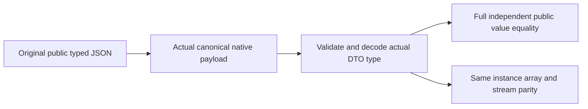
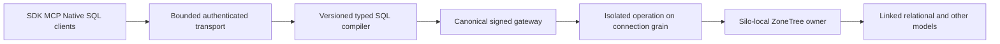

# ADR-065: Full SQL syntax and client protocol

SQL syntax is T-SQL through Microsoft ScriptDOM, governed by [ADR-130](ADR-130-microsoft-scriptdom-tsql.md). Selected native parsing and closed lowering are source-integrated; complete execution and current Linux qualification remain open. PostgreSQL wire framing remains a separately qualified transport, not the chosen SQL grammar.

Full SQL for one composable database is required, not merely independent per-model calls. [DatabaseComposition](../Features/DatabaseComposition.md)
and [ADR-067](ADR-067-composable-agent-database.md) define the first bounded atomic
queue-to-entity-to-graph and graph-to-queue derivation stage through the selected canonical operation compiler.
This is a prerequisite building block; full declarative sources, joins and
data-modifying statements across the models remain this ADR's required outcome.

Status: Accepted staged implementation contract; full execution/native protocol
and exact-source qualification pending. Date2026-10-03. Related QueryExecution/ClientApi/RelationalStorage/Search;
REQ-SQLC-001–011 and AC-SQLC-001–011 in the root sql-client-compatibility acceptance.
This extends ADR-012/054; the selected finite T-SQL SELECT/EXEC/INSERT/CREATE TABLE adapter is a bounded initial
stage, not the full product. Existing SQL envelope1 and generated DTO IDs remain unchanged.

## Accepted public/native test-oracle stage

REQ-SQLC-003 / AC-SQLC-003P defines the independent public-value
oracle for canonical native serialization. Native array and stream writers must
agree for the same decoded instance, and the complete typed DTO must roundtrip
without changing its public JSON value. Serializer defects belong to the owning
serializer; the SQL caller must not normalize payloads to hide them.
Verification: actual same-instance native array/MemoryStream writer parity plus received-command/recursive DTO semantic regressions over the ClientApi canonical corpus, command/read/polymorphic tests and the QueryExecution SQL compiler tests, then the integrated build/format/static gates and real GitHub normal/scalar/recovery/cluster originals. No mocks or packages.

The full original public JsonElement is an independent value oracle; generic
test-only native-decode delegates retain the actual DTO type, validate/deserialize
native bytes and compare every resulting JSON field/union/value. Preserve kinds,
stable IDs, dictionaries, original JSON, safe invalid/null/unknown rejections and
exact SQL-native parity against the same real canonical descriptor. Post-disposal
tests compare an actual-byte copy taken while the source document lived and then
decode the complete DTO. No-body uses actual native int-zero/correct read identity,
not JSON/null text. All existing recursive/raw JSON value assertions remain.

A same decoded instance must produce exact equal native array/stream bytes and
valid typed round trips. Any genuine failure remains failing and escalates to
its serializer owner; no fixture avoidance, dropped assertion or consumer
workaround. No public format, storage, authorization, or transport change is in scope; rollback
the corpus and oracle changes together. FullSQL/native/coverage gates stay open.

## Current decision and conformance target

The syntax is T-SQL through Microsoft ScriptDOM under [ADR-130](ADR-130-microsoft-scriptdom-tsql.md), with [ScriptDOM requirements](../Features/QueryExecution/ScriptDom.md) and the [active conformance inventory](../implementation/sql-client-conformance.json). Preserve REQ/AC-SQLC-001–011. Native grammar acceptance, closed authorized execution and actual client interoperability remain separate gates. General SQL remains required and OPEN; a parser or finite SELECT/EXEC/INSERT adapter does not complete it.

PostgreSQL wire3.0 and genuine Npgsql are independent bounded authenticated transport contracts. PostgreSQL wire3.0 is the first native client target; explicit real protocol3.2 negotiation fixtures are mandatory BEFORE advertising protocol3.2 support. They may carry selected T-SQL text; neither PostgreSQL grammar nor SQL Server TDS compatibility follows. PostgreSQL remains a native benchmark competitor.

[ADR-125](ADR-125-connection-owned-execution.md)
selects one grain per actual connection, admitting bounded parallel independent
operations and commands without creating request/read activations. Signed
operation identity, principal, read cut, deadline and result remain call-local;
current persisted authorization is reloaded for every call. Connection close
stops admission, cancels and joins original work before native deactivation.
[ClientApi](../Features/ClientApi.md#persistent-connection-ownership) owns
REQ/AC-CLIENT-CONNECTION-001/002;
[ClusterRouting](../Features/ClusterRouting/ExecutionPrimitives.md#connection-and-request-lifetimes)
owns REQ/AC-ORL-013. Native SQL protocol work must
reuse this boundary while retaining its separately defined connection protocol
requirements. Runtime and matched Linux performance qualification remain open.

Microsoft [ScriptDOM](https://github.com/microsoft/SqlScriptDOM) is the syntax owner; [PostgreSQL protocol](https://www.postgresql.org/docs/18/protocol.html) and [Npgsql](https://www.npgsql.org/doc/types/basic.html) remain transport references.

## Native transport and search freezes

No handshake/listener/session implementation is authorized by the lexical
contract alone. The later native implementation contract must fix version/frame/
encoding, statement/result types and OIDs, simple/extended protocol, portal/cut,
implicit/explicit transaction state, SQLSTATE, startup/catalog client probes,
pipeline/connection/reply numeric limits and original execution drain. Every
command revalidates persisted principal/policy and uses a fresh operation context on its connection grain.
Current SHA256 API-key verifiers are not SCRAM verifiers. Do not invent SCRAM,
trusted roles or DefaultHttpContext to impersonate the HTTP gateway. Any native
authentication/TLS or transport-neutral gateway admission contract must preserve
persisted authorization and prove invalid, revoked, failover, cancellation and
recovery behavior through real clients.

[ZoneTree.FullTextSearch](https://github.com/ZoneTree/ZoneTree.FullTextSearch) is
the owner's search candidate under AC010/ADR-009; no package/replacement decision
yet. Its private query language cannot satisfy full SQL. Establish native tree
ownership, atomic index publication, rebuild/checkpoint/restart/collision/scoring,
partial cancellation and quotas before integration. Real
matched read/create/update/delete and fault/performance tests determine the choice.

## Implementation boundaries and qualification

This stage adds grammar/internal SDK classification only; it does not change data,
serializer, SQL envelope version, API route, package, or persisted storage format.
Roll back the shared reader and all consumers together. Preserve canonical execution
and native WAL/atomic journals. Native transport or broader AST work needs its
own implementation contract and recovery proof before implementation.

First-author TUnit/MTP tests from AC; no mocks/doubles. Unit real-store/Kestrel,
process recovery and Docker/Aspire cluster actual SDK plus official MCP qualify only
in GitHub. Local source checks do not prove runtime behavior. Missing collector/
coverage, native clients, full execution and complete isolated measurements stay
pending. No power-loss, full SQL, production or acceleration claim before the
corresponding complete exact-source evidence. Manual source review and DBeaver UI
login/query evidence are explicit review exceptions, not substitutes for driver
tests or numeric coverage. Dependencies: ADR-004/009/010/012/013/014/020/022/024/
035/036/039/042/054/055/056/059.
