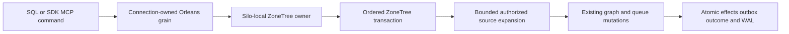

# ADR-067: One composable database for AI agents

Status: Accepted. Date: 2026-10-03.
REQ-COMP-001–007 / AC-COMP-001–009, [DatabaseComposition](../Features/DatabaseComposition.md).

## Decision

The product is one database whose documents, typed tables, graphs, blobs, queues,
events, vectors/search and time series can reference and use one another. SQL is
the familiar central language across them. A model/resource boundary is logical
organization, not a separate database or an obstacle to composition. Preserve
canonical EntityRef identity, persisted authority and explicit atomic partitions.
The target supports one SQL request reading queue messages, resolving linked
entities and writing a knowledge graph, and graph-driven queue workflows.

Extend ADR-054's invocation stage with two typed atomic composing mutations:
QueueToGraph and GraphToQueue. They run inside the existing CommandRequest apply
transaction and expand to existing primitive mutations, receipts and outbox.
SQL `CALL keyload_documents_commit(@arguments)` reaches the same operation through
the sole catalog and signed request gateway. Full declarative model sources,
joins and data-modifying SQL remain mandatory under ADR-065; this is a delivered
stage only after actual tests, never the completed full SQL product.

## Implementation contract

1. Requirements, DTOs, states, grants, bounds and errors are frozen in this ADR and [DatabaseComposition](../Features/DatabaseComposition.md). No dependency or format substitution.
2. Attributed DTOs live in Abstractions/Features/DatabaseComposition with stable v1 aliases/field IDs and additive JSON mutation discriminators.
3. Real-store acceptance regressions come first, then new Core/Features/DatabaseComposition helpers. Frozen APIs: ExpandComposition(IAtomicTransaction, PrincipalRecord, PartitionRef, Mutation, DateTimeOffset, ReadExecutionBudget) -> IReadOnlyList<Mutation>; AuthorizeComposition(IKeyValueView, PrincipalRecord, PartitionRef, Mutation). The expand helper materializes before writes; no storage view/iterator or decoded body escapes the transaction. Noncomposing input returns one original mutation. Composition sources share one deterministic read-byte budget per ApplyMutations. The expanded mutation count and ordinary outbox paths in AtomicMutationApplication, protocol owner/bounds, command source/target authorization and reauthorization before cached replay are part of the same contract.
4. README, site HTML and matching TUnit content files name both directions and distinguish the current stage, preserving exact measured values.
5. Real Docker/Aspire cluster tests run through SQL, the .NET client and the official MCP client, covering serialization, stable retry and safe-error cases.
6. A private composition RecoveryProcess mode and canonical DatabaseComposition recovery tests seed real catalog/documents/queue with the observer disarmed, save the original command, arm its exact next commit position and run forward/reverse composition together. The parent kills the real child at HeaderWritten, PayloadWritten, JournalFlushed, MutationApplied and ApplyCompleted; reopen must recover one whole cut including edges, generated messages, outbox, outcome/private authority and stable replay. Use existing storage trial admission, bounded waits, file readiness and cleanup; do not weaken generic recovery cases or call this power-loss proof.
7. Development and exact-source GitHub proof are recorded separately; build/analyzers/format/governance, normal/scalar, process recovery and cluster gates remain mandatory. Full site publication waits on a complete Benchmarks producer.
8. The README and landing AI thesis copy and the SiteProductCopy/SiteProductThesis* content tests cover REQ-COMP-007/AC-COMP-009. They change no runtime contract, storage, serialization or topology.

Determinism: replicated apply cannot use a local elapsed deadline or caller
cancellation to choose effects. A frozen monotonic TimeProvider feeds the existing
read budget; numeric scan/read/expanded-effect/frame bounds remain enforced.
Public admission/deadline/unknown-write contracts remain with existing owners.
All resources share the exact catalog-bound atomic partition. Source Ready queue
projection does not claim, sweep or ACK; leased/scheduled/expired sources are not
converted. Source caps reject incomplete scans; derived IDs are prefix+source ID,
with create-only edges and ordinary duplicate-message rejection. Earlier staged
mutations are visible; errors reset the whole mixed transaction.

Authorization requires QueueInspect/GraphWrite or GraphRead/QueuePublish,
source raw-read/raw-use and target write grants and visible canonical rows.
Current authority is rechecked before receipt-only replay; no source rescan or
effect duplication on stable command retries. Payload mismatch still conflicts.
Receipts contain actual primitive effects, not raw copied source documents.

Current generated DTOs persist a `CompositionOutcomeAuthority` containing
distinct authorized `EntityRef` endpoints selected by successful composition
(and the explicit reverse start) alongside `StoredOutcome` at stable field ID5.
The internal `MutationReceipt` uses stable field ID4, ignored by public JSON, with
an empty value for ordinary effects. Ordered apply marks expanded effects and
captures endpoints from already-authorized primitive operands after success,
then folds those references into the stored outcome. Do not infer origin from
prefixes or reread final target records: a later valid delete or unrelated
message must not break the command. Do not rescan sources or spend an extra
post-apply storage read budget. Current composition operations require authority
on replay, fail closed when it is absent or invalid, and recheck current
DocumentsRead/catalog/row visibility for saved endpoints. Source changes or
ACK/deletion do not select new effects on retries. Bound saved references by the
existing expanded-mutation limits. Every active node runs the same current serializer
contract before composition producers are enabled.

This stage accepts composition only in standalone CommandRequest batches. Handler,
subscription and projection inbox Effects explicitly reject these new mutation
types before dispatch with UnsupportedCapability; their existing primitive
effects remain available. A later lease/ACK composition stage must retain saved
authority through every inbox receipt and recheck it on new-command handler
replays before enabling those joins. Ready projection does not consume messages.

Dependencies: ADR-004/010/014/022/024/026/054/055/060/065. Current generated DTO
identities and public JSON contracts remain stable; primitive stored data and
existing digest format remain unchanged. Every active node must run the same
current contract before composition producers are enabled. Recovery continues to
use canonical graph/queue data and the existing journals. Tests and error flows are frozen in this implementation contract
and the durable feature acceptance below. Remain Accepted until required
implementation, tests and exact-source qualification evidence exist.

AC-COMP-004/007/008 requires independent value oracles for
current document mutation images. Expected values are constructed independently
from the production canonicalizer; compare every decoded entry, receipt,
polymorphic mutation and before/after image, then require byte-exact execution
reserialization of the actual decoded graph. Preserve actual store operations,
sequential same-ID mutations, tombstone/revision/outbox counts and failure/CAS
assertions. These checks do not authorize serializer or durability changes.

Cluster AC-COMP-007 fixture refinement: existing Enqueue canonicalizes the outer
payload JSON before projection. Compare the complete decoded QueueGraphLink
against the submitted link, including canonical endpoints, label and exact
AttributesJson string; preserve source Ready/Attempts and graph assertions.
Original property ordering is not a queue contract. Do not change queue storage
or invoke a second projection to bypass the failure. The genuine SDK/MCP workflow is rerun before qualification.

## Bounded declarative model insertion

REQ-COMP-DML-001 / AC-COMP-DML-001: Add a closed parameterized INSERT…SELECT model-composition grammar to existing SqlOperationCompiler. Forward: `INSERT INTO GRAPH_EDGES(@graph, @prefix) SELECT LINKS FROM QUEUE_MESSAGES(@queue) LIMIT @limit WITH COMMAND @command`. Reverse: `INSERT INTO QUEUE_MESSAGES(@queue, @prefix) SELECT LINKS FROM GRAPH_TRAVERSE(@graph, @start, @depth, @vertices, @edges) WITH COMMAND @command`. Every argument is an explicitly bound JSON parameter, including the original nonempty caller command ID. No generated command identity. Exact bound parameter census; no extra/duplicate placeholders. Existing SQL text/token/depth/parameter/byte/cancellation admission applies unchanged. INSERT accepts only envelope1/dialect1, no cursor/full-scan flag, and no trailing statements.

REQ-COMP-DML-002 / AC-COMP-DML-002: Lower directly to the existing single CommandRequest containing QueueToGraph or GraphToQueueMutation and existing DocumentsCommit descriptor. Preserve payload encoding, stable identity, persisted current authorization, same atomic transaction/read cut, cumulative observed reads/bytes, expanded mutation cap, lookahead refusal, unknown-write behavior and ordered apply. No new dispatcher, persisted alias/field, schema, policy authority or provider. Same-ID CALL/SDK/MCP replay must return the original complete receipt; changed body remains Conflict under existing authority precedence.

REQ-COMP-DML-003 / AC-COMP-DML-003: A new public whole flow seeds two literal typed rows and one canonical link, refuses malformed/trailing/missing bound input without model effects, executes forward through real SDK and reverse through official MCP, checks complete independent literal references/payload/Ready state/no lease/zero attempts and single mutation receipts, then replays through both surfaces and the original typed SDK API. Reuse actual CompositionSqlColdTrial for both same-root cold cuts, persisted authority revocation/repair and healthy continuation. Existing method declarations and all original CALL cases remain unchanged. New UID is pending real discovery; source proposal is not runtime qualification.

REQ-COMP-DML-001..006 map to QueryExecution, DatabaseComposition and ADR054/067. Reserve only SqlOperationCompiler structural insertion plus the three named new feature-local helper paths and a dedicated DeclarativeCompositionClusterTests case (original DatabaseCompositionClusterTests remains untouched). Canonical docs append proposals precede implementation; no Main writes or build/test allowed in this freeze.

This is a bounded KeyLoad model DML extension, not general relational INSERT/JOIN/DML. QueueToGraph validates both endpoint entities and rejects missing or hidden references; it is NOT INNER JOIN row exclusion. Full queue/document/table/graph declarative JOIN remains OPEN and requires a distinct authorized plan with defined endpoint-miss behavior. Existing Q2 join and broader SQL/client-protocol gates remain unchanged. Required Linux/SDK/MCP/source-image tests remain OPEN.

The dedicated `DeclarativeCompositionClusterTests.AcDeclarativeInsertRefusesMalformedInputThenReplaysBothModelsAcrossColdAuthorityRepair` declaration is proposed, not discovered or executed. Original CALL cases remain unchanged. It preserves SDK/official MCP/refusal/replay/conflict and reuses original same-root two-cold authority/healthy continuation, then independently replays both INSERT statements after cold. Compiler/execution50/SIMD/Linux/cluster and new UID qualification remain OPEN. Required deterministic cancellation/point+range budget refusal coverage must be verified in the owning operation cohort; existing cancellation gates are preserved and no new result claim is made.

## Controlled cancellation and lookahead

REQ-COMP-DML-004 / AC-COMP-DML-004: Preserve the actual cancellation boundary. An already-cancelled SDK caller token before SendAsync returns the existing complete UnknownWriteOutcome Problem, with the original safe write-response detail. Fresh authorized full source/target observations prove no effects. The exact same original nonempty command ID then succeeds under the ordinary SQL request and retains the complete receipt through SDK/MCP/typed replay and both genuine cold cuts. This is pre-send caller cancellation, NOT proof of cancellation during traversal/replicated apply. Core composition expansion intentionally constructs its deterministic ReadExecutionBudget without caller cancellation; never mutate that invariant or add a test product callback.

REQ-COMP-DML-005 / AC-COMP-DML-005: Configure two distinct fixture-owned resources using existing current SDK commands, seed exactly two genuine ready links from the literal typed rows, and execute INSERT with MaxMessages1. charged range lookahead refuses BudgetExceeded through SDK and official MCP. Keep the SAME failed command and verify exact replay. Every failure must leave complete source message records/payload/state/attempts/lease and empty target graph unchanged. A NEW explicit caller command with MaxMessages2 produces exactly two edges with independently literal sorted IDs, references, label, attributes and revision1, while preserving both full original messages. It is a changed-body command, not generic random retry authority or cap widening.

REQ-COMP-DML-006 / AC-COMP-DML-006: Add only a feature-local test cold owner helper. Reuse actual ModelSqlClusterCold, original CompositionSqlColdAuthority/Assertions, and fixture-owned RequestCqrsClusterCallers. The helper observes complete main-model and budget-model state, original SQL and typed receipt replay, and retained failed command refusal AFTER EACH of the two original same-volume cold cuts. Every original CALL method and CompositionSqlColdTrial remains untouched. No clock, timeout, quota, health, provider, persisted DTO/alias or dispatcher change. Authenticated SDK/MCP/real Aspire/execution50/SIMD/Linux/compiler/UID gates remain OPEN until executed. Source is a conditional successor to immutable READY9, not a passed operation.

## Finite atomic typed endpoint join

REQ/AC-COMP-TYPED-ENDPOINT-JOIN-001..003 extend the already closed INSERT model leaf with two explicit typed endpoint collection declarations, not materialized client queries or a new dispatcher. The canonical entity reference resolves a same-partition Text primary-key row inside the original transaction; missing/deleted/row-denied rows omit that pair while missing declared resources, schema/field denial, corrupt links and budget overflow refuse before effects. Existing current principal and atomic/WAL authority remain authoritative.

QueueToGraph Ids4/5 are nullable FromCollection/ToCollection; the original alias and Ids0..3 remain. Both null are JSON-omitted and keep the original command fingerprint and ordinary semantics. The new current-format layout has no migration or legacy reader. Replay keeps original successful/failure outcomes, fresh authorization before lookup, original policy epoch and retained effect references; it does not rescan queue sources. Scoped record/byte grants are charged and released by their genuine original leases. Same-principal resource-policy CAS repair is explicit, not retry authority.

The dedicated whole cluster SDK/MCP flow covers literal matched/missing/hidden and empty selections, policy and structural refusal/no-effects, retained failures, healthy receipts, Conflict, lookahead and late atomic rollback, exact replay after source change, original zero-effect replay after genuine source change versus new-ID malformed refusal, full graph SDK/MCP parity, and two original same-volume cold cuts. All original declarations/limits/owner lifetimes remain; UID/compiler/runtime/exact-source Linux qualification is still required. Broader relational/cross-model JOIN syntax, full SQL protocol and additional scheduled/expired/deleted edge qualification are not closed by source review.

## Canonical retained QueueToGraph authority

REQ-COMP-001/002/005 and AC-COMP-002/004/005 retain the existing ordered atomic derivation. The composition contract in [DatabaseComposition](../Features/DatabaseComposition.md) requires the Ready-index authority and exact endpoint identities before derived writes. The real SQL CALL regression proves rollback, same-ID dirty refusal, exact repair and two cold continuations. Public contracts, error-outcome persistence and cluster gates remain unchanged. Source is implemented; runtime qualification remains open.
