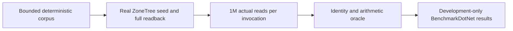

# ADR-069: ZoneTree raw resident-read lane

Status: Accepted contract; qualification remains open.
Related: REQ-SCALE-001..006 / AC-SCALE-001..006; local development benchmarks in
[BenchmarkComparisons](../Features/BenchmarkComparisons.md#local-development-benchmarks-and-profiling).

## Decision

`ScaledStorageReadBenchmarks` in `benchmarks/KeyLoad.BenchmarkScenarios` is an
internal ZoneTree diagnostic with exactly eight cells: one ZoneTree engine, two
record counts (100,000 and 1,000,000), two payload sizes (32 and 1,024 bytes) and
two methods (sequential and deterministic shuffled). Each read-method invocation
performs exactly 1,000,000 actual point reads, `OperationsPerInvoke = 1,000,000`,
one invocation and one unroll. At 100,000 records it visits every key ten times; at
1,000,000 records it visits every key once. Both methods validate and consume every
returned full record identity and require the exact sum oracle
`((1,000,000 / N) * N * (N - 1) / 2)`; checksum-only or attribute-only proof is
insufficient.

Use .NET 10, one launch, eight warmups and ten actual iterations; retain 8..10
actual result samples as the benchmark permits, and reject a measured row below
100 ms. Charge the oracle and validation work inside the measurement; do not
relabel it as lookup-only. Record count, measured operation count and benchmark
iterations are separate facts.

The fixture verifies exactly N successful seed writes and reads all N distinct
complete values before and after timing, preserving record and residency
observations. The reserved miss is not a seed. Preparation has a bounded 20-minute
deadline with cancellation checks at least every 256 operations; the whole child
has a 12 GiB peak ceiling and requires 2 GiB of total and cgroup headroom. Owners
remain charged until original operations, readers and close settle. Primary and
cleanup failures stay independently observable.

## Acceptance

| Requirement | Required evidence |
|---|---|
| REQ-SCALE-001 / AC-SCALE-001 | Compact deterministic corpus, exact key/value format, independent goldens, order and uniqueness |
| REQ-SCALE-002 / AC-SCALE-002 | Real seed/readback, complete distinct-value validation, owned scratch and successful cleanup |
| REQ-SCALE-003 / AC-SCALE-003 | Actual residency, process and preparation bounds; cancellation and cleanup |
| REQ-SCALE-004 / AC-SCALE-004 | Every measured call performs and validates one million reads at exact 100K/1M scales |
| REQ-SCALE-005 / AC-SCALE-005 | Complete eight-cell profile, separate counts/operations/iterations, minimum duration and original BenchmarkDotNet reports |
| REQ-SCALE-006 / AC-SCALE-006 | Results stay development evidence; the lane is never a Benchmarks job or a website figure |

## Consequences and rollback

The lane can guide storage optimization while staying separate from database
comparisons and public performance claims. Rollback removes only this diagnostic
profile and its implementation; it does not alter ZoneTree authority, WAL, Orleans
request or partition ownership, public APIs or stored data.
