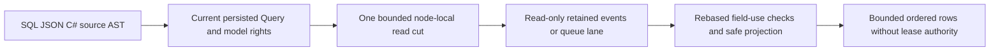

# ADR-072: Authorized SQL event and queue read views

Status: Accepted bounded implementation contract; qualification pending.
Date: 2026-10-03. Related: REQ/AC-SQLVIEW-001..005 in [QueryExecution](../Features/QueryExecution.md).
Extends ADR-065/067; does not complete full SQL, JOIN or client transport.

Superseded in part by [ADR-149](ADR-149-no-operation-limits.md): the `DatabaseLimits` operation limits it references are removed.

## Decision and scope

Extend the existing normalized SelectQuery with optional ModelSource at execution
field7, omitted from public JSON when null. Collection remains the configured
resource name. ModelQuerySource has kind Events or QueueMessages, Item (stream
ID or the same queue resource name) and Generation (positive event generation;
exactly1 for queues). A queue lane is the existing `(Partition, Queue)` identity;
there is no separate SQL lane axis or new persisted queue identity.
All old AST fields, JSON meanings, aliases and capability values remain.
This additive AST1 extension is advertised separately as modelViews.

Grammar: `FROM EVENTS('streamSet', 'streamId' [, generation])` or
`FROM QUEUE_MESSAGES('queue')`. Arguments are bounded literal strings and
an optional positive integer; quoted identifiers named EVENTS/QUEUE_MESSAGES
remain ordinary collections. The existing projections, predicates, named value
parameters, ordering, LIMIT and EXPLAIN apply to the resulting row schema.
Source arguments do not accept caller authority or executable expressions.

Each request authorizes Query plus EventsRead or QueueInspect using current
persisted principal/resource metadata inside one node-local budgeted read cut.
No receive, sweep, lease, ACK or event append occurs. Queue dead-letter records
additionally require DeadLettersRead before body access. Generic UPDATE of these
sources remains UnsupportedCapability. The existing unique request/read grains,
canonical-cut read and actual SDK/MCP adapters carry the complete request unchanged.

Event row JSON: eventId, eventType, schemaVersion, revision, eventSequence,
recordedAt, payload (JSON object) and headers (JSON object). QueryRow.EntityId is
EventId and Revision is stream revision. Queue row JSON: id, state, attempts,
stateVersion, notBefore, expiresAt, payload and headers; Revision is StateVersion.
Never include lease tokens, owner, delivery generation, lease version, internal
fingerprints or signing material. Terminal records may have null removed bodies;
missing nonterminal bodies are Corruption. Synthetic DocumentRecord values are
ephemeral query-operator rows, never stored or exposed as canonical EntityRefs.

Rebase payload/header field policies under /payload and /headers without changing
their grants. Bind every predicate/order field before touching records. The
existing safe projector applies those rebased policies to every row, including
star, alias and nested output. No raw protected values escape in errors/Explain.
Returned values must match independently projected SDK records for the same cut.

## Resource, error and continuation contract

Model scans require AllowFullScan. Use borrowed ordered visits under one
ReadExecutionBudget for principal/catalog/head/metadata/body/lookahead and exact
output bytes. Scan <= configured MaxScanRecords; additional retained records
reject the complete request with BudgetExceeded rather than imply completeness.
LIMIT bounds final rows after filtering/sorting. Bounded PreparedQuery selection
remains reusable; no unbounded model materialization or callbacks under apply.
Cancellation/deadline failures leave the following authorized read healthy.

Events read only the selected retained generation. Head/key/record identities and
consecutive retained revisions must agree; missing or inconsistent mandatory
history fails Corruption, stale generation TokenInvalidated. Empty absent streams
are valid empty views. This SELECT is not historical replay across a removed cut.
Queue identity/key/body agreement is validated in its existing partition/queue
lane. Queue ModelSource.Item must equal Collection; a second queue argument and
an AST that invents another lane reject before scanning.
For this first complete source stage Cursor input is UnsupportedCapability and
the response Cursor is null; no continuation or distributed snapshot is promised.
EXPLAIN returns the authorized model scan and configured bounds without bodies.
Unknown source kind, arguments and mutations reject before scanning.

## Implementation and verification

1. Shared ModelQuerySource/aliases and the optional SelectQuery field carry the accepted REQ/AC and source/format contracts.
2. Query SqlParser/QueryValidation/QueryEngine, new Query QueryExecution ModelQuery* helpers and new Core QueryExecution ModelQuery* read helpers implement the feature, with real-store/parser/AST/security/budget tests in UnitTests QueryExecution SqlModelView*. Core owns key/record interpretation; Query owns parsing, binding and evaluation. No other model writer, storage provider, central config or shared contracts change.
3. .NET and official MCP cluster cases live in the matching IntegrationTests slice; the TUnit test entry launches and cleans the real topology.
4. After code, tests and self-review, run the integrated Release/analyzer/format/governance, focused and full TUnit, process recovery, Docker/Aspire cluster and exact-source Linux CI. No source-only assertion closes parent acceptance or measures performance.

## Rollout and rollback

The generated query DTOs use stable field identities. Roll back parser,
AST source metadata and executor together if this feature is withdrawn. Document
queries retain their defined semantics, and unsupported model sources fail
explicitly rather than being treated as document collections. Full SQL/execution
session and cross-partition contracts remain required later ADR-065 stages.
UI: N/A, existing programmable SQL/SDK/MCP surfaces suffice. No new package.

