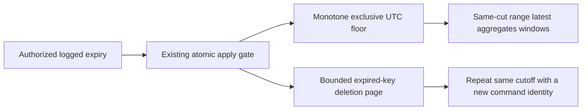

# ADR-073: Logged bounded time-series retention

Status: Accepted implementation contract, not qualified. Date: 2026-10-03.
Scope: time-series expiry; REQ-SERIES-013..016 / AC-SERIES-013..016 in [TimeSeries](../Features/TimeSeries.md).
Rollups and chunk encoding remain separate required stages.

Superseded in part by [ADR-149](ADR-149-no-operation-limits.md): the `DatabaseLimits` operation limits it references are removed.

## Decision and alternatives

Persist an exclusive UTC retention floor per canonical series. A replicated
`ExpireSamples` mutation advances that floor monotonically and deletes at most
the caller's bounded page of older sample records. Readers use the floor in the
same storage cut even when physical deletion needs further pages. This avoids
unbounded deletion under the apply gate and prevents partially purged history
from becoming visible. Reading the wall clock to expire records, deleting an
entire segment, or deleting sample identity receipts is rejected: those
choices would weaken deterministic replay, scoped ownership or retry identity.

The cutoff must not exceed the operation's trusted logged EvaluatedAt. It is
normalized to UTC, applies to timestamps strictly before it, and cannot move
backwards. `SeriesManage` authorizes expiry; `SeriesRead` authorizes its status.
Append retains old sample-ID fingerprint checks. An identical retained ID may
deduplicate without resurrection; a new sample older than the floor is rejected.
All decisions occur inside the existing ordered atomic command path.

## Implementation and format contract

1. Abstractions `Features/TimeSeries/SampleRetentionContracts.cs`, the additive capability bit, mutation/aliases, protocol validation, authorization, engine dispatch and the Server/SDK/MCP/Orleans joins carry the contract. Existing enum values and field IDs are preserved.
2. Core `Features/TimeSeries/` retention helpers and the sample append region of GraphAndSeries.cs, plus matching UnitTests `SampleRetention*` files, implement it. Tests are authored with the code and runtime tests run after review. No other GraphAndSeries region changes.
3. New private generated record under `sample-retention` is scoped by full
   partition, set and series. It stores format1, Before UTC ticks, cumulative
   PurgedCount and HasMore. Stable Alias/Id contracts are mandatory. Absent state
   means no retention; unknown format or corrupt state fails closed. Existing
   sample/sequence/ID bytes, WAL and recovery journals are preserved.
4. Validate positive MaximumDeletes <=256 and configured MaxScanRecords. Traverse
   using ordered range APIs, charge examined key/value bytes, copy only
   at most that many keys, and mutate only after traversal finishes. Persist
   floor, checked counts and delete page atomically. Same cutoff resumes purge;
   an older cutoff returns RevisionConflict. No background per-sample timers.
5. Range/latest/raw aggregate/dense-window reads apply the same floor, preserving
   their original inclusive/half-open windows and empty-window anchors. All
   metadata, scans, cancellation/deadline and complete result bytes remain under
   the operation budget. Existing store read leases protect an in-flight cut:
   expiry waits for that cut and cannot dispose its storage or borrowed buffers.
6. Real process reopen/recovery and SDK/official MCP cluster tests run through the TUnit test entry, followed by the complete build/format/governance/CI gates. Source presence alone is not acceptance.

### Recovery and cluster verification

The frozen Command<DatabaseCommand> is persisted as binary before arming the real commit observer, and the actual child is terminated at HeaderWritten, PayloadWritten, JournalFlushed, MutationApplied and ApplyCompleted. Reopen observes either the old floor and all old points with no outcome, or the complete new floor, bounded deleted page and matching durable outcome; JournalFlushed and later recover committed. Retrying the same command returns the original receipt without purging a second page, and a new command at the same floor resumes exactly the next page. Sample-ID receipts, sequence and surviving point bytes are preserved, and range/latest/aggregate/windows/status match an independent ordered raw reference. Process kill does not prove power-loss durability.

Actual Aspire-owned SDK and official MCP clients verify partial purge, replay and complete logical hiding across all nodes. Stop an owned node and verify exact authorized reads from an available current copy. A new expiry page must refuse when fewer than the configured copies are available. Restart the same container, await Orleans routing, then apply the bounded expiry page with a fresh command ID and verify its complete persisted-copy receipt and public state. Cover persisted SeriesManage/SeriesRead denial and late new versus identical retained IDs through existing APIs. Every stopped container is restored and every actual process joined in finally; no direct Docker launch, mock, skip, changed numerical contract or assertion weakening. This stage does not implement rollup buckets or physical chunks. Forbidden: storage ownership changes, outcome pruning, provider substitutions, cross-partition atomicity or claims of power-loss qualification.

## Current record and rollout contract

The current record is scoped to the canonical partition, set and series.
Its format discriminator is validated before use, and unknown or corrupt state
fails closed. The feature does not alter existing sample, sequence or identity
bytes. Rollback removes the feature only as a complete reviewed deployment change;
it must not silently remove a persisted retention floor.

