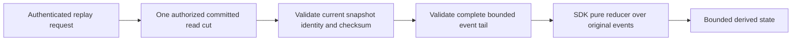

# ADR-075: Bounded aggregate snapshots and pure replay

Status: Accepted implementation contract under the owner-authorized scope;
source and runtime qualification pending. Date: 2026-10-03.

Related: REQ/AC-EVENT-007..010, ADR-002/011/015/024/025/029/030/060.

## Decision

Keep one latest snapshot slot per complete stream generation, keyed by
`aggregate-snapshot-v1 / partition / streamSet / streamId / generation` in the
canonical ZoneTree store. Each replacement atomically updates that one slot;
retained events remain the authority for rebuilding derived snapshot state.

The public snapshot contains StreamRef, monotonically increasing SnapshotVersion,
SourceRevision, exact ReducerVersion identifier, positive StateSchemaVersion,
StateJson and a SHA256 checksum from JsonData.Fingerprint over the public
AggregateSnapshotState with Checksum="". This exact frozen JSON identity,
including original state text, is independent of native serializer output.
A private generated
native envelope includes FormatVersion=1. Preserve original state JSON bytes
after bounded valid-JSON validation; native Orleans serializers and the existing
atomic journals persist the envelope. Never persist executable reducer code.

`StoreAggregateSnapshot` is a normal atomic Batch mutation. It requires persisted
EventsSnapshotsManage plus EventsRead and complete raw worker-input grants.
ExpectedSnapshotVersion=0 requires an absent slot; otherwise compare the exact
prior version. SourceRevision must be nonnegative, no greater than the current
tail, no earlier than FirstAvailableRevision-1 and no earlier than the prior
snapshot source revision. Generation mismatch is TokenInvalidated; CAS or
backwards source conflicts are RevisionConflict. Successful replacement advances
SnapshotVersion by one. CommandId retry returns its original durable outcome.
Cross-partition snapshots are unsupported.

`ReadAggregateReplayRequest` includes StreamRef, exact ReducerVersion,
StateSchemaVersion, FromBeginning=false and MaximumEvents=100. One budgeted
Store.Read resolves current persisted principal, resource, head, snapshot and
entire needed tail under one read/apply gate; returned cut is Store.Position
inside that gate. It requires EventsReplay plus EventsRead. Before any snapshot
or event body, require RawReadGrant and RawUseGrant for every configured payload
and header policy, even when RequiredForProcessing is false. Snapshot state is
worker-only opaque derived data; no automatic public redaction or lineage-safe
user query is promised. Missing grants fail before body disclosure.

With an exact-compatible snapshot, return it and every event after SourceRevision
through the captured TailRevision. Without a snapshot, begin at revision zero.
FromBeginning=true explicitly ignores the slot and requires full retained history.
An incompatible reducer/state schema is FormatUnsupported; no implicit fallback.
History that cannot bridge the source revision is HistoryUnavailable. Wrong
generation is TokenInvalidated. Validate each event's stream identity, generation,
key, consecutive revision, positive sequence/schema version and generation-scoped
EventId identity. Gaps, malformed heads/envelopes or checksums are Corruption;
unknown stored formats are FormatUnsupported.

MaximumEvents must be positive and within configured MaxResults and MaxScanRecords.
The complete required tail must fit it or fail the whole request as BudgetExceeded.
Shared raw-byte/result/depth/deadline/cancellation bounds cover metadata/state and
events. No partial page/cursor, nested independent read cut or storage handle
across an await/grain movement. Replay reads never append, publish, enqueue, ACK,
invoke subscription handlers or send external output. Original event payload,
header and schema version remain exact replay inputs.

The .NET client provides an explicit worker-side reducer contract. The reducer
contains Version, StateSchemaVersion, EventSchemaVersion, InitialStateJson and
`Func<string, EventRecord, string> Apply`. The request selects one exact current
event schema; records with a different schema fail before caller code runs. The
worker validates the complete slice identity/order/floor/head before invoking
the pure reducer, then checks cancellation and bounded JSON for each payload and
resulting state. No reducer callback runs for an invalid slice. The server loads
no code and the SDK does not register or redrive a subscription. The typed read
calls `/v1/streams/replay`; official MCP name is `keyload_streams_replay`.
`AggregateReplayClient` owns the typed SDK read as an extension on `KeyLoadClient`,
using its existing internal `Send` transport. Caller syntax and HTTP contracts
stay the same; feature adapters remain separate bounded types rather than
extending the aggregate partial client beyond the mandatory 200-line type limit.

`AggregateReplayWorkerLimits` defaults to MaximumEvents=4096,
MaximumStateBytes=1048576, MaximumInputBytes=16777216 and MaximumJsonDepth=64.
Each is positive; hard ceilings are respectively 65536, 16777216, 67108864 and
64. Original payload/header/state UTF8 bytes share the complete input cap; every
intermediate state respects the state cap. These explicit worker bounds
complement server limits and do not authorize relaxing a server budget. Reduce
the original immutable events without duplicating each record into a second
object graph. Original valid DateTimeOffset metadata has no added SDK-only range.
Reducer callbacks are synchronous caller-owned pure functions; the SDK cannot
make impure callbacks safe or guarantee business correctness. No server
assembly/plugin installation.

## Implementation and verification

1. The ADR and ACs precede the Abstractions Features/EventStreams DTOs/aliases, appended dedicated capability bits, mutation discriminator and canonical protocol joins.
2. Core Features/EventStreams owns the private native snapshot codec/checksum, bounded CAS writer and same-cut complete reader, tested on real ZoneTree stores. The Orleans read kind, Server route and official MCP catalog carry the replay read.
3. Client Features/EventStreams provides the typed replay call and the pure versioned reducer helper with genuine reducer regressions.
4. RecoveryHost persists its frozen Command<DatabaseCommand> through NativeSerialization before arming the existing commit observer. HeaderWritten, PayloadWritten, JournalFlushed, MutationApplied and ApplyCompleted exercise the existing real-process recovery path. Actual Aspire Docker tests use the existing owned ClusterFixture and real .NET/official MCP clients; the replay result equals the independent reference, both transports agree, persisted worker/raw grants and revocation are enforced.
5. Verification: strict build, formatter, governance, Aspire TUnit and exact-source Linux recovery/cluster/fault receipts. Escalate contract or dependency defects; no invented fallback.

## Rollback and qualification

Run the accepted cluster topology and recovery gates before treating snapshot
behavior as qualified. Rebuild a missing snapshot explicitly only while its
complete source history is retained. Deleting derived state never permits erasing
events, ID receipts or journals. Roll back code only through a reviewed deployment
change that preserves the current stored contract. UI N/A: programmable
EventStreams/worker infrastructure. Process-kill evidence does not qualify
power-loss durability; required fault/endurance gates remain.
