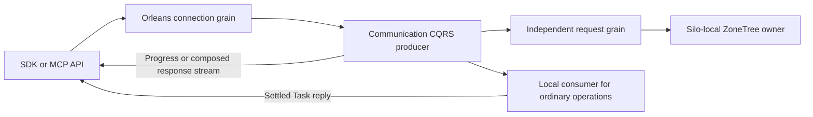

# ADR-082: CQRS streams through ManagedCode.Communication

Status: Accepted. Runtime qualification is separate from this decision.

## Decision

Use the centrally pinned `ManagedCode.Communication` packages for CQRS streams.
KeyLoad does not implement another streaming framework, producer queue, result
envelope, HTTP stream writer or command dispatcher.

The public API calls the client's Orleans connection grain. Each operation uses
one bounded Communication producer and an independent request grain. For ordinary
operations without a progress consumer, `ConnectionGrain.ExecuteAsync` consumes
the producer locally and returns the settled `GrainOperationReply` through one
Orleans Task call. Progress consumers and composed maintenance or queue operations
use `ExecuteStreamAsync` and its
`IAsyncEnumerable<CqrsStreamChunk<GrainRequestProgress, GrainOperationReply>>`.
Both entry points use the same producer, fresh authorization, request identity,
reply validation and joined cleanup. Storage calls reach the silo-local ZoneTree
owner. Clustering and inter-silo communication belong to Orleans under
[ADR-136](ADR-136-orleans-partition-ownership.md).

## Ownership

| Owner | Responsibility |
|---|---|
| `ManagedCode.Communication` | `CqrsStream.Create`, typed progress and results, sequence assignment, terminal outcome, capacity-one producer backpressure, cancellation-aware producer settlement and fatal failure classification. Use `CqrsStream.Normalize` when adapting an existing chunk stream. |
| `ManagedCode.Communication.Orleans` | generated Orleans serialization of Communication contracts. |
| Microsoft Orleans | Grain execution, response enumeration, batching, cancellation propagation and enumerator disposal. |
| `ManagedCode.Orleans.Graph` | Allowed grain-call transitions and their context across response enumeration. |
| `ManagedCode.Communication.AspNetCore` | CQRS HTTP stream results when an external HTTP streaming endpoint is exposed. |
| KeyLoad | Fresh persisted authorization; request/result identity; operation-specific progress validation; byte, frame, duration and concurrent-operation bounds; database effects and storage shutdown ordering. |

`ConnectionGrain` creates its shared operation producer with `CqrsStream.Create`.
Its KeyLoad adapters must remain limited to the last row;
they must not reproduce package-owned producer or transport machinery.
Cancellation and early disposal must await the producer before releasing
resources it can still access. An in-memory response stream is not a durable job
or proof that a database write was persisted.

## Verification

Exercise both terminal Orleans calls and response enumeration with the published
packages: successful
results, progress, authorization refusal, cancellation, early disposal, producer
failure, independent concurrent operations and joined cleanup. Exercise public
.NET SDK and official MCP clients through the Aspire-owned topology. A mechanism
test or successful build does not qualify recovery, durability or complete
client interoperability.

Confirmed defects in a ManagedCode dependency are repaired and tested in its
owning repository, published once as a complete repair batch, verified on NuGet,
and then consumed here. No local package, copied implementation or consumer
workaround replaces that delivery.

## Source basis

The installed `ManagedCode.Communication` 10.3.21 package identifies source commit
`433c0bbd63150d470fa11364b32de7c42c18a644`. Its execution
[CqrsStream implementation](https://github.com/managedcode/Communication/blob/433c0bbd63150d470fa11364b32de7c42c18a644/ManagedCode.Communication/Cqrs/CqrsStream.cs)
and
[producer settlement](https://github.com/managedcode/Communication/blob/433c0bbd63150d470fa11364b32de7c42c18a644/ManagedCode.Communication/Cqrs/CqrsStreamProducerSettlement.cs)
own the streaming mechanisms above. Related KeyLoad specifications are
[RuntimeCqrs](../Features/OrleansExecution/RuntimeCqrs.md),
[ClientApi](../Features/ClientApi.md) and
[ADR-125](ADR-125-connection-owned-execution.md).
